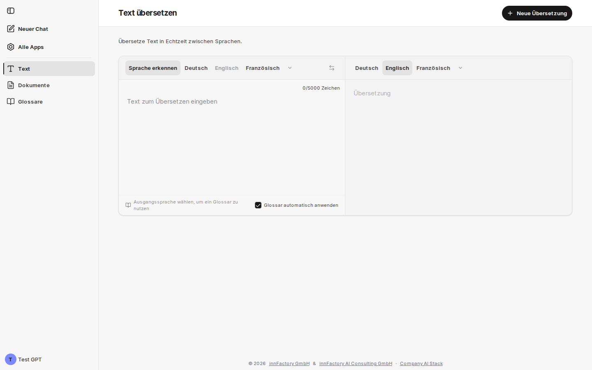
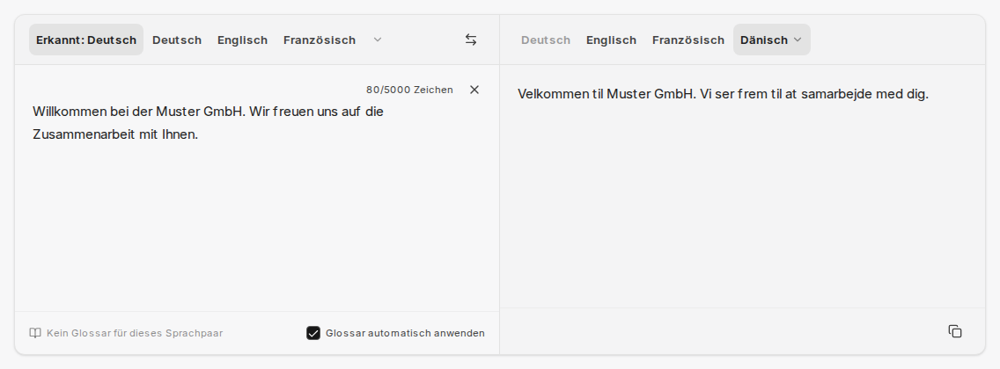
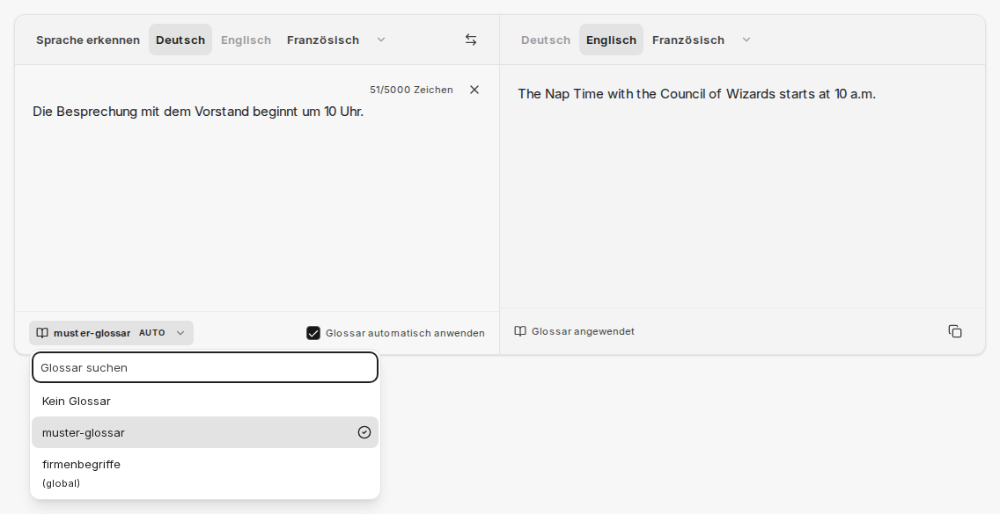

Der Bereich **Text** übersetzt eingegebenen Text unmittelbar zwischen zwei Sprachen. Die Seite trägt den Titel **Text übersetzen** und den Hinweis „Übersetze Text in Echtzeit zwischen Sprachen.“ Ausgangs- und Zieltext stehen nebeneinander; die Übersetzung wird während der Eingabe aktualisiert.

## Sprachen wählen

Über der Eingabe stehen zwei Sprachleisten: links die Ausgangssprache, rechts die Zielsprache. Beide bieten Deutsch, Englisch und Französisch direkt an, soweit der Platz reicht. Die Namen der Sprachen erscheinen in der Sprache der Oberfläche. Alle weiteren Sprachen öffnet der Pfeil hinter den angebotenen Sprachen (**Mehr**) in einer durchsuchbaren Liste („Sprache suchen...“). Eine dort gewählte Sprache erscheint anschließend in der Leiste. Auf dem Smartphone zeigt jede Leiste nur die gewählte Sprache; ein Tipp darauf öffnet die Liste.

Links steht zusätzlich **Sprache erkennen**. Ist diese Option aktiv, ermittelt companyTRANSLATE die Ausgangssprache aus dem eingegebenen Text und zeigt das Ergebnis an, etwa **Erkannt: Deutsch**. Die Schaltfläche **Sprachen tauschen** vertauscht Ausgangs- und Zielsprache und übernimmt die bisherige Übersetzung als neuen Ausgangstext.

Das gewählte Sprachpaar bleibt erhalten, wenn Sie in den Bereich **Dokumente** wechseln.

## Zeichenlimit und Aktionen

Über dem Eingabefeld zählt companyTRANSLATE die Zeichen mit, etwa `22/5000 Zeichen`. Pro Übersetzung sind 5.000 Zeichen möglich. Das Kreuz neben dem Zähler leert das Eingabefeld, **Kopieren** unter dem Ergebnis legt die Übersetzung in die Zwischenablage. **Neue Übersetzung** im Seitenkopf leert das Eingabefeld und behält die gewählten Sprachen.

:::note
Längere Inhalte übersetzen Sie über [Dokument übersetzen](/de/company-gpt/addons/company-translate/dokument-uebersetzen/) als Datei bis 40 MB oder per Agent im [Chat](/de/company-gpt/addons/company-translate/im-chat/).
:::

## Übersetzungsdienst

Welcher Dienst den Text übersetzt, hängt von Ihrer Umgebung ab (siehe [Übersetzungsdienste und Datenfluss](/de/company-gpt/addons/company-translate/#übersetzungsdienste-und-datenfluss)):

- **Azure AI Translator** (Standard): Bei kurzen Eingaben wie einzelnen Begriffen zeigt companyTRANSLATE unter dem Ergebnis zusätzlich **Alternativen**, sofern es für das Sprachpaar welche gibt. Glossare stehen in der Textübersetzung nicht zur Verfügung.
- **Google Cloud Translation** (falls in Ihrer Umgebung aktiviert): Die Textübersetzung kann Glossare anwenden, wie im nächsten Abschnitt beschrieben.

## Glossar anwenden

Ist Google aktiviert, zeigt companyTRANSLATE am unteren Rand des Eingabefelds, welches [Glossar](/de/company-gpt/addons/company-translate/glossare/) für das aktuelle Sprachpaar gilt:

| Anzeige | Bedeutung |
|---|---|
| **Ausgangssprache wählen, um ein Glossar zu nutzen** | Es ist noch keine Ausgangssprache bekannt. Bei aktiver Spracherkennung steht sie nach der ersten Übersetzung fest. |
| **Kein Glossar für dieses Sprachpaar** | Für die Kombination gibt es kein Glossar. |
| **Kein Glossar** | Es gibt passende Glossare, aber keines ist ausgewählt. |
| Glossarname, ggf. mit Kennzeichen **AUTO** | Das Glossar wird angewendet; **AUTO** zeigt, dass companyTRANSLATE es automatisch gewählt hat. |

Ein Klick auf die Anzeige öffnet die Glossarauswahl. Die Liste ist durchsuchbar („Glossar suchen“); globale Glossare sind mit **(global)** markiert. Glossare, die Google noch einrichtet, erscheinen ausgegraut mit dem Hinweis „wird für Live-Übersetzung vorbereitet“. Pro Übersetzung wirkt genau ein Glossar.

Das Kontrollkästchen **Glossar automatisch anwenden** ist anfangs aktiv. companyTRANSLATE wählt dann selbst ein passendes Glossar, wobei eigene Glossare vor globalen Vorrang haben. Eine Auswahl, die Sie selbst treffen, wird nie automatisch überschrieben. Die Einstellung merkt sich Ihr Browser.

Wurde ein Glossar angewendet, erscheint unter dem Ergebnis der Hinweis **Glossar angewendet**.

Im Beispiel übersetzt companyTRANSLATE „Besprechung“ mit dem Glossareintrag **Nap Time** statt mit der sonst üblichen Entsprechung „Meeting“.

## Weiterführende Themen

- [Glossare](/de/company-gpt/addons/company-translate/glossare/) – Glossare anlegen, hochladen und anwenden
- [Dokument übersetzen](/de/company-gpt/addons/company-translate/dokument-uebersetzen/) – ganze Dateien mit erhaltener Formatierung übersetzen
- [Übersetzen im Chat](/de/company-gpt/addons/company-translate/im-chat/) – Texte und Dateien per Agent übersetzen
