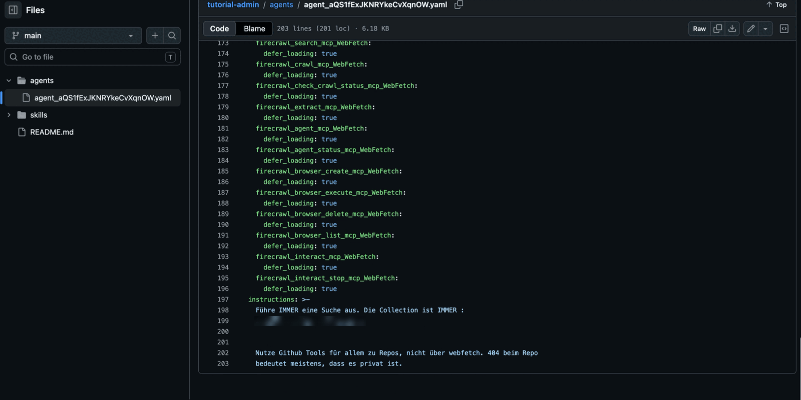

Der **Bibliotheks-Sync** verbindet CompanyGPT mit Git-Repositories und holt **Skills, Agents und Prompts** von dort nach CompanyGPT. So lässt sich die Inhaltsbibliothek versionieren, im Team prüfen und zwischen Umgebungen übertragen. Bei Repositories, die Ihnen gehören, schreibt companyADMIN Änderungen auch nach Git zurück.

Sie finden den Sync unter **Inhalte** → **Bibliotheks-Sync**. Unterstützt werden GitHub und selbst gehostete Git-Server (GitLab, Gitea oder einfaches Git).

## Repositories

Die Liste zeigt alle verbundenen Repositories:

| Spalte | Inhalt |
|---|---|
| **Repository** | Repository und Branch |
| **Erkannt** | Anzahl der erkannten Skills, Agents und Prompts |
| **Zuletzt synchronisiert** | Wann (relativ), mit welchem Commit und von wem |
| **Status** | **OK**, **Fehler** oder **Nie**; dazu **Aktuell**, **Update verfügbar** oder **Update-Status unbekannt** und gegebenenfalls die Anzahl der Fehler |

Mit **Repository suchen** finden Sie ein Repository. **Alle synchronisieren** synchronisiert alle Repositories nacheinander. Ein Klick auf eine Zeile öffnet die Detailseite.

## Repository hinzufügen

**Repository hinzufügen** öffnet eine Seite mit vier Schritten: **Klonen** → **Pfade auswählen** → **Konfigurieren** → **Speichern & synchronisieren**.

1. **Klonen**: Wählen Sie den **Git-Server** (**GitHub** oder **Selbst gehostet (GitLab, Gitea, plain git)**) und geben Sie das Repository an. Bei GitHub können Sie auch eine vollständige URL einfügen; sie wird automatisch in Repository, Branch und Pfad zerlegt. Unter **Authentifizierung** wählen Sie:
   - **PAT** – ein persönliches Zugriffstoken. Für öffentliche Repositories bleibt das Feld leer.
   - **SSH-Deploy-Key** – companyADMIN erzeugt ein Schlüsselpaar (**SSH-Key erzeugen**). Den **Öffentlichen Schlüssel** hinterlegen Sie im Repository als Deploy-Key mit Schreibzugriff (bei GitHub: „Allow write access“).

   Für einen selbst gehosteten Server geben Sie zusätzlich die **HTTPS-Basis-URL** (für PAT) bzw. **SSH-Host** und **SSH-Port** (für SSH) an.
2. **Pfade auswählen**: Wählen Sie die Ordner der obersten Ebene, die synchronisiert werden sollen. Nur diese Ordner werden geladen, gescannt und weiter synchron gehalten. Die Auswahl lässt sich später nicht mehr ändern; dazu entfernen Sie das Repository und verbinden es neu.
3. **Konfigurieren**:
   - **Mit KI analysieren** – erscheint nur, wenn für Ihre Umgebung ein Analyse-Modell eingerichtet ist. Ein Sprachmodell (**Analyse-Modell**) schlägt anhand des Dateibaums vor, welche Ordner Skills, Agents und Prompts enthalten. Der Vorschlag füllt nur die Struktur vor; synchronisiert wird dabei nichts.
   - **Erkannte Inhalte** – die Anzahl der erkannten Skills, Agents und Prompts.
   - **Struktur (Quellen)** – je Eintrag ein **Typ** und ein **Pfad**, zum Beispiel `agents` oder `library/agents`. Mit **Quelle hinzufügen** ergänzen Sie weitere Pfade.
   - **Sichtbarkeit** – die Standardsichtbarkeit der importierten Inhalte: **Besitzer / System (Standard)**, **Öffentlich (alle Nutzer)** oder **Bestimmte Gruppen**. Mit **Besitzer / System (Standard)** sieht kein Nutzer die importierten Inhalte, bis Sie **Öffentlich** oder Gruppen wählen.
   - **Wir besitzen dieses Repo (Rückschreiben/Up-sync erlauben)** – erlaubt companyADMIN, Änderungen aus CompanyGPT in das Repository zurückzuschreiben. Mit PAT braucht das Token dafür Schreibrechte (bei GitHub den Scope `repo`); mit SSH schreibt der Deploy-Key zurück.
4. **Speichern & synchronisieren**: Der Knopf **Speichern** legt die Verbindung an. Synchronisiert wird dabei noch nichts; das Repository steht danach auf **Nie**. Den ersten Sync mit Vorschau starten Sie auf der Detailseite mit **Synchronisieren**.

## Synchronisieren

**Synchronisieren** auf der Detailseite zeigt zuerst eine Vorschau (**Änderungen prüfen & anwenden**): was angelegt, aktualisiert, gelöscht wird oder unverändert bleibt. Geschrieben wird erst nach **Bestätigen & anwenden**. Danach zeigt das **Sync-Ergebnis**, was tatsächlich passiert ist, und unter **Hinweise**, was übersprungen wurde, etwa Tools, die Ihre Umgebung sperrt, nicht erreichbare MCP-Server oder nicht auflösbare Skill-Namen.

:::caution[Löschungen und Änderungen in CompanyGPT]
- Die Vorschau enthält auch Löschungen: Inhalte, die im Repository entfernt wurden, verschwinden beim Sync auch aus CompanyGPT. Erkennt ein Sync gar keine Inhalte mehr, obwohl vorher welche da waren, löscht companyADMIN nichts und fragt nach, weil meist Branch oder Pfad falsch sind.
- Fällt die Datei eines Eintrags, seine Quelle oder sein Ordner weg, löscht der Sync den Eintrag auch dann, wenn er in CompanyGPT geändert wurde, selbst bei **Wir besitzen dieses Repo**. Die Änderung ist dann verloren.
- Wurde ein synchronisierter Inhalt in CompanyGPT bearbeitet und ist **Wir besitzen dieses Repo** nicht gesetzt, **überschreibt der Sync diese Änderung**. Die Vorschau zeigt das als **In companyGPT bearbeitet — wird überschrieben**. Um die Änderung zu behalten, brechen Sie ab und übernehmen sie zuerst ins Repository.
- Bei Repositories mit **Wir besitzen dieses Repo** bleiben in CompanyGPT geänderte Agents und Skills beim Sync erhalten, solange ihre Datei im Repository liegt. Die Vorschau zeigt sie als **In companyGPT bearbeitet — bleibt erhalten, zuerst nach Git zurückschreiben (Änderungen erkennen)**. Schreiben Sie sie mit **Zurückschreiben (Up-sync)** zurück (siehe [Abgleich mit Git](#abgleich-mit-git)).
- Prompts schreibt companyADMIN nie zurück. Eine Änderung an einem synchronisierten Prompt in CompanyGPT überschreibt der Sync immer, auch bei **Wir besitzen dieses Repo**. Ändern Sie synchronisierte Prompts deshalb im Repository.
:::

Ältere Prompt-Versionen und Freigaben, die Personen in CompanyGPT vergeben haben, bleiben beim Sync erhalten. Avatar, Gesprächseinstiege und hochgeladene Dateien eines Agents bleiben nur erhalten, wenn die YAML-Datei im Repository das jeweilige Feld nicht selbst setzt. Exportierte Agents (siehe [Bestehende Inhalte exportieren](#bestehende-inhalte-exportieren)) haben diese Felder in ihrer YAML-Datei.

## Detailseite eines Repositorys

Die Detailseite hat die Reiter **Überblick**, **Inhalt**, **Läufe**, **Herausnehmen** und **Einstellungen** sowie eine Gefahrenzone.

### Überblick

**Status**, **Quelle**, **Branch**, **Auswahl** (die geladenen Ordner), **Letzter Lauf**, ob es eine **Neue Version im Repository** gibt, und die Anzahl der **Inhalte**. Fehler des letzten Laufs stehen direkt auf der Seite; bereits vorhandene Versionen in CompanyGPT bleiben dabei unverändert.

### Inhalt

Alle Einträge des Repositorys mit **Name**, **Art**, **Pfad** und **Status**:

| Status | Bedeutung |
|---|---|
| **Gesynct** | Wie im Repository |
| **Geändert in companyGPT** | Seit dem letzten Sync in CompanyGPT bearbeitet |
| **Konflikt** | In CompanyGPT und im Repository geändert. Bei **Wir besitzen dieses Repo** überspringt das Zurückschreiben solche Einträge, siehe [Abgleich mit Git](#abgleich-mit-git) |
| **Fehler** | Konnte nicht übernommen werden |
| **Herausgenommen** | Wird nicht mehr synchronisiert |
| **In companyGPT gelöscht** | In CompanyGPT gelöscht, im Repository noch vorhanden. Der nächste Sync legt den Eintrag neu an, ohne die früheren Freigaben und Favoriten. Dauerhaft entfernen Sie ihn über **Herausnehmen** oder im Repository |

Darunter steht **Verwaist (N)**: Inhalte mit der Markierung dieses Repositorys, die der Sync nicht mehr verfolgt. Sie werden nie automatisch gelöscht.

#### Abgleich mit Git

**Abgleich mit Git** prüft, was sich zwischen Repository und CompanyGPT unterscheidet, und ändert nichts. **Änderungen erkennen (DB ↔ Git)** fasst das Ergebnis zusammen:

- **Repo neuer** – im Repository geändert; der nächste Sync übernimmt das
- **in der Software geändert** – in CompanyGPT geändert
- **synchron**
- **Datei(en) fehlerhaft** – Dateien, die sich nicht lesen lassen; die Version in CompanyGPT bleibt

Bei Repositories mit **Wir besitzen dieses Repo** schreiben Sie in CompanyGPT geänderte Agents und Skills mit **Zurückschreiben (Up-sync)** nach Git: Erst zeigt companyADMIN eine Vorschau der Dateien, geschrieben wird mit **Commit & push**. companyADMIN erzeugt dabei einen Commit mit sprechender Nachricht und listet die geschriebenen Dateien auf. Hat der Branch im Repository inzwischen neue Commits, synchronisieren Sie zuerst und versuchen es dann erneut. Prompts schreibt companyADMIN nicht zurück.

Einträge mit **Konflikt** überspringt das Zurückschreiben; ohne weiteres Zutun bleiben sie in diesem Zustand. Um einen solchen Eintrag aufzulösen, setzen Sie vor **Zurückschreiben (Up-sync)** das Häkchen **Konfliktbehaftete Einheiten einschließen (überschreibt die Git-seitige Änderung)**. Die Änderung im Repository wird dabei durch die Fassung aus CompanyGPT ersetzt.

#### Bestehende Inhalte exportieren

Bei Repositories mit **Wir besitzen dieses Repo** schreibt **Bestehende Inhalte exportieren** Agents und Skills, die in CompanyGPT entstanden und noch nie mit einem Repository synchronisiert wurden, erstmals in das Repository. Wählen Sie einzelne Einträge oder **Alle auswählen**, prüfen Sie die Dateien mit **Vorschau** und schreiben Sie mit **Commit & push**.

:::caution[Exportierte Inhalte gehören danach zum Repository]
Nach dem Export sind die Einträge synchronisierte Inhalte dieses Repositorys. Das hat Folgen:

- Wird die Datei im Repository gelöscht oder umbenannt, löscht der nächste Sync den Eintrag in CompanyGPT.
- Ein exportierter Skill geht sofort an das Systemkonto über und ist für alle aktiv, die ihn sehen dürfen.
- Ein exportierter Agent geht mit der ersten Aktualisierung aus dem Repository an das Systemkonto über.
- Die Sichtbarkeit bleibt **Individuell verwaltet**; die Standardsichtbarkeit des Repositorys gilt für diese Einträge nicht.
:::

Im Repository liegt danach je Agent eine YAML-Datei samt Anweisungen, Tools und Einstellungen in den konfigurierten Ordnern.

### Läufe

Jeder Sync mit **Gestartet**, **Ergebnis**, **Änderungen**, **Von** und **Commit**, auch abgebrochene. Ein Lauf zeigt das Ergebnis je Eintrag.

### Herausnehmen

Hier nehmen Sie einzelne Einträge aus dem Sync, ohne das Repository zu ändern:

1. Wählen Sie die Einträge aus.
2. Legen Sie fest, was in CompanyGPT passiert: **In companyGPT behalten (als normalen Inhalt freigeben)** oder **Beim nächsten Sync aus companyGPT löschen**.
3. Prüfen Sie die **Vorschau** und klicken Sie auf **Herausnahme speichern**. Sie wirkt beim nächsten Sync.

**Wieder aufnehmen** nimmt einen Eintrag wieder in den Sync auf. Ist seit der Herausnahme schon ein Sync gelaufen, ist das kein einfaches Rückgängigmachen:

- Nach **In companyGPT behalten** übernimmt der nächste Sync den Eintrag wieder und überschreibt Änderungen aus CompanyGPT, ohne sie vorher als **In companyGPT bearbeitet** anzuzeigen.
- Nach **Beim nächsten Sync aus companyGPT löschen** legt der nächste Sync einen neuen Eintrag an.

### Einstellungen

Branch, Token, Quellen, Sichtbarkeit und **Wir besitzen dieses Repo** ändern Sie hier. Das Repository selbst und die Ordnerauswahl aus **Pfade auswählen** lassen sich nicht ändern; entfernen und verbinden Sie das Repository stattdessen neu. Änderungen an Quellen und Sichtbarkeit wirken erst beim nächsten Sync; companyADMIN bietet nach dem Speichern an, gleich zu synchronisieren.

### Repository entfernen

**Repository entfernen …** in der Gefahrenzone zeigt zuerst, was mit jedem Eintrag in CompanyGPT passiert:

- **Behalten** – alle Einträge bleiben als normale, frei bearbeitbare Inhalte in CompanyGPT. Sie gelten danach als manuell angelegt; ihre Sichtbarkeit dürfen dann nur noch Superadmins ändern.
- **Mitlöschen** – die ausgewählten Einträge werden gelöscht. In CompanyGPT geänderte, geteilte oder von anderen Agents verwendete Einträge sind nicht vorausgewählt; Agents, die Personen als Favorit markiert haben, dagegen schon. Nicht gelöschte Einträge bleiben als verwaist markiert.

Zur Bestätigung geben Sie den Namen des Repositorys ein. Läuft gerade ein Sync, geht das Entfernen erst danach.

## Zusammenspiel mit der Sichtbarkeit

Synchronisierte Inhalte tragen unter [Inhalte und Sichtbarkeit](/de/company-gpt/addons/companyadmin/inhalte/) die Kennzeichnung **synchronisiert**, nach einer Änderung in CompanyGPT zusätzlich **geändert in LibreChat**. Die Sichtbarkeit kommt aus dem Repo-Standard. Ändern Sie sie an einem einzelnen Eintrag, verwaltet companyADMIN diesen Eintrag individuell, bis Sie ihn auf den Repo-Standard zurücksetzen.

:::note[Benötigte Rechte]
Ohne das Recht **Skills verwalten** fehlen die Reiter **Herausnehmen** und **Einstellungen**, die Knöpfe **Synchronisieren**, **Alle synchronisieren** und **Repository hinzufügen** sowie die Gefahrenzone. Synchronisieren, Hinzufügen, Herausnehmen und Entfernen brauchen außerdem das Verwalten-Recht für jede Inhaltsart im Repository (**Agenten verwalten**, **Prompts verwalten** bzw. **Skills verwalten**).
:::
