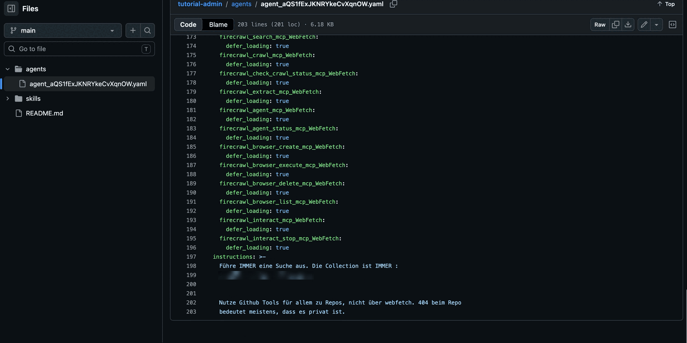

Der **Bibliotheks-Sync** verbindet companyGPT mit Git-Repositories und holt **Skills, Agents und Prompts** von dort nach companyGPT. So lässt sich die Inhaltsbibliothek versionieren, im Team prüfen und zwischen Umgebungen übertragen. Bei Repositories, die dir gehören, schreibt companyADMIN Änderungen auch nach Git zurück.

Du findest den Sync unter **Inhalte** → **Bibliotheks-Sync**. Unterstützt werden GitHub und selbst gehostete Git-Server (GitLab, Gitea oder einfaches Git). Das Repository gibst du als `besitzer/name` an; GitLab-Untergruppen (`gruppe/untergruppe/repo`) werden nicht unterstützt.

## Zwei Richtungen

- **Down-sync**: Repository → companyGPT. Das ist der normale Sync mit **Synchronisieren**.
- **Up-sync**: companyGPT → Repository. Das ist **Zurückschreiben (Up-sync)**: companyADMIN schreibt Änderungen, die in companyGPT entstanden sind, als Commit ins Repository. Der Up-sync und der Export bestehender Inhalte gelten nur für Repositories mit **Wir besitzen dieses Repo (Rückschreiben/Up-sync erlauben)**. Setze das Häkchen, wenn dein Team das Repository selbst pflegt und companyADMIN dort Commits schreiben darf.

In den Meldungen von companyADMIN steht für companyGPT teils „DB“ (Datenbank) oder „Software“, zum Beispiel in **Änderungen erkennen (DB ↔ Git)**.

## Repositories

Die Liste zeigt alle verbundenen Repositories:

| Spalte | Inhalt |
|---|---|
| **Repository** | Repository und Branch |
| **Erkannt** | Anzahl der erkannten Skills, Agents und Prompts |
| **Zuletzt synchronisiert** | Wann (relativ), mit welchem Commit und von wem |
| **Status** | **OK**, **Fehler** oder **Nie**; dazu **Aktuell**, **Update verfügbar** oder **Update-Status unbekannt** und gegebenenfalls die Anzahl der Fehler |

Mit **Repository suchen** findest du ein Repository. **Alle synchronisieren** synchronisiert alle Repositories nacheinander. Ein Klick auf eine Zeile öffnet die Detailseite.

## Repository hinzufügen

**Repository hinzufügen** öffnet eine Seite mit vier Schritten: **Klonen** → **Pfade auswählen** → **Konfigurieren** → **Speichern & synchronisieren**.

1. **Klonen**: Wähle den **Git-Server** (**GitHub** oder **Selbst gehostet (GitLab, Gitea, plain git)**) und gib das Repository an. Bei GitHub kannst du auch eine vollständige URL einfügen; sie wird automatisch in Repository, Branch und Pfad zerlegt. Unter **Authentifizierung** wählst du:
   - **PAT** – ein persönliches Zugriffstoken. Für öffentliche Repositories bleibt das Feld leer.
   - **SSH-Deploy-Key** – companyADMIN erzeugt ein Schlüsselpaar (**SSH-Key erzeugen**). Den **Öffentlichen Schlüssel** hinterlegst du im Repository als Deploy-Key mit Schreibzugriff (bei GitHub: „Allow write access“).

   Für einen selbst gehosteten Server gibst du zusätzlich die **HTTPS-Basis-URL** (für PAT) bzw. **SSH-Host** und **SSH-Port** (für SSH) an.
2. **Pfade auswählen**: Wähle die Ordner der obersten Ebene, die synchronisiert werden sollen. Nur diese Ordner werden geladen, gescannt und weiter synchron gehalten. Die Auswahl lässt sich später nicht mehr ändern; dazu entfernst du das Repository und verbinden es neu.
3. **Konfigurieren**:
   - **Mit KI analysieren** – erscheint nur, wenn für deine Umgebung ein Analyse-Modell eingerichtet ist. Ein Sprachmodell (**Analyse-Modell**) schlägt anhand des Dateibaums vor, welche Ordner Skills, Agents und Prompts enthalten. Der Vorschlag füllt nur die Struktur vor; synchronisiert wird dabei nichts.
   - **Erkannte Inhalte** – die Anzahl der erkannten Skills, Agents und Prompts.
   - **Struktur (Quellen)** – je Eintrag ein **Typ** und ein **Pfad**, zum Beispiel `agents` oder `library/agents`. Mit **Quelle hinzufügen** ergänzt du weitere Pfade.
   - **Sichtbarkeit** – die Standardsichtbarkeit der importierten Inhalte: **Besitzer / System (Standard)**, **Öffentlich (alle Nutzer)** oder **Bestimmte Gruppen**. Mit **Besitzer / System (Standard)** sieht kein Nutzer die importierten Inhalte, bis du **Öffentlich** oder Gruppen wählst.
   - **Wir besitzen dieses Repo (Rückschreiben/Up-sync erlauben)** – erlaubt companyADMIN, Änderungen aus companyGPT in das Repository zurückzuschreiben (Up-sync, siehe [Zwei Richtungen](#zwei-richtungen)). Mit PAT braucht das Token dafür Schreibrechte (bei GitHub den Scope `repo`); mit SSH schreibt der Deploy-Key zurück.
4. **Speichern & synchronisieren**: Der Knopf **Speichern** legt die Verbindung an. Synchronisiert wird dabei noch nichts; das Repository steht danach auf **Nie**. Den ersten Sync mit Vorschau startest du auf der Detailseite mit **Synchronisieren**.

## Synchronisieren

**Synchronisieren** auf der Detailseite zeigt zuerst eine Vorschau (**Änderungen prüfen & anwenden**): was angelegt, aktualisiert, gelöscht wird oder unverändert bleibt. Geschrieben wird erst nach **Bestätigen & anwenden**. Danach zeigt das **Sync-Ergebnis**, was tatsächlich passiert ist, und unter **Hinweise**, was übersprungen wurde, etwa Tools, die deine Umgebung sperrt, nicht erreichbare MCP-Server, nicht auflösbare Skill-Namen oder Binärdateien, die deine Umgebung nicht übernehmen kann.

:::caution[Löschungen und Änderungen in companyGPT]
- Die Vorschau enthält auch Löschungen: Inhalte, die im Repository entfernt wurden, verschwinden beim Sync auch aus companyGPT. Erkennt ein Sync gar keine Inhalte mehr, obwohl vorher welche da waren, löscht companyADMIN nichts und fragt nach, weil meist Branch oder Pfad falsch sind.
- Fällt die Datei eines Eintrags, seine Quelle oder sein Ordner weg, löscht der Sync den Eintrag auch dann, wenn er in companyGPT geändert wurde, selbst bei **Wir besitzen dieses Repo**. Die Änderung ist dann verloren.
- Wurde ein synchronisierter Inhalt in companyGPT bearbeitet und ist **Wir besitzen dieses Repo** nicht gesetzt, **überschreibt der Sync diese Änderung**. Die Vorschau zeigt das als **In companyGPT bearbeitet — wird überschrieben**. Um die Änderung zu behalten, brich ab und übernimm sie zuerst ins Repository.
- Bei Repositories mit **Wir besitzen dieses Repo** bleiben in companyGPT geänderte Agents, Skills und Prompts beim Sync erhalten, solange ihre Datei im Repository liegt. Die Vorschau zeigt sie als **In companyGPT bearbeitet — bleibt erhalten, zuerst nach Git zurückschreiben (Änderungen erkennen)**. Schreibe sie mit **Zurückschreiben (Up-sync)** zurück (siehe [Abgleich mit Git](#abgleich-mit-git)).
:::

Ältere Prompt-Versionen und Freigaben, die Personen in companyGPT vergeben haben, bleiben beim Sync erhalten. Avatar, Gesprächseinstiege und hochgeladene Dateien eines Agents bleiben nur erhalten, wenn die YAML-Datei im Repository das jeweilige Feld nicht selbst setzt. Exportierte Agents (siehe [Bestehende Inhalte exportieren](#bestehende-inhalte-exportieren)) haben diese Felder in ihrer YAML-Datei.

### Ordner mit Skills

Für Skills durchsucht Library Sync den angegebenen Pfad **beliebig tief**: Jeder Ordner mit einer `SKILL.md` wird zu einem Skill. Weitere Textdateien im selben Ordner (z. B. `references/` oder `scripts/`) werden mit dem Skill übernommen. Binärdateien (z. B. Bilder oder Vorlagen) übernimmt der Sync nur, wenn deine Umgebung dafür eingerichtet ist; sonst überspringt er sie und nennt sie unter **Hinweise**. Frage in diesem Fall innFactory. Ist deine Umgebung eingerichtet, stehen die Dateien eines Skills auch der Code-Ausführung von Agents zur Verfügung. Maßgeblich ist der `name` in der `SKILL.md` – kommt ein Name doppelt vor, wird nur der erste übernommen.

### Fertige Skills und Agenten von innFactory einbinden

Die [fertigen Skills](/de/tutorials/skills/) und Agenten liegen im öffentlichen Repository [innFactory-AI/companygpt-library](https://github.com/innFactory-AI/companygpt-library) und lassen sich direkt verbinden – ohne Token:

| Feld | Wert |
|---|---|
| Repository | `innFactory-AI/companygpt-library`, Branch `main` |
| Struktur (Quellen) | Typ `skill`, Pfad `skills`; optional zusätzlich Typ `agent`, Pfad `agents` |
| Wir besitzen dieses Repo | aus |

Deutsche und englische Skills tragen verschiedene Namen (`de-excel`, `en-excel`), also kannst du beide Sprachen gleichzeitig verbinden. Die Skills sind nach Bereichen sortiert; mit einem Pfad wie `skills/files` verbindest du nur einen Bereich. Brauchst du nur eine Sprache, nimm die andere unter **Herausnehmen** aus dem Sync. Die Agenten gibt es ebenfalls je Sprache (`de-demogpt.yaml`, `en-demogpt.yaml`); sie verweisen auf die Skills ihrer Sprache. Werkzeuge, die deine Umgebung nicht anbietet, lässt der Sync weg und nennt sie unter **Hinweise**. Ein **Synchronisieren** holt neue und geänderte Inhalte; einen automatischen Zeitplan gibt es nicht.

:::caution[Umstieg von company-ai-stack-skills]
Das frühere Repository `innFactory-AI/company-ai-stack-skills` ist archiviert und bekommt keine Updates mehr. Die Skills heißen im neuen Repository anders (`excel-skill` → `de-excel`). Entferne das alte Repository mit **Repository entfernen …** und verbinde das neue. Eigene Agenten, die alte Skill-Namen verwenden, musst du auf die neuen Namen umstellen.
:::

:::note
Synchronisierte Skills stehen Agenten sofort zur Verfügung. In der Skill-Auswahl im Chat (`$`) erscheinen sie zunächst inaktiv, bis Nutzer sie einschalten.
:::

## Detailseite eines Repositorys

Die Detailseite hat die Reiter **Überblick**, **Inhalt**, **Läufe**, **Herausnehmen** und **Einstellungen** sowie eine Gefahrenzone.

### Überblick

**Status**, **Quelle**, **Branch**, **Auswahl** (die geladenen Ordner), **Letzter Lauf**, ob es eine **Neue Version im Repository** gibt, und die Anzahl der **Inhalte**. Fehler des letzten Laufs stehen direkt auf der Seite; bereits vorhandene Versionen in companyGPT bleiben dabei unverändert.

### Inhalt

Alle Einträge des Repositorys mit **Name**, **Art**, **Pfad** und **Status**:

| Status | Bedeutung |
|---|---|
| **Gesynct** | Wie im Repository |
| **Geändert in companyGPT** | Seit dem letzten Sync in companyGPT bearbeitet |
| **Konflikt** | In companyGPT und im Repository geändert. Bei **Wir besitzen dieses Repo** überspringt das Zurückschreiben solche Einträge, siehe [Abgleich mit Git](#abgleich-mit-git) |
| **Fehler** | Konnte nicht übernommen werden |
| **Herausgenommen** | Wird nicht mehr synchronisiert |
| **In companyGPT gelöscht** | In companyGPT gelöscht, im Repository noch vorhanden. Der nächste Sync legt den Eintrag neu an, ohne die früheren Freigaben und Favoriten. Dauerhaft entfernst du ihn über **Herausnehmen** oder im Repository |

Darunter steht **Verwaist (N)**: Inhalte mit der Markierung dieses Repositorys, die der Sync nicht mehr verfolgt. Sie werden nie automatisch gelöscht.

#### Abgleich mit Git

**Abgleich mit Git** prüft, was sich zwischen Repository und companyGPT unterscheidet, und ändert nichts. **Änderungen erkennen (DB ↔ Git)** fasst das Ergebnis zusammen:

- **Repo neuer** – im Repository geändert; der nächste Sync übernimmt das
- **in der Software geändert** – in companyGPT geändert
- **synchron**
- **Datei(en) fehlerhaft** – Dateien, die sich nicht lesen lassen; die Version in companyGPT bleibt

Bei Repositories mit **Wir besitzen dieses Repo** schreibst du in companyGPT geänderte Agents, Skills und Prompts mit **Zurückschreiben (Up-sync)** nach Git: Erst zeigt companyADMIN eine Vorschau der Dateien, geschrieben wird mit **Commit & push**. companyADMIN erzeugt dabei einen Commit mit sprechender Nachricht und listet die geschriebenen Dateien auf. Was sich nicht zurückschreiben lässt, überspringt companyADMIN mit Begründung; die Änderung bleibt dann in companyGPT erhalten. Hat der Branch im Repository inzwischen neue Commits, synchronisiere zuerst und versuche es dann erneut.

Einträge mit **Konflikt** überspringt das Zurückschreiben; ohne weiteres Zutun bleiben sie in diesem Zustand. Um einen solchen Eintrag aufzulösen, setze vor **Zurückschreiben (Up-sync)** das Häkchen **Konfliktbehaftete Einheiten einschließen (überschreibt die Git-seitige Änderung)**. Die Änderung im Repository wird dabei durch die Fassung aus companyGPT ersetzt.

#### Bestehende Inhalte exportieren

Bei Repositories mit **Wir besitzen dieses Repo** schreibt **Bestehende Inhalte exportieren** Agents, Skills und Prompts, die in companyGPT entstanden und noch nie mit einem Repository synchronisiert wurden, erstmals in das Repository. Angeboten werden nur Inhalte, die für alle oder für Gruppen freigegeben sind (**Geteilt**), und deine eigenen (**Eigen**). Nichts ist vorausgewählt. Wähle einzelne Einträge oder **Alle auswählen**, prüfe die Dateien mit **Vorschau** und schreibe mit **Commit & push**. Die Vorschau zeigt Zielpfade, neue Ordner und jeden übersprungenen Inhalt mit Namen und Grund.

- Ein Prompt ohne Befehl bekommt einen aus seinem Namen, etwa `report` oder `report-2`. Die Vorschau markiert ihn mit **(neu)**. In companyGPT erscheint damit ein neuer Slash-Befehl.
- Ein Skill, dessen Dateien in companyGPT hochgeladen wurden, lässt sich nicht exportieren und wird mit Begründung übersprungen. Das gilt auch für Skills mit Binärdateien oder Dateien über dem Größenlimit.
- Fehlt im Repository der Ordner für eine Inhaltsart, legt der Export `agents/`, `skills/` oder `prompts/` als private Quelle an. Bei einer Ordnerauswahl schreibt er nur in ausgewählte Ordner.

:::caution[Exportierte Inhalte gehören danach zum Repository]
Nach dem Export sind die Einträge synchronisierte Inhalte dieses Repositorys. Das hat Folgen:

- Wird die Datei im Repository gelöscht oder umbenannt, löscht der nächste Sync den Eintrag in companyGPT.
- Ein exportierter Skill oder Prompt geht sofort an das Systemkonto über. Ein Skill ist für alle aktiv, die ihn sehen dürfen. Die bisherige Autorin oder der bisherige Autor behält den Zugriff als Besitzer.
- Ein exportierter Agent geht mit der ersten Aktualisierung aus dem Repository an das Systemkonto über.
- Die Sichtbarkeit bleibt **Individuell verwaltet**; die Standardsichtbarkeit des Repositorys gilt für diese Einträge nicht.
:::

Im Repository liegt danach je Agent eine YAML-Datei samt Anweisungen, Tools und Einstellungen in den konfigurierten Ordnern.

### Läufe

Jeder Sync mit **Gestartet**, **Ergebnis**, **Änderungen**, **Von** und **Commit**, auch abgebrochene. Ein Lauf zeigt das Ergebnis je Eintrag.

### Herausnehmen

Hier nimmst du einzelne Einträge aus dem Sync, ohne das Repository zu ändern:

1. Wähle die Einträge aus.
2. Lege fest, was in companyGPT passiert: **In companyGPT behalten (als normalen Inhalt freigeben)** oder **Beim nächsten Sync aus companyGPT löschen**.
3. Prüfe die **Vorschau** und klicke auf **Herausnahme speichern**. Sie wirkt beim nächsten Sync.

**Wieder aufnehmen** nimmt einen Eintrag wieder in den Sync auf. Ist seit der Herausnahme schon ein Sync gelaufen, ist das kein einfaches Rückgängigmachen:

- Nach **In companyGPT behalten** übernimmt der nächste Sync den Eintrag wieder und überschreibt Änderungen aus companyGPT, ohne sie vorher als **In companyGPT bearbeitet** anzuzeigen.
- Nach **Beim nächsten Sync aus companyGPT löschen** legt der nächste Sync einen neuen Eintrag an.

### Einstellungen

Branch, Token, Quellen, Sichtbarkeit und **Wir besitzen dieses Repo** änderst du hier. Das Repository selbst und die Ordnerauswahl aus **Pfade auswählen** lassen sich nicht ändern; entferne und verbinde das Repository stattdessen neu. Änderungen an Quellen und Sichtbarkeit wirken erst beim nächsten Sync; companyADMIN bietet nach dem Speichern an, gleich zu synchronisieren.

### Repository entfernen

**Repository entfernen …** in der Gefahrenzone zeigt zuerst, was mit jedem Eintrag in companyGPT passiert:

- **Behalten** – alle Einträge bleiben als normale, frei bearbeitbare Inhalte in companyGPT. Sie gelten danach als manuell angelegt; ihre Sichtbarkeit dürfen dann nur noch Superadmins ändern.
- **Mitlöschen** – die ausgewählten Einträge werden gelöscht. In companyGPT geänderte, geteilte oder von anderen Agents verwendete Einträge sind nicht vorausgewählt; Agents, die Personen als Favorit markiert haben, dagegen schon. Nicht gelöschte Einträge bleiben als verwaist markiert.

Zur Bestätigung gibst du den Namen des Repositorys ein. Läuft gerade ein Sync, geht das Entfernen erst danach.

## Zusammenspiel mit der Sichtbarkeit

Synchronisierte Inhalte tragen unter [Inhalte und Sichtbarkeit](/de/company-gpt/addons/companyadmin/inhalte/) die Kennzeichnung **synchronisiert**, nach einer Änderung in companyGPT zusätzlich **geändert in LibreChat** (LibreChat ist die technische Basis von companyGPT, siehe [Inhalte](/de/company-gpt/addons/companyadmin/inhalte/#listen)). Die Sichtbarkeit kommt aus dem Repo-Standard. Änderst du sie an einem einzelnen Eintrag, verwaltet companyADMIN diesen Eintrag individuell, bis du ihn auf den Repo-Standard zurücksetzen.

:::note[Benötigte Rechte]
Zum Ansehen des Bibliotheks-Syncs brauchst du das Recht **Skills ansehen**. Ohne das Recht **Skills verwalten** fehlen die Reiter **Herausnehmen** und **Einstellungen**, die Knöpfe **Synchronisieren**, **Alle synchronisieren** und **Repository hinzufügen** sowie die Gefahrenzone. Synchronisieren, Hinzufügen, Herausnehmen und Entfernen brauchen außerdem das Verwalten-Recht für jede Inhaltsart im Repository (**Agenten verwalten**, **Prompts verwalten** bzw. **Skills verwalten**).
:::
