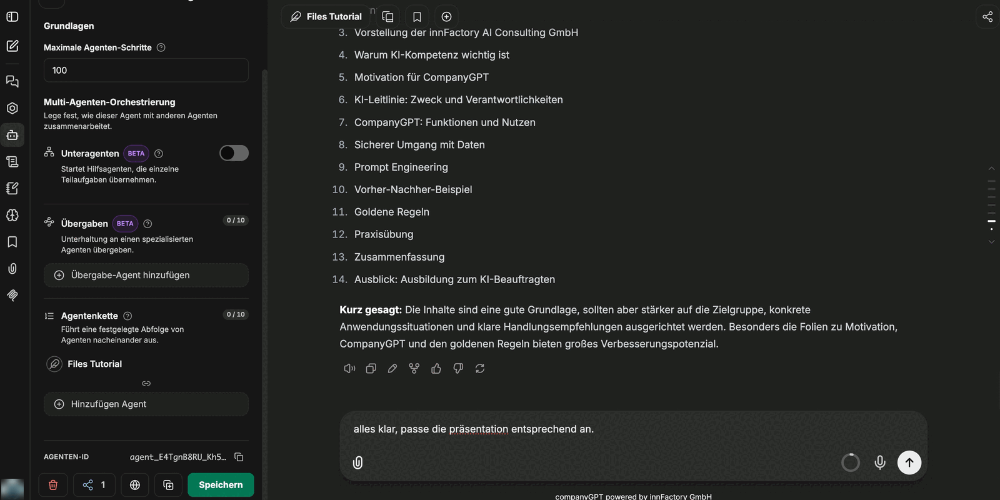

Die Werkzeuge von companyFILES stehen in jedem Chat zur Verfügung. Für alles, was über eine einzelne Datei hinausgeht, lohnt sich trotzdem ein eigener Agent: Er bringt das Werkzeug **Files** und die passenden Skills schon mit, sodass Sie im Prompt nur noch das Ziel nennen müssen. Angelegt wird er wie jeder andere Agent über **Agenten → Neuen Agenten erstellen**.

## Grundeinstellungen

| Feld | Empfehlung |
|---|---|
| Name | sprechender Name, zum Beispiel der Zweck des Agenten |
| Was dieser Agent macht | kurze Beschreibung; optional |
| KI-Modell | ein kleines, schnelles Modell genügt – die Arbeit besteht überwiegend aus Werkzeugaufrufen |
| Kategorie | `Allgemein`, sofern keine eigene Kategorie vorgesehen ist |
| Anweisungen | knapp halten; die Regeln liefern die Skills |

Große Systemanweisungen braucht ein companyFILES-Agent nicht. Bewährt haben sich zwei Kontextvariablen, die über das Plus-Symbol am Feld **Anweisungen** eingesetzt werden und beim Aufruf gefüllt werden:

| Variable | Zweck |
|---|---|
| `{{current_user}}` | wer das Dokument anfordert – landet zum Beispiel im Absenderfeld eines Briefs |
| `{{current_datetime}}` | Datum und Uhrzeit für Dokumentenköpfe, Protokolle und Dateinamen |

## Werkzeug Files

Unter **Tools → Hinzufügen** kommt das Werkzeug **Files** dazu. Es ist ein MCP-Server und bringt eine ganze Reihe von Werkzeugen mit. Wie viele es genau sind, hängt davon ab, welche Erweiterungen in Ihrer Umgebung aktiv sind; der Zähler in der Seitenleiste zeigt die Zahl neben dem Namen, in der Abbildung als `Files · 56`. Im Dialog steht der Verbindungsstatus (**Verbunden**) und darunter die Liste **Tools auf diesem Server**, in der einzelne Werkzeuge ab- und über **Auswahl aufheben** gesammelt abgewählt werden können.

Jede Zeile hat neben dem Namen ein Uhr-Symbol. Es markiert das verzögerte Laden (Lazy Loading): Das Werkzeug wird erst dann in den Kontext geholt, wenn es gebraucht wird. Das spart Kontext und ist für nahezu alle Werkzeuge sinnvoll. Ausgenommen bleibt `help` – es ist dauerhaft aktiv, damit der Agent die übrigen Werkzeuge überhaupt nachschlagen kann.

### Die Werkzeuge im Überblick

**Excel:** `create_excel`, `create_excel_from_csv`, `create_excel_from_json`, `create_excel_advanced`, `modify_excel`, `read_excel`, `read_excel_detailed`, `create_excel_from_template`, `fill_excel_template`

**Word und OpenDocument:** `create_word`, `create_word_from_html`, `create_word_from_json`, `read_word`, `read_word_content`, `append_to_word`, `replace_word_content`, `create_word_from_template`, `create_word_from_template_with_images`, `create_odt`, `create_odt_from_html`, `create_odt_from_template`

**PDF:** `create_pdf`, `create_pdf_from_html`, `read_pdf`, `list_pdf_form_templates`, `fill_pdf_form`, `fill_and_flatten_pdf_form`, `read_pdf_form_fields`, `fill_pdf_form_fields`

**PowerPoint:** `create_powerpoint`, `read_powerpoint_slides`, `append_slides_to_powerpoint`, `update_powerpoint_slide`, `create_powerpoint_from_template`, `describe_pptx_template`, `create_powerpoint_from_layouts`, `add_slides_from_layouts`, `set_powerpoint_slide_fields`

**Text, Konvertierung, Archive:** `create_text_file`, `convert_document`, `get_supported_conversions`, `create_zip_from_stored_files`

**Dateiverwaltung:** `upload_file`, `download_stored_file`, `list_documents`, `search_documents`, `list_my_files`, `get_settings`, `open_companyfiles_ui`

**Vorlagen:** `list_templates`, `attach_template_to_chat` – Letzteres hängt eine Kopie einer Vorlage an den Chat, damit der Code-Interpreter sie bearbeiten kann; siehe [Vorlage für den Code-Interpreter an den Chat hängen](/de/company-gpt/addons/companyfiles/vorlagen/#vorlage-für-den-code-interpreter-an-den-chat-hängen)

**Bilder:** `view_image` – der Agent sieht sich ein gespeichertes Bild (PNG, JPEG, WebP, GIF) selbst an, etwa ein hochgeladenes Foto oder einen exportierten Chart, und kann es beschreiben oder auswerten

**Visualisierung:** `create_chart_document`, `embed_chart_in_document`, `show_interactive_chart`, `show_interactive_diagram`, `show_interactive_map`

**Hilfe:** `help`

Dazu kommen Werkzeuge, die nur mit einer zusätzlichen Erweiterung bereitstehen:

| Erweiterung | Werkzeuge | Beschreibung |
|---|---|---|
| Weitere Formate lesen | `read_file`, `save_file_part`, `convert_to_markdown` | E-Mails, Archive und ältere Formate lesen, Anhänge als eigenes Dokument speichern, ganze Dateien als Markdown sichern – siehe [E-Mails, Archive und ältere Formate lesen](/de/company-gpt/addons/companyfiles/dokumente-erstellen/#e-mails-archive-und-ältere-formate-lesen) |
| CAD, BIM und 3D | `describe_model`, `query_model`, `get_model_element`, `aggregate_model`, `model_areas`, `create_model_report`, `render_model_view`, `show_model_viewer`, `convert_model`, `edit_model` | Modelle auswerten, ansehen, umwandeln und bearbeiten – siehe [CAD, BIM und 3D](/de/company-gpt/addons/companyfiles/cad-und-3d/) |

:::note[Nicht in allen Umgebungen verfügbar]
Ob diese Funktion in Ihrer Umgebung zur Verfügung steht, legt Ihr Unternehmen fest. Wenden Sie sich bei Fragen an Ihren Administrator.
:::

## Skills

Zu companyFILES gehören mitgelieferte Skills. Sie enthalten keine Inhalte, sondern die Regeln, wie mit den Werkzeugen zu arbeiten ist – welches Werkzeug für welches Format zuständig ist, in welcher Reihenfolge gearbeitet wird und woran ein Ergebnis zu prüfen ist. Ausgewählt werden sie im Bereich **Skills** des Agenten.

| Skill | Zuständig für |
|---|---|
| [`excel-skill`](/de/tutorials/skills/files/excel-skill/) | Excel-Tabellen, Formeln und Formatierungen |
| [`word-odt-skill`](/de/tutorials/skills/files/word-odt-skill/) | Word- und OpenDocument-Dokumente |
| [`pdf-skill`](/de/tutorials/skills/files/pdf-skill/) | PDF-Erstellung und PDF-Formulare |
| [`powerpoint-skill`](/de/tutorials/skills/files/powerpoint-skill/) | Präsentationen erstellen und überarbeiten |
| [`templates-skill`](/de/tutorials/skills/files/templates-skill/) | Dokumente aus Vorlagen erzeugen |
| [`charts-diagrams-skill`](/de/tutorials/skills/files/charts-diagram-skill/) | Charts, Diagramme und Karten |
| [`convert-skill`](/de/tutorials/skills/files/convert-skill/) | Konvertierung zwischen Formaten |
| [`file-management-skill`](/de/tutorials/skills/files/file-management-skill/) | Dateien ablegen, suchen, herunterladen |
| [`settings-ui-skill`](/de/tutorials/skills/files/settings-ui-skill/) | Einstellungen lesen und in Dokumenten anwenden |

Der Agent kann wahlweise alle Skills der Organisation, keine oder nur ausgewählte Skills nutzen. Für einen Dokumenten-Agenten genügt die gezielte Auswahl der companyFILES-Skills.

:::tip[Hinweis]
Jeder Skill ist in dieser Dokumentation einzeln beschrieben – die Tabelle verlinkt direkt dorthin. Wer einen eigenen Agenten baut, kann dort nachlesen, welcher Skill welche Arbeitsweise vorgibt.
:::

Im Chat ist beides sichtbar: Über der Antwort steht, wie viele Werkzeuge benutzt wurden und welche Quelle sie hatten – zum Beispiel *„2 Tools benutzt · skill, Files"*, darunter der ausgeführte Skill und das aktive Werkzeug.

## Maximale Agenten-Schritte

Unter **Erweitert → Grundlagen** steht das Feld **Maximale Agenten-Schritte**. Es begrenzt, wie viele Werkzeugaufrufe ein Agent in einem Durchgang machen darf. Ohne eigenen Wert gilt der Standard Ihrer Umgebung – in CompanyGPT 150 Schritte. Das reicht in der Regel auch für größere Umbauten wie das Überarbeiten einer ganzen Präsentation.

:::note
Ein eigener Wert ersetzt den Standard – auch nach unten. Tragen Sie deshalb nur dann etwas ein, wenn der Agent bei sehr umfangreichen Änderungen ins Limit läuft, und wählen Sie dann einen Wert über 150. Läuft der Agent mitten in der Bearbeitung ins Limit, bleibt das Dokument in einem halbfertigen Zustand zurück.
:::

Darunter liegt der Bereich **Multi-Agenten-Orchestrierung** mit **Unteragenten** (Beta), **Übergaben** (Beta) und der **Agentenkette**. Für companyFILES sind sie nicht erforderlich.

## Weitere Werkzeuge kombinieren

companyFILES lässt sich mit anderen Werkzeugen desselben Agenten verbinden. Im Beispiel der Karte kommt eine **Websuche** hinzu: Erst recherchiert der Agent die Standorte, dann zeichnet er sie über `show_interactive_map` ein. Ohne Websuche kennt er nur die Orte aus dem Prompt.

Für das Arbeiten mit [`attach_template_to_chat`](/de/company-gpt/addons/companyfiles/vorlagen/#vorlage-für-den-code-interpreter-an-den-chat-hängen) braucht der Agent zusätzlich die Fähigkeit **Code ausführen**, denn die angehängte Vorlage bearbeitet der Code-Interpreter.

Als Nächstes: [Dokumente erstellen](/de/company-gpt/addons/companyfiles/dokumente-erstellen/).
