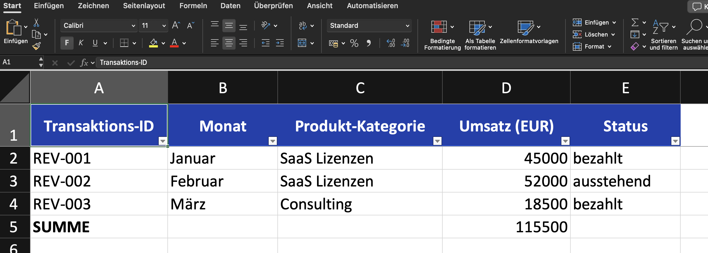
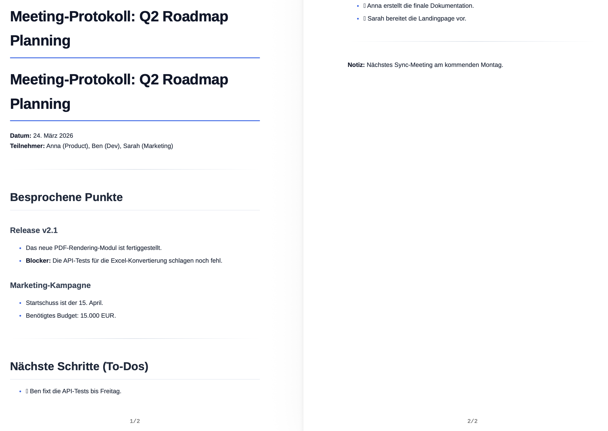
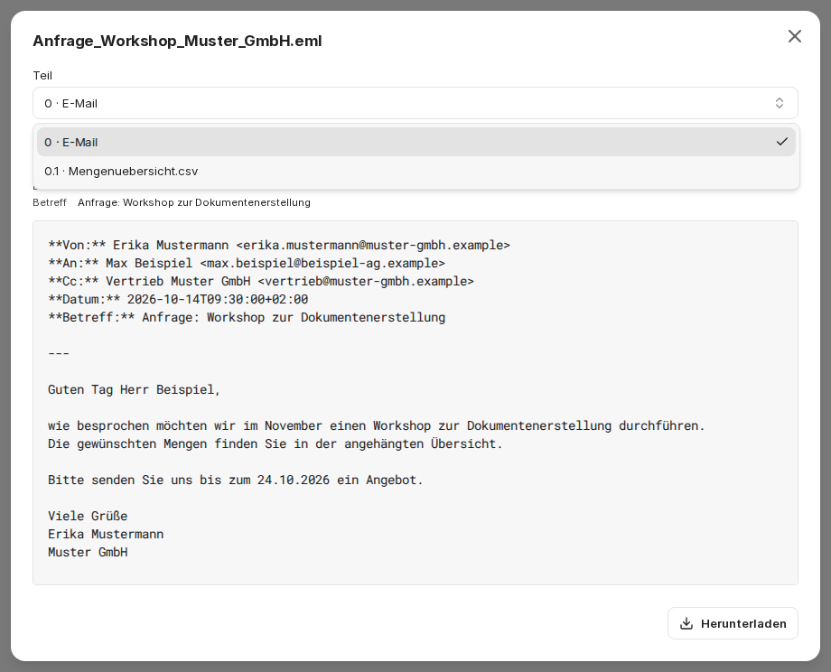

Dokumente entstehen im Chat. Sie beschreiben, was Sie brauchen, hängen bei Bedarf eine Datei an – companyFILES erzeugt das Dokument und stellt es im Chat bereit. Dieselbe Datei liegt anschließend in der [Oberfläche](/de/company-gpt/addons/companyfiles/oberflaeche/) unter **Dokumente**.

## Umfassende Dokumentenerstellung

Native Word- (`.docx`), Excel- (`.xlsx`), PowerPoint- (`.pptx`), OpenDocument- (`.odt`) und PDF-Dateien lassen sich erstellen.

- **Excel:** Tabellen können aus CSV, JSON und Arrays generiert oder erweiterte Vorlagen inklusive Formeln genutzt werden.
- **Word:** Markdown, HTML, JSON oder Vorlagen werden nahtlos in fertige Dokumente umgewandelt.
- **PowerPoint:** Präsentationen können direkt aus Markdown-Texten oder Vorlagen erstellt werden – siehe [Präsentationen bearbeiten](/de/company-gpt/addons/companyfiles/praesentationen/).
- **PDF:** PDFs lassen sich direkt aus Markdown oder HTML generieren.

## Beispiel: CSV zu formatierter Excel-Tabelle

Der Prompt nennt die Datei und das gewünschte Ergebnis, nicht den Weg dorthin:

> *„Wandle diese CSV-Datei in eine formatierte Excel-Tabelle um, füge Summenzeilen am Ende hinzu und hebe alle Werte farblich hervor, die unter dem Zielwert liegen."*

Dazu wird die CSV-Datei an die Nachricht angehängt. Der Agent zieht den `excel-skill` heran, prüft die verfügbaren Werkzeuge und erzeugt die Datei; im Chat erscheint sie als Download.

Im Ergebnis stecken mehr als reine Zahlen:

- eine formatierte Kopfzeile mit **Autofilter** über allen Spalten,
- eine **Summenzeile**, die nicht hart geschrieben, sondern als Formel angelegt ist,
- eine **bedingte Formatierung**, die Werte unter dem Ziel farbig markiert,
- ergänzende Auswertungen, ebenfalls berechnet.

## Beispiel: JSON zu Excel

Eine JSON-Datei mit Rohdaten wird an die Nachricht angehängt, dazu der Auftrag:

> *„Nimm diese JSON-Rohdaten der Q1-Umsätze und mache daraus eine saubere Excel-Tabelle. Markiere die Kopfzeile blau und füge unten eine Summenzeile hinzu."*

Ergebnis:

## Datenverarbeitung & Code-Export

Strukturierte Daten wie JSON oder CSV können direkt in saubere Excel-Tabellen oder Word-Dokumente konvertiert werden. Außerdem lassen sich beliebige textbasierte Dateien und Code-Skripte erzeugen (z. B. SQL, JSON, YAML, XML, HTML, Python oder JS).

## Beispiel: Text zu PDF

Ein PDF muss nicht aus einer Datei entstehen. Genauso gut lässt sich der Inhalt vorher im Chat erarbeiten – im Beispiel eine Beschreibung des Freigabeprozesses von Reisekosten – und anschließend mit einem Satz in ein Dokument überführen: *„Mach daraus ein PDF."* Der Agent formatiert den Text und gibt das PDF zurück; das Ergebnis lässt sich danach wieder anhängen und weiterverarbeiten, etwa um daraus ein [Flussdiagramm](/de/company-gpt/addons/companyfiles/visualisierungen/) zu erzeugen.

**Beispiel: Meeting-Protokoll in PDF-Dokument**

Ein Meeting-Protokoll als Markdown-Datei wird angehängt, dazu der Auftrag *„Wandle mein Meeting-Protokoll von Markdown in ein professionelles PDF um."*

Ergebnis:

## Dokumente im Chat

Ein erzeugtes Dokument erscheint im Chat als Link zum Herunterladen. Je nach Umgebung legt companyFILES erzeugte Dokumente außerdem als Datei im CompanyGPT-Chat ab; dann zeigt der Chat sie zusätzlich als **Anhang-Karte**, Office-Dokumente mit Vorschau. In der Oberfläche tragen solche Dateien die Marke **CompanyGPT**. Bilder, ZIP-Archive und die PNG-Fassungen von Charts erscheinen nur als Link.

Auch für diese Dokumente gilt die Aufbewahrungsfrist von companyFILES: Läuft sie ab, wird das Dokument samt der Datei im Chat gelöscht – siehe [Ablauf und Aufbewahrung](/de/company-gpt/addons/companyfiles/oberflaeche/#ablauf-und-aufbewahrung).

### Angehängte Dateien bearbeiten

Bitten Sie den Agenten, eine im Chat angehängte Datei zu ändern – etwa Zeilen in einer Excel-Tabelle zu ergänzen, Text in einem Word-Dokument zu ersetzen oder Folien einer Präsentation zu überarbeiten –, schreibt companyFILES die Änderungen in der Regel direkt in diese Datei zurück. Ist das nicht möglich, entsteht eine geänderte Kopie als neues Dokument. Die Antwort des Agenten nennt, was passiert ist.

:::caution[Nur Textauszug vorhanden]
Liegt von einer angehängten Datei im Chat nur ein Textauszug vor und nicht die Originaldatei, kann companyFILES sie nicht als Word-, Excel-, PowerPoint- oder PDF-Datei verarbeiten. companyFILES meldet dann: *„Von dieser Datei liegt bei LibreChat nur ein Textauszug vor – bitte die Originaldatei erneut hochladen.“* Hängen Sie die Datei in diesem Fall erneut an.
:::

## Dateikonvertierung & Datenextraktion

- **Konvertierung:** Folgende Umwandlungen sind möglich. Welche Wege im Einzelfall verfügbar sind, beantwortet der Agent über `get_supported_conversions`.

  | Von | Nach |
  |---|---|
  | Excel | CSV, JSON, Markdown, HTML |
  | CSV | Excel, JSON, Markdown, HTML |
  | JSON | Excel, CSV, Markdown |
  | Markdown | Word, PDF, HTML, Text, ODT |
  | HTML | Word, PDF, Markdown, Text, ODT |
  | Word | Text, Markdown, HTML, PDF |
  | PDF | Text |

  Eine PDF-Datei lässt sich also nicht zurück in ein Word-Dokument umwandeln, sondern nur als Text auslesen.
- **Extraktion:** Daten und Texte können gezielt aus bestehenden Excel-, Word- und PDF-Dateien ausgelesen werden. Weitere Formate wie E-Mails, ZIP-Archive und ältere Office-Dateien liest companyFILES mit einer Erweiterung – siehe [E-Mails, Archive und ältere Formate lesen](#e-mails-archive-und-ältere-formate-lesen).
- **PDF-Formulare:** Hängen Sie ein PDF mit ausfüllbaren Formularfeldern im Chat an, liest der Agent die Felder aus (Name, Typ, aktueller Wert, Auswahlmöglichkeiten) und füllt sie mit Ihren Angaben. Das Ergebnis speichert companyFILES als neues PDF, das leere Formular bleibt erhalten; auf Wunsch werden die Werte fest eingebrannt, sodass sie sich nicht mehr ändern lassen. Unterschrifts- und Schaltflächenfelder werden dabei nicht berücksichtigt, und PDFs ohne Formularfelder – etwa Scans – lassen sich so nicht ausfüllen. PDF-Formulare als Vorlagen zu hinterlegen, ist derzeit nicht möglich: Die Oberfläche nimmt beim Hochladen von Vorlagen keine PDF-Dateien an.

:::note
Eine Bildbearbeitung (z. B. Größe ändern oder Grafikformat umwandeln) bietet companyFILES nicht. Ansehen kann der Agent ein gespeichertes Bild aber: Über das Werkzeug `view_image` liest er PNG-, JPEG-, WebP- und GIF-Dateien ein und kann sie beschreiben oder auswerten – etwa ein hochgeladenes Foto oder einen exportierten Chart.
:::

## E-Mails, Archive und ältere Formate lesen

:::note[Nicht in allen Umgebungen verfügbar]
Ob diese Funktion in Ihrer Umgebung zur Verfügung steht, legt Ihr Unternehmen fest. Wenden Sie sich bei Fragen an Ihren Administrator.
:::

Mit der Erweiterung zum Lesen weiterer Formate öffnet companyFILES auch Dateien, die die normalen Lesewerkzeuge nicht abdecken, und wandelt sie in lesbaren Text (Markdown) um:

| Format | Beispiele |
|---|---|
| E-Mails | Outlook-Nachrichten (`.msg`) und `.eml` – mit Kopfzeilen, Text und Anhängen |
| Archive | ZIP-Archive mit allen Einträgen |
| Ältere Office-Formate | `.doc`, `.xls`, `.ppt` sowie Excel-Binärmappen (`.xlsb`) |
| Weitere Dokumentformate | RTF, OpenDocument (`.odt`, `.ods`, `.odp`), EPUB, HTML, Jupyter-Notebooks (`.ipynb`) |
| Bilder und Scans | Texterkennung (OCR, Deutsch und Englisch) für Bilder, TIFF und gescannte PDFs |

Für Word-, Excel- und PDF-Dateien bleiben die normalen Lesewerkzeuge die erste Wahl.

Eine Datei besteht dabei aus **Teilen**: der Datei selbst sowie ihren Anhängen bzw. Archiv-Einträgen – auch den Anhängen einer angehängten E-Mail. Der Agent arbeitet mit drei Werkzeugen:

| Werkzeug | Wirkung |
|---|---|
| `read_file` | liest eine Datei oder einen einzelnen Teil seitenweise als Text, zusammen mit der Liste aller Teile, den Kopfzeilen einer E-Mail und Hinweisen aus der Umwandlung |
| `save_file_part` | speichert einen Anhang oder Archiv-Eintrag unverändert als eigenes Dokument – danach lässt er sich wie jede andere Datei weiterverarbeiten, etwa eine angehängte Excel-Tabelle auswerten |
| `convert_to_markdown` | speichert die ganze Datei – oder einen Teil samt Inhalt – als ein Markdown-Dokument (`.md`), mit einem Abschnitt je Teil; die Originaldatei bleibt unverändert |

Beispiel-Prompt: *„Fasse diese E-Mail zusammen und speichere die angehängte Excel-Tabelle als eigenes Dokument."*

Umfangreiche Umwandlungen wie die Texterkennung können etwas dauern. Der Agent meldet dann, dass die Datei noch umgewandelt wird, und fragt kurz darauf erneut nach.

**Grenze bei Excel-Binärmappen:** `.xlsb`-Dateien liest companyFILES bis etwa 60.000 Zeilen × 8 Spalten. Bei größeren Mappen bricht die Umwandlung mit dem Hinweis *„Speichergrenze erreicht – Datei zu komplex“* ab. Speichern Sie die Datei in diesem Fall in Excel als `.xlsx` – diese Dateien liest companyFILES schrittweise, sodass auch größere Mappen gelingen.

In der Oberfläche nimmt **Dateien hochladen** diese Formate ebenfalls an. Ob sich `.msg`- und `.eml`-Dateien direkt im Chat anhängen lassen, hängt von Ihrer Umgebung ab; andernfalls laden Sie sie über die Oberfläche hoch.

Die **Vorschau** unter **Dokumente** zeigt solche Dateien als lesbaren Text:

- Ein Auswahlfeld **Teil** wechselt zwischen der E-Mail bzw. dem Dokument und den Anhängen oder Einträgen.
- Bei E-Mails stehen oben **Von**, **An**, **Cc**, **Datum** und **Betreff**.
- Die Marke **OCR** kennzeichnet Text aus der Texterkennung (Erkennungsfehler sind möglich), die Marke **Gekürzt** einen Teil, der nicht vollständig umgewandelt wurde. Unter **Hinweise aus der Umwandlung** stehen weitere Meldungen.
- Lange Texte blättern Sie über **Vorherige Seite** und **Nächste Seite**; angezeigt wird, welche Zeichen Sie gerade sehen (*„Zeichen x–y von z“*).
- **Als Dokument speichern** legt einen Anhang oder Eintrag als eigenes Dokument unter **Dokumente** ab.

Solange die Umwandlung läuft, zeigt die Vorschau: *„Die Datei wird noch umgewandelt (z. B. Texterkennung). Das kann eine Minute dauern.“*

## KI-Kennzeichnung

Neu erzeugte Dokumente kennzeichnet companyFILES standardmäßig als KI-generiert (EU AI Act, Art. 50). Die Kennzeichnung steht maschinenlesbar in den Metadaten der Datei und verändert den Inhalt nicht:

| Format | Kennzeichnung |
|---|---|
| Word, Excel, PowerPoint | Eigenschaften `AIGenerated` und `AIGenerator`, dazu das Stichwort `AI-generated` und eine Beschreibung – in Office sichtbar unter **Datei → Informationen → Eigenschaften** |
| OpenDocument | benutzerdefinierte Metadaten |
| PDF | Stichwörter und Thema in den Dokumenteigenschaften |
| Bilder (PNG, JPEG, WebP) | Bildbeschreibung und Software in den EXIF-Daten |

Das gilt auch für Dokumente aus Vorlagen und für exportierte Charts und Diagramme. Nicht gekennzeichnet werden hochgeladene Dateien, Änderungen an bestehenden Dateien, reine Formatumwandlungen, Textdateien wie CSV, TXT oder Markdown sowie ZIP-Archive.

## Dateiverwaltung

- **Datentransfer:** Dateien können hochgeladen und generierte Dokumente direkt heruntergeladen werden.
- **Bündeln:** Mehrere Dokumente lassen sich als ZIP-Archiv zum gemeinsamen Download zusammenfassen – 1 bis 50 Dokumente je Archiv, auch Dateien aus dem Chat. ZIP-Archive sind nur für den Download gedacht: Sie erscheinen nicht unter **Dokumente** und werden nach kurzer Zeit wieder gelöscht.
- **Verwaltung:** Der Agent kann den eigenen Dateibestand auflisten und durchsuchen und die hinterlegten [Einstellungen](/de/company-gpt/addons/companyfiles/einstellungen/) auslesen, um Farben und Layout korrekt anzuwenden.

:::tip[Hinweis]
Die Frage *„Zeig mir meine Dokumente"* funktioniert direkt im Chat – der Agent listet den Bestand auf, ohne dass Sie in die Oberfläche wechseln müssen.
:::

## Grenzen

- Bilder, die in ein PDF oder eine Präsentation eingebunden werden sollen, lädt companyFILES nur von öffentlich erreichbaren Adressen. Bilder aus dem Intranet hängen Sie stattdessen im Chat an oder laden sie in companyFILES hoch.
- Ein ZIP-Archiv fasst höchstens 50 Dokumente zusammen.

Als Nächstes: [Visualisierungen](/de/company-gpt/addons/companyfiles/visualisierungen/).
