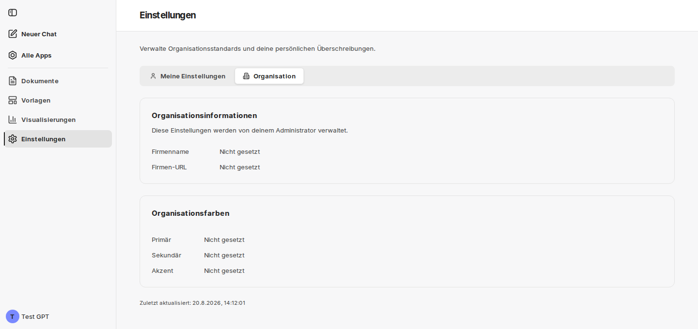
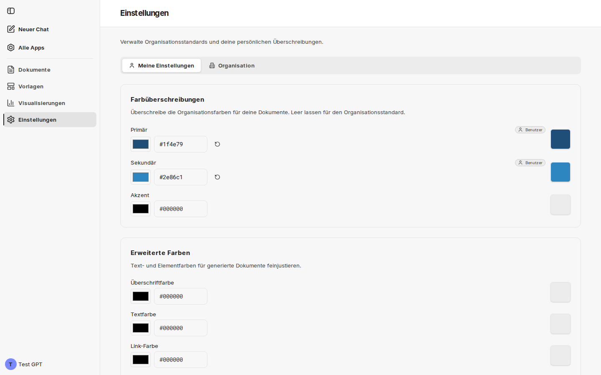
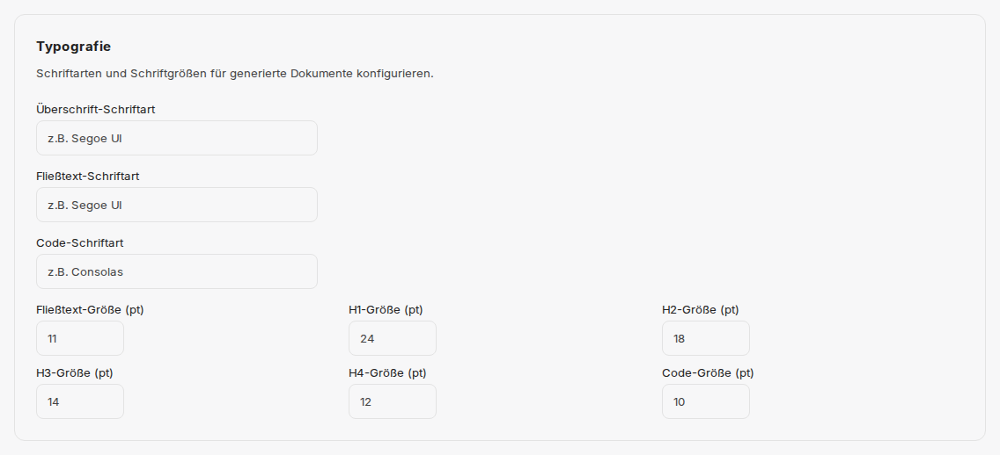
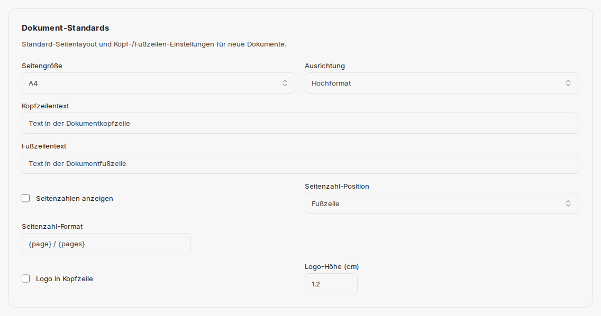

Die Einstellungen legen fest, wie generierte Dokumente aussehen, wenn **keine Vorlage** verwendet wird. Sie werden einmal gesetzt und danach auf jedes neu erzeugte Dokument, jedes Chart und jede Präsentation angewendet.

Der Bereich ist zweigeteilt, sichtbar an den Tabs oberhalb der Karten:

| Tab | Wirkung |
|---|---|
| **Meine Einstellungen** | persönliche Überschreibungen für Farben, Typografie, Dokument-Standards und Logo; leere Felder verwenden den Organisationsstandard |
| **Organisation** | Standard für alle Benutzer; nur mit Administratorrechten bearbeitbar |

Die Sprache der Oberfläche stellen Sie nicht hier ein, sondern im Kontomenü unten in der Seitenleiste – siehe [Die Oberfläche](/de/company-gpt/addons/companyfiles/oberflaeche/#seitenleiste-und-kontomenü).

## Organisation

Administratoren bearbeiten im Tab **Organisation** diese Karten:

- **Organisationsinformationen** mit **Firmenname** und **Firmen-URL**. Der Hinweis lautet: *„Bearbeite die Organisationsdetails. Änderungen wirken sich auf alle Benutzer aus."*
- **Organisationsfarben** mit den drei Grundfarben **Primär**, **Sekundär** und **Akzent** – jeweils über einen Farbwähler oder als Hex-Wert. Diese Farben tauchen anschließend nicht nur in Dokumenten auf, sondern auch in den im Chat erzeugten Charts.
- **Erweiterte Farben**, **[Typografie](#typografie)** und **[Dokument-Standards](#dokument-standards)** als Vorgaben für alle Benutzer.
- **Organisationslogo** mit **Logo hochladen** bzw. **Logo ersetzen** und **Logo löschen** – die Bilddatei, die in generierten Dokumenten verwendet wird.

Gespeichert wird über **Organisationseinstellungen speichern**. Darunter steht, wann und von wem der Stand zuletzt geändert wurde.

Benutzer ohne Administratorrechte sehen im Tab **Organisation** nur, was gilt: *„Diese Einstellungen werden von deinem Administrator verwaltet."*

## Meine Einstellungen

Im Tab **Meine Einstellungen** überschreiben Sie die Vorgaben der Organisation für Ihre eigenen Dokumente. Er enthält diese Karten:

| Karte | Inhalt |
|---|---|
| **Farbüberschreibungen** | dieselben drei Farben **Primär**, **Sekundär** und **Akzent**: *„Überschreibe die Organisationsfarben für deine Dokumente. Leer lassen für den Organisationsstandard."* Haben Sie eine Farbe selbst gesetzt, steht darunter zum Vergleich der **Org-Standard**; **Auf Organisationsstandard zurücksetzen** leert das Feld wieder. |
| **Erweiterte Farben** | **Überschriftfarbe**, **Textfarbe**, **Link-Farbe**, **Tabellenkopf-Hintergrund**, **Tabellenkopf-Text** und **Code-Hintergrund** |
| **[Typografie](#typografie)** | eigene Schriftarten und Schriftgrößen |
| **[Dokument-Standards](#dokument-standards)** | eigenes Seitenlayout, Kopf- und Fußzeile |
| **Logo** | *„Lade ein persönliches Logo hoch, um das Organisationslogo in deinen Dokumenten zu ersetzen."* – über **Logo hochladen**; **Mein Logo entfernen** stellt das Organisationslogo wieder her |
| **Vorschau** | zeigt, wie die aufgelösten Farben zusammen aussehen |

Bei den Farben und beim Logo zeigt eine Marke neben dem Feldnamen, woher der aktuelle Wert stammt: **Org** aus dem Organisationsstandard, **Benutzer** aus Ihren eigenen Einstellungen. Gespeichert wird über **Einstellungen speichern**.

## Typografie

Die Karte **Typografie** gibt es in beiden Tabs: im Tab **Organisation** als Vorgabe, im Tab **Meine Einstellungen** als persönliche Überschreibung.

*„Schriftarten und Schriftgrößen für generierte Dokumente konfigurieren."*

| Feld | Beispielwert im Feld |
|---|---|
| Überschrift-Schriftart | z. B. Segoe UI |
| Fließtext-Schriftart | z. B. Segoe UI |
| Code-Schriftart | z. B. Consolas |
| Fließtext-Größe (pt) | 11 |
| H1-Größe (pt) | 24 |
| H2-Größe (pt) | 18 |
| H3-Größe (pt) | 14 |
| H4-Größe (pt) | 12 |
| Code-Größe (pt) | 10 |

## Dokument-Standards

Auch die Karte **Dokument-Standards** gibt es in beiden Tabs.

*„Standard-Seitenlayout und Kopf-/Fußzeilen-Einstellungen für neue Dokumente."*

| Feld | Bedeutung |
|---|---|
| Seitengröße | Papierformat, zum Beispiel A4 |
| Ausrichtung | **Hochformat** oder **Querformat** |
| Kopfzeilentext | Text in der Dokumentkopfzeile |
| Fußzeilentext | Text in der Dokumentfußzeile |
| Seitenzahlen anzeigen | schaltet die Seitennummerierung ein |
| Seitenzahl-Position | **Kopfzeile** oder **Fußzeile** |
| Seitenzahl-Format | Muster der Seitenzahl, zum Beispiel `{page} / {pages}` |
| Logo in Kopfzeile | bindet das Logo in die Kopfzeile ein |
| Logo-Höhe (cm) | Höhe des Logos, zum Beispiel 1.2 |

:::tip[Hinweis]
Die Farben lohnen sich als Erstes: Sobald eine Primärfarbe gesetzt ist, kommen auch die im Chat erzeugten Charts in den Unternehmensfarben – ohne dass Sie das im Prompt erwähnen müssen.
:::

Als Nächstes: [Agent einrichten](/de/company-gpt/addons/companyfiles/agent/).
