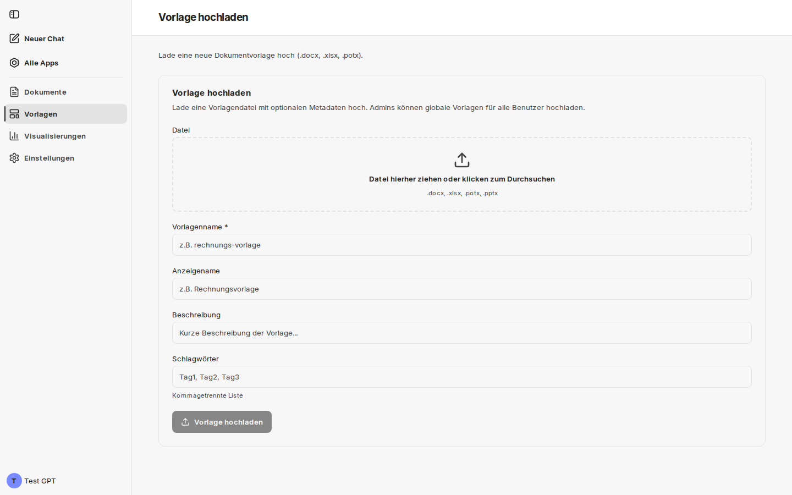
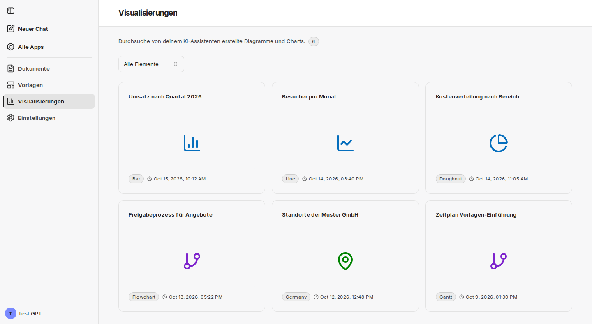

Die companyFILES Oberfläche erreichen Sie im CompanyGPT über **Apps → Files** oder über die Seite [Alle Apps](/de/company-gpt/addons/alle-apps/). Sie nutzt die [gemeinsame Oberfläche](/de/company-gpt/addons/gemeinsame-oberflaeche/) aller CompanyGPT-Addons: Die Anmeldung läuft über Ihre Chat-Sitzung, Aufbau und Design entsprechen dem Chat.

## Seitenleiste und Kontomenü

Die Seitenleiste lässt sich ein- und ausklappen. Von oben nach unten enthält sie:

| Eintrag | Wirkung |
|---|---|
| **Neuer Chat** | öffnet einen neuen Chat im CompanyGPT |
| **Alle Apps** | führt zur Übersicht aller Apps Ihrer Umgebung |
| **[Dokumente](#dokumente)** | alle erzeugten und hochgeladenen Dateien; zugleich die Startseite von companyFILES |
| **[Vorlagen](#vorlagen)** | alle verfügbaren Vorlagen |
| **[Visualisierungen](#visualisierungen)** | alle im Chat erzeugten Charts, Diagramme und Karten |
| **Einstellungen** | Standards für generierte Dokumente – siehe [Einstellungen](/de/company-gpt/addons/companyfiles/einstellungen/) |

Ganz unten steht Ihr Konto. Das **Kontomenü** zeigt Ihre E-Mail-Adresse und enthält:

- **Design** – **System**, **Dunkel**, **Hell**, **High contrast light** oder **High contrast dark**,
- **Sprache** – Deutsch oder English,
- **Abmelden**.

Auf dem Smartphone steht die Navigation in einer Kopfzeile mit ausklappbarem Menü. Ist Ihr Konto für companyFILES nicht freigeschaltet, zeigt die Oberfläche statt der Inhalte die Seite **Kein Zugriff**. Mehr zu Navigation, Kontomenü und Zustandsseiten steht unter [Gemeinsame Oberfläche](/de/company-gpt/addons/gemeinsame-oberflaeche/).

Hochgeladen wird nicht mehr über eigene Menüpunkte, sondern über **Seitenaktionen** oben rechts auf der jeweiligen Seite: **Dateien hochladen** auf der Seite Dokumente und **Vorlage hochladen** auf der Seite Vorlagen.

## Dokumente

Hier finden Sie alle erzeugten und hochgeladenen Dateien an einem Ort – auch die Dateien, die Sie im Chat angehängt haben.

Über die Suche **Dokumente suchen...**, den Filter **Alle Typen** (Word, Excel, PowerPoint, PDF, Text, Bild, Archiv) und **Sortieren nach** (Datum, Name, Größe, Typ) finden Sie Dateien schnell. Die Tabelle zeigt **Name**, **Typ**, **Größe**, **Datum** und **Ablauf**. Kleine Bilder (bis 1 MB) erscheinen als Vorschaubild neben dem Namen, alle anderen Dateien mit dem Symbol ihres Typs.

Die Marke **CompanyGPT** neben dem Dateinamen bedeutet: Die Datei liegt als Datei im CompanyGPT-Chat vor – entweder weil Sie sie im Chat hochgeladen haben oder weil companyFILES ein erzeugtes Dokument dort abgelegt hat.

Ein Klick auf eine Zeile öffnet die **Vorschau**. Über das **Drei-Punkte-Menü** (⋯) können Sie eine Datei herunterladen, die Vorschau öffnen, das Ablaufdatum bearbeiten oder die Datei löschen. In der im Chat eingebetteten Ansicht steht statt **Herunterladen** der Eintrag **Link kopieren**.

### Vorschau

Die Vorschau zeigt Word-, Excel- und PowerPoint-Dateien, PDFs, Bilder und Textdateien direkt im Browser; für andere Dateitypen bietet sie **Stattdessen herunterladen** an. Ist in Ihrer Umgebung die Erweiterung zum Lesen weiterer Formate aktiv, zeigt sie E-Mails, ZIP-Archive und ältere Office-Formate als lesbaren Text – siehe [E-Mails, Archive und ältere Formate lesen](/de/company-gpt/addons/companyfiles/dokumente-erstellen/#e-mails-archive-und-ältere-formate-lesen).

Ein Klick auf ein Bild öffnet es im Vollbild. Dort zoomen Sie per Mausrad, Fingergeste oder `+`/`−`, verschieben das Bild durch Ziehen oder mit den Pfeiltasten, passen es mit `0` an den Bildschirm an und schließen es mit `Esc`. **In neuem Tab öffnen** zeigt das Bild in einem eigenen Browser-Tab.

### Ablauf und Aufbewahrung

Erzeugte und in companyFILES hochgeladene Dokumente haben eine Aufbewahrungsfrist, deren Länge Ihre Umgebung festlegt. Die Spalte **Ablauf** zeigt die Restlaufzeit; ein Klick darauf oder **Ablauf bearbeiten** im Menü ändert das Datum. Nach Ablauf löscht companyFILES das Dokument automatisch – liegt es zusätzlich als Datei im CompanyGPT-Chat vor, wird diese mit gelöscht.

**Dauerhaft** steht nur bei Dateien, die Sie direkt im Chat hochgeladen haben. Für sie gilt keine Frist von companyFILES.

### Dateien hochladen

Die Seitenaktion **Dateien hochladen** öffnet den Dialog **Hochladen**. Ziehen Sie eine oder mehrere Dateien in den Upload-Bereich oder klicken Sie zum Durchsuchen, und starten Sie den Upload mit **Dateien hochladen**. Nach dem Upload zeigt der Dialog für jede Datei das Ergebnis; über **Weitere hochladen** geht es mit den nächsten Dateien weiter.

Angenommen werden:

- Office-Dokumente (`.docx`, `.xlsx`, `.pptx`, `.potx`),
- PDF,
- Bilder (PNG, JPG, GIF, WebP, BMP, SVG, HEIC),
- ZIP-Archive,
- Textformate wie TXT, Markdown, CSV, JSON, XML, HTML, YAML, CSS, JS und TS.

Ist die Erweiterung zum Lesen weiterer Formate aktiv, kommen unter anderem E-Mails (`.msg`, `.eml`), ältere Office-Formate (`.doc`, `.xls`, `.ppt`), Excel-Binärmappen (`.xlsb`), RTF, OpenDocument, EPUB und TIFF hinzu.

Beim Hochladen prüft companyFILES, ob der Inhalt einer Datei zu ihrer Endung passt. Umbenannte Dateien – etwa ein ZIP-Archiv mit der Endung `.docx` – und Dateien, deren Inhalt sich nicht erkennen lässt, werden abgelehnt.

## Vorlagen

Hier sehen Sie alle verfügbaren Vorlagen für die Dokumentenerstellung.

Über die Suche **Vorlagen suchen...** und die Filter **Alle Typen**, **Alle Bereiche** und **Alle Schlagwörter** grenzen Sie die Liste ein. Die Tabelle zeigt Name, Typ, Bereich, Schlagwörter, Größe und Upload-Datum. Der **Bereich** entscheidet über die Sichtbarkeit:

| Bereich | Bedeutung |
|---|---|
| **Benutzer** | nur für Sie selbst nutzbar |
| **Global** | für alle Benutzer der Organisation nutzbar |

Ein Klick auf eine Vorlage öffnet ihre Detailansicht mit Beschreibung, Schlagwörtern und den erkannten **Platzhaltern** – in der Schreibweise, die der Vorlagentyp erwartet. So prüfen Sie, ob eine Vorlage richtig vorbereitet ist. Darunter stehen die Aktionen:

| Aktion | Verfügbar |
|---|---|
| **Herunterladen** | für jede Vorlage |
| **Bearbeiten** (Anzeigename, Beschreibung, Schlagwörter) und **Löschen** | für eigene Vorlagen; bei globalen Vorlagen nur für Administratoren |
| **Zu Global heraufstufen** | für Administratoren bei eigenen Word-, Excel- und PowerPoint-Vorlagen |
| **Zu Lokal herabstufen** | für Administratoren bei globalen Word-, Excel- und PowerPoint-Vorlagen |
| **Vorlage verwenden** | nur in der im Chat eingebetteten Ansicht: schreibt eine Anfrage zum Ausfüllen der Vorlage samt ihrer Platzhalter in den Chat |

Wie Vorlagen vorbereitet und im Chat genutzt werden, steht unter [Vorlagen](/de/company-gpt/addons/companyfiles/vorlagen/).

### Vorlage hochladen

Die Seitenaktion **Vorlage hochladen** auf der Seite Vorlagen öffnet das Upload-Formular.

Ziehen Sie eine Vorlagendatei (`.docx`, `.xlsx`, `.potx`, `.pptx`) in den Upload-Bereich. Füllen Sie den **Vorlagennamen** aus – er ist Pflicht und darf nur Buchstaben, Zahlen, Bindestriche und Unterstriche enthalten – und optional **Anzeigename**, **Beschreibung** und **Schlagwörter** (kommagetrennt). Administratoren sehen zusätzlich das Feld **Bereich**: **Global** (für alle Benutzer verfügbar, voreingestellt) oder **User** (nur für sie selbst sichtbar). Klicken Sie auf **Vorlage hochladen**, um den Upload abzuschließen.

## Visualisierungen

Hier sehen Sie alle durch CompanyGPT erzeugten Charts, Diagramme und Karten.

Über den Filter **Alle Elemente** zeigen Sie nur **Charts**, **Diagramme** oder **Karten** an. Jede Karte zeigt den Titel, eine Vorschau, den Typ und das Erstellungsdatum. Ein Klick auf einen Chart oder ein Diagramm öffnet die Detailansicht; Karten öffnen sich in einem neuen Browser-Tab.

Wie Visualisierungen entstehen, steht unter [Visualisierungen](/de/company-gpt/addons/companyfiles/visualisierungen/).

Als Nächstes: [Einstellungen](/de/company-gpt/addons/companyfiles/einstellungen/).
