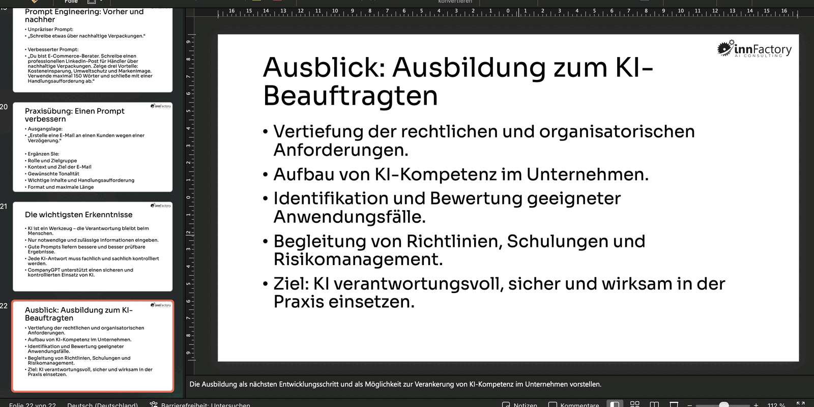

Präsentationen lassen sich nicht nur neu erzeugen, sondern auch **bestehende Foliensätze überarbeiten**. Sie hängen die `.pptx`-Datei im Chat an, der Agent liest die Folien samt Layout und ändert gezielt, was Sie nennen. Design, Schriftart und Logo der Vorlage bleiben dabei erhalten.

## Ablauf

1. **Präsentation hochladen.** Die Datei wird an die Nachricht angehängt; der Upload läuft im Hintergrund.
2. **Prüfauftrag stellen.** Ein guter Einstieg ist eine Frage statt einer Anweisung, zum Beispiel *„Passt die Agenda zum Inhalt?"*. Der Agent liest den Foliensatz und antwortet mit einer Einschätzung.
3. **Änderung freigeben.** Erst danach folgt der Auftrag – etwa *„Passe die Agenda an."* Der Agent schreibt die Änderungen in der Regel direkt in die angehängte Präsentation zurück; ist das nicht möglich, legt er eine geänderte Kopie als neues Dokument an. Die Antwort nennt, was passiert ist.
4. **Inhalt verbessern lassen.** Auf die Frage, wie sich der Inhalt verbessern ließe, antwortet der Agent mit einer Liste von Vorschlägen, die Sie einzeln oder als Ganzes übernehmen können.

Im Beispiel wächst eine Schulungspräsentation so von einer Agenda mit vier Punkten auf einen Foliensatz mit **22 Folien**, ergänzt um „Prompt Engineering: Vorher und Nachher", eine Praxisübung, die wichtigsten Erkenntnisse und einen Ausblick.

Neue Folien setzt der Agent auf die Layouts des Folienmasters der Präsentation. So übernehmen sie Schriften, Farben, Logo und Anordnung der Ausgangsdatei – auch dann, wenn die Präsentation keine Platzhalter enthält. Bildplatzhalter eines Layouts kann er mit einem angehängten oder in companyFILES gespeicherten Bild füllen; das Bild wird dabei passend zugeschnitten, statt verzerrt zu werden.

## Vor größeren Änderungen: Schritte hochsetzen

Ein Umbau einer ganzen Präsentation besteht aus vielen einzelnen Werkzeugaufrufen – Folie lesen, Felder setzen, Folien anfügen, Ergebnis prüfen. Der Standardwert für **Maximale Agenten-Schritte** reicht dafür nicht aus.

:::note
Der Standard von 150 Agenten-Schritten reicht in der Regel. Ein eigener Wert unter **Erweitert → Maximale Agenten-Schritte** ersetzt ihn – setzen Sie dort also nur einen Wert über 150, wenn der Agent bei sehr großen Präsentationen ins Limit läuft. Läuft der Agent ins Limit, bricht er mitten in der Bearbeitung ab und die Präsentation bleibt halbfertig. Siehe [Agent einrichten](/de/company-gpt/addons/companyfiles/agent/#maximale-agenten-schritte).
:::

## Was der Agent selbst korrigiert

Bei umfangreichen Umbauten prüft der Agent die Antworten der Werkzeuge und merkt selbst, wenn eine Änderung nicht übernommen wurde. Lehnt das Werkzeug etwa einen Teil der Änderungen **wegen eines zu strengen Feldformats** ab, wiederholt der Agent sie im akzeptierten Format (zum Beispiel als mehrzeilige Textfelder).

Das passiert ohne Zutun, verlängert aber den Durchlauf – ein weiterer Grund, die Schrittzahl vorher großzügig zu setzen. Mehrere Änderungen an derselben Präsentation führt companyFILES nacheinander aus, sodass sich gleichzeitig gestartete Aufrufe nicht gegenseitig überschreiben.

## Grenzen

:::caution
Textfelder, unter denen ein **Bild** liegt, kann companyFILES nicht verarbeiten. Diese Folien müssen nach der Bearbeitung von Hand nachgezogen werden.
:::

- Bilder für Folien lädt companyFILES nur von öffentlich erreichbaren Adressen. Bilder aus dem Intranet hängen Sie stattdessen im Chat an.

Auch sonst gilt: Das Ergebnis ist ein sehr weit gebrachter Rohentwurf, keine fertige Präsentation. Einzelne Folien brauchen danach noch Feinarbeit am Text und an der Anordnung. Der Nutzen liegt im Grundschritt – Struktur, Inhalt und Design stehen, und zwar durchgängig im Design der Ausgangsdatei.

## Vorlagen als Ausgangspunkt

Statt einer hochgeladenen Datei kann auch eine hinterlegte PowerPoint-Vorlage der Ausgangspunkt sein. Sie liegt dann dauerhaft in companyFILES und muss nicht jedes Mal angehängt werden. Das funktioniert mit Platzhaltern ebenso wie mit einem reinen Folienmaster ohne Platzhalter – siehe [Vorlagen](/de/company-gpt/addons/companyfiles/vorlagen/#powerpoint-vorlagen-ohne-platzhalter).

Für Änderungen, die die Werkzeuge von companyFILES nicht abdecken, kann der Agent eine Kopie der Vorlage an den Chat hängen und mit dem Code-Interpreter bearbeiten. Eine `.potx`-Vorlage kommt dabei als `.pptx` an – siehe [Vorlage für den Code-Interpreter an den Chat hängen](/de/company-gpt/addons/companyfiles/vorlagen/#vorlage-für-den-code-interpreter-an-den-chat-hängen).

Als Nächstes: [Vorlagen](/de/company-gpt/addons/companyfiles/vorlagen/).
