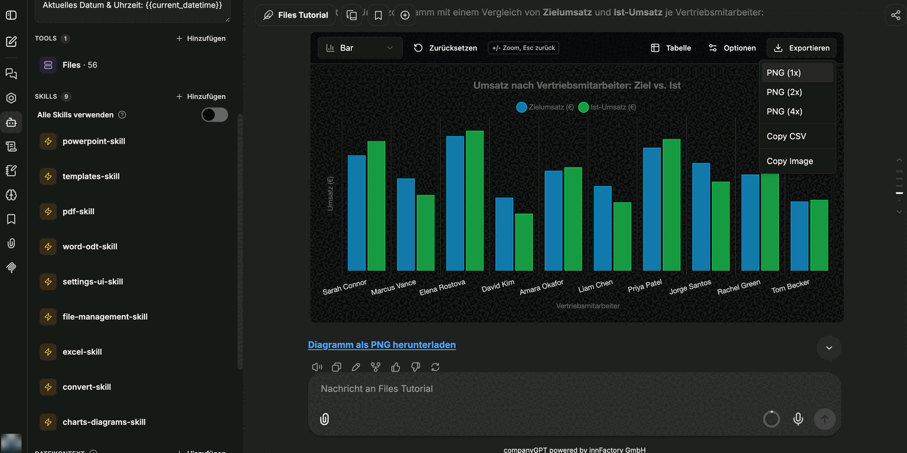
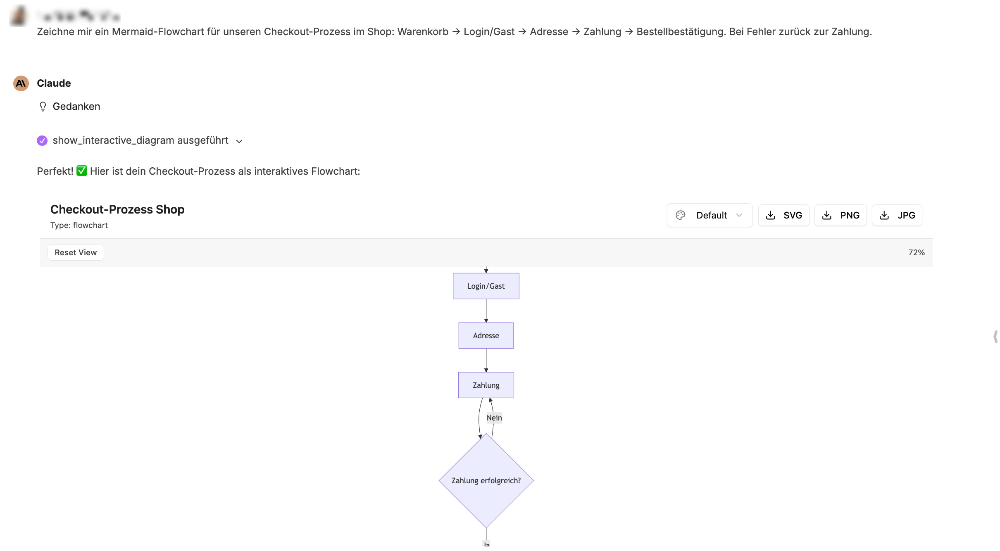
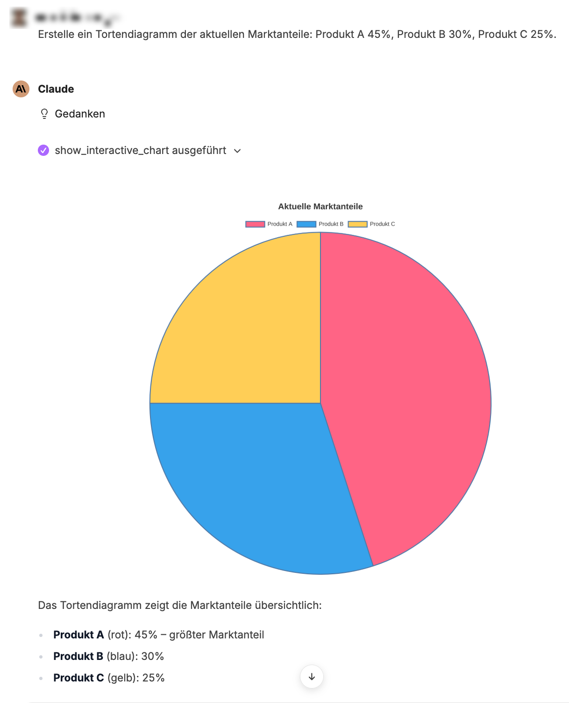

Rohe Zahlen können direkt als aussagekräftige Grafiken visualisiert werden. companyFILES kennt dafür drei Darstellungen, die im Chat interaktiv sind: **Charts** für Zahlenreihen, **Diagramme** für Abläufe und Strukturen und **Karten** für Standorte. Alles, was so entsteht, sammelt sich in der Oberfläche unter [Visualisierungen](/de/company-gpt/addons/companyfiles/oberflaeche/#visualisierungen).

## Interaktive Charts

Charts lassen sich aus Daten im Chat erzeugen – zum Beispiel direkt aus einer Tabelle, die zuvor erstellt wurde: *„Zeige mir den Umsatz als Diagramm."* Zur Auswahl stehen:

- Balkendiagramme, auch gestapelt oder horizontal,
- Linien- und Flächendiagramme,
- Torten- und Ringdiagramme (Doughnut) sowie Polar-Area-Diagramme,
- Radar-, Streu- (Scatter) und Blasendiagramme (Bubble),
- Wasserfall- und Trichterdiagramme (Funnel).

Über die Leiste oberhalb des Charts steuern Sie die Darstellung:

| Bedienelement | Wirkung |
|---|---|
| Diagrammtyp (z. B. **Bar**) | wechselt die Darstellungsform |
| **Zurücksetzen** | stellt die Ausgangsansicht wieder her |
| **+/- Zoom, Esc zurück** | Zoom in den Datenbereich; `Esc` führt zurück |
| **Tabelle** | schaltet zwischen Diagramm und zugrunde liegender Tabelle um |
| **Optionen** | Feineinstellungen wie Titel, Achsenbeschriftungen, Legendenposition, **Farbschema**, **Gitterlinien**, **Gestapelt** oder **Fläche füllen**; **Übernehmen** wendet sie an |
| **Exportieren** | **PNG (1x)**, **PNG (2x)**, **PNG (4x)**, **Copy CSV**, **Copy Image** |

Exportierte Bilddateien legt companyFILES zusätzlich unter **Dokumente** ab. Unter dem Chart nennt der Agent außerdem einen Link auf die Vollansicht und einen Link zum Herunterladen als PNG.

:::tip[Hinweis]
Die Farben des Charts kommen aus den [Einstellungen](/de/company-gpt/addons/companyfiles/einstellungen/). Sobald eine Primärfarbe gesetzt ist, erscheinen neue Charts automatisch in den Unternehmensfarben.
:::

## Mermaid-Diagramme

Per Prompt können Flowcharts, Sequenzdiagramme, Klassendiagramme, State-Machines, ER-Diagramme und weitere Mermaid-Diagrammtypen generiert werden. Als Vorlage genügt ein beschriebener Ablauf – auch aus einem vorher erzeugten Dokument: Sie hängen das PDF an und bitten um ein Flussdiagramm.

Die Diagrammansicht im Chat lässt sich zoomen und über **Reset View** zurücksetzen; die aktuelle Vergrößerung steht als Prozentwert daneben. Oben rechts wählen Sie das Farbthema des Diagramms (**Standard**, **Dunkel**, **Wald** oder **Neutral**) und exportieren es über **SVG**, **PNG** oder **JPG**. Nach dem Export meldet die Ansicht „Exportiert“ mit dem Dateinamen; **Link kopieren** legt den Download-Link der Datei in die Zwischenablage. Die exportierte Datei liegt danach auch unter **Dokumente**. Ist ein Diagramm abgelaufen oder nicht mehr vorhanden, zeigt die Ansicht „Diagramm nicht verfügbar“.

**Beispiel: Tortendiagramm**

## Karten

Standorte lassen sich auf einer interaktiven Karte darstellen – als Weltkarte oder als Deutschlandkarte mit den Grenzen der Bundesländer. Der Prompt nennt nur die Orte oder die Organisationen – im Beispiel: *„Zeige die Hauptstandorte von BMW, Audi, Mercedes-Benz und Porsche auf einer Karte."*

Jede Markierung trägt eine Beschriftung, die Legende ordnet die Farben den Einträgen zu, und über die Bedienelemente steuern Sie die Ansicht:

| Bedienelement | Wirkung |
|---|---|
| **Clustern** | fasst nahe beieinanderliegende Markierungen zusammen |
| **Extern öffnen** | öffnet die Karte als eigene Seite |
| **Exportieren** | speichert die Karte als Bild (PNG oder JPG) |

Unterhalb der Karte listet der Agent die gefundenen Standorte noch einmal als Text auf. In einzelnen Umgebungen kann die Karte zusätzlich Adressen in Kartenpunkte umsetzen und Routen zwischen Orten, Entfernungen und Fahrzeiten oder den von einem Punkt aus erreichbaren Bereich darstellen.

:::note
Für Standorte, die nicht im Prompt stehen, braucht der Agent zusätzlich eine **Websuche** – siehe [Agent einrichten](/de/company-gpt/addons/companyfiles/agent/#weitere-werkzeuge-kombinieren). Erst damit findet er nicht nur den Ort, sondern den tatsächlich als Hauptsitz oder Konzernzentrale ausgewiesenen Standort.
:::

## Visualisierungen in Dokumente einbetten

Ein Chart muss nicht als Bild neben dem Dokument liegen. Der Bitte, das Diagramm in ein Word-Dokument zu übernehmen, folgt ein Dokument, in dem Text und Grafik zusammenstehen – Titel, Erläuterung und das eingebettete Diagramm.

Als Nächstes: [Präsentationen bearbeiten](/de/company-gpt/addons/companyfiles/praesentationen/).
