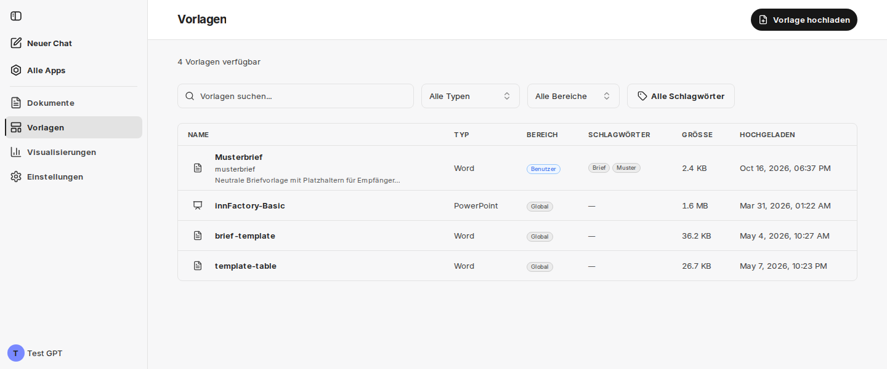
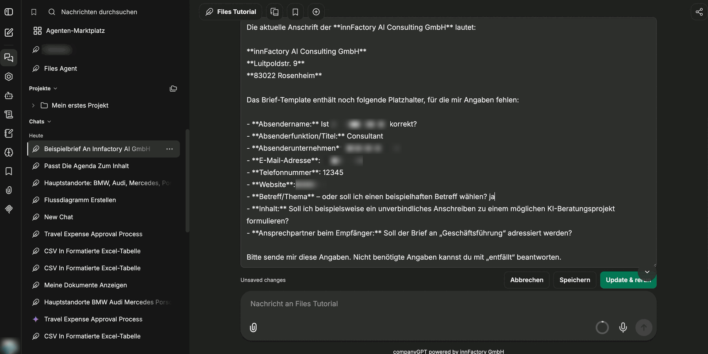

Vorlagen ermöglichen die wiederverwendbare Dokumentenerstellung mit standardisiertem Aufbau: Das Format wird einmal festgelegt, danach werden nur noch die Inhalte befüllt. Das lohnt sich überall dort, wo Dokumente sich im Aufbau gleichen – Briefe, Begleitschreiben, Besprechungsprotokolle, Angebotsvorlagen.

Word-Vorlagen müssen dafür zuerst mit **Platzhaltern** vorbereitet werden – ein fertig ausgefülltes Dokument lässt sich nicht einfach als Vorlage hochladen. Bei Excel-Vorlagen kann der Agent alternativ Zellen direkt über ihre Adresse befüllen, und PowerPoint-Folienmaster ohne Platzhalter nutzt er über ihre Layouts.

## Vorlagen vorbereiten

Sie öffnen das Dokument in der nativen Anwendung (Word, Excel, PowerPoint) und setzen Platzhalter an die Stellen, an denen CompanyGPT dynamische Inhalte einsetzen soll. Die Namen können Sie frei wählen, sie sollten jedoch aussagekräftig sein. Wie ein Platzhalter geschrieben wird, hängt vom Format ab:

| Format | Schreibweise | Beispiel |
|---|---|---|
| Word (`.docx`) | eine geschweifte Klammer: `{Name}` | „Sehr geehrte/r `{Anrede}` `{Nachname}`, ..." oder eine Tabellenzelle mit `{Rechnungsbetrag}` |
| Excel (`.xlsx`) | doppelte geschweifte Klammern: `{{Name}}` | Zelle A1 enthält `{{Mitarbeitername}}`, Zelle B1 enthält `{{Abteilung}}` |
| PowerPoint (`.pptx` / `.potx`) | doppelte geschweifte Klammern: `{{Name}}` | Titelfolie mit `{{Projektname}}`, Inhaltsfolie mit `{{Zusammenfassung}}` |
| OpenDocument (`.odt`) | doppelte geschweifte Klammern: `{{Name}}` | `{{Kundenname}}` im Fließtext |

In der Beispiel-Briefvorlage für Word stehen die Platzhalter für Absender (`{from_name}`, `{from_title}`, `{from_company}`, `{from_email}`, `{from_phone}`, `{from_website}`), Empfänger (`{to_name}`, `{to_company}`, `{to_address_line1}`, `{to_address_line2}`) sowie `{date}`, `{topic}` und `{message}`.

Bei **Excel-Vorlagen** gibt es eine zweite Möglichkeit: Der Agent kann einzelne Zellen direkt über ihre Adresse befüllen, zum Beispiel `A1` oder `Tabelle2!B3`. Eine Excel-Vorlage, deren Aufbau feststeht, braucht dafür keine Platzhalter.

:::tip[Hinweis]
Verwenden Sie aussagekräftige Platzhalternamen wie `Kundenname` statt `K1`. So erkennt CompanyGPT den Kontext und kann die Platzhalter zuverlässiger mit den richtigen Daten befüllen. Welche Platzhalter companyFILES in einer hochgeladenen Vorlage erkannt hat, zeigt ihre Detailansicht unter [Vorlagen](/de/company-gpt/addons/companyfiles/oberflaeche/#vorlagen).
:::

:::caution
Ein normales, fertig ausgefülltes Word-Dokument ohne Platzhalter kann nicht als Vorlage verwendet werden. CompanyGPT benötigt die Platzhalter-Markierungen, um zu erkennen, welche Stellen dynamisch ersetzt werden sollen.
:::

## PowerPoint-Vorlagen ohne Platzhalter

Ein Folienmaster im Corporate Design enthält meist keine `{{Platzhalter}}`, sondern nur Folienlayouts – Titelfolie, Kapiteltrenner, Inhalt, zwei Spalten, Abschluss. Auch solche Vorlagen kann companyFILES nutzen:

1. Der Agent liest die Layouts der Vorlage aus (`describe_pptx_template`): Name und Rolle jedes Layouts sowie seine Felder für Titel, Text und Bilder.
2. Daraus baut er eine neue Präsentation (`create_powerpoint_from_layouts`). Die Inhalte landen in den Feldern der Layouts; Schriften, Farben, Logos und Anordnung kommen unverändert aus dem Folienmaster.
3. Weitere Folien fügt er einer bestehenden Präsentation hinzu (`add_slides_from_layouts`), einzelne Folien überarbeitet er gezielt (`set_powerpoint_slide_fields`).

Bildfelder der Layouts lassen sich mit angehängten oder in companyFILES gespeicherten Bildern füllen. Dasselbe Vorgehen funktioniert mit einer `.pptx`-Datei, die Sie im Chat anhängen – siehe [Präsentationen bearbeiten](/de/company-gpt/addons/companyfiles/praesentationen/). Enthält eine Vorlage dagegen `{{Platzhalter}}`, füllt der Agent diese wie oben beschrieben.

## Vorlagen hochladen und freigeben

Hochgeladen werden Vorlagen in der Oberfläche über die Seitenaktion [Vorlage hochladen](/de/company-gpt/addons/companyfiles/oberflaeche/#vorlage-hochladen) – als `.docx`, `.xlsx`, `.potx` oder `.pptx`. Der Vorlagenname darf nur Buchstaben, Zahlen, Bindestriche und Unterstriche enthalten. Der **Bereich** entscheidet danach über die Sichtbarkeit: **Benutzer** bedeutet, dass nur Sie selbst die Vorlage nutzen können; **Global** gibt sie für alle Benutzer der Organisation frei. Globale Vorlagen legen Administratoren an; sie können eigene Vorlagen auch nachträglich über **Zu Global heraufstufen** freigeben und über **Zu Lokal herabstufen** wieder zurücknehmen.

OpenDocument-Vorlagen (`.odt`) und PDF-Formulare lassen sich derzeit nicht über die Oberfläche als Vorlage hochladen. Ein PDF mit Formularfeldern füllen Sie stattdessen direkt im Chat aus – siehe [PDF-Formulare](/de/company-gpt/addons/companyfiles/dokumente-erstellen/#dateikonvertierung--datenextraktion).

## Erweiterte Vorlagen-Syntax

Neben einfachen `{Platzhalter}`-Markierungen unterstützen Word-Vorlagen eine erweiterte Ausdrucks-Syntax für dynamische Inhalte wie beispielsweise Schleifen, um Zeilen in Tabellen zu erstellen.

### Tabellen-Schleifen in Word

Schleifen in Word-Tabellen werden über dedizierte Zeilen gesteuert. Die `FOR`- und `END-FOR`-Befehle stehen jeweils in einer eigenen Tabellenzeile:

| Name | Eingetreten seit |
|---|---|
| `{FOR person IN personen}` | |
| `{= $person.name}` | `{= $person.eintrittsjahr}` |
| `{END-FOR person}` | |

- Die **FOR-Zeile** markiert den Schleifenbeginn – sie wird beim Rendern entfernt.
- Die **Körper-Zeile** wird für jeden Eintrag im Array dupliziert.
- Die **END-FOR-Zeile** schließt die Schleife ab – sie wird ebenfalls entfernt.

:::caution
Die `FOR`- und `END-FOR`-Zeilen müssen **vollständige Tabellenzeilen** sein – platzieren Sie den Befehl in der ersten Zelle, die restlichen Zellen der Zeile bleiben leer. Befehle innerhalb einer Zelle einer normalen Zeile funktionieren nicht als Schleifensteuerung.
:::

### Erlaubte Ausdrücke

Ausdrücke in Word-Vorlagen wertet companyFILES mit einem eigenen, eingeschränkten Auswerter aus; JavaScript wird dabei nicht ausgeführt. Erlaubt sind:

- Variablen und Pfade wie `name`, `$person.name` oder `positionen[0]`,
- Zahlen, Text in Anführungszeichen sowie `true`, `false` und `null`,
- Rechen- und Vergleichsoperatoren (`+ - * / %`, `< <= > >=`, `== != === !==`), logische Operatoren (`&& || ?? !`) und die Bedingung `a ? b : c`,
- die Befehle `FOR`/`END-FOR`, `IF`/`END-IF` und `EXEC` mit Zuweisungen wie `summe += $pos.betrag`,
- eine feste Liste harmloser Methoden und Funktionen, zum Beispiel `toFixed`, `toUpperCase`, `toLowerCase`, `trim`, `replace`, `join`, `toLocaleDateString`, `Math.round`, `parseFloat`, `Object.keys` und `new Date(…)`.

Nicht erlaubt sind Arrow-Functions, Methoden wie `.map()` oder `.filter()`, Schleifen im Ausdruck und Template-Literals. Enthält eine Vorlage solche Ausdrücke, scheitert das Befüllen mit einer Fehlermeldung. Text in geschweiften Klammern, der kein gültiger Ausdruck ist, bleibt als Text stehen und erscheint als Warnung.

| Ausdruck | Ergebnis |
|---|---|
| `{= $pos.menge * $pos.preis}` | funktioniert |
| `{= $pos.preis.toFixed(2)}` | funktioniert |
| `{= kunde.name.toUpperCase()}` | funktioniert |
| `{= positionen.map(p => p.preis).join(", ")}` | scheitert – stattdessen eine `FOR`-Schleife verwenden |

## Vorlage im Chat verwenden

Nach dem Hochladen nennen Sie die Vorlage im Chat und geben die Daten für die Platzhalter an. Fehlen Angaben, fragt der Agent sie nach – er listet die offenen Platzhalter auf und schlägt teilweise schon Werte vor.

Die Angaben tragen Sie direkt in die Nachricht ein: Die eigene Nachricht lässt sich bearbeiten und über **Update & rerun** erneut abschicken, **Speichern** übernimmt die Änderung ohne neuen Durchlauf. Nicht benötigte Felder können Sie ausdrücklich als *entfällt* beantworten.

Anschließend erzeugt companyFILES das Dokument: Aufbau, Schriftbild und Akzentfarbe stammen unverändert aus der Vorlage, an den Stellen der Platzhalter stehen die gelieferten Inhalte.

Beispiel-Prompt: *„Erstelle eine Rechnung mit der Vorlage ‚Rechnungsvorlage'. Kundenname: Muster GmbH, Rechnungsbetrag: 1.500 €, Datum: 15.04.2026"*

Öffnen Sie companyFILES innerhalb des Chats, steht in der Detailansicht einer Vorlage zusätzlich **Vorlage verwenden** bereit: Die Schaltfläche schreibt eine Anfrage zum Ausfüllen der Vorlage samt ihrer Platzhalter in den Chat.

:::tip[Hinweis]
Wenn immer dieselbe Vorlage zum Einsatz kommt, hinterlegen Sie sie in den Anweisungen eines eigenen [Agenten](/de/company-gpt/addons/companyfiles/agent/). Dann müssen Sie im Prompt nicht mehr nennen, welche Vorlage gemeint ist – der Agent arbeitet genauer und die Bedienung wird deutlich einfacher.
:::

## Vorlage für den Code-Interpreter an den Chat hängen

:::note[Nicht in allen Umgebungen verfügbar]
Ob diese Funktion in Ihrer Umgebung zur Verfügung steht, legt Ihr Unternehmen fest. Wenden Sie sich bei Fragen an Ihren Administrator.
:::

Manche Änderungen gehen über das Befüllen von Platzhaltern hinaus. Für solche Fälle kann der Agent eine **Kopie** einer Vorlage als Datei an den Chat hängen (`attach_template_to_chat`). Der Code-Interpreter öffnet sie dann mit Python, bearbeitet sie und speichert das Ergebnis als neue Datei. Die Vorlage selbst bleibt unverändert.

- Möglich ist das für Word- (`.docx`), Excel- (`.xlsx`), PowerPoint- (`.potx`) und OpenDocument-Vorlagen (`.odt`). Eine `.potx`-Vorlage kommt als `.pptx` im Chat an, damit der Code-Interpreter sie öffnen kann.
- Gibt es eine persönliche und eine globale Vorlage mit demselben Namen, nimmt der Agent die persönliche.
- Die angehängte Datei sieht der Code-Interpreter erst **ab Ihrer nächsten Nachricht**, und nur, wenn für den Chat bzw. den Agenten **Code ausführen** aktiv ist.
- Wird dieselbe Vorlage erneut angehängt, entsteht keine zweite Kopie: Eine unveränderte Vorlage wird wieder angehängt, eine inzwischen geänderte ersetzt die alte Kopie.

Beispiel-Prompt: *„Hänge die Vorlage ‚Angebot' an den Chat und füge in der Preistabelle eine Spalte für Rabatte ein."*

## Dokumente ohne Vorlage

Wird keine Vorlage genutzt, greifen die [Einstellungen](/de/company-gpt/addons/companyfiles/einstellungen/): Farben, Typografie, Seitenlayout und Logo kommen dann aus dem Organisationsstandard beziehungsweise aus Ihren persönlichen Überschreibungen. In PowerPoint-Präsentationen setzt companyFILES das Logo nicht automatisch ein; ein Logo fügen Sie dort als Bild hinzu.
