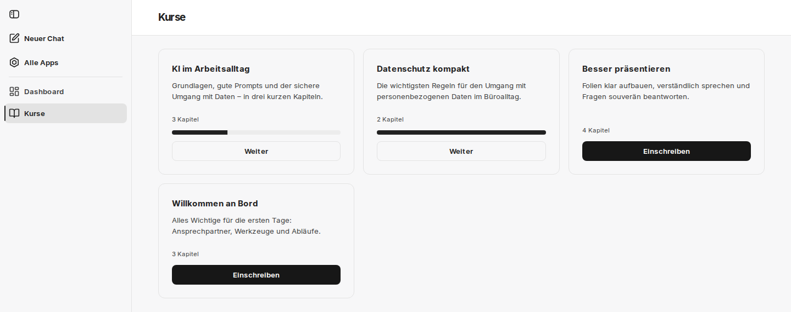
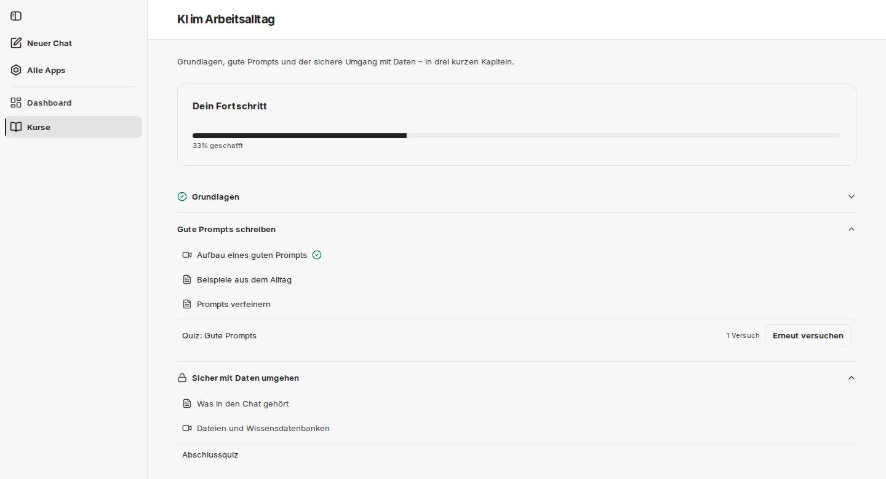
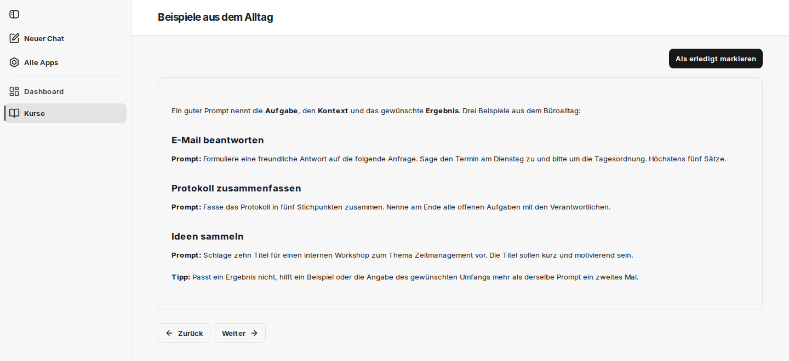
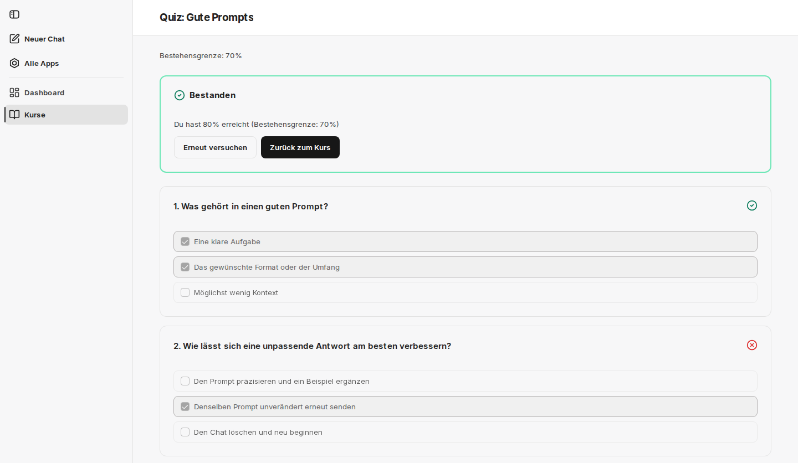
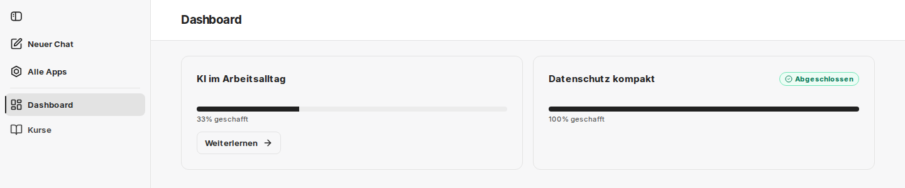

import { Steps } from '@astrojs/starlight/components';

Diese Seite beschreibt den Weg durch einen Kurs in der Oberfläche von companyLEARN. Dieselben Schritte können Sie auch im Chat erledigen – siehe [Im Chat](/de/company-gpt/addons/companylearn/im-chat/).

## Kurse finden

Unter **Kurse** sehen Sie alle veröffentlichten Kurse als Karten. Jede Karte zeigt den Titel, die Beschreibung und die Anzahl der Kapitel. Bei Kursen, in die Sie eingeschrieben sind, kommen ein Fortschrittsbalken und die Schaltfläche **Weiter** hinzu, die zur Kursseite führt.

Gibt es noch keine veröffentlichten Kurse, erscheint der Hinweis „Es sind noch keine Kurse verfügbar.“

## Einschreiben

Klicken Sie auf der Karte eines Kurses auf **Einschreiben**. Die Einschreibung gilt sofort; der Kurs erscheint danach im **Dashboard**, und die Karte zeigt **Weiter**.

Öffnen Sie einen Kurs, in den Sie noch nicht eingeschrieben sind – etwa über einen Link oder aus dem Chat –, zeigt die Kursseite unter **Dein Fortschritt** den Hinweis „Schreib dich ein, um den Kurs zu beginnen.“ und ebenfalls die Schaltfläche **Einschreiben**. Bis dahin lassen sich die Lektionen nicht öffnen.

## Die Kursseite

Die Kursseite zeigt oben **Dein Fortschritt** mit Balken und Prozentangabe. Darunter stehen die Kapitel als aufklappbare Liste mit ihren Lektionen – jeweils mit einem Symbol für Video oder Text – und gegebenenfalls dem Quiz des Kapitels.

| Anzeige | Bedeutung |
|---|---|
| Schloss am Kapitel | Das Kapitel ist gesperrt. Der Hinweis dazu lautet „Schließe zuerst das vorherige Kapitel ab“. Seine Lektionen lassen sich nicht öffnen. |
| Häkchen am Kapitel | Das Kapitel ist abgeschlossen. |
| Häkchen an einer Lektion | Die Lektion ist erledigt. |
| **Bestanden** am Quiz | Sie haben das Quiz bestanden. |
| „2 Versuche“ am Quiz | Anzahl Ihrer bisherigen Versuche |
| **Quiz starten** / **Erneut versuchen** | öffnet das Quiz – beim ersten Mal bzw. nach mindestens einem Versuch |

## Lektionen

Klicken Sie auf eine Lektion, um sie zu öffnen.

- **Textlektionen** zeigen den formatierten Text. Wenn Sie fertig sind, klicken Sie auf **Als erledigt markieren**.
- **Videolektionen** spielen das Video im Browser ab; Sie können vor- und zurückspulen. Läuft das Video bis zum Ende, markiert companyLEARN die Lektion automatisch als erledigt. Über **Als erledigt markieren** können Sie sie auch vorher abschließen.

Erledigte Lektionen zeigen oben **Abgeschlossen**. Mit **Zurück** und **Weiter** wechseln Sie zur vorherigen oder nächsten Lektion des Kurses, auch über Kapitelgrenzen hinweg. In der letzten Lektion eines Kapitels, das ein Quiz hat, erscheint zusätzlich **Quiz starten**.

Führt **Weiter** in ein Kapitel, das noch gesperrt ist, erscheint „Dieses Kapitel ist gesperrt. Schließe zuerst das vorherige Kapitel ab.“ und die Schaltfläche **Zurück zum Kurs**.

## Quiz

Sie öffnen ein Quiz über **Quiz starten** auf der Kursseite oder in der letzten Lektion des Kapitels. Unter dem Titel steht die Bestehensgrenze, zum Beispiel „Bestehensgrenze: 70%“.

<Steps>

1. Wählen Sie bei jeder Frage alle zutreffenden Antworten aus. Eine Frage kann mehrere richtige Antworten haben.

2. Sobald jede Frage beantwortet ist, klicken Sie auf **Antworten abschicken**.

3. Oben erscheint das Ergebnis: **Bestanden** oder **Nicht bestanden**, dazu eine Zeile wie „Du hast 80% erreicht (Bestehensgrenze: 70%)“. An jeder Frage zeigt ein Symbol, ob Sie sie richtig oder falsch beantwortet haben.

4. Mit **Erneut versuchen** beginnen Sie einen neuen Versuch, mit **Zurück zum Kurs** kehren Sie zur Kursseite zurück.

</Steps>

### So wird bewertet

- Eine Frage zählt nur dann als richtig, wenn genau die richtigen Antworten ausgewählt sind – nicht mehr und nicht weniger.
- Das Ergebnis ist der Anteil der richtig beantworteten Fragen in Prozent, gerundet auf ganze Zahlen.
- Erreicht das Ergebnis mindestens die Bestehensgrenze, ist das Quiz bestanden.

Die Bestehensgrenze legt der Kurs-Admin für jedes Quiz fest; beim Anlegen ist sie mit 70 % vorbelegt. Welche Antworten richtig gewesen wären, zeigt companyLEARN nicht an.

Die Zahl der Versuche ist nicht begrenzt. Unter **Bisherige Versuche** stehen alle Ihre Versuche mit Zeitpunkt, Ergebnis und Status. Ein einmal bestandenes Quiz bleibt bestanden, auch wenn ein späterer Versuch schlechter ausfällt.

Das Quiz eines freigeschalteten Kapitels können Sie jederzeit ablegen, auch bevor Sie alle Lektionen erledigt haben. Abgeschlossen ist das Kapitel aber erst, wenn beides erfüllt ist.

## Freischaltung der Kapitel

Ist die Kapitel-Sperre des Kurses eingeschaltet, gilt:

- Nach der Einschreibung ist das erste Kapitel offen.
- Ein Kapitel ist abgeschlossen, wenn alle seine Lektionen erledigt sind und sein Quiz bestanden ist – sofern es eines hat.
- Das erste noch nicht abgeschlossene Kapitel ist offen; alle Kapitel danach bleiben gesperrt, bis es abgeschlossen ist.

Hat der Kurs-Admin die Kapitel-Sperre für einen Kurs ausgeschaltet, sind nach der Einschreibung alle Kapitel offen.

Ändert ein Kurs-Admin einen laufenden Kurs – fügt er zum Beispiel einem Kapitel eine Lektion hinzu –, kann ein Kapitel, das Sie schon abgeschlossen hatten, wieder offen sein. Die Kapitel danach sind dann gesperrt, bis Sie es erneut abschließen.

## Dashboard

Das **Dashboard** ist die Startseite von companyLEARN. Für jeden Kurs, in den Sie eingeschrieben sind, zeigt es eine Karte mit Fortschrittsbalken und einer Angabe wie „40% geschafft“. Die Prozentzahl ist der Anteil der abgeschlossenen Kapitel.

- **Weiterlernen** führt direkt zum nächsten Schritt: zur ersten noch nicht erledigten Lektion oder – wenn alle Lektionen des aktuellen Kapitels erledigt sind – zu dessen Quiz.
- Abgeschlossene Kurse tragen die Markierung **Abgeschlossen**.

Sind Sie noch in keinem Kurs eingeschrieben, zeigt das Dashboard „Du bist noch in keinem Kurs eingeschrieben.“ und die Schaltfläche **Kurskatalog ansehen**.

Als Nächstes: [Im Chat](/de/company-gpt/addons/companylearn/im-chat/).
