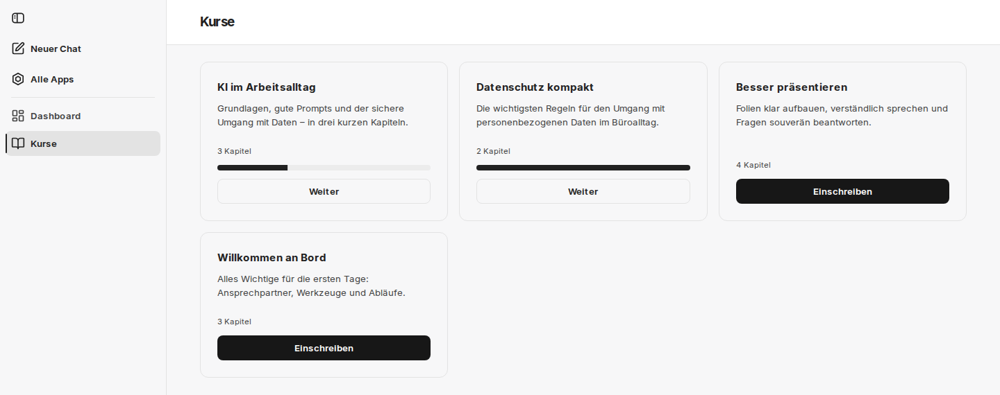
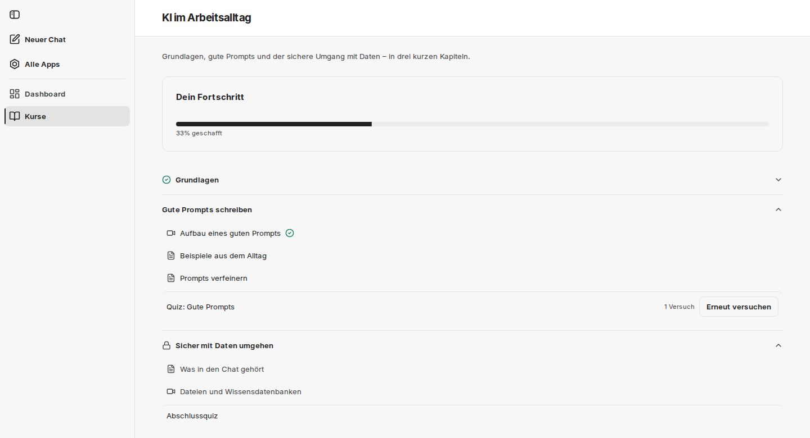
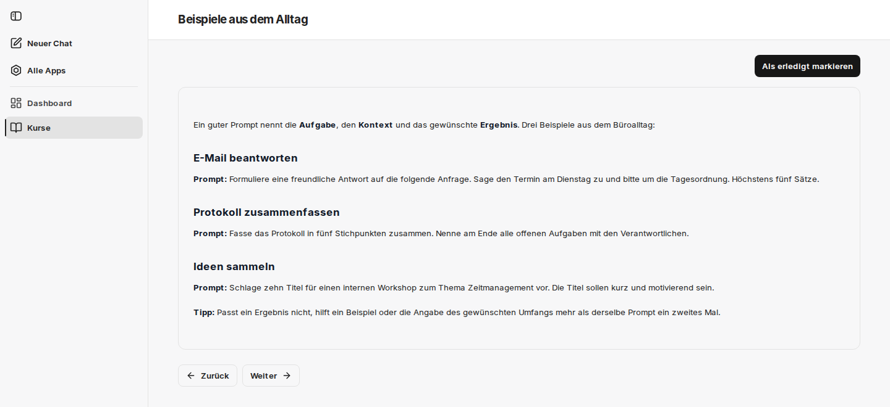
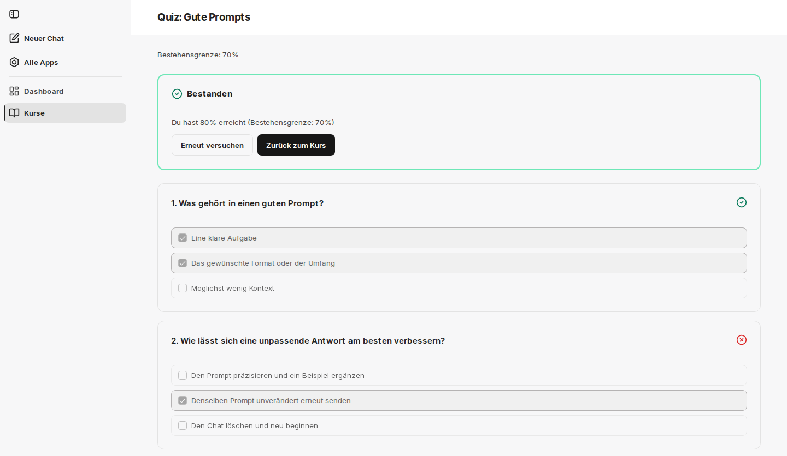
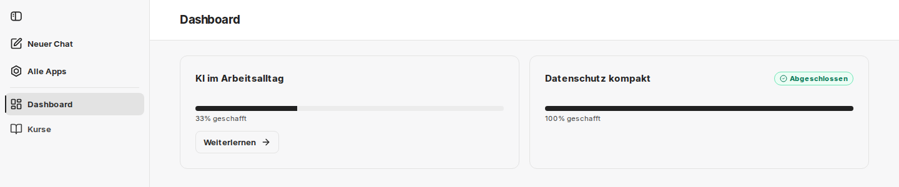

import { Steps } from '@astrojs/starlight/components';

Diese Seite beschreibt den Weg durch einen Kurs in der Oberfläche von companyLEARN. Dieselben Schritte können Sie auch im Chat erledigen – siehe [Im Chat](/de/company-gpt/addons/companylearn/im-chat/).

## Kurse finden

Unter **Kurse** sehen Sie alle veröffentlichten Kurse, in die Sie sich selbst einschreiben dürfen, als Karten. Jede Karte zeigt den Titel, die Beschreibung und die Anzahl der Kapitel. Kurse, die Ihnen zugewiesen wurden, tragen die Markierung **Zugewiesen**. Bei Kursen, in die Sie eingeschrieben sind, kommen ein Fortschrittsbalken und die Schaltfläche **Weiter** hinzu, die zur Kursseite führt.

Gibt es noch keine veröffentlichten Kurse, erscheint der Hinweis „Es sind noch keine Kurse verfügbar.“

## Zugewiesene Kurse

Ein Admin kann Ihnen einen Kurs zuweisen, zum Beispiel für eine Compliance-Schulung oder das Onboarding. Sie sind dann automatisch eingeschrieben, und der Kurs steht im **Dashboard** unter **Dir zugewiesen** ganz oben, jeweils mit Fortschritt und der Schaltfläche **Weiter**.

- Hat die Zuweisung eine Frist, steht an der Karte **Fällig bis …**. Ist die Frist verstrichen und der Kurs nicht abgeschlossen, erscheint **Überfällig seit …**. Eine Frist gilt bis zum Ende des Tages (Zeitzone Europe/Berlin).
- Sind Sie über mehrere Zuweisungen demselben Kurs zugeordnet, gilt die früheste Frist.
- Kurse, die ein Admin nicht zur Selbsteinschreibung freigegeben hat, fehlen im Katalog. Sie erscheinen für Sie erst, wenn sie Ihnen zugewiesen wurden.
- Wird eine Zuweisung zurückgenommen, bleiben Ihre Einschreibung und Ihr Fortschritt erhalten. Der Kurs ist dann nur nicht mehr verpflichtend und zählt nicht mehr als überfällig.

## Einschreiben

Klicken Sie auf der Karte eines Kurses auf **Einschreiben**. Die Einschreibung gilt sofort; der Kurs erscheint danach im **Dashboard**, und die Karte zeigt **Weiter**.

Öffnen Sie einen Kurs, in den Sie noch nicht eingeschrieben sind – etwa über einen Link oder aus dem Chat –, zeigt die Kursseite unter **Dein Fortschritt** den Hinweis „Schreib dich ein, um den Kurs zu beginnen.“ und ebenfalls die Schaltfläche **Einschreiben**. Bis dahin lassen sich die Lektionen nicht öffnen.

## Die Kursseite

Die Kursseite zeigt oben **Dein Fortschritt** mit Balken und Prozentangabe. Darunter stehen die Kapitel als aufklappbare Liste mit ihren Lektionen – jeweils mit einem Symbol für Video oder Text – und gegebenenfalls dem Quiz des Kapitels.

| Anzeige | Bedeutung |
|---|---|
| Schloss am Kapitel | Das Kapitel ist gesperrt. Der Hinweis dazu lautet „Schließe zuerst das vorherige Kapitel ab“. Seine Lektionen lassen sich nicht öffnen. |
| Häkchen am Kapitel | Das Kapitel ist abgeschlossen. |
| Häkchen an einer Lektion | Die Lektion ist erledigt. |
| **Bestanden** am Quiz | Sie haben das Quiz bestanden. |
| „2 Versuche“ am Quiz | Anzahl Ihrer bisherigen Versuche |
| **Quiz starten** / **Erneut versuchen** | öffnet das Quiz – beim ersten Mal bzw. nach mindestens einem Versuch |

## Lektionen

Klicken Sie auf eine Lektion, um sie zu öffnen.

- **Textlektionen** zeigen den formatierten Text. Wenn Sie fertig sind, klicken Sie auf **Als erledigt markieren**.
- **Videolektionen** spielen das Video im Browser ab; Sie können vor- und zurückspulen. Läuft das Video bis zum Ende, markiert companyLEARN die Lektion automatisch als erledigt. Über **Als erledigt markieren** können Sie sie auch vorher abschließen.

Erledigte Lektionen zeigen oben **Abgeschlossen**. Mit **Zurück** und **Weiter** wechseln Sie zur vorherigen oder nächsten Lektion des Kurses, auch über Kapitelgrenzen hinweg. In der letzten Lektion eines Kapitels, das ein Quiz hat, erscheint zusätzlich **Quiz starten**.

Führt **Weiter** in ein Kapitel, das noch gesperrt ist, erscheint „Dieses Kapitel ist gesperrt. Schließe zuerst das vorherige Kapitel ab.“ und die Schaltfläche **Zurück zum Kurs**.

Neben der Lektion zeigt die **Kursübersicht** den gesamten Kurs: Kapitel mit Lektionen und Quiz, erledigte und gesperrte Schritte und den aktuellen Schritt. **Zurück** und **Weiter** folgen der Reihenfolge der Kursübersicht und überspringen gesperrte Schritte. Auf schmalen Bildschirmen lässt sich die Kursübersicht ein- und ausblenden. Klicken Sie bei einer Textlektion, die Sie noch nicht als erledigt markiert haben, auf **Weiter** oder **Quiz starten**, markiert companyLEARN sie dabei als erledigt.

Unter einer Lektion stehen gegebenenfalls **Anhänge**, etwa PDFs oder Arbeitsblätter, die Sie herunterladen können.

## Quiz

Sie öffnen ein Quiz über **Quiz starten** auf der Kursseite oder in der letzten Lektion des Kapitels. Unter dem Titel steht die Bestehensgrenze, zum Beispiel „Bestehensgrenze: 70%“.

<Steps>

1. Wählen Sie bei jeder Frage alle zutreffenden Antworten aus. Eine Frage kann mehrere richtige Antworten haben.

2. Sobald jede Frage beantwortet ist, klicken Sie auf **Antworten abschicken**.

3. Oben erscheint das Ergebnis: **Bestanden** oder **Nicht bestanden**, dazu eine Zeile wie „Du hast 80% erreicht (Bestehensgrenze: 70%)“. An jeder Frage zeigt ein Symbol, ob Sie sie richtig oder falsch beantwortet haben.

4. Mit **Erneut versuchen** beginnen Sie einen neuen Versuch, mit **Zurück zum Kurs** kehren Sie zur Kursseite zurück.

</Steps>

### So wird bewertet

- Eine Frage zählt nur dann als richtig, wenn genau die richtigen Antworten ausgewählt sind – nicht mehr und nicht weniger.
- Das Ergebnis ist der Anteil der richtig beantworteten Fragen in Prozent, gerundet auf ganze Zahlen.
- Erreicht das Ergebnis mindestens die Bestehensgrenze, ist das Quiz bestanden.

Die Bestehensgrenze legt der Kurs-Admin für jedes Quiz fest; beim Anlegen ist sie mit 70 % vorbelegt. Unter **Bisherige Versuche** stehen alle Ihre Versuche mit Zeitpunkt, Ergebnis und Status. Ein einmal bestandenes Quiz bleibt bestanden, auch wenn ein späterer Versuch schlechter ausfällt.

### Regeln eines Quiz

Der Kurs-Admin kann für jedes Quiz zusätzliche Regeln festlegen:

- **Zufällige Fragen:** Sie bekommen nur eine Auswahl aus einem größeren Fragenpool. Die Auswahl bleibt für einen Versuch fest und wird genau darauf ausgewertet.
- **Gemischte Antworten:** Die Reihenfolge der Antwortoptionen ist pro Versuch gemischt.
- **Versuchslimit:** Die Anzeige „Versuch X von Y“ zeigt, wie viele Versuche Sie haben. Sind alle verbraucht, wenden Sie sich an die Kursverwaltung, die Ihre Versuche zurücksetzen kann. Ohne Limit sind beliebig viele Versuche möglich.
- **Wartezeit:** Nach einem nicht bestandenen Versuch kann eine Wartezeit gelten. Die Seite zeigt, ab wann Sie es erneut versuchen können.

### Auswertung

Nach dem Absenden zeigt die **Auswertung** zu jeder Frage, ob sie richtig war, die **Richtigen Antworten** und, falls hinterlegt, eine **Erklärung**. Vor dem Absenden sind die richtigen Antworten nie sichtbar.

Haben Sie ein Kapitel-Quiz bestanden und ist der nächste Schritt freigeschaltet, führt **Weiter: …** direkt dorthin. Sind im Kapitel noch Lektionen offen, nennt die Seite sie, denn das Kapitel ist erst abgeschlossen, wenn auch diese erledigt sind.

## Abschlussprüfung

Manche Kurse haben nach dem letzten Kapitel eine **Abschlussprüfung**. Sie ist erst freigeschaltet, wenn alle Kapitel abgeschlossen sind, und funktioniert wie ein Quiz (Fragenpool, Versuchslimit, Wartezeit, Auswertung mit Erklärungen). Sie starten sie mit **Prüfung starten** auf der Kursseite.

Hat ein Kurs eine Abschlussprüfung, gilt er erst als abgeschlossen, wenn Sie sie bestanden haben. Beim Fortschritt zählt sie als ein weiterer Schritt neben den Kapiteln.

Ein bereits abgeschlossener Kurs bleibt abgeschlossen, auch wenn ein Admin später Kapitel oder eine Prüfung ergänzt.

Das Quiz eines freigeschalteten Kapitels können Sie jederzeit ablegen, auch bevor Sie alle Lektionen erledigt haben. Abgeschlossen ist das Kapitel aber erst, wenn beides erfüllt ist.

## Freischaltung der Kapitel

Ist die Kapitel-Sperre des Kurses eingeschaltet, gilt:

- Nach der Einschreibung ist das erste Kapitel offen.
- Ein Kapitel ist abgeschlossen, wenn alle seine Lektionen erledigt sind und sein Quiz bestanden ist – sofern es eines hat.
- Das erste noch nicht abgeschlossene Kapitel ist offen; alle Kapitel danach bleiben gesperrt, bis es abgeschlossen ist.

Hat der Kurs-Admin die Kapitel-Sperre für einen Kurs ausgeschaltet, sind nach der Einschreibung alle Kapitel offen.

Ändert ein Kurs-Admin einen laufenden Kurs – fügt er zum Beispiel einem Kapitel eine Lektion hinzu –, kann ein Kapitel, das Sie schon abgeschlossen hatten, wieder offen sein. Die Kapitel danach sind dann gesperrt, bis Sie es erneut abschließen.

## Dashboard

Das **Dashboard** ist die Startseite von companyLEARN. Für jeden Kurs, in den Sie eingeschrieben sind, zeigt es eine Karte mit Fortschrittsbalken und einer Angabe wie „40% geschafft“. Die Prozentzahl ist der Anteil der abgeschlossenen Kapitel; hat der Kurs eine Abschlussprüfung, zählt sie als ein weiterer Schritt.

- **Weiterlernen** führt direkt zum nächsten Schritt: zur ersten noch nicht erledigten Lektion oder – wenn alle Lektionen des aktuellen Kapitels erledigt sind – zu dessen Quiz.
- Oben stehen die Ihnen zugewiesenen Kurse unter **Dir zugewiesen**, danach **Deine weiteren Kurse**.
- Beendete Kurse stehen unter **Abgeschlossen** mit dem Abschlussdatum und dem Link **Abschluss ansehen**.
- Nimmt die Kursverwaltung einen Kurs aus der Veröffentlichung, verschwindet er aus dem Dashboard. Ihr Fortschritt bleibt gespeichert.

Sind Sie noch in keinem Kurs eingeschrieben, zeigt das Dashboard „Du bist noch in keinem Kurs eingeschrieben.“ und die Schaltfläche **Kurskatalog ansehen**.

## Abschluss und Zertifikate

Wenn Sie den letzten Schritt erledigt haben (letzte Lektion, Kapitel-Quiz oder Abschlussprüfung), öffnet sich die **Abschlussseite** „Kurs abgeschlossen“. Sie zeigt das Abschlussdatum, **Deine Ergebnisse** zu jedem Quiz und zur Prüfung, den Download des Zertifikats (sofern der Kurs eines hat) und unter **Wie geht es weiter?** zuerst offene zugewiesene Kurse, dann weitere Kurse. Sie erreichen sie später über **Abschluss ansehen**.

Hat Ihre Umgebung Zertifikate eingerichtet, finden Sie im Menü **Meine Zertifikate**. Dort laden Sie jedes Zertifikat als PDF herunter, wahlweise **auf Deutsch oder auf Englisch**, sofern der Admin für die Sprache eine Vorlage hinterlegt hat. Die Zertifikatsnummer wird beim ersten Herunterladen vergeben.

:::note
Auf dem Zertifikat steht Ihr Name aus Ihrem Konto. Ist noch kein Name bekannt, schlägt der Download fehl; öffnen Sie dann CompanyGPT einmal über den Chat und versuchen es erneut. Hat ein Admin Ihre Einschreibung entfernt, ist das Zertifikat nicht mehr abrufbar.
:::

Als Nächstes: [Im Chat](/de/company-gpt/addons/companylearn/im-chat/).
