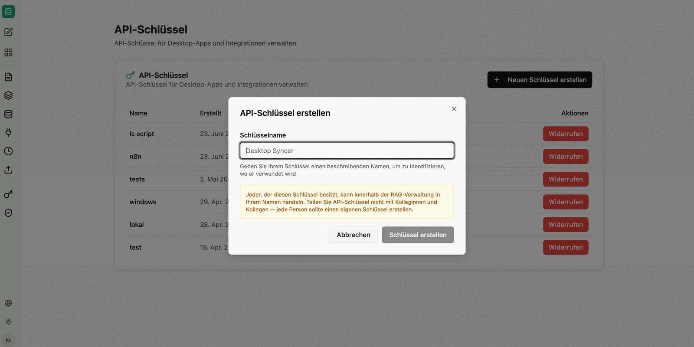

Unter **API-Schlüssel** erstellen und verwalten Administratoren Schlüssel, um andere Programme und eigene Tools sicher mit dem RAG-Service zu verbinden – etwa den [Windows Syncer](/de/company-gpt/addons/companyrag/#downloads), ein Skript, die [companyRAG API](/de/api/company-rag-api/) oder den Ingestion-Endpunkt einer [Datensatzsammlung](/de/company-gpt/addons/companyrag/datensaetze/).

Der Bereich erscheint nur für Administratoren von companyRAG (siehe [Rechte und Rollen](/de/company-gpt/addons/companyrag/#rechte-und-rollen)).

Die Übersicht zeigt:

- **Name**: Der frei gewählte Name des Schlüssels (z. B. „Intranet-Suche"), um ihn später zuzuordnen.
- **Erstellt** / **Zuletzt verwendet**: Wann der Schlüssel erstellt und wann er das letzte Mal genutzt wurde.
- **Status**: **Aktiv** oder **Widerrufen**.
- **Aktionen**: **Widerrufen** sperrt den Schlüssel sofort und unwiderruflich. Alle damit verknüpften Programme verlieren sofort den Zugriff.

## Schlüssel erstellen

1. **Neuen Schlüssel erstellen** wählen.
2. Im Dialog **API-Schlüssel erstellen** einen **Schlüsselname** vergeben und **Schlüssel erstellen** wählen.
3. Den Schlüssel im Dialog **API-Schlüssel erstellt** mit **Kopieren** übernehmen und an einem sicheren Ort ablegen.

Der Schlüssel beginnt mit `rag_` und wird nur einmalig direkt nach der Erstellung komplett angezeigt. Geht er verloren, erstellen Sie einen neuen.

## Nutzerbezogener Zugriff

Ein API-Schlüssel ist an die Person gebunden, die ihn erstellt hat, und handelt innerhalb der RAG-Verwaltung in deren Namen. Damit gelten für alle Aufrufe genau die Sammlungen und Berechtigungen dieser Person.

:::danger
Teilen Sie API-Schlüssel nicht mit Kolleginnen und Kollegen – jede Person und jedes System sollte einen eigenen Schlüssel erstellen. Andernfalls können über die Schnittstelle Inhalte zugänglich werden, die die empfangende Person selbst nicht sehen dürfte.
:::

Alle Erstellungen und Widerrufe werden im [Audit-Protokoll](/de/company-gpt/addons/companyrag/audit-protokoll/) aufgezeichnet. Die verfügbaren Endpunkte beschreibt die [companyRAG API-Referenz](/de/api/company-rag-api/).
