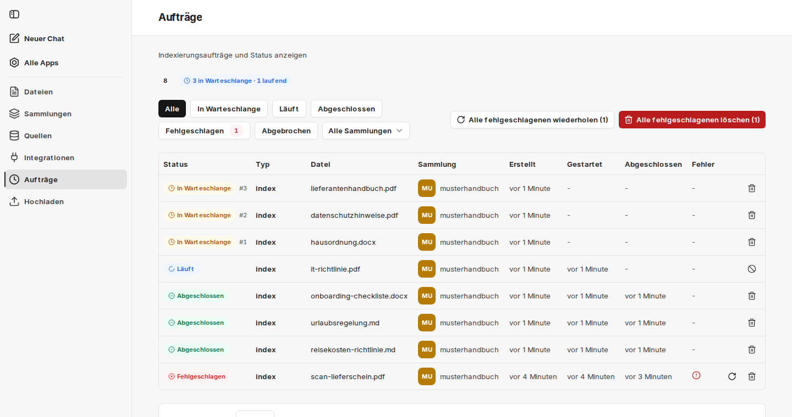

Unter **Aufträge** sehen Sie alle Indexierungs- und Synchronisationsvorgänge mit ihrem aktuellen Status. Jeder Upload und jeder Synchronisationslauf einer [Quelle](/de/company-gpt/addons/companyrag/quellen/) erzeugt Aufträge – ein Auftrag pro Datei.

Oben zeigt companyRAG, wie viele Aufträge in der Warteschlange stehen und wie viele gerade laufen. Die Zahl gilt über alle Sammlungen hinweg – auch Aufträge vor Ihren zählen mit. Wartende Aufträge tragen ihre Position in der Warteschlange (z. B. `#3`).

Die Liste lässt sich nach Status und nach Sammlung filtern. Je Auftrag werden **Typ** (z. B. `index`), **Datei**, **Sammlung** sowie die Zeitpunkte **Erstellt**, **Gestartet** und **Abgeschlossen** angezeigt; fehlgeschlagene Aufträge führen die Ursache in der Spalte **Fehler**.

Status:

- **In Warteschlange**: Das Dokument wird demnächst indexiert
- **Läuft**: Das Dokument wird gerade indexiert
- **Abgeschlossen**: Das Dokument wurde indexiert
- **Fehlgeschlagen**: Das Dokument konnte nicht indexiert werden. Weitere Informationen können der Spalte **Fehler** entnommen werden.
- **Abgebrochen**: Der Auftrag wurde abgebrochen

Aktionen je Auftrag:

- **Auftrag wiederholen**: bei fehlgeschlagenen Aufträgen, etwa nach einem behobenen Fehler.
- **Auftrag abbrechen**: bei laufenden Aufträgen. Teilweise hochgeladene Daten werden dabei bereinigt. Laufende Aufträge lassen sich nicht löschen, nur abbrechen.
- **Auftrag löschen**: Löscht den Auftrag aus der Warteschlange oder dem Verlauf. Status **Abgeschlossen** → indexierte Datei bleibt bestehen. Status **In Warteschlange** → die Datei wird nicht indexiert.

Gibt es fehlgeschlagene Aufträge, erscheinen zusätzlich **Alle fehlgeschlagenen wiederholen** und **Alle fehlgeschlagenen löschen**.

:::tip[Hinweis]
Große Dateien und aktivierte [Bildbeschreibung](/de/company-gpt/addons/companyrag/sammlungen/#bilder-beschreiben) verlängern die Laufzeit deutlich, da jede Seite zusätzlich an ein Vision-Modell gesendet wird. Reine Textdateien sind dagegen in Sekunden indexiert.
:::
