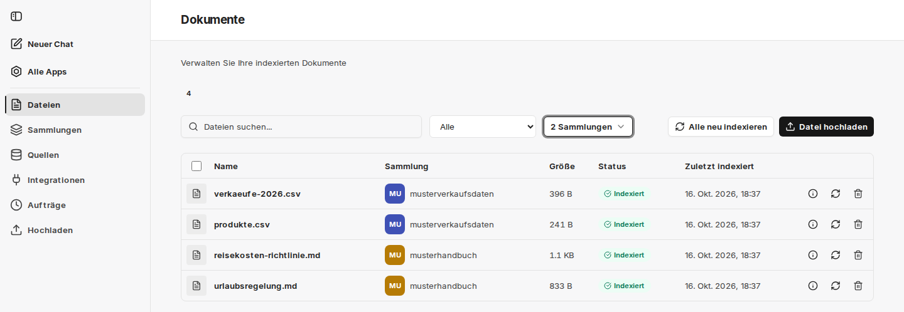

Unter **Dateien** sehen Sie alle Dateien, die dem Service hinzugefügt wurden – unabhängig davon, ob sie [manuell hochgeladen](/de/company-gpt/addons/companyrag/hochladen/) oder über eine [Quelle](/de/company-gpt/addons/companyrag/quellen/) synchronisiert wurden. Die Seite trägt den Titel **Dokumente**.

Die Übersicht enthält:

- **Name**: Dokumentenbezeichnung des Dokuments (teilweise gekürzt – Mouseover-Funktion für Vollanzeige)
- **Sammlung**: Die Sammlung, die der Datei zugewiesen wurde
- **Größe**: Dateigröße
- **Status**:
  - **Ausstehend**: Die Indexierung steht noch aus
  - **Indexiert**: Das Dokument wurde erfolgreich indexiert
  - **Indexiert (Warnung)**: Das Dokument ist für die Suche indexiert, ein nachgelagerter Schritt wie die [Extraktion strukturierter Daten](/de/company-gpt/addons/companyrag/strukturierte-daten/) ist aber fehlgeschlagen
  - **Fehlgeschlagen**: Indexierung nicht erfolgreich; der Grund erscheint beim Überfahren des Status
- **Zuletzt indexiert**: Datum und Zeit der letzten abgeschlossenen Indexierung
- **Aktionen**:
  - Info-Symbol: zeigt die Metadaten der Datei
  - **Neu indexieren**: Legt einen neuen Auftrag zur Indexierung an
  - **Löschen**: Löscht die Datei aus dem Service inklusive zugehöriger Aufträge und indexierter Form

## Suchen und filtern

Über der Liste durchsuchen Sie die Dateien, filtern nach Status und wählen über **Nach Sammlung filtern** eine oder mehrere Sammlungen aus.

## Mehrere Dateien bearbeiten

- **Ausgewählte löschen**: Markieren Sie Dateien über die Kontrollkästchen und löschen Sie sie gemeinsam.
- **Alle löschen**: Erscheint, sobald ein Statusfilter gesetzt ist, und löscht alle Dateien, die dem Filter entsprechen und für die Sie Löschrechte haben. Zur Bestätigung geben Sie `delete` ein.
- **Alle neu indexieren**: Indexiert alle Dateien in den Sammlungen neu, in denen Sie Administrator oder Besitzer sind. Zur Bestätigung geben Sie `index` ein. Der Vorgang kann lange dauern und lässt sich nach dem Start nicht stoppen.
- **Datei hochladen**: Wechselt zu [Hochladen](/de/company-gpt/addons/companyrag/hochladen/).

:::note
Wird eine Datei gelöscht, die über eine Quelle synchronisiert wurde, kann sie beim nächsten Synchronisationslauf erneut angelegt werden. Um Inhalte dauerhaft auszuschließen, passen Sie die [Quelle](/de/company-gpt/addons/companyrag/quellen/) an – etwa über ausgeschlossene Ordner.
:::

Den Fortschritt laufender Indexierungen sehen Sie unter [Aufträge](/de/company-gpt/addons/companyrag/auftraege/).
