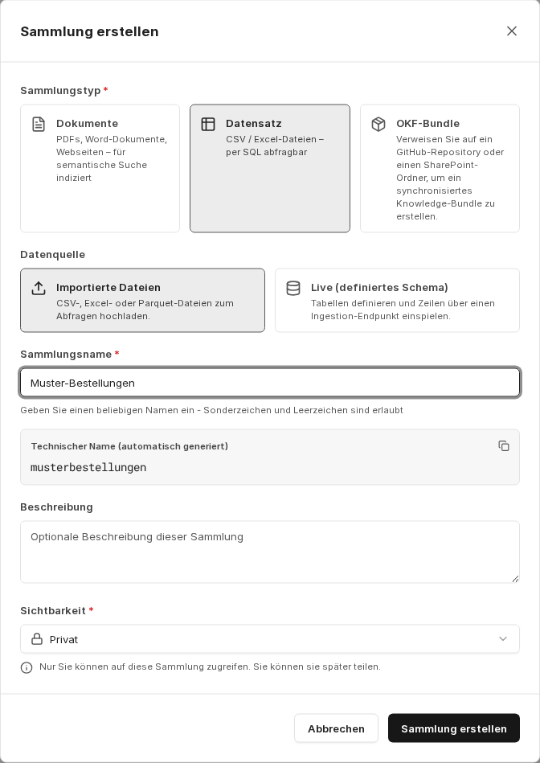
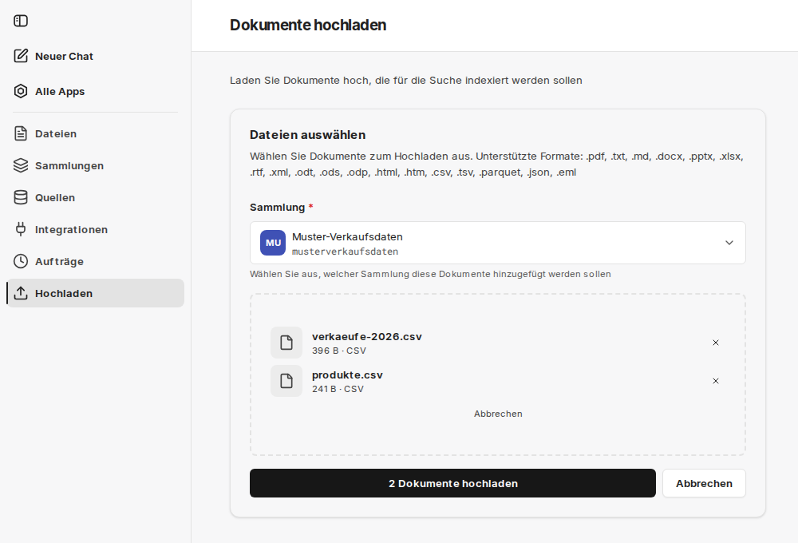
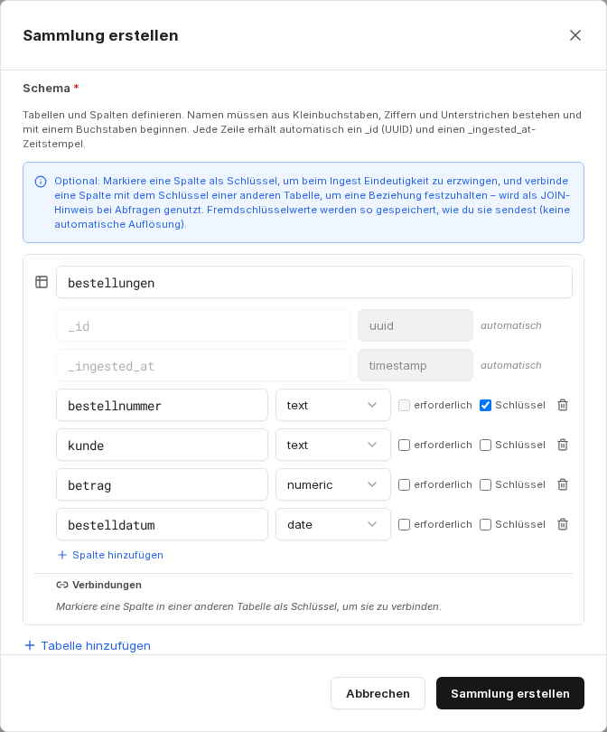

Datensatzsammlungen enthalten keine Dokumente, sondern Tabellen. Sie eignen sich für alles, was ohnehin tabellarisch vorliegt – Verkaufszahlen, Bestellungen, Stammdaten – und beantworten damit Fragen nach Summen, Mengen und Ranglisten, die eine semantische Suche nicht beantworten kann.

Beim [Erstellen der Sammlung](/de/company-gpt/addons/companyrag/sammlungen/#sammlung-erstellen) wählen Sie den Sammlungstyp **Datensatz** und anschließend die **Datenquelle**:

- **Importierte Dateien**: CSV-, Excel- oder Parquet-Dateien zum Abfragen hochladen.
- **Live (definiertes Schema)**: Tabellen definieren und Zeilen über einen Ingestion-Endpunkt einspielen.

## Importierte Dateien

Die Daten sollten immer in tabellarischer Form vorliegen. Beim [Hochladen](/de/company-gpt/addons/companyrag/hochladen/) werden CSV- und TSV-Dateien, Excel-Arbeitsmappen (`.xlsx`), OpenDocument-Tabellen (`.ods`) und Parquet-Dateien unterstützt; über eine Quelle zusätzlich Excel-Arbeitsmappen mit Makros (`.xlsm`). Möglich sind einzelne Tabellen ebenso wie mehrere zusammenhängende Tabellen, die gemeinsam über Joins abgefragt werden.

Bei Excel-Arbeitsmappen wird jedes Blatt, das sich laden lässt, zu einer eigenen Tabelle. Das alte Excel-Format `.xls` wird nicht unterstützt; speichern Sie solche Dateien in Excel als Arbeitsmappe (`.xlsx`) und laden Sie sie erneut hoch.

Der Import ist auch als [Quelle](/de/company-gpt/addons/companyrag/quellen/) möglich, etwa aus einem SharePoint-Ordner. Damit werden aktualisierte Dateien automatisch nachgezogen. Für Datensatzsammlungen synchronisiert eine Quelle nur tabellarische Dateien.

Das Schema einer importierten Datei sehen Sie unter [Dateien](/de/company-gpt/addons/companyrag/dateien/) über das Info-Symbol der Datei.

## Live definiertes Schema

Sie definieren Tabellen und Spalten mit Datentypen (`text`, `integer`, `numeric`, `boolean`, `timestamp`, `date`). Namen müssen aus Kleinbuchstaben, Ziffern und Unterstrichen bestehen und mit einem Buchstaben beginnen. Jede Zeile erhält automatisch `_id` (UUID) und `_ingested_at` (Zeitstempel).

Optional markieren Sie eine Spalte als **Schlüssel**, um beim Einspielen Eindeutigkeit zu erzwingen, und verbinden eine Spalte mit dem Schlüssel einer anderen Tabelle, um eine Beziehung festzuhalten. Diese Beziehung wird bei Abfragen als JOIN-Hinweis genutzt. Fremdschlüsselwerte werden so gespeichert, wie sie gesendet werden.

### Zeilen einspielen

Nach dem Erstellen steht ein Endpunkt pro Tabelle bereit. Die genauen URLs zeigt das Symbol **Ingestion-Anleitung** an der Sammlung.

Der Aufruf erwartet ein Objekt mit einem `rows`-Array; jedes Objekt darin entspricht einer Zeile. Pro Aufruf sind bis zu 10.000 Zeilen möglich, sodass ein Drittsystem die Tabelle fortlaufend befüllen kann. Die Antwort meldet mit Status `201`, wie viele Zeilen eingefügt (`inserted`) und abgelehnt (`rejected`) wurden, samt Fehlern (`errors`). Ein `DELETE` auf dieselbe URL leert die Tabelle.

Details zu Pfaden, Parametern und Antworten finden Sie in der [companyRAG API-Referenz](/de/api/company-rag-api/).

Für den Zugriff wird ein [API-Schlüssel](/de/company-gpt/addons/companyrag/api-schluessel/) einer Person benötigt, die Administrator oder Besitzer der Sammlung ist.

:::danger
Ein API-Schlüssel handelt immer im Namen der Person, die ihn erstellt hat. Wird er weitergegeben, kann die empfangende Person über die Schnittstelle auf Inhalte zugreifen, die sie selbst nicht sehen dürfte. Jede Person und jedes System sollte einen eigenen Schlüssel erhalten.
:::

## Abfragen

Datensatzsammlungen werden nicht über die Content-Suche, sondern über die SQL-Tools des MCP-Servers `ai-search` abgefragt. Ein Agent kann damit die verfügbaren Datensätze auflisten, das Schema lesen, Tabellen beschreiben und Abfragen über mehrere Tabellen mit Joins ausführen.

Welche Tools dafür aktiviert werden und welcher Prompt sich bewährt hat, beschreibt [companyRAG in CompanyGPT nutzen](/de/company-gpt/addons/companyrag/in-companygpt/).
