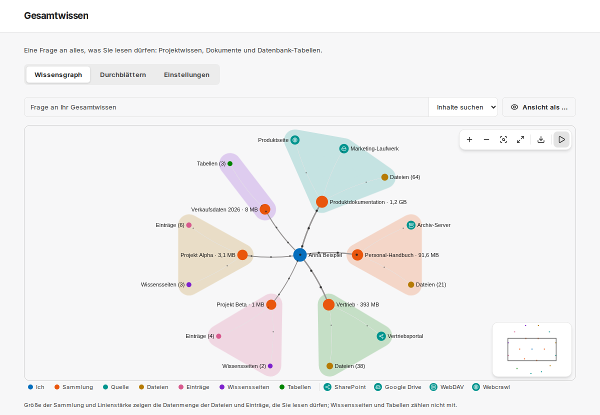

Das **Gesamtwissen** beantwortet eine Frage über alles, was Sie lesen dürfen: Seiten aus [Projekten](/de/company-gpt/addons/companyrag/projektwissen/), Dokumente aus Sammlungen sowie die Seiten und Hinweise zu Tabellen. Zeilen aus Tabellen zeigt es nie; dafür gibt es die [SQL-Tools](/de/company-gpt/addons/companyrag/in-companygpt/#sql-tools-für-datensätze-und-strukturierte-daten).

Das Gesamtwissen erscheint in der Navigation von companyRAG über **Dokumente**; mit eingeschaltetem Projektwissen öffnet die Startseite den Wissensgraphen. Es hat die Reiter **Wissensgraph**, **Durchblättern** und **Einstellungen**. Ein Administrator kann das Gesamtwissen mit dem Projektwissen ausschalten (siehe [Projektwissen](/de/company-gpt/addons/companyrag/projektwissen/#admin-einstellungen)).

## Was durchsucht wird

- Sammlungen, die Ihnen gehören oder mit Ihnen geteilt wurden, sind enthalten. Unter **Einstellungen** nehmen Sie eine Sammlung mit dem Schalter **Im Gesamtwissen** heraus (stummgeschaltet). Eine stummgeschaltete Sammlung bleibt direkt durchsuchbar.
- **Öffentliche Sammlungen** anderer sind nur enthalten, wenn Sie sie unter **Öffentliche Sammlungen** aufnehmen. Bis dahin sind sie nur verfügbar.
- Die Suche in einem Projekt umfasst das Projekt und die mit ihm verknüpften Sammlungen, jede nur, sofern Sie sie selbst lesen dürfen.
- Die Treffer sind nach Relevanz sortiert. Antwortet eine Sammlung nicht rechtzeitig, wird sie als übersprungen benannt.
- Über das Sammlungsmenü grenzen Sie die Suche auf einzelne Sammlungen ein; ein Suchfeld auf jeder Sammlungsseite sucht nur in dieser einen Sammlung.

Das Gesamtwissen zeigt nie mehr, als die Quellen erlauben: Sammlungsrechte und die [Berechtigungen einzelner Dateien](/de/company-gpt/addons/companyrag/quellen/#berechtigungen) gelten für jeden Treffer.

## Wissensgraph

Der **Wissensgraph** ist die Landkarte Ihres Wissens. Er zeigt nur, was Sie jetzt lesen dürfen: Knoten, Beschriftungen, Zahlen und Verbindungen gibt es ausschließlich für Inhalte mit Leserecht.

### Ihre Sicht (Ego-Graph)

In der Standardansicht stehen **Sie** („Ich“) in der Mitte:

1. Im ersten Ring liegen die Sammlungen, die Sie lesen dürfen, jeweils mit Ihrer Rolle (**Betrachter**, **Bearbeiter**, **Owner**). Stummgeschaltete Sammlungen sind markiert statt ausgeblendet.
2. Im zweiten Ring folgen die Quellen jeder Sammlung sowie Sammelknoten für **Einträge**, **Wissensseiten**, **Tabellen** und **Dateien**. Ein Klick auf einen Sammelknoten lädt seine Elemente seitenweise nach; nichts wird abgeschnitten.

Die Größe einer Sammlung und die Linienstärke zeigen die Datenmenge der Dateien und Einträge, die Sie lesen dürfen. Wissensseiten und Tabellen zählen nicht mit. Die Legende filtert nach Art und Quellenart.

### Eine Sammlung im Mittelpunkt

Auf der Seite **Wissen** einer Sammlung zeigt der Graph die Sammlung in der Mitte mit ihren Quellen, Einträgen, Seiten und Tabellen. Eine Sammlung, die Sie nicht lesen dürfen, gibt es dort nicht.

### Suchen und Bedienen

- Das Suchfeld führt die echte Gesamtwissen-Suche aus (ab drei Zeichen, **Enter** sucht sofort, **Escape** leert). Treffer erscheinen im Graph samt Pfad von der Sammlung über die Quelle zum Treffer; die Liste zeigt fünf Zeilen und **Alle anzeigen**. Alternativ filtern Sie nach Namen.
- Die Werkzeugleiste bietet Zoom, Einpassen, Vollbild, PNG-Export, **Stumme ausblenden** und Animation. Bei der Einstellung „Bewegung reduzieren“ Ihres Systems pausiert die Animation.
- Zu jedem Knoten zeigt die Seitenleiste Details und Aktionen. Eine Liste unter dem Graph enthält dieselben Knoten als Links.

### Zugriffsübersicht für Administratoren

Globale Administratoren sehen unter **Ansicht als …**, welche Sammlungen eine Person mit welcher Rolle und über welchen Weg erreicht – ohne Inhalte. Sammlungen, die der Administrator selbst nicht lesen darf, erscheinen nur als „Sammlung ohne Ihre Leserechte“ mit Rolle und Weg, ohne Name und Zahlen. Jede Ansicht wird protokolliert; ein Link auf die Ansicht einer Person lädt erst nach Ihrer Bestätigung.
