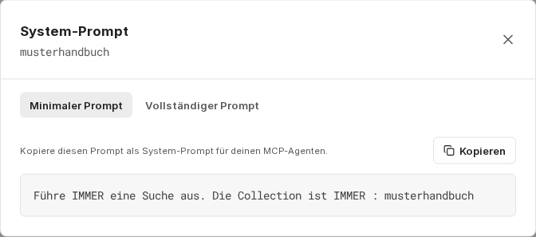
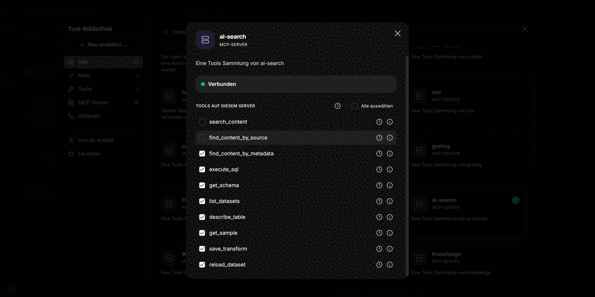
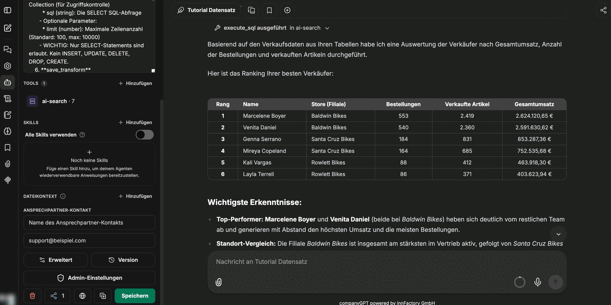

Über den [MCP Server](/de/company-gpt/integrationen/mcp-server/) `ai-search` lässt sich der RAG-Service mit CompanyGPT verbinden, um indexierte Dokumente über alle dem Nutzer zur Verfügung stehenden Sammlungen zu durchsuchen (s. [Ähnlichkeitssuche](/de/prompt-engineering/prompt-techniken/rag/#rag-workflow-für-die-dateiverarbeitung)). Die Ergebnisse berücksichtigen dabei immer die Berechtigungen des fragenden Nutzers – bei SharePoint-Quellen auch die Berechtigungen auf Dokumentebene.

Der MCP Server kann für einen erleichterten Umgang einem [Agenten](/de/company-gpt/agenten/) hinzugefügt werden.

## Beispiel-Prompt aus der Sammlung

Jede Sammlung stellt einen vorbereiteten **System-Prompt** bereit, in dem der technische Name der Sammlung bereits eingetragen ist. Sie erreichen ihn über das Terminal-Symbol an der Sammlung und übernehmen ihn mit **Kopieren** direkt in Ihren Agenten. Bei Datensatzsammlungen ist der Prompt auf einen Datenanalyse-Agenten mit den SQL-Tools zugeschnitten.

- **Minimaler Prompt**: Kurze Anweisung, die vor allem sicherstellt, dass der Agent immer sucht und die richtige Sammlung verwendet.
- **Vollständiger Prompt**: Ausführliche Variante, die zusätzlich das Antwortformat und die Quellenangaben vorgibt. Sie standardisiert die Ausgaben und erhöht die Qualität der Antworten deutlich.

:::tip[Hinweis]
Beginnen Sie mit dem vollständigen Prompt. Ohne Formatvorgabe fallen die Antworten knapp aus und enthalten keine Quellen.
:::

## Tools auswählen

Beim Agenten wird der MCP-Server `ai-search` hinzugefügt; anschließend aktivieren Sie die Tools, die zum Typ der Sammlung passen.

In allen Tools steht `collection` für den technischen Namen der Sammlung. Tragen Sie ihn im Prompt fest ein, damit der Agent immer die richtige Sammlung abfragt. Außer bei `list_datasets` lehnt companyRAG einen Tool-Aufruf ohne `collection` ab.

Hat die Person, die gerade chattet, keinen Zugriff auf die abgefragte Sammlung, erhält der Agent die Meldung „Kein Zugriff auf Collection '…' – bitte an eine Person mit Berechtigung wenden.“ und versucht es nicht erneut. Den Zugriff gibt ein Besitzer der Sammlung über **Sammlung teilen** frei (siehe [Sammlungen](/de/company-gpt/addons/companyrag/sammlungen/#sammlung-teilen)).

### Content-Such-Tools für Dokumentensammlungen

1. **search_content**:
   Suche für allgemeine Anfragen. Standardwahl für die meisten Nutzerfragen.
   Erforderliche Parameter: `query` (Suchtext), `collection` (technischer Name der Sammlung)
   Optional: `topK` (Anzahl Ergebnisse: Standard 5, max. 20), `searchMode` (`similarity` = semantische Suche, Standard; `keyword` = Volltextsuche; `hybrid` = beides kombiniert), `filter` (Metadaten-Filter, Aufbau wie bei `find_content_by_metadata`)

2. **find_content_by_source**:
   Abrufen aller Inhalte aus einem spezifischen Dokument. Nutzen bei Anfragen zu einzelnen Dokumenten (z. B. „Was steht in Dokumentation.md?").
   Erforderliche Parameter: `source` (Dokumentname), `collection` (technischer Name der Sammlung)

3. **find_content_by_metadata**:
   Filterung von Inhalten nach Metadaten-Attributen. Nutzen bei gefilterten Ergebnissen (z. B. „Alle dringenden Aufgaben von 2026").
   Erforderliche Parameter: `filter` (JSON-Objekt mit den logischen Operatoren `$and`, `$or`, `$not`, den Vergleichsoperatoren `$eq`, `$ne`, `$gt`, `$gte`, `$lt`, `$lte` oder direkten Schlüssel-Wert-Paaren), `collection` (technischer Name der Sammlung)

### SQL-Tools für Datensätze und strukturierte Daten

Für [Datensatzsammlungen](/de/company-gpt/addons/companyrag/datensaetze/) werden die SQL-basierten Tools aktiviert. Für Dokumentensammlungen mit [strukturierten Daten aus Dokumenten](/de/company-gpt/addons/companyrag/strukturierte-daten/) oder mit der Option [Tabellen als Datensätze](/de/company-gpt/addons/companyrag/sammlungen/#tabellen-als-datensätze) werden die SQL-Tools zusätzlich zu den Content-Such-Tools aktiviert. Außer bei `list_datasets` ist `collection` bei allen SQL-Tools erforderlich; darüber prüft companyRAG den Zugriff.

| Tool | Erforderlich | Optional | Zweck |
|---|---|---|---|
| **list_datasets** | – | – | Listet alle für Sie verfügbaren Datensatzsammlungen mit ihren Tabellennamen auf. Bei Excel-Arbeitsmappen mit mehreren Blättern sind Blatt und Datei angegeben. |
| **get_schema** | `collection` | `dataset` (Tabellenname; weglassen = alle Tabellen der Sammlung) | Liest das Schema einer Tabelle oder listet die Tabellen einer Sammlung. |
| **describe_table** | `collection`, `table` | `sample_rows` (Standard 5, max. 50) | Schema und Beispielzeilen einer Tabelle. |
| **get_sample** | `collection`, `table` | `rows` (Standard 10, max. 1000), `random` | Beispielzeilen einer Tabelle, optional zufällig ausgewählt. |
| **execute_sql** | `collection`, `sql` | `limit` (Standard 100, max. 10000) | Führt eine lesende SQL-Abfrage über die Tabellen der Sammlung aus. |
| **save_transform** | `collection`, `table`, `query` | – | Speichert eine SELECT-Abfrage als Bereinigung einer Tabelle. companyRAG legt daraus eine Sicht `<tabelle>_clean` an, die bei jedem weiteren Laden automatisch angewendet wird. |
| **reload_dataset** | `collection`, `table` | – | Lädt eine Tabelle neu, etwa nachdem eine Datei erneut hochgeladen wurde. |

`execute_sql` und `save_transform` erlauben ausschließlich eine einzelne SELECT-Abfrage, optional mit vorangestellten `WITH`-Klauseln. Schreibende Anweisungen wie `INSERT`, `UPDATE`, `DELETE`, `DROP` oder `CREATE` werden abgelehnt. Zeilen werden ausschließlich über den Ingestion-Endpunkt einer Datensatzsammlung eingespielt.

Die SQL-Tools stehen nur zur Verfügung, wenn Ihre Umgebung die Datensatz-Abfrage bereitstellt; sonst zeigt `ai-search` nur die drei Content-Such-Tools.

:::note[Nicht in allen Umgebungen verfügbar]
Ob diese Funktion in Ihrer Umgebung zur Verfügung steht, legt Ihr Unternehmen fest. Wenden Sie sich bei Fragen an Ihren Administrator.
:::

Die vollständige Beschreibung jedes Tools zeigt das Info-Symbol in der Tool-Bibliothek.

## Antworten mit Quellen

Im Verlauf sind die verwendeten Chunks einsehbar, sodass nachvollziehbar bleibt, worauf eine Antwort beruht. Gibt der Prompt Quellenangaben vor, führt der Agent die genutzten Dokumente zusätzlich am Ende der Antwort auf.

:::note
Eine klickbare Quellverlinkung auf die Originaldatei entsteht nur bei Dokumenten, die über eine [Quelle](/de/company-gpt/addons/companyrag/quellen/) synchronisiert wurden – etwa aus SharePoint. Bei manuell hochgeladenen Dateien wird die Quelle benannt, aber nicht verlinkt.
:::

Bei Datensatzsammlungen führt der Agent die Abfrage aus und stellt das Ergebnis als Tabelle dar – auch über mehrere Tabellen mit Joins.

:::tip[Hinweis]
Achten Sie darauf, dass im Prompt die richtige Sammlung eingetragen ist. Zeigt ein Agent auf eine andere Sammlung, bleibt die Antwort leer oder unpassend, obwohl die Daten vorhanden sind.
:::

Eine Schritt-für-Schritt-Anleitung zum Einrichten eines Such-Agenten mit passender Anweisung finden Sie im Tutorial **[companyRAG in CompanyGPT nutzen](/de/tutorials/addons/companyrag-in-companygpt/).**
