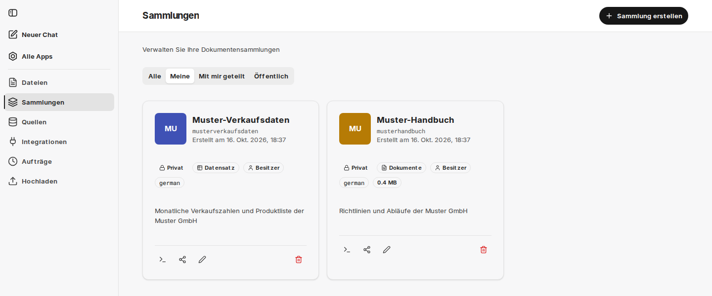

Mit dem companyRAG Addon können Sie große Mengen an Dokumenten für Ihre Agenten über die MCP-Schnittstelle verfügbar machen. Die Dokumente können aus unterschiedlichen Quellen indexiert werden und über die [RAG - Retrieval Augmented Generation](/de/prompt-engineering/prompt-techniken/rag/)-Methodik integriert werden.

Die Indexierung kann hierbei einmalig oder wiederkehrend, basierend auf Ihrem Anwendungsfall, implementiert werden. Neben der klassischen semantischen Suche kann companyRAG aus denselben Dokumenten auch [strukturierte Daten extrahieren](/de/company-gpt/addons/companyrag/strukturierte-daten/) und [tabellarische Datensätze](/de/company-gpt/addons/companyrag/datensaetze/) per SQL abfragbar machen.

companyRAG liest Inhalte aus den angebundenen Systemen nur. In SharePoint, Google Drive oder andere Quellsysteme wird nicht zurückgeschrieben. Die einzige Ausnahme sind [OKF-Bundles](/de/company-gpt/addons/companyrag/okf-bundles/), deren Markdown-Dateien in einem GitHub-Repository oder SharePoint-Ordner gepflegt werden.

## companyRAG öffnen

Sie öffnen companyRAG über [Alle Apps](/de/company-gpt/addons/alle-apps/) mit der Kachel **Wissen** oder direkt unter `https://FIRMA.company-gpt.com/companygpt/rag`. Die Anmeldung erfolgt in der Regel über Ihre bestehende CompanyGPT-Sitzung; in einzelnen Umgebungen melden Sie sich direkt in companyRAG über **Mit Microsoft anmelden** an. Hat Ihr Konto keinen Zugriff auf companyRAG, erscheint statt der Oberfläche ein Hinweis **Kein Zugriff**. Wenden Sie sich dann an Ihren Administrator.

## Arten von Sammlungen

Alle Inhalte in companyRAG liegen in Sammlungen. Den Typ wählen Sie beim [Erstellen der Sammlung](/de/company-gpt/addons/companyrag/sammlungen/#sammlung-erstellen) unter **Sammlungstyp**. Er entscheidet, wie die Inhalte abgelegt und abgefragt werden, und ist in der Übersicht als Badge an jeder Sammlung sichtbar.

| Typ | Inhalt | Abfrage |
|---|---|---|
| **Dokumente** | Dokumente aus Upload, SharePoint, Nextcloud, Google Drive, GitHub, WebDAV, FTP oder Web-Crawl | Semantische Suche und Volltextsuche; optional zusätzlich [strukturierte Felder](/de/company-gpt/addons/companyrag/strukturierte-daten/) |
| **Datensatz** | Tabellen aus CSV-, Excel- und Parquet-Dateien oder über einen Ingestion-Endpunkt | SQL-Abfragen über eine oder mehrere Tabellen, inklusive Joins |
| **OKF-Bundle** | Markdown-Wissenssammlungen im [Open Knowledge Format](/de/company-gpt/addons/companyrag/okf-bundles/) in GitHub oder SharePoint | Wie eine Dokumentensammlung |

## companyRAG-Benutzeroberfläche

companyRAG nutzt die [gemeinsame Oberfläche der CompanyGPT-Addons](/de/company-gpt/addons/gemeinsame-oberflaeche/): links die Seitenleiste mit **Neuer Chat** und **Alle Apps**, darunter die Bereiche von companyRAG und unten Ihr Konto mit Design und Sprache. Die Oberfläche steht auf Deutsch und Englisch zur Verfügung.

Die Seitenleiste von companyRAG enthält folgende Bereiche:

- [Dateien](/de/company-gpt/addons/companyrag/dateien/) – alle indexierten Dateien mit Status
- [Sammlungen](/de/company-gpt/addons/companyrag/sammlungen/) – Speicherorte für Dokumente und Berechtigungen
- [Quellen](/de/company-gpt/addons/companyrag/quellen/) – automatische Synchronisation aus angebundenen Systemen
- [Integrationen](/de/company-gpt/addons/companyrag/integrationen/) – Verbindungen zu SharePoint, Nextcloud, Google Drive, WebDAV, FTP, GitHub und Webcrawl
- [Aufträge](/de/company-gpt/addons/companyrag/auftraege/) – Indexierungsaufträge und deren Status
- [Hochladen](/de/company-gpt/addons/companyrag/hochladen/) – einzelne und mehrere Dateien manuell indexieren

Unter einer Trennlinie folgen die Bereiche für die Verwaltung:

- [API-Schlüssel](/de/company-gpt/addons/companyrag/api-schluessel/) *(nur für Administratoren)*
- [Audit-Protokoll](/de/company-gpt/addons/companyrag/audit-protokoll/) *(nur für Superadmins)*

## Rechte und Rollen

Was Sie in einer Sammlung tun dürfen, hängt von Ihrer Rolle in dieser Sammlung ab (**Betrachter**, **Administrator** oder **Besitzer**, siehe [Sammlungen](/de/company-gpt/addons/companyrag/sammlungen/#sammlung-teilen)). Darüber hinaus gibt es drei Rechte für companyRAG insgesamt:

| Recht | Bedeutung |
|---|---|
| Nutzen | companyRAG öffnen und die Sammlungen durchsuchen, auf die Sie Zugriff haben. |
| Administrator | Zusätzlich [API-Schlüssel](/de/company-gpt/addons/companyrag/api-schluessel/) erstellen und widerrufen. Inhalte von Sammlungen pflegen Sie weiterhin über die Rolle in der jeweiligen Sammlung. |
| Superadmin | Zusätzlich alle Sammlungen der Organisation sehen und verwalten sowie das [Audit-Protokoll](/de/company-gpt/addons/companyrag/audit-protokoll/) einsehen. Die Dateien fremder Sammlungen kann auch ein Superadmin nicht lesen. |

Wer welches Recht erhält, legt Ihr Unternehmen fest. Steuert Ihre Umgebung den Zugriff über companyADMIN, vergeben Administratoren die Rechte dort unter [Erweiterungen](/de/company-gpt/addons/companyadmin/erweiterungen/) als **Wissen nutzen**, **RAG-Einstellungen verwalten** und **Superadmin**. Das Recht **Superadmin** wird nie automatisch vergeben, auch nicht an Administratoren.

## Weiterführende Themen

- [Strukturierte Daten aus Dokumenten](/de/company-gpt/addons/companyrag/strukturierte-daten/) – typisierte Felder aus wiederkehrenden Dokumentenarten extrahieren
- [Datensatzsammlungen](/de/company-gpt/addons/companyrag/datensaetze/) – Tabellen importieren oder live über einen Endpunkt befüllen
- [OKF-Bundles](/de/company-gpt/addons/companyrag/okf-bundles/) – Wissenssammlungen als Markdown in GitHub oder SharePoint
- [companyRAG in CompanyGPT nutzen](/de/company-gpt/addons/companyrag/in-companygpt/) – MCP-Server `ai-search`, Tools und Agenten
- [companyRAG API](/de/api/company-rag-api/) – programmatischer Zugriff auf Dateien, Sammlungen, Aufträge und Quellen

## Downloads

- [companyRAG Windows Syncer 2.6.2](/downloads/companyRAG-syncer-windows-v2.6.2.zip)
