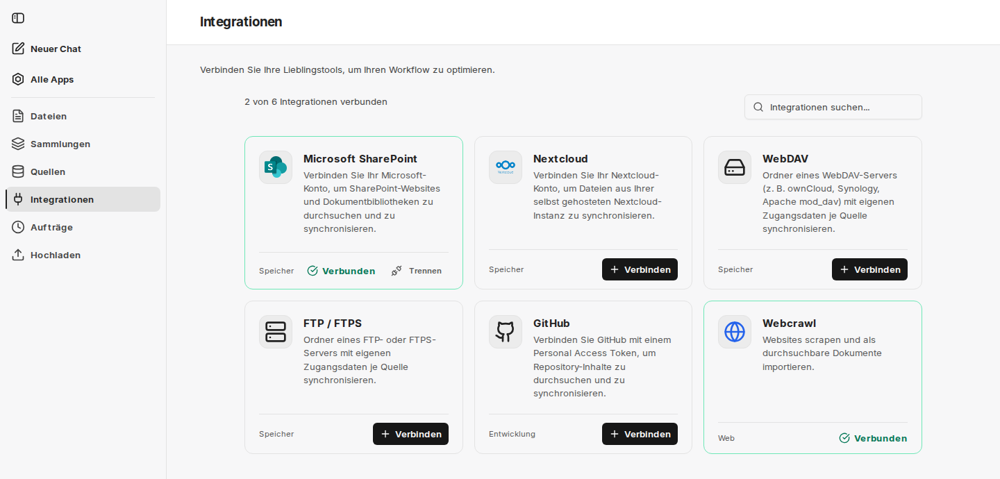

Integrationen sind die Verbindungen zu den Drittsystemen, aus denen companyRAG Dokumente beziehen kann. Eine Integration wird einmal verbunden und anschließend von beliebig vielen [Quellen](/de/company-gpt/addons/companyrag/quellen/) genutzt.

Über alle Integrationen liest companyRAG Inhalte nur. Es schreibt nichts in die verbundenen Systeme zurück – mit Ausnahme von [OKF-Bundles](/de/company-gpt/addons/companyrag/okf-bundles/) in GitHub oder SharePoint.

Die Übersicht zeigt je Integration den Namen, die Kategorie (**Speicher**, **Entwicklung**, **Web**) und den Verbindungsstatus sowie oben, wie viele Integrationen verbunden sind. Über **Verbinden** stellen Sie eine Verbindung her, über **Trennen** lösen Sie sie wieder.

## Verfügbare Integrationen

| Integration | Zweck | Authentifizierung |
|---|---|---|
| **Microsoft SharePoint** | SharePoint-Websites und Dokumentbibliotheken durchsuchen und synchronisieren | Anmeldung mit dem Microsoft-Konto |
| **Nextcloud** | Dateien aus einer selbst gehosteten Nextcloud-Instanz synchronisieren | URL, Benutzername und App-Passwort |
| **Google Drive** | Dateien aus „Meine Ablage", geteilten Ablagen und für Sie freigegebenen Dateien synchronisieren | Anmeldung mit dem Google-Konto |
| **WebDAV** | Ordner eines WebDAV-Servers synchronisieren, z. B. ownCloud, Synology oder Apache mod_dav | Zugangsdaten je Quelle |
| **FTP / FTPS** | Ordner eines FTP- oder FTPS-Servers synchronisieren | Zugangsdaten je Quelle |
| **GitHub** | Repository-Inhalte durchsuchen und synchronisieren | Personal Access Token (fine-grained) mit Lesezugriff |
| **Webcrawl** | Websites scrapen und als durchsuchbare Dokumente importieren | Keine Anmeldung erforderlich |

Bei **WebDAV** und **FTP / FTPS** gibt es keine Verbindung auf Kontoebene: **Verbinden** öffnet direkt den Dialog für eine neue Quelle, und die Karte gilt als verbunden, sobald es mindestens eine Quelle dieses Typs gibt. **Webcrawl** stellt Ihre Umgebung bereit; Sie müssen es nicht verbinden. Auch GitHub kann von Ihrer Umgebung bereits verbunden sein; dann lässt sich die Verbindung nicht trennen.

:::note[Nicht in allen Umgebungen verfügbar]
Ob diese Funktion in Ihrer Umgebung zur Verfügung steht, legt Ihr Unternehmen fest. Wenden Sie sich bei Fragen an Ihren Administrator.
:::

Integrationen, die in Ihrer Umgebung nicht eingerichtet sind, blendet companyRAG aus.

:::note
Wird eine Integration getrennt, bleiben bereits importierte Dateien in den Sammlungen erhalten, werden jedoch nicht mehr automatisch aktualisiert. Läuft eine Anmeldung ab, verbinden Sie die Integration erneut, um die Synchronisation fortzusetzen.
:::

Ist eine Integration verbunden, legen Sie den konkret zu synchronisierenden Ordner, das Repository oder die Sitemap unter [Quellen](/de/company-gpt/addons/companyrag/quellen/) an. GitHub und SharePoint dienen zusätzlich als Speicherort für [OKF-Bundles](/de/company-gpt/addons/companyrag/okf-bundles/).
