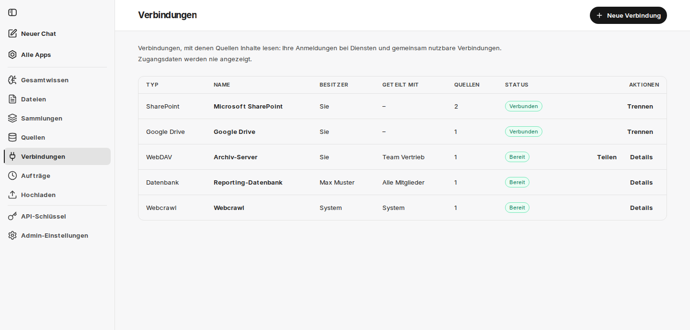

Verbindungen sind die Zugänge zu den Drittsystemen, aus denen companyRAG Dokumente bezieht. Zugangsdaten gehören der **Verbindung**, nicht der [Quelle](/de/company-gpt/addons/companyrag/quellen/): Die Quelle legt nur fest, was gelesen wird. Eine Verbindung wird einmal angelegt und von beliebig vielen Quellen genutzt. Zugangsdaten werden nach dem Speichern nie wieder angezeigt. Die frühere Seite **Integrationen** ist in **Verbindungen** aufgegangen; alte Links leiten weiter.

Über alle Verbindungen liest companyRAG Inhalte nur. Es schreibt nichts in die verbundenen Systeme zurück – mit Ausnahme von [OKF-Bundles](/de/company-gpt/addons/companyrag/okf-bundles/) in GitHub oder SharePoint.

Die Liste zeigt Ihre Verbindungen mit Typ, Name, Besitzer, Freigaben, Quellen und Status (**Bereit**, **Deaktiviert**, **Prüfung nötig** oder **Angehalten**). **Bereit** und **Verbunden** beschreiben den gespeicherten Zustand, nicht eine Live-Prüfung. Mit **Neue Verbindung** legen Sie jede Art an. Der Server prüft die Verbindung, bevor er etwas speichert.

## Arten von Verbindungen

| Verbindung | Zweck | Anmeldung |
|---|---|---|
| **Microsoft SharePoint** | SharePoint-Websites und Dokumentbibliotheken synchronisieren | persönliche Anmeldung mit dem Microsoft-Konto |
| **Google Drive** *(Alpha)* | Dateien aus „Meine Ablage“, geteilten Ablagen und für Sie freigegebenen Dateien synchronisieren | persönliche Anmeldung mit dem Google-Konto |
| **Nextcloud** | Dateien aus einer Nextcloud synchronisieren | Ihre eigene Server-Adresse, Benutzername und App-Passwort |
| **GitHub / Git** | Repository-Inhalte synchronisieren | Zugriffstoken mit Lesezugriff oder SSH-Deploy-Key |
| **Datenbank** *(Alpha)* | Tabellen einer Datenbank als Kopie synchronisieren | Zugangsdaten der Datenbank |
| **WebDAV** | Ordner eines WebDAV-Servers synchronisieren | Benutzername und Passwort |
| **FTP / FTPS** | Ordner eines FTP- oder FTPS-Servers synchronisieren | Benutzername und Passwort |
| **Webcrawl** | Websites lesen und als Dokumente importieren | keine Anmeldung; stellt Ihre Umgebung bereit |

Welche Arten Sie neu anlegen können, bestimmt Ihr Administrator über die [Quellenarten](/de/company-gpt/addons/companyrag/quellen/#quellenarten-ein--und-ausschalten); abgeschaltete Arten blenden companyRAG aus. Neue Verbindungen mit eigenen Zugangsdaten setzen das Recht **Sammlungen und Quellen anlegen** voraus; die eigene Microsoft- oder Google-Anmeldung können auch Betrachter verbinden.

## Nextcloud

Jede Person trägt unter **Neue Verbindung → Nextcloud** ihren eigenen Server (ohne Pfad), Benutzernamen und ein App-Passwort aus den Sicherheitseinstellungen der Nextcloud ein. Administratoren können einen Standardserver hinterlegen, der die Adresse nur vorausfüllt.

## Teilen

Verbindungen mit eigenen Zugangsdaten (Nextcloud, GitHub, Datenbank, WebDAV, FTP) gehören ihrem Besitzer und sind zunächst privat. Der Besitzer kann sie mit **Teilen** an Personen oder Gruppen weitergeben, die sie dann für ihre Quellen nutzen dürfen; das Geheimnis sehen sie nie. SharePoint und Google Drive bleiben persönlich und lassen sich nicht teilen.

## Trennen und Ausfälle

Löschen Sie eine Verbindung, werden nur Ihre Zugangsdaten gelöscht. Quellen, die allein Ihre Anmeldung nutzen, synchronisieren danach nicht mehr (öffentliche Git-Repositories ausgenommen); bereits indexierte Inhalte bleiben erhalten. Eine Verbindung lässt sich erst löschen, wenn keine Quelle sie mehr nutzt. Läuft eine Anmeldung ab oder lehnt das System die Zugangsdaten ab, zeigt die Quelle **Zugangsdaten erforderlich**; speichern Sie neue Zugangsdaten, wird die Quelle wieder synchronisiert.

Eine Quelle wird **angehalten** und ihre Daten für alle ausgeblendet, wenn ihre Verbindung nicht mehr nutzbar ist, etwa weil die Freigabe entzogen oder die Verbindung deaktiviert wurde oder der Besitzer ausgeschieden ist.

:::note[Nicht in allen Umgebungen verfügbar]
Ob diese Funktion in Ihrer Umgebung zur Verfügung steht, legt Ihr Unternehmen fest. Wenden Sie sich bei Fragen an Ihren Administrator.
:::

Den konkret zu synchronisierenden Ordner, das Repository oder die Sitemap legen Sie unter [Quellen](/de/company-gpt/addons/companyrag/quellen/) fest. GitHub und SharePoint dienen zusätzlich als Speicherort für [OKF-Bundles](/de/company-gpt/addons/companyrag/okf-bundles/).
