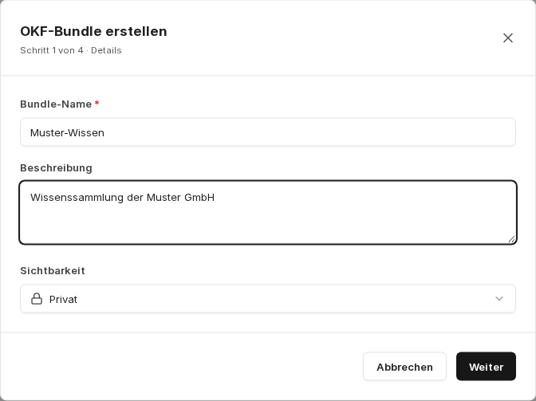
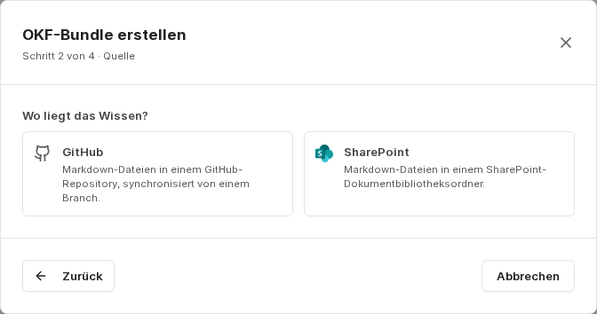
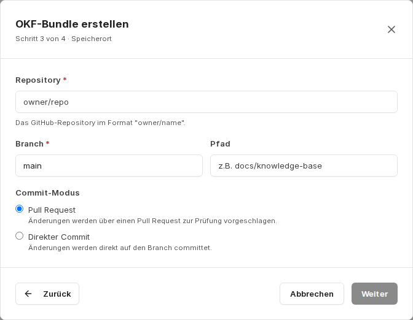

OKF-Bundles sind Wissenssammlungen im **Open Knowledge Format** – einem offengelegten, quelloffenen Format, das Wissen als Markdown-Dateien mit einer definierten Ordnerstruktur beschreibt. Das Wissen bleibt damit dort, wo es versioniert und geprüft werden kann: in einem GitHub-Repository oder einem SharePoint-Ordner.

Da das Bundle als Sammlung verbunden ist, sind seine Inhalte automatisch in companyRAG durchsuchbar.

:::note
OKF-Bundles sind aktuell experimentell. Struktur und Bedienung können sich noch ändern.
:::

## Lesen und Schreiben

Quellen wie SharePoint liest companyRAG grundsätzlich nur. OKF-Bundles sind der einzige Fall, in dem Inhalte in den Speicherort geschrieben werden: companyRAG legt beim Erstellen auf Wunsch ein Grundgerüst an, und ein Agent kann über [companyKNOWLEDGE](/de/company-gpt/addons/companyknowledge/) Markdown-Dateien im Bundle anlegen und fortschreiben. Normale SharePoint-Quellen werden dagegen nie beschrieben.

## Bundle anlegen

Sie starten unter [Sammlungen](/de/company-gpt/addons/companyrag/sammlungen/#sammlung-erstellen) mit **Sammlung erstellen** und wählen den Sammlungstyp **OKF-Bundle**. Es öffnet sich der Assistent **OKF-Bundle erstellen** mit vier Schritten.

**Schritt 1 – Details:** **Bundle-Name**, optionale **Beschreibung** und **Sichtbarkeit**.

**Schritt 2 – Quelle:** Auswahl, wo das Wissen liegt.

- **GitHub**: Markdown-Dateien in einem GitHub-Repository, synchronisiert von einem Branch.
- **SharePoint**: Markdown-Dateien in einem SharePoint-Dokumentbibliotheksordner.

**Schritt 3 – Speicherort:** Bei GitHub geben Sie **Repository** im Format `owner/name`, **Branch** und optional einen **Pfad** an.

Über den **Commit-Modus** legen Sie fest, wie Änderungen zurückgeschrieben werden:

- **Pull Request**: Änderungen werden über einen Pull Request zur Prüfung vorgeschlagen.
- **Direkter Commit**: Änderungen werden direkt auf den Branch committet.

Bei SharePoint wählen Sie stattdessen Website, Bibliothek und Zielordner.

**Schritt 4 – Prüfen & Erstellen:** Sie prüfen die Zusammenfassung. Ist **OKF-Grundgerüst anlegen, falls leer** aktiviert (Standard), legt companyRAG an einem Speicherort ohne OKF-Dateien ein Grundgerüst mit `README.md`, `index.md` und `log.md` an, damit das Bundle nicht leer ist. Mit **Bundle erstellen** wird direkt eine Sammlung angelegt und eine erste Synchronisierung gestartet.

OKF-Bundles werden automatisch mit der Chunking-Strategie **Markdown-basiert** angelegt, da die Inhalte über Überschriften strukturiert sind. Siehe [Chunking-Strategien](/de/company-gpt/addons/companyrag/sammlungen/#chunking-strategien).

## Bundles pflegen

In CompanyGPT kann ein Agent OKF-Bundles und die darin enthaltenen Markdown-Dateien selbst erstellen und fortschreiben. In Kombination mit dem Commit-Modus *Pull Request* entsteht daraus ein prüfbarer Ablauf: Der Agent schlägt Änderungen am Wissensbestand vor, ein Mensch gibt sie frei.

Wie ein solcher Agent eingerichtet wird, welche Werkzeuge er benötigt und wie der Ablauf vom Aufbau des Formats bis zur Indexierung aussieht, beschreibt [companyKNOWLEDGE](/de/company-gpt/addons/companyknowledge/).

Voraussetzung ist eine verbundene [GitHub- oder SharePoint-Integration](/de/company-gpt/addons/companyrag/integrationen/).
