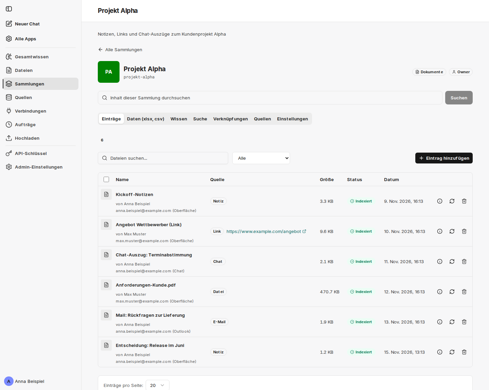
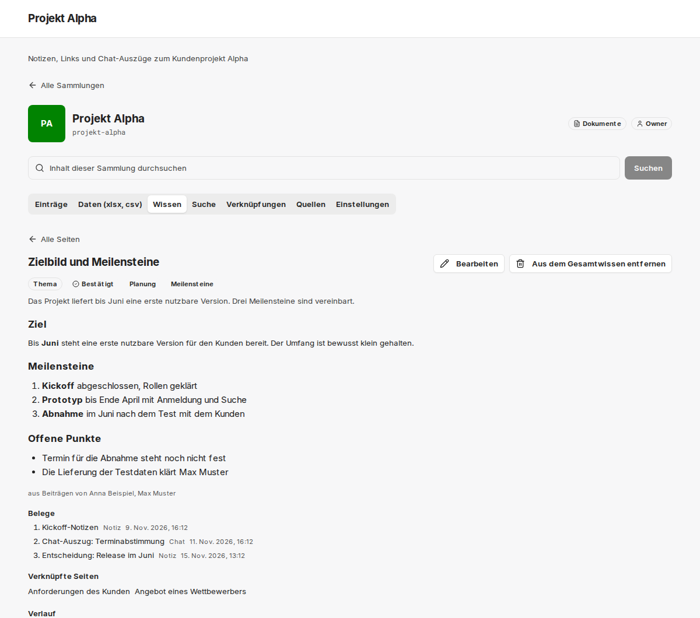
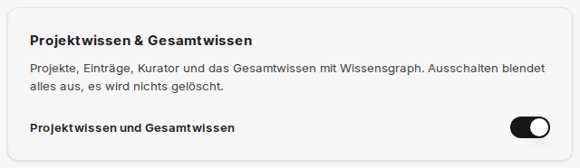
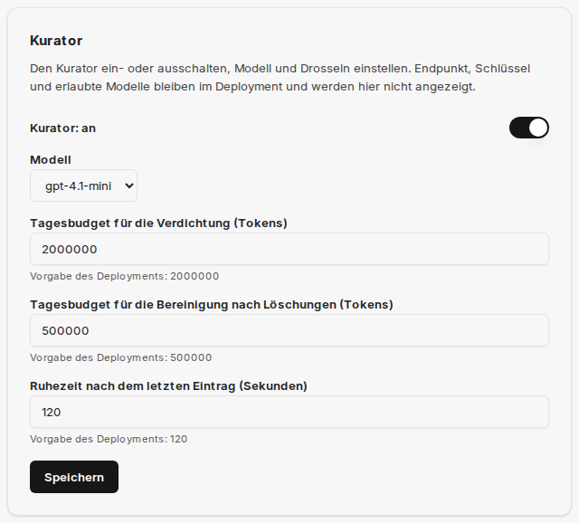

Projektwissen ist ein zweites Gedächtnis pro Projekt: Was Sie speichern, bleibt erhalten, ist belegt und wird zu Wissensseiten verdichtet, die Sie, Ihre Kolleginnen und Kollegen sowie Ihre Agenten durchsuchen können. Eine Übersicht über alles, was Sie lesen dürfen, bietet das [Gesamtwissen](/de/company-gpt/addons/companyrag/gesamtwissen/).

:::note[Nicht in allen Umgebungen verfügbar]
Ein Administrator kann Projektwissen für die Organisation ausschalten (siehe [Admin-Einstellungen](#admin-einstellungen)). Dann sind Projekte, Einträge und das Gesamtwissen ausgeblendet. Gelöscht wird dabei nichts.
:::

## Projekte

Ein **Projekt** ist eine Sammlung mit einem Zweck: Sie speichern Dinge hinein, und das Projekt führt Seiten darüber. Angelegt wird es wie jede andere [Sammlung](/de/company-gpt/addons/companyrag/sammlungen/#sammlung-erstellen) mit dem Sammlungstyp **Projekt**.

Was Sie in einem Projekt tun dürfen, bestimmt Ihre [Rolle in der Sammlung](/de/company-gpt/addons/companyrag/sammlungen/#rollen-in-sammlungen):

| Rolle | Darf |
|---|---|
| **Betrachter** | Seiten und Einträge lesen, suchen |
| **Bearbeiter** | zusätzlich Einträge speichern, Dateien hochladen, Seiten bearbeiten, Quellen anhängen und Einstellungen ändern; löschen aber nur Eigenes |
| **Owner** | alles, auch fremde Inhalte löschen, Freigaben verwalten, das Projekt übergeben, archivieren und löschen |

Ein **archiviertes** Projekt ist schreibgeschützt: Lesen und Suchen funktionieren weiter, neue Einträge, Uploads und Quellen sind nicht möglich. Sie können es jederzeit reaktivieren.

Ein Superadmin liest und schreibt ein Projekt nicht allein aufgrund dieser Rolle. Ihm bleiben nur Wartungsrechte wie Neuindexieren oder das Entfernen von Seiten.

## Einträge

Ein **Eintrag** ist eine Notiz, ein Chat-Ausschnitt, ein Link, eine Mail, eine Teams-Nachricht oder eine Datei, die Sie in einem Projekt speichern. Sie speichern ihn in der Oberfläche, aus dem Chat über das Tool `save_knowledge` (siehe [In CompanyGPT nutzen](/de/company-gpt/addons/companyrag/in-companygpt/#projektwissen-und-gesamtwissen)) oder aus Outlook und Teams, sobald diese Add-ins aktiviert sind.

- Der Text eines Eintrags ist nicht in der Länge begrenzt. Für Anhänge gelten die üblichen Dateigrenzen Ihrer Organisation; ein zu großer Anhang wird als abgelehnt aufgeführt, der Eintrag selbst bleibt erhalten.
- Speichern Sie denselben Text noch einmal, entsteht kein zweiter Eintrag: Sie werden als weitere Mitwirkende eingetragen.
- Ein gespeicherter **Link** wird einmal abgerufen und als Momentaufnahme mit Zeitpunkt abgelegt. Die Originalseite kann sich später ändern.
- Ein Bearbeiter löscht die Einträge, die er selbst gespeichert hat; Owner löschen jeden Eintrag.

## Kurator und Seiten

Der **Kurator** ist ein Sprachmodell, das aus den Einträgen **Seiten** schreibt: ein Thema pro Seite, mit Quellenangaben, die auf Ihre Einträge zurückverweisen. Eine Seite zeigt Typ, Schlagwörter, Zusammenfassung, Quellen und die Seiten, auf die sie verweist.

- Der Kurator verarbeitet nur **Einträge von Projekten** sowie neue oder geänderte [Tabellen-Hinweise](/de/company-gpt/addons/companyrag/datensaetze/#tabellen-hinweise). Andere Dokumente einer Sammlung fasst er nicht zusammen.
- Er startet kurz nach dem letzten Eintrag eines Projekts, nicht bei jedem einzelnen.
- Der Kurator hat ein **Tagesbudget** an Modell-Tokens. Es ist eine Drossel, keine Grenze: Was darüber liegt, wird auf den nächsten Tag verschoben und geht nicht verloren.
- Eine Seite ist schreibgeschützt, bis Sie sie bearbeiten. Speichern Sie Ihren Text, ist er der **bestätigte Text** („Bestätigt“). Der Kurator überschreibt ihn nie; neue Erkenntnisse erscheinen als **Nachtrag**, Widersprüche bleiben sichtbar.
- Sehr lange Seiten werden in **Unterseiten** geteilt.
- Sie sehen nur Seiten, die Sie lesen dürfen. Eine Seite ist nie für mehr Personen sichtbar als ihre am stärksten eingeschränkte Quelle. Eine Seite, die Sie nicht sehen dürfen, ist für Sie wie nicht vorhanden.
- Wird eine Quelle gelöscht, werden die darauf beruhenden Seiten sofort ausgeblendet und ohne den gelöschten Inhalt neu geschrieben. Die Liste zeigt bis dahin „n Seiten werden aktualisiert und sind bis dahin nicht sichtbar“.
- Mit **Als OKF exportieren** laden Bearbeiter und Owner die lesbaren Seiten als Bündel von Markdown-Dateien herunter (siehe [OKF-Bundles](/de/company-gpt/addons/companyrag/okf-bundles/)).

Die Kuratierungsaufträge sehen Besitzer und Bearbeiter unter [Aufträge](/de/company-gpt/addons/companyrag/auftraege/) als **Kuratierung** und **Neu-Kuratierung**.

## Admin-Einstellungen

Globale Administratoren finden in den **Admin-Einstellungen** drei Karten, die Projektwissen betreffen. Eine Änderung wirkt innerhalb weniger Sekunden, ohne Neustart.

| Karte | Wirkung |
|---|---|
| **Projektwissen & Gesamtwissen** | Schalter für Projekte, Einträge, Kurator für Projekte und das Gesamtwissen mit Wissensgraph, in der Oberfläche und für die Agenten. Ab Werk **an**; die Karte speichert sofort. Ausschalten blendet alles aus und löscht nichts; Einschalten stellt alles wieder her. |
| **Kurator** | Schaltet den Kurator ein oder aus, wählt das Modell und stellt die Tagesbudgets ein (Verdichtung und Bereinigung nach Löschungen) sowie die Ruhezeit nach dem letzten Eintrag. Nach einem Update von einer älteren Version ist der Kurator **aus**, bis ein Administrator ihn einschaltet. Ist er aus, bleiben Einträge durchsuchbar und vorhandene Seiten lesbar; neue Seiten entstehen nicht. |
| **Kurator-Verbrauch** | Zeigt den Verbrauch des Modells je Tag und Zweck. Namen von Sammlungen sehen Administratoren nur, wenn sie diese selbst lesen dürfen. |

Hat Ihre Umgebung keinen Endpunkt oder kein Modell für den Kurator hinterlegt, zeigt die Karte **Nicht konfiguriert**, und der Schalter ist gesperrt. Ebenso lässt sich Projektwissen nicht einschalten, wenn Ihre Umgebung es nicht anbietet.

Die Karte **Quellenarten** (Schalter je Quellenart) beschreibt [Quellen](/de/company-gpt/addons/companyrag/quellen/#quellenarten-ein--und-ausschalten).

## Löschen

- Wird ein Eintrag oder eine Datei gelöscht, verschwindet sie sofort aus der Suche. Die darauf beruhenden Seiten werden ausgeblendet, ohne den gelöschten Inhalt neu geschrieben und dann wieder angezeigt.
- Owner der Sammlung und globale Administratoren können eine Seite mit **Aus dem Gesamtwissen entfernen** (optional mit Grund) für alle ausblenden. Der Kurator legt sie nicht wieder an; unter **Entfernte Seiten** lässt sie sich wiederherstellen.
- Ein gelöschtes Projekt ist sofort für alle unsichtbar; die gespeicherten Daten werden danach im Hintergrund entfernt.
