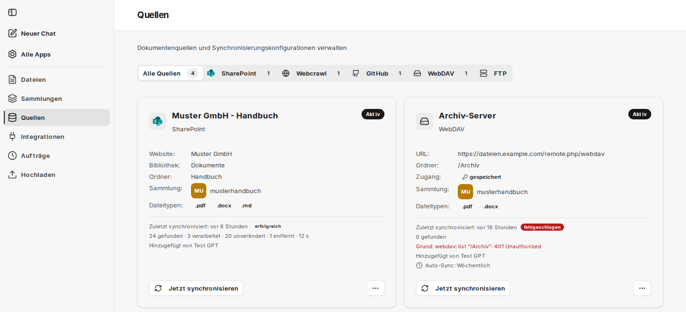
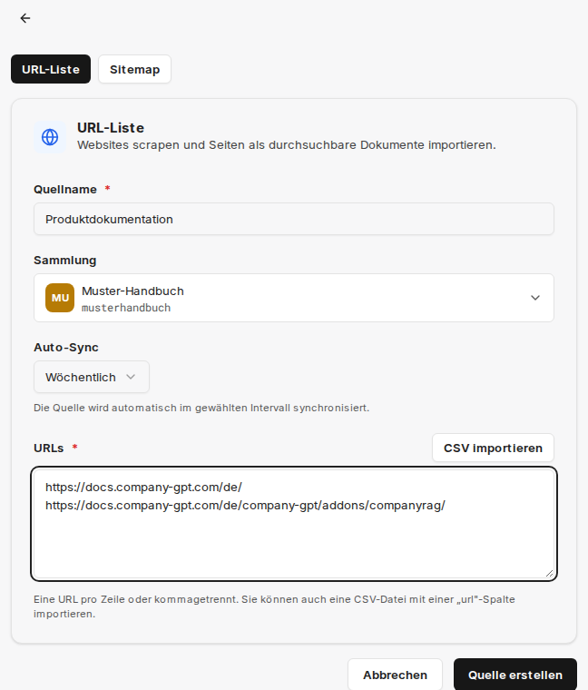
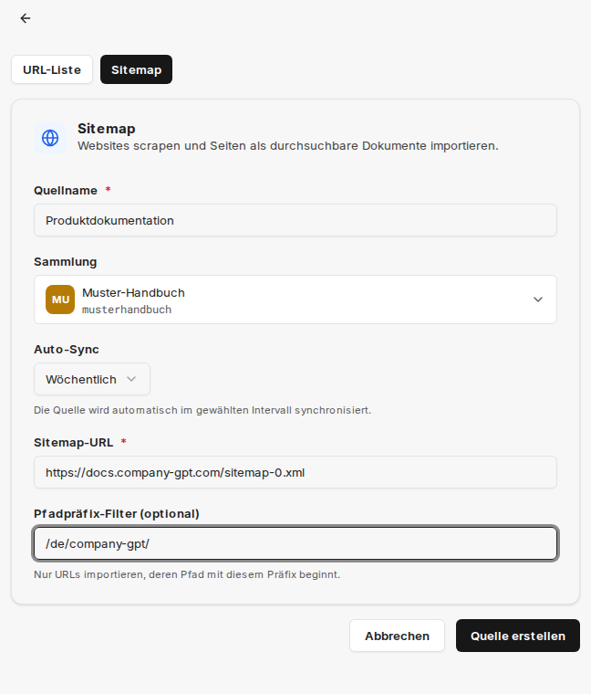
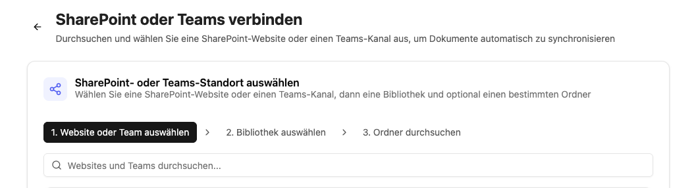
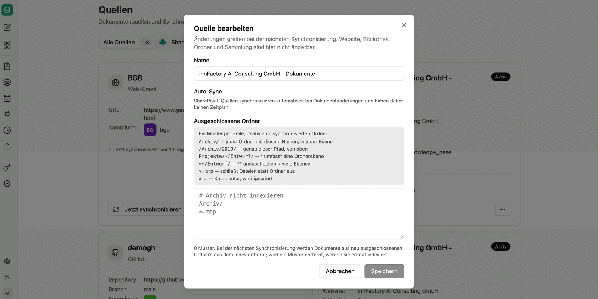

Quellen verbinden companyRAG dauerhaft mit einem Drittsystem und synchronisieren Dokumente in eine [Sammlung](/de/company-gpt/addons/companyrag/sammlungen/). Neue und geänderte Dateien werden nachgezogen, ohne dass Sie sie erneut hochladen müssen. Bei Dateiquellen wie SharePoint, Google Drive, Nextcloud, GitHub, WebDAV und FTP werden Dateien, die im Quellsystem entfernt wurden, beim nächsten Lauf auch aus dem Index entfernt.

companyRAG liest die Quellsysteme nur. Es schreibt weder Dateien noch Änderungen nach SharePoint, Google Drive oder in andere Systeme zurück. Einzige Ausnahme sind [OKF-Bundles](/de/company-gpt/addons/companyrag/okf-bundles/).

Voraussetzung ist eine verbundene [Integration](/de/company-gpt/addons/companyrag/integrationen/). WebDAV- und FTP-Quellen bringen ihre Zugangsdaten selbst mit und brauchen keine vorherige Verbindung.

Die Übersicht hat einen Reiter **Alle Quellen** und je verfügbarem System einen eigenen Reiter. Jede Quelle zeigt ihre Konfiguration, die Zielsammlung und ihren Status (**Aktiv**, **Deaktiviert** oder **Synchronisiert**). Darunter stehen der Zeitpunkt der letzten Synchronisation, das Ergebnis des letzten Laufs (**läuft**, **erfolgreich**, **teilweise** oder **fehlgeschlagen**) mit Kennzahlen wie gefundenen, verarbeiteten, unveränderten und entfernten Dateien, bei Fehlern der **Grund** sowie die Person, die die Quelle hinzugefügt hat.

Quellen ändern dürfen Besitzer und Administratoren der Zielsammlung. Alle anderen sehen eine Quelle mit dem Hinweis **Nur Ansicht**.

## Wann synchronisiert wird

| Quelle | Erster Lauf | Danach |
|---|---|---|
| **SharePoint** | startet automatisch direkt nach dem Verbinden | automatisch bei Dokumentänderungen; zusätzlich gleicht companyRAG die Quelle in regelmäßigen Abständen vollständig ab. Es gibt keinen Zeitplan. |
| **Google Drive** | startet automatisch direkt nach dem Verbinden | Änderungen werden automatisch übernommen; companyRAG prüft die Quelle dazu regelmäßig. Es gibt keinen Zeitplan. |
| **Nextcloud, GitHub, Web-Crawl, WebDAV, FTP** | bei gewähltem Intervall automatisch kurz nach dem Anlegen; bei **Nur manuell** über **Jetzt synchronisieren** | im gewählten **Auto-Sync**-Intervall: **Stündlich**, **Täglich** oder **Wöchentlich** – oder nur manuell |

Bei Dateiquellen überträgt jeder Lauf nur die Differenz – unveränderte Dokumente werden nicht erneut indexiert. Zum Web-Crawl siehe unten. Über **Jetzt synchronisieren** stoßen Sie bei jeder Quelle jederzeit einen zusätzlichen Lauf an.

## Web-Crawl

Einzelne Webseiten, Listen (in CSV-Dateien) sowie gesamte Website-Sitemaps können gecrawlt und indexiert werden. Einzelne Seiten werden bei jedem Lauf neu abgerufen und nur bei geändertem Inhalt neu indexiert. Bei Sitemap-Crawlings wird nur die Differenz anhand des letzten Crawls sowie des Änderungsdatums berücksichtigt.

Im Reiter **Webcrawl** öffnen Sie mit **Web-Quelle hinzufügen** die Seite **Neue Web-Crawl-Quelle**. Im Reiter **URL-Liste** tragen Sie **Quellname**, **Sammlung**, **Auto-Sync** und die **URLs** ein – eine URL pro Zeile oder kommagetrennt. Über **CSV importieren** übernehmen Sie eine CSV-Datei mit einer Spalte `url`.

Für ganze Websites wechseln Sie auf den Reiter **Sitemap** und geben die **Sitemap-URL** an. Über den **Pfadpräfix-Filter (optional)** bestimmen Sie, welche Seiten indexiert werden: `/tutorials/` importiert beispielsweise nur URLs, deren Pfad mit `/tutorials/` beginnt.

Nach **Quelle erstellen** starten Sie den ersten Lauf direkt über **Jetzt synchronisieren** oder warten bei gewähltem Intervall auf den automatischen Lauf.

## SharePoint anbinden

Im Reiter **SharePoint** startet **SharePoint verbinden** die Seite **SharePoint oder Teams verbinden**. Unter **Zu synchronisierende Inhalte** wählen Sie zuerst **Nur Dateien**, **Nur Seiten & News** oder **Dateien + Seiten & News**.

1. **Website oder Team auswählen**: Auswahl der SharePoint-Website oder des Teams
2. **Bibliothek auswählen**: Bibliotheken der/des ausgewählten Website/Teams
3. **Ordner durchsuchen**: Auswahl des Ordners und der Sammlung unter **Zielsammlung**, in die die Dateien synchronisiert werden; anschließend **Diesen Ordner auswählen**

Unter **Synchronisierungskonfiguration** legen Sie die **Zu synchronisierenden Dateitypen** fest und schließen mit **SharePoint verbinden** bzw. **Teams verbinden** ab. Bei **Nur Seiten & News** entfällt die Auswahl von Bibliothek und Ordner.

:::note
Nur Ordner sind auswählbar. Alle unterstützten Dateien in diesem Ordner und in darunter liegenden hierarchischen Ebenen (Unterordner) werden automatisch synchronisiert. Für Datensatzsammlungen werden nur tabellarische Dateien synchronisiert.
:::

Nach dem Verbinden startet die erste Synchronisation automatisch. Anschließend hält companyRAG die Quelle bei Dokumentänderungen selbstständig aktuell.

:::tip[Berechtigungen]
Bei der Synchronisation aus SharePoint werden die Berechtigungen des Quellsystems mit übergeben. Ein Nutzer sieht über companyRAG damit niemals mehr Inhalte, als er über die SharePoint-Oberfläche sehen würde.
:::

## Google Drive anbinden

Im Reiter **Google Drive** öffnet **Google Drive-Quelle hinzufügen** die Auswahl. Sie wählen **Meine Ablage**, eine **Geteilte Ablage** oder **Für mich freigegeben**, optional einen Ordner und die **Ziel-Collection**.

Unter **Google-Formate** legen Sie fest, ob **Google Docs & Sheets exportieren** (Docs als Text, Sheets als CSV) und **Google Slides einbeziehen** (Umwandlung in PDF mit OCR, langsamer und teurer) aktiv sind. Google-Dateien über 10 MB kann Google nicht exportieren; sie werden übersprungen. Die erste Synchronisierung startet direkt nach dem Verbinden.

:::caution
Bei Google Drive werden keine Berechtigungen übernommen. Der Zugriff auf die synchronisierten Inhalte wird ausschließlich über die Sammlung gesteuert: Alle Personen mit Zugriff auf die Sammlung können die Dokumente durchsuchen.
:::

## Nextcloud und GitHub

Bei **Nextcloud** wählen Sie über **Quelle erstellen** einen Ordner Ihrer Nextcloud, vergeben einen Quellennamen und legen Dateitypen, Sammlung und **Auto-Sync** fest.

Bei **GitHub** wählen Sie über **GitHub-Quelle hinzufügen** Repository und Branch, optional ein **Unterverzeichnis (optional)**, die **Dateiendungen** (`.md`, `.markdown`, `.mdx`, `.txt`), die Ziel-Kollektion und **Auto-Sync**. Unter **Zugang zum Repository** stehen drei Wege zur Wahl:

- **Token des Erstellers**: Die Quelle nutzt den GitHub-Token aus Ihrer [Integration](/de/company-gpt/addons/companyrag/integrationen/). Läuft er ab oder wird er entfernt, schlägt die Synchronisation fehl.
- **Eigener Personal Access Token**: Ein Token mit Lesezugriff, der verschlüsselt bei dieser Quelle gespeichert und nie wieder angezeigt wird.
- **SSH-Deploy-Key**: companyRAG erzeugt ein Schlüsselpaar. Den öffentlichen Schlüssel tragen Sie im Repository als Deploy-Key ohne Schreibzugriff ein; erst danach gelingt die erste Synchronisation.

## WebDAV und FTP

WebDAV- und FTP-Server binden Sie mit eigenen Zugangsdaten je Quelle an, etwa ownCloud, Synology oder Apache mod_dav per WebDAV. Die Zugangsdaten werden verschlüsselt bei der Quelle gespeichert und nie wieder angezeigt.

- **WebDAV-Quelle erstellen**: vollständige **WebDAV-URL**, Benutzername und Passwort.
- **FTP-Quelle erstellen**: **Host**, **Port** und **Verschlüsselung** – **FTPS (explizit, AUTH TLS)**, **FTPS (implizit, Port 990)** oder **Unverschlüsselt (FTP)**. Unverschlüsselte Verbindungen erlaubt der Server nur für interne Hosts.

Wählen Sie zuerst die Sammlung, dann prüfen Sie die Verbindung mit **Verbindung testen und durchsuchen** und wählen den Ordner. Dateitypen und **Auto-Sync** legen Sie wie bei den anderen Quellen fest.

:::note[Nicht in allen Umgebungen verfügbar]
Ob diese Funktion in Ihrer Umgebung zur Verfügung steht, legt Ihr Unternehmen fest. Wenden Sie sich bei Fragen an Ihren Administrator.
:::

## Dateitypen und eigene Endungen

Bei SharePoint, Google Drive, Nextcloud, WebDAV und FTP wählen Sie, welche Dateitypen indexiert werden. Zusätzlich können Sie unter **Eigene Dateiendung hinzufügen** weitere Endungen ergänzen (nur Buchstaben und Ziffern, 1 bis 12 Zeichen). Solche Dateien werden als reiner Text gelesen; nutzen Sie das nur für Endungen, für die es keine eigene Unterstützung gibt.

GitHub-Quellen bieten nur die festen Endungen `.md`, `.markdown`, `.mdx` und `.txt`, ohne eigene Endungen. Beim Web-Crawl gibt es keine Auswahl der Dateitypen.

## Ordner ausschließen

Bei SharePoint-, WebDAV- und FTP-Quellen können Sie unter **Bearbeiten** im Feld **Ausgeschlossene Ordner** einzelne Bereiche ausschließen, etwa Entwürfe oder Archive. Sie tragen ein Muster pro Zeile ein, relativ zum synchronisierten Ordner:

| Muster | Wirkung |
|---|---|
| `Archiv/` | jeder Ordner mit diesem Namen, in jeder Ebene |
| `/Archiv/2019/` | genau dieser Pfad, von oben |
| `Projekte/*/Entwurf/` | `*` umfasst eine Ordnerebene |
| `**/Entwurf/` | `**` umfasst beliebig viele Ebenen |
| `*.tmp` | schließt Dateien statt Ordner aus |
| `# …` | Kommentar, wird ignoriert |

Bei der nächsten Synchronisierung werden Dokumente aus neu ausgeschlossenen Ordnern aus dem Index entfernt; wird ein Muster entfernt, werden sie erneut indexiert.

## Quellen-Aktionen

- **Jetzt synchronisieren**: Lauf sofort starten
- Über das Menü **…** der Quelle:
  - **Pausieren** / **Fortsetzen**: Quelle deaktivieren oder reaktivieren. Nicht verfügbar bei SharePoint, Nextcloud und Google Drive.
  - **Bearbeiten**: **Name**, **Status** (nicht bei SharePoint, Nextcloud und Google Drive), **Auto-Sync** (nicht bei SharePoint und Google Drive), **Zugangsdaten** (WebDAV, FTP), **Zugang zum Repository** (GitHub) und **Ausgeschlossene Ordner** (SharePoint, WebDAV, FTP) anpassen. Website, Bibliothek, Ordner und Sammlung sind nicht änderbar; Änderungen greifen bei der nächsten Synchronisierung.
  - **Löschen**: Entfernt die Quelle

:::danger
Beim Löschen einer Quelle werden alle Dateien dieser Quelle mitsamt ihren Embeddings und gespeicherten Inhalten unwiderruflich gelöscht. Sie verschwinden aus der Suche und können nicht wiederhergestellt werden.
:::

Den Fortschritt der Läufe verfolgen Sie unter [Aufträge](/de/company-gpt/addons/companyrag/auftraege/).
