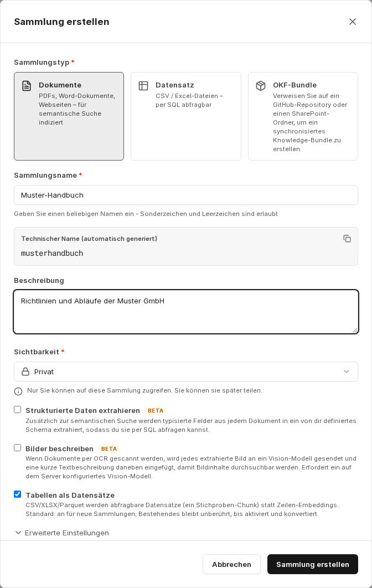
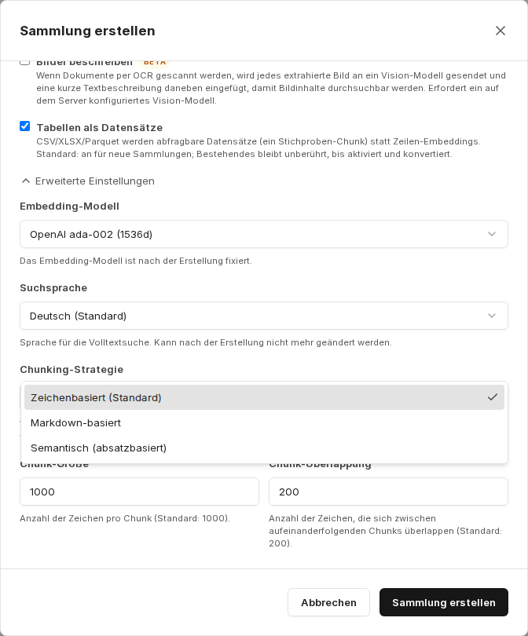
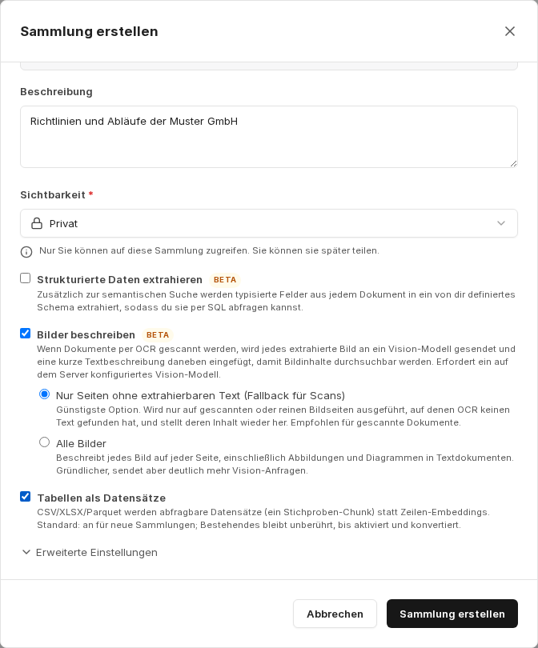
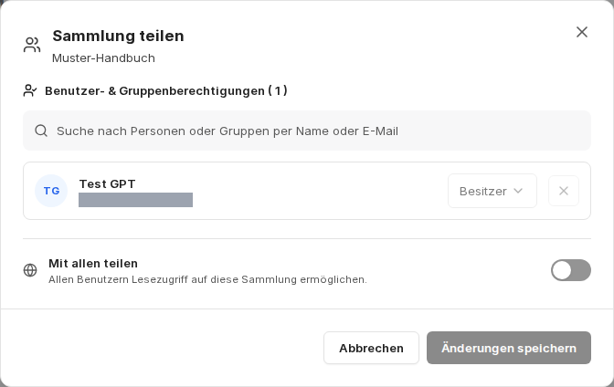

Sammlungen sind Speicherorte und ermöglichen es, Dokumente und Berechtigungen zu organisieren. Jede Sammlung ist unabhängig durchsuchbar, und jede Freigabe wird auf Ebene der Sammlung erteilt.

Die Übersicht unter **Sammlungen** gliedert sich in die Reiter **Alle**, **Meine** (Sammlungen, die Sie besitzen), **Mit mir geteilt** (Sammlungen, die mit Ihnen geteilt wurden) und **Öffentlich**. Jede Sammlung zeigt Badges für Sichtbarkeit, Typ und Ihre Rolle.

## Sammlung erstellen

Über **Sammlung erstellen** öffnen Sie den Dialog. Zuerst wählen Sie den **Sammlungstyp**:

- **Dokumente**: PDFs, Word-Dokumente, Webseiten und weitere Dateien, die für die semantische Suche indexiert werden.
- **Datensatz**: Tabellen, die per SQL abfragbar sind. Siehe [Datensatzsammlungen](/de/company-gpt/addons/companyrag/datensaetze/).
- **OKF-Bundle**: öffnet stattdessen den Assistenten für ein [OKF-Bundle](/de/company-gpt/addons/companyrag/okf-bundles/).

Anschließend legen Sie **Sammlungsname**, **Beschreibung** und **Sichtbarkeit** fest. Der **Technische Name** wird automatisch aus dem Namen generiert – er wird später in Agenten-Prompts und in den MCP-Tools als `collection` verwendet und kann nicht mehr geändert werden.

Bei der Sichtbarkeit stehen zwei Optionen zur Verfügung:

- **Privat**: Nur Sie können auf diese Sammlung und die damit verknüpften Dokumente zugreifen. Sie können die Sammlung jederzeit später teilen.
- **Öffentlich**: Alle Nutzer Ihrer Organisation können die Sammlung sehen und Dateien daraus anzeigen – ausschließlich unternehmensintern.

Für Sammlungen vom Typ **Dokumente** stehen zusätzlich drei Verarbeitungsoptionen zur Verfügung:

- **Strukturierte Daten extrahieren** *(Beta)*: Zusätzlich zur semantischen Suche werden typisierte Felder aus jedem Dokument in ein von Ihnen definiertes Schema extrahiert und per SQL abfragbar. Siehe [Strukturierte Daten aus Dokumenten](/de/company-gpt/addons/companyrag/strukturierte-daten/).
- **Bilder beschreiben** *(Beta)*: Bildinhalte werden über ein Vision-Modell in Text überführt (siehe [unten](#bilder-beschreiben)).
- **Tabellen als Datensätze**: CSV-, Excel- und Parquet-Dateien werden als abfragbare Datensätze abgelegt statt Zeile für Zeile eingebettet (siehe [unten](#tabellen-als-datensätze)). Bei neuen Sammlungen ist die Option eingeschaltet.

## Erweiterte Einstellungen

Für Sammlungen vom Typ **Dokumente** öffnen Sie im Dialog den Bereich **Erweiterte Einstellungen**.

| Einstellung | Bedeutung |
|---|---|
| **Embedding-Modell** | Modell für die Vektorisierung der Inhalte. Das Feld erscheint nur, wenn Ihre Umgebung eine Auswahl an Modellen anbietet; sonst wird das Standardmodell der Umgebung verwendet. |
| **Suchsprache** | Sprache für die Volltextsuche, die zusätzlich zur KI-Suche ausgeführt wird. Sie sollte zur Sprache der Inhalte passen, damit Füllwörter korrekt entfernt und Wortformen richtig reduziert werden. Standard: **Deutsch (Standard)**. |
| **Chunking-Strategie** | Wie Dokumente für die Suche in Abschnitte aufgeteilt werden (siehe unten). |
| **Chunk-Größe** | Anzahl der Zeichen pro Chunk. Standard: 1000. Nur bei der Strategie **Zeichenbasiert (Standard)**. |
| **Chunk-Überlappung** | Anzahl der Zeichen, die sich zwischen aufeinanderfolgenden Chunks überlappen. Standard: 200. Nur bei der Strategie **Zeichenbasiert (Standard)**. |

Welche Embedding-Modelle zur Auswahl stehen, hängt von Ihrer Umgebung ab.

:::note[Nicht in allen Umgebungen verfügbar]
Ob diese Funktion in Ihrer Umgebung zur Verfügung steht, legt Ihr Unternehmen fest. Wenden Sie sich bei Fragen an Ihren Administrator.
:::

Embedding-Modell und Chunking-Strategie sind nach der Erstellung der Sammlung fixiert. Prüfen Sie diese Einstellungen daher vor dem Anlegen – insbesondere bei großen Beständen, die sonst neu indexiert werden müssten. Die Suchsprache können Sie später unter **Sammlung bearbeiten** ändern; die Volltextsuche wird dann im Hintergrund neu aufgebaut, und Suchergebnisse können vorübergehend unvollständig sein.

### Chunking-Strategien

- **Zeichenbasiert (Standard)**: Feste Chunk-Größe mit Überlappung, standardmäßig 1000 Zeichen mit 200 Zeichen Überlappung. Geeignet für gemischte Bestände ohne verlässliche Struktur.
- **Markdown-basiert**: Alles zwischen zwei Überschriften bildet einen Chunk. Empfohlen für Wikis und Dokumentationen; [OKF-Bundles](/de/company-gpt/addons/companyrag/okf-bundles/) werden automatisch mit dieser Strategie angelegt.
- **Semantisch (absatzbasiert)**: Jeder Absatz bildet einen Chunk. Geeignet für Texte mit klar abgegrenzten Absätzen.

## Bilder beschreiben

Alle Dokumente – etwa als PDF hochgeladene Scans – laufen durch eine OCR-Pipeline. Wenn OCR keinen Text findet oder Abbildungen inhaltlich relevant sind, kann companyRAG jedes Bild an ein Vision-Modell senden und eine kurze Textbeschreibung an der passenden Stelle im Dokument einfügen. Dadurch werden Bildinhalte durchsuchbar.

- **Nur Seiten ohne extrahierbaren Text (Fallback für Scans)**: Günstigste Option. Wird nur auf gescannten oder reinen Bildseiten ausgeführt, auf denen OCR keinen Text gefunden hat, und stellt deren Inhalt wieder her. Empfohlen für gescannte Dokumente.
- **Alle Bilder**: Beschreibt jedes Bild auf jeder Seite, einschließlich Abbildungen und Diagrammen in Textdokumenten. Gründlicher, sendet aber deutlich mehr Vision-Anfragen.

:::note
Die Bildbeschreibung erfordert ein auf dem Server konfiguriertes Vision-Modell. Sie können die Option auch nachträglich unter **Sammlung bearbeiten** ein- oder ausschalten; die Änderung gilt für Dateien, die ab dann indexiert werden.
:::

## Tabellen als Datensätze

Mit der Option **Tabellen als Datensätze** legt companyRAG CSV-, Excel- und Parquet-Dateien in einer Dokumentensammlung als abfragbare Datensätze ab. In der semantischen Suche erscheint je Datei nur ein Stichproben-Chunk; die eigentlichen Werte fragt ein Agent über die [SQL-Tools](/de/company-gpt/addons/companyrag/in-companygpt/#sql-tools-für-datensätze-und-strukturierte-daten) ab. Ohne die Option werden Tabellen Zeile für Zeile eingebettet.

Bei bestehenden Sammlungen schalten Sie die Option unter **Sammlung bearbeiten** ein und speichern. Bereits indexierte Tabellen wandeln Sie anschließend über **Bestehende Tabellen zu Datensätzen konvertieren** um; companyRAG zeigt vorher an, wie viele Dateien betroffen sind. Dateien, deren Quelle nur extrahierten Text liefert (etwa eine gerenderte Webseite), lassen sich nicht umwandeln und bleiben unverändert. Dateien, deren Quelle nicht mehr verfügbar ist, können dabei entfernt werden.

## Sammlungs-Aktionen

Am unteren Rand jeder Sammlung stehen je nach Ihrer Rolle folgende Symbole zur Verfügung:

- **System-Prompt**: vorbereiteter System-Prompt für einen Agenten, siehe [companyRAG in CompanyGPT nutzen](/de/company-gpt/addons/companyrag/in-companygpt/#beispiel-prompt-aus-der-sammlung).
- **Ingestion-Anleitung**: nur bei Live-Datensätzen; zeigt die Endpunkte zum Einspielen von Zeilen, siehe [Datensatzsammlungen](/de/company-gpt/addons/companyrag/datensaetze/#zeilen-einspielen).
- **Sammlung teilen**: nur für Besitzer (siehe unten).
- **Sammlung bearbeiten**: für Besitzer und Administratoren der Sammlung.
- **Sammlung löschen**: nur für Besitzer.

### Sammlung teilen

Im Dialog **Sammlung teilen** suchen Sie Personen oder Gruppen per Name oder E-Mail (mindestens zwei Zeichen) und legen für jeden Eintrag eine Rolle fest:

- **Betrachter**: Kann die Sammlung ansehen und durchsuchen, aber nicht ändern.
- **Administrator**: Kann ansehen, Dateien hochladen und Einstellungen ändern.
- **Besitzer**: Volle Kontrolle, einschließlich Teilen und Löschen. Eine Sammlung muss mindestens einen Besitzer behalten.

Mit dem Schalter **Mit allen teilen** erhalten alle Nutzer Lesezugriff auf die Sammlung. Ihre Änderungen übernehmen Sie mit **Änderungen speichern**.

:::note
Mit allen geteilte Sammlungen werden immer nur mit Lesezugriff freigegeben, damit nicht jeder Nutzer Inhalte verändern kann. Für Gruppenfreigaben und die Suche im gesamten Verzeichnis ist ein verbundenes Microsoft-Konto erforderlich; ohne diese Verbindung finden Sie nur Personen, die sich mindestens einmal angemeldet haben.
:::

### Sammlung bearbeiten

Unter **Sammlung bearbeiten** ändern Sie Name und Beschreibung sowie die Suchsprache. Bei Dokumentensammlungen passen Sie außerdem die Extraktionsanweisungen, **Bilder beschreiben** und **Tabellen als Datensätze** an; diese Änderungen gelten für Dateien, die ab dann indexiert werden. Sammlungstyp, technischer Name und Chunking-Strategie sind nicht änderbar.

### Sammlung löschen

:::danger
Das Löschen einer Sammlung löscht alle verknüpften Dokumente und Aufträge der Sammlung unwiderruflich!
:::

## Ansicht für Superadmins

Gibt es Sammlungen, die Sie nur als Superadmin sehen, erscheint über der Übersicht ein Hinweis mit der Umschaltung **Meine Zugänge** / **Alle**. Unter **Alle** erscheinen alle Sammlungen der Organisation; Sammlungen, auf die Sie nur als Superadmin zugreifen, tragen das Badge **nur als Superadmin sichtbar**. Für diese Sammlungen sind die Metadaten sichtbar, die Dateien aber nicht lesbar.

## Weiter

- Inhalte hinzufügen: [Hochladen](/de/company-gpt/addons/companyrag/hochladen/) oder [Quellen](/de/company-gpt/addons/companyrag/quellen/)
- Sammlung abfragen: [companyRAG in CompanyGPT nutzen](/de/company-gpt/addons/companyrag/in-companygpt/)
