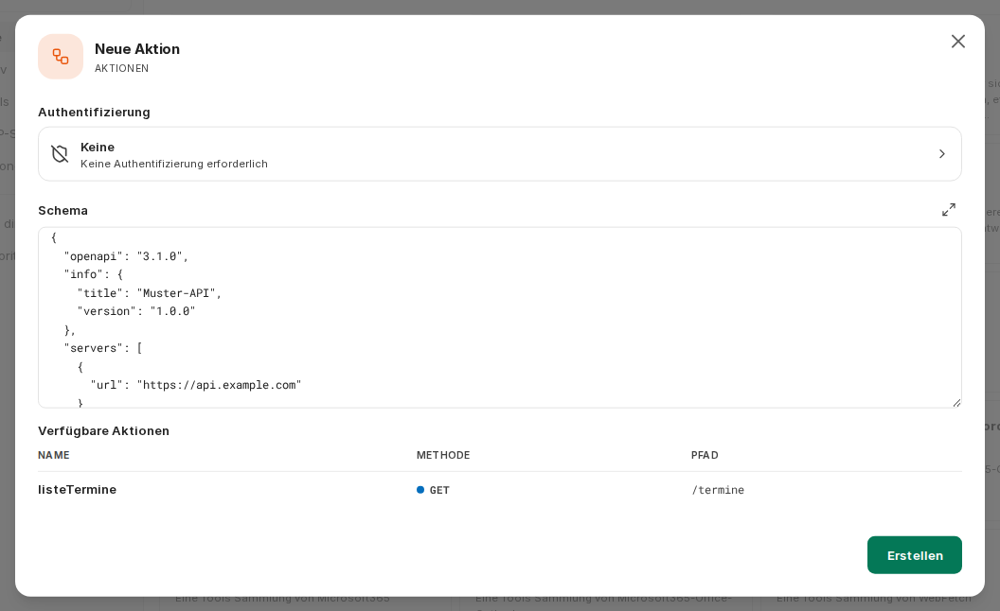
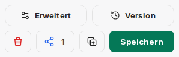
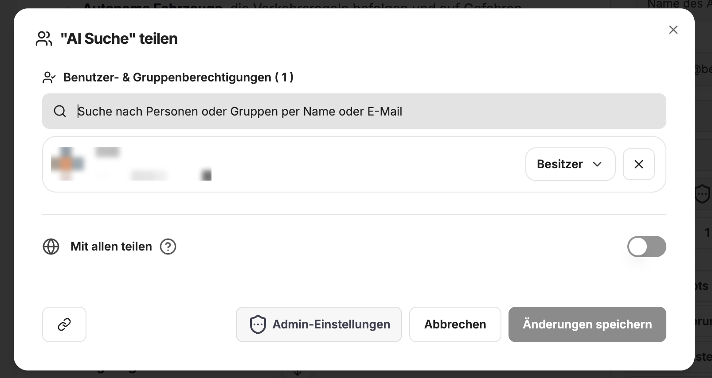
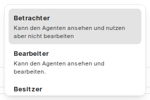
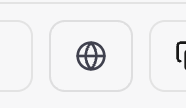
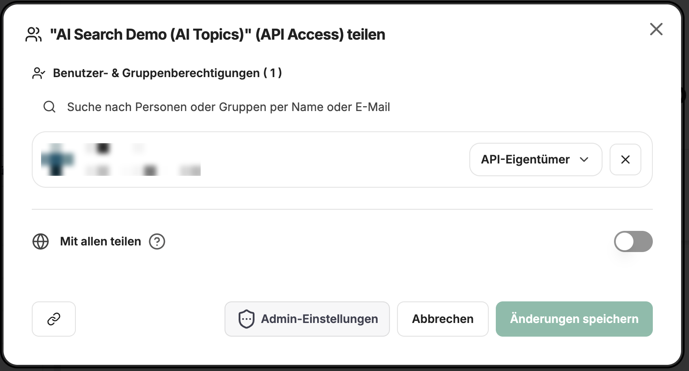
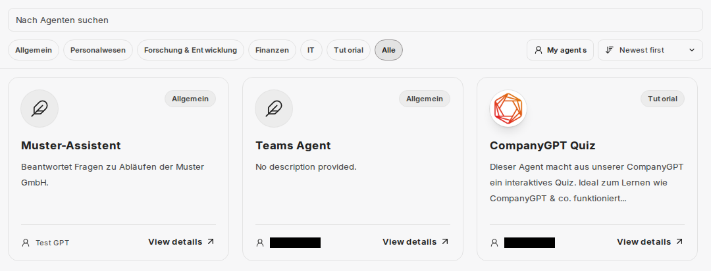

Agenten im CompanyGPT sind fortgeschrittene Systeme, die dafür ausgelegt sind, mehr als nur Text zu generieren. Sie analysieren die Anfrage des Benutzers, erstellen einen Plan zur Erledigung, benutzen Werkzeuge (Tools), um Informationen zu beschaffen und die Anfrage zu beantworten.

Fähigkeiten:

- **Reasoning**: Können komplexe Probleme in kleinere Einheiten zerlegen und bearbeiten
- **Tool Usage**: Können entscheiden, welche Tools für welche Aufgabe genutzt werden sollen
- **Action**: Können Tools ausführen, um Informationen zu beschaffen

Agenten legen Sie über **Agenten erstellen** in der linken Seitenleiste an und bearbeiten sie dort. Der Eintrag erscheint nur, wenn Ihre Rolle Agenten erstellen darf (siehe [Berechtigungen](#berechtigungen)).

## Bestandteile von Agenten

### Name und Beschreibung

Agenten sollten immer einen Namen haben, da sie über den Namen in der Modellauswahl ausgewählt werden können. Zusätzlich kann eine Beschreibung hinterlegt werden, die zusätzliche Informationen bietet.

### Kategorie

Jeder Agent kann einer Kategorie zugewiesen werden. Sollten Agenten innerhalb des Unternehmens zwischen Nutzern geteilt werden und der Agent Marketplace genutzt werden, kann dort nach Kategorien gefiltert werden.

### Anweisungen

Die Anweisungen sind der eigentliche Prompt des Agenten. Dieser beschreibt, was der Agent zu tun hat, wie er auftreten soll, usw. Informationen zu effektivem Prompting für Agenten finden Sie hier: [Prompt Engineering](/de/prompt-engineering/uebersicht). Besonders bei Agenten bietet es sich an, strukturierte und sauber formatierte Prompts zu verwenden.

Es können außerdem Variablen wie das aktuelle Datum, die Uhrzeit oder der aktuelle Nutzer übergeben werden.

### KI Modell

Das KI Modell ist das Gehirn jedes Agenten, da es die Anfragen analysiert, die Tools auswählt und die Ergebnisse auswertet, zusammenfasst und zurückgibt. Hier kann der Ersteller zwischen allen verfügbaren Modellen wählen.

Zusätzlich zum Modell können die KI Parameter angepasst werden. Die ausführliche Beschreibung finden Sie hier: [KI Einstellungen](/de/company-gpt/ki-einstellungen)

### Tools

Im Abschnitt **Tools** legen Sie fest, was der Agent neben dem KI-Modell nutzen darf. Über **Tools hinzufügen** öffnet sich die **Tool-Bibliothek**. Sie ist in **Nativ** (eingebaute Funktionen), **Tools**, **MCP-Server** und **Aktionen** gegliedert. Unter **Favoriten** und **Von dir erstellt** finden Sie Ihre markierten bzw. selbst erstellten Einträge.

Ein Klick auf einen hinzugefügten Eintrag öffnet dessen Einstellungen. Über **Vom Agenten entfernen** nehmen Sie ihn wieder heraus.

Welche Einträge zur Verfügung stehen, hängt von der Konfiguration Ihrer Umgebung und den Rechten Ihrer Rolle ab. Ihr Unternehmen kann einzelne Fähigkeiten pro Rolle freigeben oder sperren (siehe [Agent-Fähigkeiten in companyADMIN](/de/company-gpt/addons/companyadmin/agent-capabilities/)).

#### Websuche

:::note
Der Eintrag **Web-Suche** in der Tool-Bibliothek funktioniert in CompanyGPT aktuell nicht. Nutzen Sie stattdessen die Websuche des KI-Modells, wie unten beschrieben.
:::

Die Websuche wird über die Modell-Parameter des gewählten KI-Modells aktiviert. Klicken Sie dazu auf das KI-Modell und öffnen Sie dessen Einstellungen. Dort finden Sie den Toggle **„Web-Suche"**. Bei Google-Gemini-Modellen heißt dieser **„Fundierung mit der Google Suche"**.

Zusätzlich können Sie über einen **MCP Server** das Tool **WebFetch** hinzufügen. Dieses nutzt einen Headless-Browser, um konkrete URLs zu crawlen – vergleichbar mit dem direkten Aufrufen einer Webseite im Browser.

Weitere Informationen zur Websuche finden Sie hier: [Websuche](/de/company-gpt/integrationen/websuche).

#### Dateikontext

Unter **Dateikontext** hinterlegte Dateien werden in Text umgewandelt. Der vollständige Text wird bei jeder Nachricht in den Kontext des Agenten eingefügt. Das eignet sich für einige wenige zentrale Dokumente, auf die der Agent immer zugreifen soll. Dateien für den Dateikontext können Sie erst hochladen, wenn der Agent erstellt ist.

:::tip
Kontextdokumente sind immer vollständig im Kontext des Agenten / der Konversation. Hier sollten Sie sich auf das Wesentliche begrenzen, z.B. Anweisungen zur Tonalität oder vergangene Beispiele. Für sehr lange Dokumente könnte die **Dateisuche** besser geeignet sein.
:::

#### Code ausführen

Mit **Code ausführen** kann der Agent Code in einer abgeschotteten Umgebung schreiben und ausführen, etwa für Berechnungen, Datenanalysen oder die Verarbeitung von Dateien. Dateien, die Sie in den Einstellungen dieses Eintrags hinterlegen, stehen dem Agenten dabei zur Verfügung.

Mehr Informationen finden Sie hier: [Code Interpreter](/de/company-gpt/code-interpreter/).

#### Artefakte

Mit **Artefakte** stellt der Agent React, HTML, SVG, Markdown und Mermaid als interaktive Artefakte in einem eigenen Bereich neben dem Chat dar, statt sie als einfache Codeblöcke auszugeben. Unter **Modus** wählen Sie:

- **Normal**: Der Agent erhält die Standardanweisungen für Artefakte.
- **shadcn/ui**: Zusätzlich werden Anweisungen für die Komponentenbibliothek shadcn/ui eingefügt.
- **Benutzerdefiniert**: Artefakte werden weiterhin dargestellt, es werden aber keine eingebauten Anweisungen hinzugefügt. Hinterlegen Sie eigene Vorgaben in den Anweisungen des Agenten.

Mehr Informationen zu Artefakten finden Sie hier: [Artefakte](/de/company-gpt/integrationen/artefakte).

#### Dateisuche

Unter **Dateisuche** hinterlegte Dateien werden zu einer durchsuchbaren Wissensbasis. Der Agent ruft bei Bedarf die relevantesten Textstellen ab. Das Abrufen funktioniert als **RAG (Retrieval Augmented Generation)** mittels Ähnlichkeitssuche zwischen Abfrage und Inhalten. Dabei werden immer nur die relevanten Textstellen genutzt. Im Gegensatz hierzu steht der **Dateikontext**, bei dem immer der gesamte Inhalt im Kontext ist.

Weitere Informationen unter [Prompt Engineering / RAG](/de/prompt-engineering/prompt-techniken/rag)

#### Nutzer fragen

Mit **Nutzer fragen** kann der Agent seine Ausführung unterbrechen, Ihnen eine Rückfrage stellen und auf Ihre Antwort warten. Die Frage erscheint im Chat als Karte; stellt der Agent mehrere Fragen, führt ein Formular Schritt für Schritt hindurch. Sobald Sie geantwortet haben, arbeitet der Agent mit Ihren Angaben weiter.

#### Erinnerung

Mit **Erinnerung** kann der Agent während der Unterhaltung Erinnerungen über Sie speichern, aktualisieren und löschen. Im Chat sehen Sie an einer Karte, wenn der Agent eine Erinnerung gespeichert oder gelöscht hat.

Ist **Erinnerungen für diesen Agenten getrennt speichern** aktiviert, verwendet der Agent eigene Erinnerungen. Diese sind von Ihren gemeinsamen Erinnerungen und den Erinnerungen anderer Agenten getrennt; bereits vorhandene gemeinsame Erinnerungen sieht der Agent dann nicht.

Der Eintrag steht nur zur Verfügung, wenn Erinnerungen für Sie aktiviert sind. Mehr dazu unter [Erinnerungen](/de/company-gpt/erinnerungen/).

#### MCP Server

MCP-Server fügen Sie über die Tool-Bibliothek im Bereich **MCP-Server** hinzu. In den Einstellungen des Servers wählen Sie unter **Tools auf diesem Server** aus, welche Tools der Agent nutzen darf, einzeln oder mit **Alle auswählen**.

Für die einzelnen Tools gibt es zusätzliche Optionen:

- **Laden aufschieben**: Das Tool wird erst geladen, wenn der Agent es benötigt, statt dauerhaft aktiv zu sein. Das ist besonders bei Servern mit vielen Tools nützlich. Mit **Alle Tools aufschieben** gilt das für alle Tools des Servers. Bei MCP-Servern mit vielen Tools lädt CompanyGPT die Tools bereits standardmäßig erst bei Bedarf.
- **Absichtsbezeichnung**: Der Agent beschreibt vor jedem Aufruf in einem Satz, was er gleich tun wird. Dieser Text wird während des Aufrufs live als Status angezeigt. Dadurch entstehen pro Anfrage geringfügig höhere Token-Kosten. Mit **Absichtsbezeichnungen für alle aktivieren** schalten Sie die Option für alle Tools des Servers ein.

Neue MCP-Server können nur Personen anlegen, deren Rolle das erlaubt. Mehr dazu unter [MCP Server](/de/company-gpt/integrationen/mcp-server/).

#### Werkzeuge

Im Bereich **Tools** der Tool-Bibliothek finden Sie eingebaute Werkzeuge, die mit MCP-Tools kombiniert werden können:

- **OpenAI Image Tools**: Bilder erzeugen und bearbeiten
- **Gemini Image Tools**: Bilder mit den Bildmodellen von Google Gemini erzeugen
- **Calculator**: einfache und komplexe Berechnungen

Ob die Bildwerkzeuge genutzt werden können, hängt davon ab, welche Bildmodelle in Ihrer Umgebung eingerichtet sind.

#### Aktionen

Aktionen sind externe API-Schnittstellen, die direkt über [OpenAPI kompatible Schemas](https://spec.openapis.org/oas/latest.html) angebunden werden können. Eine neue Aktion legen Sie in der Tool-Bibliothek über **Neu erstellen …** an.

:::tip
Diese Funktionalität ist sehr fortgeschritten, aber auch veraltet; besser ist es, API-Endpunkte über eigene MCP Server anzubinden.
:::

#### Skills

Im Abschnitt **Skills** legen Sie fest, ob und welche Skills der Agent verwenden darf. Details finden Sie unter [Skills zu Agenten hinzufügen](/de/company-gpt/skills/#skills-zu-agenten-hinzufügen).

#### Kontaktdaten

Unter **Ansprechpartner-Kontakt** kann jeder Agent mit Kontaktdaten zum Ersteller versehen werden, was nützlich ist für Feedback bei geteilten Agenten.

### Erweiterte Einstellungen

Über **Erweitert** öffnen Sie die **Erweiterten Einstellungen** des Agenten. Dort finden Sie die maximale Anzahl der Agenten-Schritte und unter **Multi-Agenten-Orchestrierung** die Einstellungen, mit denen der Agent mit anderen Agenten zusammenarbeitet: Unteragenten, Übergaben und Agenten-Ketten.

#### Maximale Agenten-Schritte

Begrenzt, wie viele Schritte der Agent in einem Durchlauf ausführen kann, bevor er eine endgültige Antwort gibt. Ohne eigene Angabe gilt in CompanyGPT ein Standardwert von 150 Schritten. Ein Schritt ist entweder eine KI-API-Anfrage oder eine Werkzeugnutzungsrunde. Eine einfache Werkzeuginteraktion umfasst beispielsweise 3 Schritte: die ursprüngliche Anfrage, die Werkzeugnutzung und die Folgeanfrage.

#### Unteragenten

Mit **Unteragenten aktivieren** kann der Agent Teilaufgaben an Hilfsagenten abgeben. Unteragenten arbeiten in einem eigenen, isolierten Kontextfenster: Ausführliche Tool-Ausgaben bleiben beim Unteragenten, an den Agenten geht nur eine Zusammenfassung zurück. Über **Unteragent hinzufügen** wählen Sie bis zu 50 Agenten aus. Mit **Selbstaufruf erlauben** kann der Agent Teilaufgaben auch an eine Kopie von sich selbst übergeben; das funktioniert auch, wenn keine weiteren Agenten ausgewählt sind.

#### Übergaben

Unter **Übergaben** legen Sie Agenten fest, an die der Agent die Unterhaltung übergeben kann, wenn spezielles Fachwissen gebraucht wird. Jede Übergabe erzeugt ein Übergabe-Tool, über das der Agent die Unterhaltung samt Kontext an den spezialisierten Agenten weiterleitet. In der **Übergabebeschreibung** halten Sie fest, wann übergeben werden soll. Über **Übergabe-Agent hinzufügen** sind bis zu 10 Übergaben möglich.

#### Agenten-Ketten

Ermöglicht das Erstellen von Agenten-Sequenzen. Jeder Agent kann auf die Ausgaben vorheriger Agenten in der Kette zugreifen. Basiert auf der "Mixture-of-Agents"-Architektur, bei der Agenten vorherige Ausgaben als zusätzliche Informationen verwenden.

### Version

Jedes Mal, wenn Änderungen an einem Agenten gespeichert werden, wird eine Version erzeugt. Über die Versionsanzeige können diese Versionen angezeigt und widerrufen werden. Das ist sinnvoll, wenn man Änderungen widerrufen möchte.

## Berechtigungen

Wer Agenten nutzen, erstellen und teilen darf, legen Administratoren in [companyADMIN](/de/company-gpt/addons/companyadmin/rollen-und-rechte/) fest: unter **Zugriff** → **Rollen** → Rolle öffnen → Reiter **companyGPT**, Funktion **Agenten** mit den Rechten **Nutzen**, **Erstellen**, **Teilen** und **Öffentlich teilen**.

In der Standardeinstellung dürfen Nutzer Agenten nutzen und erstellen, aber nicht teilen. Ihr Unternehmen kann das abweichend festlegen. Wenden Sie sich bei Fragen an Ihren Administrator.

## Teilen von Agenten

Wenn Ihre Rolle das Teilen von Agenten erlaubt, können Sie Agenten teilen. Dazu muss auf den Teilen-Button neben dem Speichern-Button geklickt werden.

Dabei kann ausgesucht werden, ob der Agent global, mit bestimmten Nutzern oder Nutzergruppen geteilt werden soll.

Dabei kann ausgewählt werden, mit welchen Rechten die anderen Benutzer auf den Agenten zugreifen können.

### Agents API

Agenten können auch von außen über die [Agents API](/de/api/agents-api/) angesprochen werden. Voraussetzung ist, dass Ihre Rolle in companyADMIN das Recht **Remote-Agenten** hat. Ihre eigenen Agenten stehen Ihnen dann automatisch über die API zur Verfügung. Über den Button **Remote-Zugriff** können Sie den API-Zugriff auf einen Agenten mit anderen teilen, sofern Ihre Rolle das erlaubt.

## Unsere Agenten

Unter [**Agenten**](/de/tutorials) finden Sie eine Auswahl an Agenten, die wir für verschiedene Anwendungsfälle entwickelt haben. Diese können Sie direkt nutzen oder als Vorlage für Ihre eigenen Agenten verwenden.

## Agenten-Marktplatz

Geteilte aber auch eigene Agenten sind über den Agenten-Marktplatz einsehbar.

