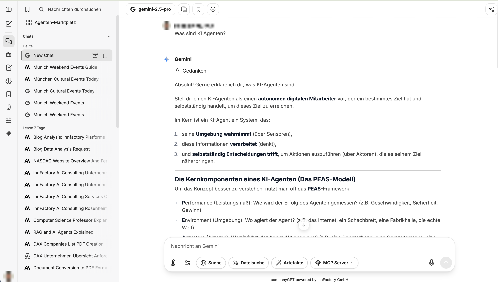
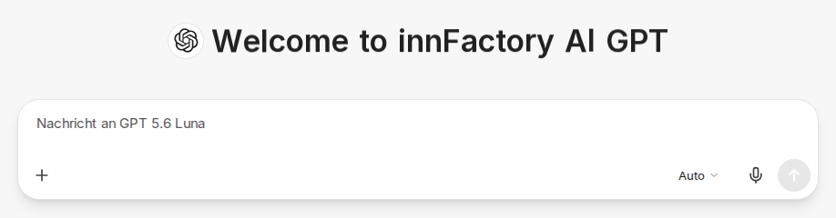
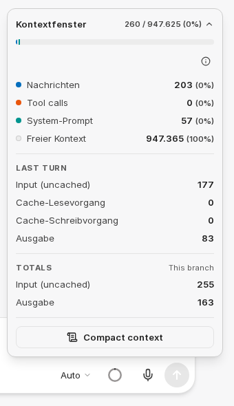
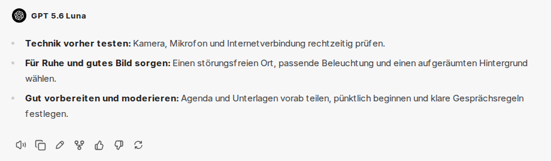
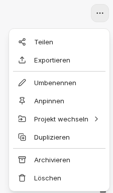
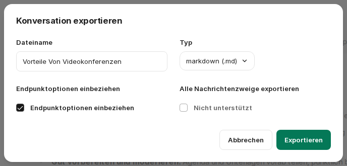

:::note[Neue Chat-Oberfläche]
Bilder und Beschriftungen auf dieser Seite zeigen die [neue Chat-Oberfläche](/de/company-gpt/neue-chat-oberflaeche/). Sie ist derzeit im Demo-Zugang und in Pilotumgebungen verfügbar; in anderen Umgebungen können Beschriftungen und Abläufe noch abweichen.
:::

Der Chat ist das Hauptinterface zur Kommunikation mit den unterschiedlichen Sprachmodellen und Agenten.

:::caution[Immer zu beachten]
Alle im aktuellen Chat befindlichen Nachrichten und Dateien sind immer Teil des Kontextes. Es lohnt sich daher, für jedes Thema einen eigenen Chat zu verwenden.
:::

## Prompteingabe

Die Eingabe von Chatnachrichten bzw. Prompts erfolgt über das Eingabefeld. Mit `Strg` + `Enter` (macOS: `⌘` + `Enter`) oder über die Senden-Schaltfläche senden Sie eine Nachricht ab, mit `Enter` fügen Sie eine neue Zeile ein. Dieses Verhalten können Sie in den [Einstellungen](/de/company-gpt/einstellungen/#senden) ändern. Eine Nachricht kann auch nur aus Anhängen bestehen.

:::tip
Informationen zum Prompt Engineering und Promptanleitungen finden Sie hier: [Prompt Engineering](/de/prompt-engineering/uebersicht/)
:::

Über das Plus-Symbol links in der Eingabeleiste (**Attach and tools**) hängen Sie Dateien an und schalten Werkzeuge zu, siehe [Integrationen](#integrationen). Bei Modellen mit Denkprozess wählen Sie den Denkaufwand über die Schaltfläche rechts in der Eingabeleiste, die die aktuelle Stufe anzeigt (zum Beispiel **Auto**), siehe [Neue Chat-Oberfläche](/de/company-gpt/neue-chat-oberflaeche/#neue-eingabeleiste).

### Nachrichten während einer laufenden Antwort

Sie können bereits weiterschreiben, während eine Antwort entsteht. Beim Absenden wird die neue Nachricht in die laufende Antwort einbezogen (**Antwort steuern**), die laufende Antwort wird sofort angehalten und mit Ihrer Nachricht fortgesetzt (**Unterbrechen & steuern**), oder die Nachricht wird für die Zeit nach der Antwort eingereiht (**Einreihen**). Bei **Unterbrechen & steuern** bleibt der bis dahin erzeugte Teil der Antwort erhalten. Was `Enter` dabei standardmäßig bewirkt, legen Sie in den [Einstellungen](/de/company-gpt/einstellungen/#senden) fest. Über die Senden-Schaltfläche können Sie es auch für einzelne Nachrichten wählen. Lässt sich die laufende Antwort nicht steuern, wird die Nachricht eingereiht.

### Kontextanzeige

Das Kreissymbol im Eingabefeld zeigt, wie viel vom Kontextfenster des Modells der aktuelle Chat belegt. Wird der Platz knapp, ändert sich die Farbe der Anzeige. Wenn Sie mit der Maus darauf zeigen oder es anklicken, sehen Sie die Belegung. Über den Pfeil neben den Zahlen klappen Sie die Aufschlüsselung auf, zum Beispiel nach **Nachrichten**, Werkzeugaufrufen (**Tool calls**), **System-Prompt** und **Freier Kontext**. Darunter stehen die Token der letzten Runde (**Last turn**) und die Summen (**Totals**). Sofern in Ihrer Umgebung verfügbar, zeigt die Aufschlüsselung auch die Kosten und den bereits verbrauchten Anteil Ihres Guthabens.

Im selben Fenster können Sie den Kontext über **Compact context** auch selbst komprimieren: CompanyGPT ersetzt den bisherigen Verlauf dann durch eine Zusammenfassung. Die früheren Nachrichten bleiben im Chat sichtbar, werden aber nicht mehr an das Modell gesendet.

## Integrationen

Neben der eigentlichen Prompteingabe kann der Kontext zusätzlich erweitert werden durch:

- [Dateisuche](/de/company-gpt/integrationen/dateisuche/)
- [Websuche](/de/company-gpt/integrationen/websuche/)
- [Skills](/de/company-gpt/skills/)
- [Code ausführen](/de/company-gpt/code-interpreter/)
- [Artefakte](/de/company-gpt/integrationen/artefakte/)
- [MCP Server](/de/company-gpt/integrationen/mcp-server/)
- [Erinnerung](/de/company-gpt/erinnerungen/#im-chat), sofern in Ihrer Umgebung verfügbar

Diese schalten Sie im jeweiligen Chat über das Plus-Symbol in der Eingabeleiste (**Attach and tools**) ein. Aktive Werkzeuge erscheinen als Chips in der Eingabeleiste, über das x im Chip schalten Sie sie wieder aus. Mehr dazu unter [User Interface](/de/company-gpt/user-interface/#integrationen).

## Nachrichten

Der Nachrichtenverlauf entwickelt sich mit der Zeit innerhalb der Konversation zwischen User und KI-Modell(en). Der Benutzer kann nach jeder Nachricht ein anderes Modell oder einen anderen Agenten nutzen, welche natürlich immer den gesamten vorherigen Kontext bekommen.

### Nachrichtenoptionen

Im Chat befindliche Nachrichten haben Schnellaktionen:

- **Neu generieren** und **Nachrichtenvarianten**: Über **Neu generieren** können mehrere Antwortvarianten erzeugt werden, zwischen denen Sie umschalten können.
- **Vorlesen**: Über [Text zu Sprache](/de/company-gpt/einstellungen/#text-zu-sprache) wird die Nachricht mit der eingestellten Engine vorgelesen.
- **In die Zwischenablage kopieren**: Kopiert den gesamten Inhalt der Nachricht in die Zwischenablage.
- **Bearbeiten**: Öffnet einen Editor in der Nachricht, siehe [Nachrichten bearbeiten](#nachrichten-bearbeiten).
- Abzweigen-Symbol: Erstellt ab einer bestimmten Nachricht einen neuen Chat mit den vorangegangenen Nachrichten. Das ist hilfreich, wenn Sie beispielsweise in unterschiedliche Richtungen weiterdenken möchten. Welche Nachrichten übernommen werden, wählen Sie zwischen **Nur sichtbare Nachrichten**, **Zugehörige Verzweigungen einbeziehen** und **Alle bis/von hier einbeziehen**.
- **Feedback**: Mit Daumen hoch oder runter bewerten Sie eine Antwort und können optional einen Kommentar ergänzen.

### Nachrichten bearbeiten

Über **Bearbeiten** öffnet sich ein Editor direkt in der Nachricht:

- **Eigene Nachrichten**: **Aktualisieren & erneut ausführen** sendet die geänderte Nachricht und erzeugt eine neue Antwort. **Speichern** übernimmt die Änderung, ohne eine neue Antwort zu erzeugen. Haben Sie nichts geändert, erzeugt **Rerun** eine neue Antwort auf die unveränderte Nachricht, zum Beispiel nach einer abgebrochenen Antwort.
- **Antworten der KI**: **Speichern** übernimmt Ihre Änderung in den Verlauf, etwa um eine Antwort zu korrigieren, bevor Sie weiterarbeiten. **Rerun** erzeugt dagegen eine neue Antwort und verwirft Ihre Änderungen.

**Abbrechen** schließt den Editor, ohne Änderungen zu übernehmen.

### Zitieren

Um einen bestimmten Inhalt zu zitieren, markieren Sie ihn in einer Nachricht und wählen **Zum Prompt hinzufügen**. Der markierte Text wird Ihrer nächsten Nachricht als Zitat beigefügt. Sie können auch mehrere Stellen nacheinander sammeln.

### Code, Diagramme und Artefakte

- **Codeblöcke** lassen sich über **Code kopieren** in die Zwischenablage übernehmen oder über das Download-Symbol als Datei herunterladen.
- **Mermaid-Diagramme** werden direkt als Diagramm dargestellt. Über **Diagramm exportieren** speichern Sie sie mit **Als SVG exportieren** oder **Als PNG exportieren**.
- [Artefakte](/de/company-gpt/integrationen/artefakte/) öffnen sich in einem eigenen Bereich neben dem Chat. Über **Vollbild öffnen** zeigen Sie ein Artefakt im Vollbild an.

### Werkzeugaufrufe

Nutzt ein Modell oder Agent Werkzeuge, etwa die Websuche oder einen MCP-Server, zeigt CompanyGPT die Aufrufe in der Antwort an. Mehrere aufeinanderfolgende Aufrufe werden zu einer Zeile zusammengefasst, die sich aufklappen lässt; fehlgeschlagene Aufrufe werden darin mitgezählt. Sollen die Details immer aufgeklappt sein, aktivieren Sie in den [Einstellungen](/de/company-gpt/einstellungen/#nachrichten) **Tool-Details automatisch aufklappen**.

Erreicht ein Agent die maximale Anzahl an Schritten für eine Antwort, hält er an und zeigt den Hinweis **Reached the tool call limit for this turn**. Alles bis dahin Erarbeitete bleibt erhalten. Mit **Keep going** macht der Agent dort weiter, wo er aufgehört hat, mit **Answer now** antwortet er sofort mit dem bisherigen Stand.

## Zwei Modelle vergleichen

Über die Schaltfläche **Mehrere Chats hinzufügen** im Kopfbereich lassen Sie dieselbe Nachricht von zwei Modellen beantworten. Das bisher gewählte Modell erscheint dann als zusätzliche Zeile über dem Eingabefeld; in der Modellauswahl wählen Sie das zweite Modell. Nach dem Senden stehen beide Antworten nebeneinander. Über das x in der zusätzlichen Zeile beenden Sie den Vergleich.

## Temporärer Chat

Über die Schaltfläche **Privater Chat** im Kopfbereich starten Sie einen temporären Chat. Er erscheint nicht im Chatverlauf und wird automatisch gelöscht. Solange ein temporärer Chat aktiv ist, zeigt der Kopfbereich einen entsprechenden Hinweis.

Sollen neue Chats immer temporär beginnen, aktivieren Sie in den [Einstellungen](/de/company-gpt/einstellungen/#standardmäßig-temporärer-chat) **Standardmäßig temporärer Chat**.

## Teilen und Exportieren

Nachrichtenverläufe können geteilt oder in unterschiedliche Dateiformate exportiert werden. Beides erreichen Sie im geöffneten Chat über das Menü **Chat options** (drei Punkte oben rechts im Kopfbereich) mit **Teilen** und **Exportieren**.

### Teilen

Mit **Link erstellen** erzeugen Sie einen Link auf den Chat. Ihr Name bleibt dabei privat. Bilder und Dateien aus dem Chat sind für andere nur sichtbar, wenn Sie **Dateien in diesem Chat teilen** aktivieren. Über **QR-Code anzeigen** erhalten Sie zusätzlich einen QR-Code.

Die Adresse des Links bleibt dauerhaft gleich. Änderungen an bereits geteilten Nachrichten erscheinen sofort. Nachrichten, die Sie nach dem Teilen hinzufügen, werden erst sichtbar, wenn Sie **Link aktualisieren** wählen. Damit veröffentlichen Sie den aktuellen Stand des Chats und Ihre aktuelle Auswahl zur Dateifreigabe unter derselben Adresse.

Über **Zugriff verwalten** sehen und ändern Sie, wer den Link öffnen darf. Mit **Link löschen** heben Sie die Freigabe auf. Chats mit aktivem Link sind im Chatverlauf gekennzeichnet. Eine Übersicht aller geteilten Chats finden Sie in den [Einstellungen](/de/company-gpt/einstellungen/#geteilte-links) unter **Geteilte Links**.

:::caution
Geteilte Links können nur Personen öffnen, die sich bei derselben CompanyGPT-Umgebung anmelden, auch wenn der Link öffentlich freigegeben ist. Ohne öffentliche Freigabe benötigen sie zusätzlich eine Leseberechtigung, die Sie über **Zugriff verwalten** vergeben. Ist Ihr CompanyGPT nur aus dem Firmennetzwerk erreichbar, gilt das auch für geteilte Links.
:::

### Export

Nachrichtenverläufe können auch exportiert werden. Das hat den Vorteil, dass sie in unterschiedlichen Formaten als Datei gespeichert werden können. Verläufe im JSON-Format können ebenfalls wieder [importiert](/de/company-gpt/einstellungen/#konversationen-importieren) werden.

Für den Export wählen Sie einen **Dateiname** und den **Typ**: Markdown, Text, JSON, CSV oder Screenshot (PNG).

Außerdem können, je nach Dateiformat, folgende Einstellungen getätigt werden:

- **Endpunktoptionen einbeziehen**: Die Modellnamen werden in den Informationen mitgespeichert (nicht bei CSV und Screenshot).
- **Alle Nachrichtenzweige exportieren**: Falls Verzweigungen bestehen, können diese mitexportiert werden (nur JSON und CSV).
- **Rekursiv oder sequentiell?** (nur JSON): Darstellung der Nachrichten innerhalb des JSON-Objekts, entweder als flache Liste von Nachrichten oder als rekursive Liste mit verschachtelten Nachrichten.
