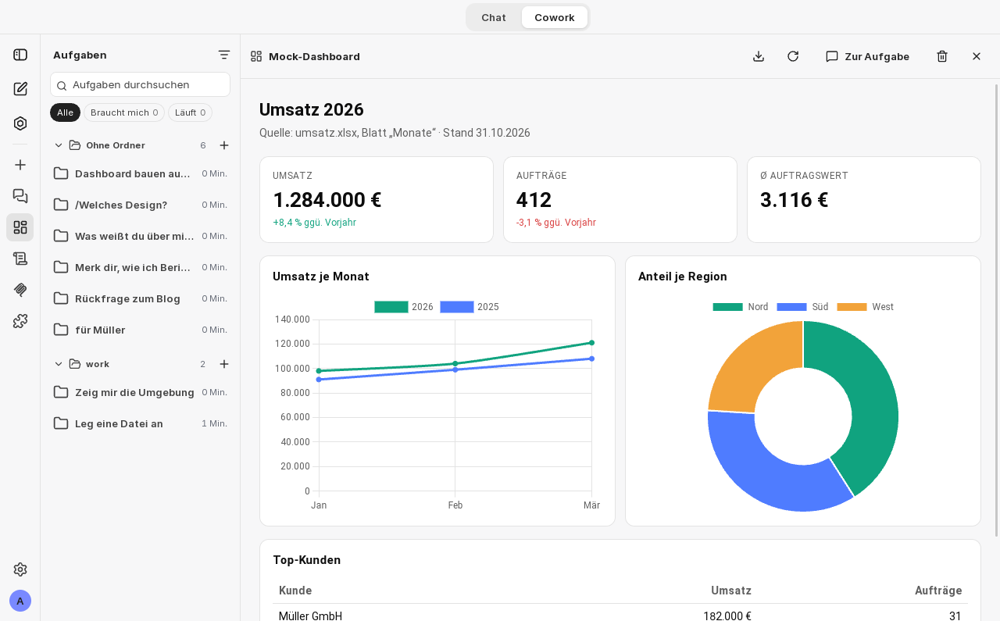
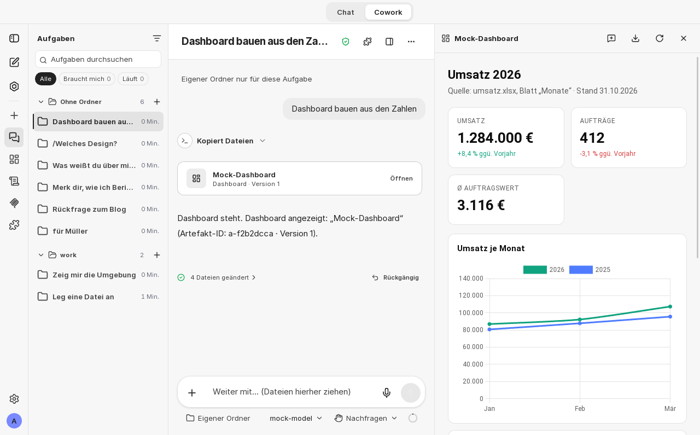
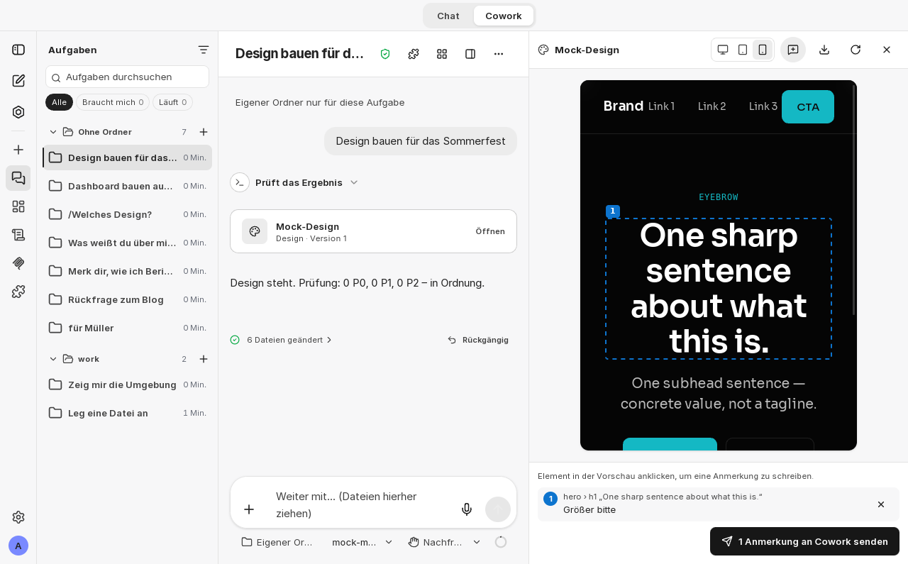
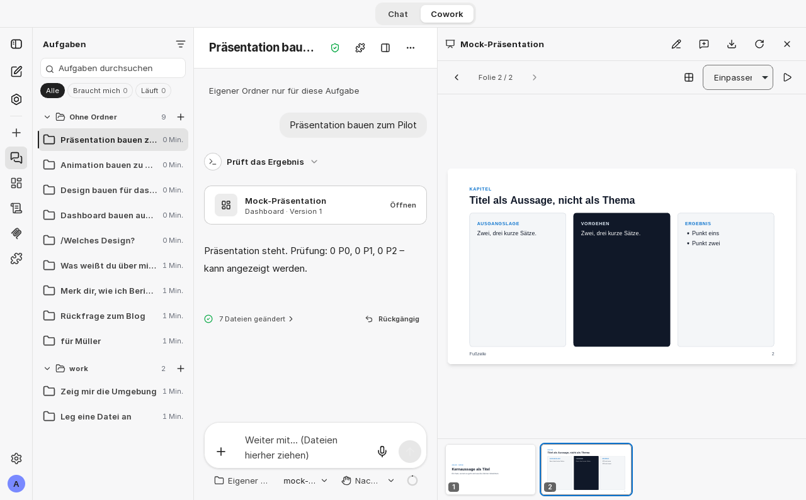
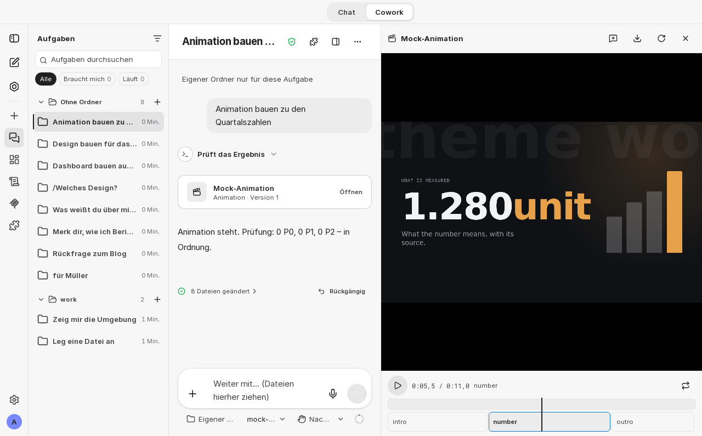

Bittest du Cowork um etwas zum Anschauen, etwa ein Dashboard, eine Landingpage, eine Präsentation oder ein kurzes Erklärvideo, baut es ein **Artefakt** und zeigt es **neben dem Gespräch**. Jede Änderung wird als neue Version gespeichert. Alle Artefakte findest du auch unter **Artefakte** in der linken Leiste.

Artefakte laufen offline und abgeschottet: Sie haben keinen Internetzugang und keinen Zugriff auf die App oder deinen Rechner.

## Die Arten von Artefakten

| Art | Was | Besonderheiten |
|---|---|---|
| **Dashboard** | Kennzahlen und Diagramme aus Daten in deinem Ordner | Cowork prüft die Daten, bevor es sie anzeigt. |
| **Design** | Landingpage, App-Ansicht oder Mockup | Ansicht für Desktop, Tablet und Smartphone, Design-Systeme, Canvas mit Varianten. |
| **Präsentation** | Folien mit Vorschaubildern und Präsentationsmodus | Kommentare pro Folie, Export als PowerPoint mit nativen, bearbeitbaren Formen. |
| **Animation** | Erklärvideo-artige Szenen in 1920 × 1080 | Player mit Zeitleiste und Szenenmarken. Derzeit ein Prototyp. |

## Dashboards

Ein Dashboard zeigt Kennzahlen und Diagramme zu Daten aus deinem Arbeitsordner, zum Beispiel einer Excel- oder CSV-Datei. Es öffnet sich direkt neben dem Gespräch.

## Designs und Canvas

Für Designs nutzt Cowork Vorlagen für Web, App und Mobil. Das Aussehen kommt aus einem **Design-System**: Mitgeliefert sind innFactory und companyGPT. Dein Unternehmen kann eigene Design-Systeme als Skill bereitstellen, und du kannst eines aus einer CI-Datei von companyFILES übernehmen. Das Design-System wählst du über **+** im Eingabefeld.

Designs liegen auf dem **Canvas** der Aufgabe. Jedes Design ist dort eine Fläche, Varianten stehen nebeneinander:

- Verschiebe und zoome den Canvas frei. Eine Fläche öffnest du in Desktop-, Tablet- oder Smartphone-Breite.
- Mit **Mit dieser weiter** wählst du eine Variante aus, an der Cowork weiterarbeitet.
- Texte, Farben und Theme-Werte kannst du selbst ändern. Deine Änderung wird als neue Version gespeichert, und Cowork erfährt davon.

### Kommentarmodus

Im **Kommentarmodus** klickst du ein Element an und beschreibst, was sich ändern soll. Du kannst mehrere Elemente kommentieren, auch über mehrere Flächen hinweg, und alles als eine Nachricht an Cowork schicken.

## Präsentationen

Präsentationen öffnen sich als Foliensatz mit Vorschaubildern und **Präsentationsmodus**. Kommentare setzt du auf ein Element oder auf eine ganze Folie. Sie werden nach Folien gruppiert an Cowork geschickt.

Cowork exportiert die Präsentation als **PowerPoint mit nativen, bearbeitbaren Formen**, auch auf der Vorlage deines Unternehmens oder zurück in eine bestehende PowerPoint-Datei, die Cowork zuvor eingelesen hat.

## Animationen

Animationen sind kurze, erklärvideo-artige Szenen. Der Player hat Abspielen/Pause und eine Zeitleiste mit Szenenmarken. Du springst zu einer Szene, wiederholst sie und kommentierst ein Element oder eine ganze Szene. Kommentare tragen den Zeitpunkt und die Szene.

:::note
Animationen sind ein Prototyp. Ein Export als Video (MP4) ist noch nicht möglich.
:::

## Export

Jedes Artefakt exportierst du als **PDF** (über den Druckdialog des Systems), als **einzelne HTML-Datei** mit allen eingebetteten Inhalten oder als **ZIP**. Präsentationen zusätzlich als **PowerPoint**. Veröffentlichen oder Teilen direkt aus der App ist noch nicht möglich.

Die Seitenleisten der Artefakte änderst du in der Breite durch Ziehen am Rand.
