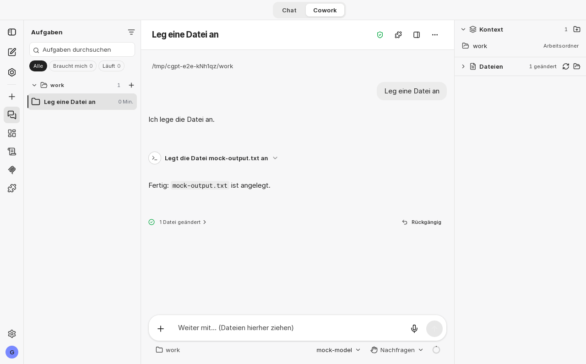
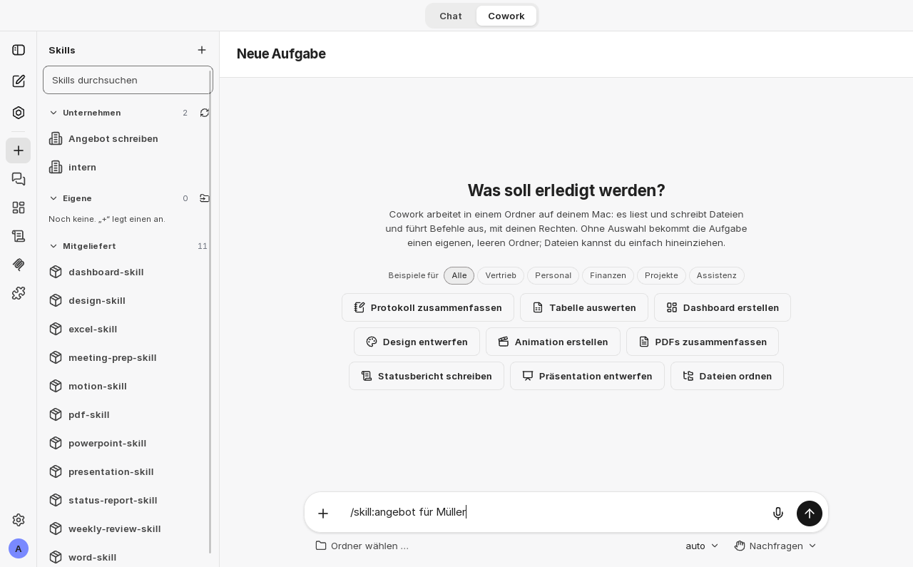
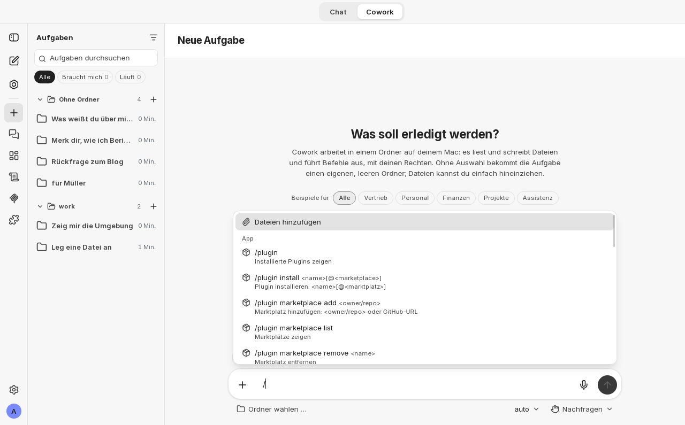
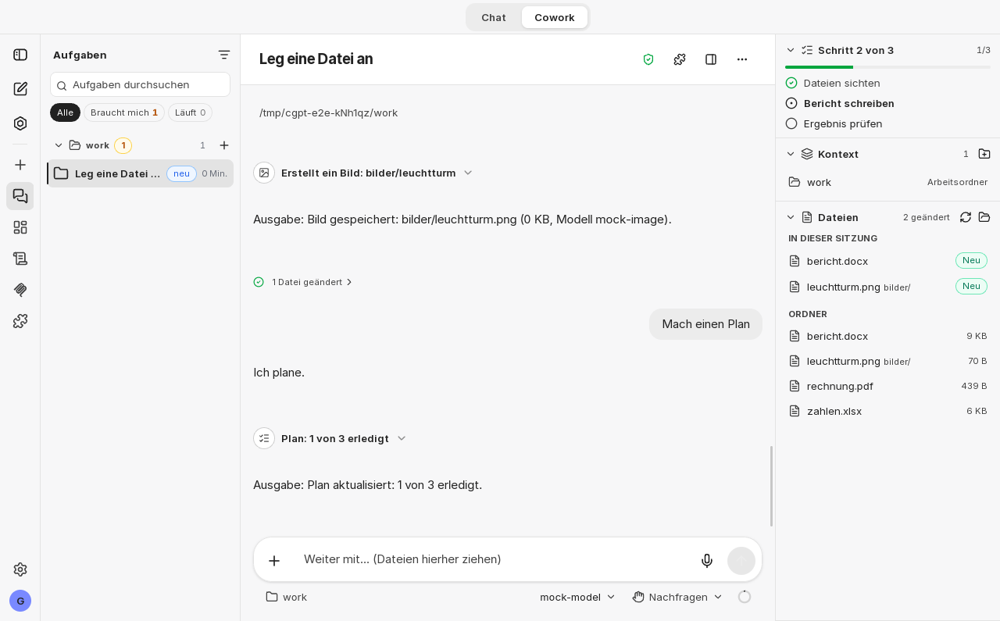
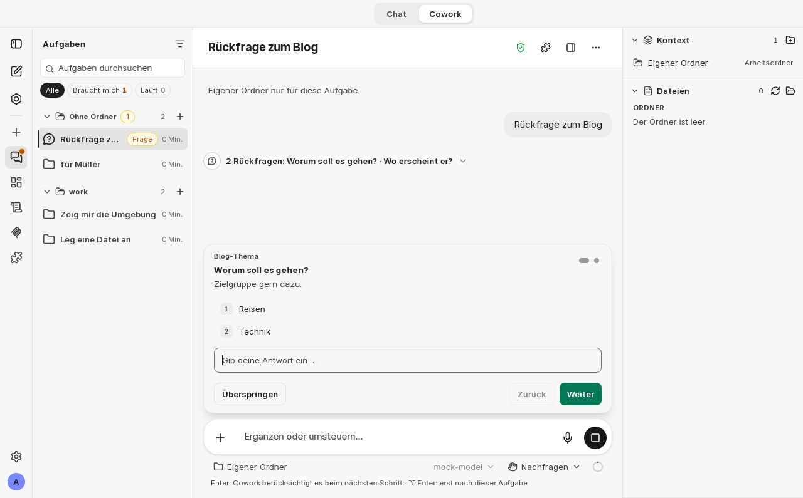
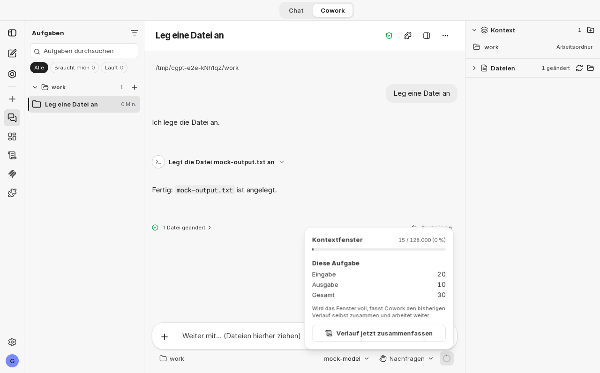
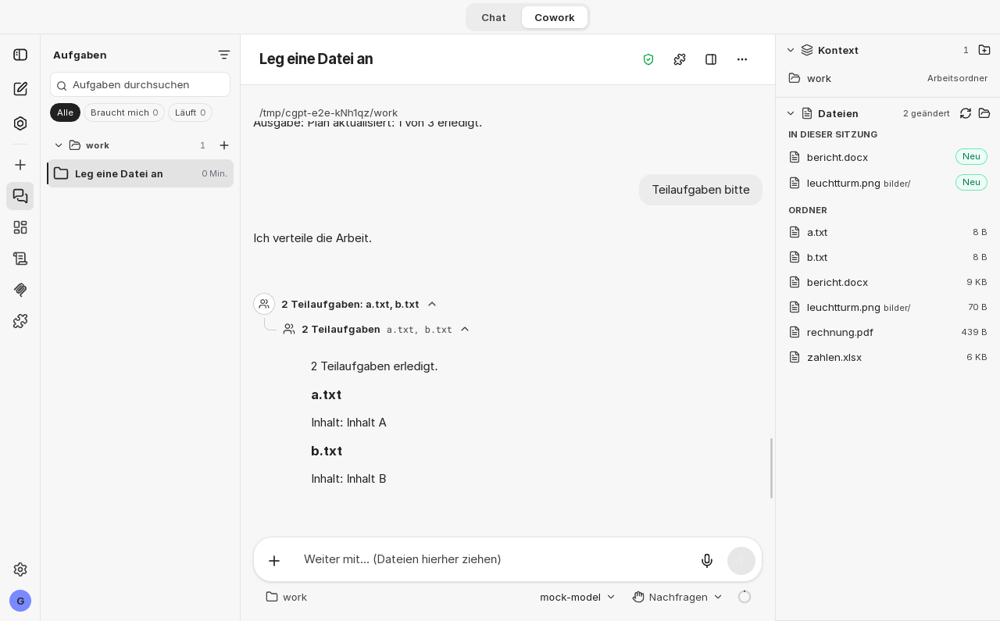

**Cowork** ist ein KI-Agent, der Aufgaben direkt auf deinem Rechner erledigt. Du gibst ihm einen Ordner und beschreibst, was zu tun ist, zum Beispiel „Fasse die PDFs in diesem Ordner zusammen und erstelle daraus ein Word-Dokument“ oder „Baue aus der Excel-Datei ein Dashboard“. Cowork liest und schreibt Dateien im Ordner, führt Befehle in einer [geschützten Umgebung](/de/company-gpt/desktop-app/sicherheit/) aus und zeigt dir jeden Schritt.

Die Modelle kommen über das [AI Gateway](/de/company-gpt/addons/ai-gateway/) deines Unternehmens. Deine Dateien verlassen deinen Rechner nur, soweit das Modell ihren Inhalt für die Aufgabe lesen muss.

## Eine Aufgabe starten

1. Wechsle mit ⌘2 (Windows: Strg+2) zu Cowork oder klicke auf **Neue Aufgabe** (⌘N bzw. Strg+N).
2. Wähle unten im Eingabefeld den **Arbeitsordner**: einen zuletzt verwendeten, einen anderen Ordner oder **Ohne Ordner**. Ohne Ordner legt Cowork einen neuen, leeren Ordner nur für diese Aufgabe an. Du kannst einen Ordner auch einfach auf das Fenster ziehen.
3. Beschreibe die Aufgabe und sende sie ab. Die **Startvorschläge** (zum Beispiel „Dashboard erstellen“ oder „PDFs zusammenfassen“) füllen das Eingabefeld mit einem Beispiel, das du anpassen kannst.

Jede Aufgabe läuft in ihrem eigenen Prozess. Mehrere Aufgaben arbeiten parallel weiter, auch wenn du in den Chat wechselst oder das Fenster schließt. Nach der ersten Antwort gibt das Modell der Aufgabe einen kurzen Titel.

### Modell

Unten im Eingabefeld wählst du das Modell pro Aufgabe. Standard ist `auto`: Das AI Gateway wählt dann je nach Aufgabe ein passendes Modell. Das Standardmodell legst du in den [Einstellungen](/de/company-gpt/desktop-app/einstellungen/) fest.

## Die Aufgabenliste

Die linke Spalte listet deine Aufgaben mit ihrem Status:

- **Filter:** **Alle**, **Braucht mich** (wartet auf eine Freigabe oder Antwort) und **Läuft**.
- **Suche:** **Aufgaben durchsuchen** findet Aufgaben nach Titel.
- **Gruppieren:** standardmäßig **Nach Ordner**, alternativ **Nach Ordner und Zeit**, **Nach Zeit** oder **Keine**.
- Das **+** an einem Ordner startet eine neue Aufgabe in diesem Ordner.
- Beim Überfahren einer Aufgabe erscheint ihr **…**-Menü: umbenennen, Ordner zeigen oder löschen, ohne die Aufgabe zu öffnen.

Aufgaben bleiben auf deinem Rechner gespeichert. Nach einem Neustart der App setzt du sie mit dem vollständigen Verlauf fort.

## Das Eingabefeld

- **@-Erwähnungen** verweisen auf Dateien im Arbeitsordner.
- **/** am Anfang einer Nachricht listet Aktionen, [Skills](/de/company-gpt/desktop-app/erweiterungen/#skills) und Plugin-Befehle.
- **+** fügt Dateien hinzu, wählt einen Skill, schaltet [Konnektoren](/de/company-gpt/desktop-app/erweiterungen/#konnektoren) ein und wählt ein Design-System.
- **Dateien ablegen:** Gezogene Dateien kopiert Cowork in den Arbeitsordner.
- **Mikrofon:** [Diktat](/de/company-gpt/desktop-app/quick-ask/#diktat) statt Tippen.

## Während Cowork arbeitet

Du musst nicht warten, bis Cowork fertig ist:

- **Enter** schickt eine Ergänzung, die Cowork vor dem nächsten Schritt berücksichtigt, etwa „Nimm bitte nur die Daten ab 2025“.
- **⌥Enter** (Windows: Alt+Enter) hängt eine Nachricht für danach an.
- Wartende Nachrichten stehen sichtbar in einer Warteschlange über dem Eingabefeld.
- **Stoppen** bricht den aktuellen Lauf ab und legt wartenden Text zurück ins Eingabefeld.

## Plan und Fortschritt

Bei Aufgaben mit drei oder mehr Schritten pflegt Cowork eine Schrittliste. In der Seitenleiste der Aufgabe siehst du unter **Plan**, welcher Schritt gerade dran ist, zum Beispiel „Schritt 2 von 3“, und welche erledigt sind.

## Rückfragen

Braucht Cowork eine Entscheidung von dir, stellt es eine **Rückfrage** mit Auswahlmöglichkeiten: ein bis vier Fragen, mit Einfach- oder Mehrfachauswahl und Freitext. Die Fragekarte erscheint über dem Eingabefeld und sieht aus wie im Chat. Mit deiner Antwort arbeitet Cowork weiter.

## Das Gespräch

- Antworten erscheinen als formatierter Text. Den Denkprozess des Modells kannst du aufklappen.
- Jeder Arbeitsschritt erscheint als Karte, etwa ein ausgeführter Befehl mit seiner Ausgabe oder eine gelesene bzw. geänderte Datei mit den Änderungen.
- Nach einem Lauf fasst eine Karte zusammen, welche Dateien sich geändert haben. Über **Rückgängig** drehst du den letzten Schritt zurück (siehe [Sicherheit und Freigaben](/de/company-gpt/desktop-app/sicherheit/#rückgängig)).
- Unter jeder Antwort findest du beim Überfahren **Kopieren** und **Abzweigen**. **Abzweigen** erstellt eine neue Aufgabe mit dem Verlauf bis zu dieser Antwort und denselben Einstellungen (Ordner, Kontextordner, Modell, Berechtigungen, Konnektoren). So probierst du einen anderen Weg aus, ohne die ursprüngliche Aufgabe zu verändern.

## Kontext und Zusammenfassung

Der **Kontext-Ring** neben dem Eingabefeld zeigt, wie voll das Kontextfenster des Modells ist. Beim Überfahren siehst du die Tokens (Eingabe, Cache, Ausgabe) und kannst den **Verlauf jetzt zusammenfassen**. Bei langen Aufgaben fasst Cowork den Verlauf auch selbst zusammen. Dabei bleiben Dateien, Entscheidungen, offene Punkte und der aktuelle Plan erhalten. Wurde eine Antwort abgeschnitten, bietet Cowork **Weiter** an.

## Unteragenten

Für unabhängige Lese- und Zusammenfassungsaufgaben startet Cowork bis zu vier **Unteragenten** parallel, zum Beispiel, um mehrere Dokumente gleichzeitig zu lesen. Unteragenten dürfen nur lesen: Sie führen keine Befehle aus und schreiben nichts. Ihre Ergebnisse fließen gesammelt in die Aufgabe zurück.

## Unternehmensvorgaben

Hat dein Administrator in companyADMIN Anweisungen für Cowork hinterlegt, etwa zur Tonalität, zu Ablageorten oder zu internen Richtlinien, gelten sie für jede Cowork-Aufgabe. Du musst dafür nichts tun.

## Schutz vor Endlosschleifen

Wiederholt Cowork dieselbe Aktion mehrfach hintereinander, bekommt es zuerst einen Hinweis, dann wird die Aktion gesperrt, und schließlich bricht Cowork den Lauf ab.
