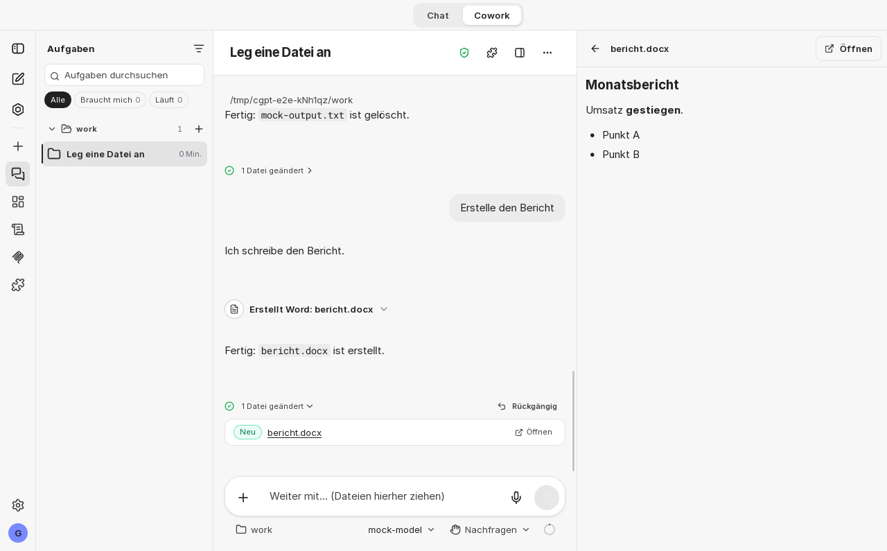
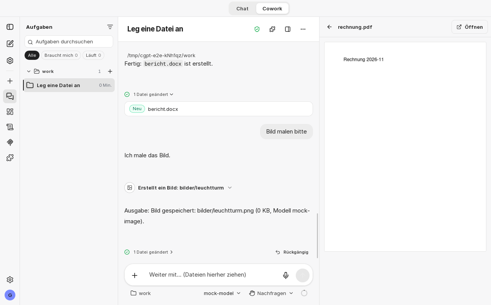

Cowork arbeitet direkt mit den Dateien in deinem Arbeitsordner. Es liest PDFs, Word-, Excel- und PowerPoint-Dateien, erstellt neue Dokumente und prüft sein Ergebnis anhand einer Vorschau. Die Office-Werkzeuge laufen lokal auf deinem Rechner, Dateien werden dafür nicht hochgeladen. Auf deinem Rechner muss dafür nichts installiert sein: Die App bringt eine eigene Python-Umgebung mit allen nötigen Bibliotheken mit.

## Die Seitenleiste der Aufgabe

Rechts neben dem Gespräch zeigt die Seitenleiste der Aufgabe drei Abschnitte, die du einzeln auf- und zuklappst. Der Zustand bleibt gespeichert.

- **Plan:** die Schritte der Aufgabe mit Fortschritt (siehe [Cowork](/de/company-gpt/desktop-app/cowork/#plan-und-fortschritt)).
- **Kontext:** der Arbeitsordner und weitere Ordner, die du über **Ordner hinzufügen** dazunimmst. Cowork liest diese Ordner ohne Nachfrage. Bevor es dort etwas ändert, fragt es dich.
- **Dateien:** der Inhalt des Arbeitsordners. Ein Klick auf eine Datei zeigt ihre Vorschau, über **Öffnen** öffnest du sie im zugehörigen Programm, außerdem kannst du sie im Finder bzw. Explorer zeigen.

Die Seitenleiste blendest du über das Symbol oben rechts in der Aufgabe ein und aus. Ihre Breite änderst du durch Ziehen am Rand.

## Vorschau

Die Vorschau zeigt Text-, PDF-, Word-, Excel- und PowerPoint-Dateien direkt in der App.

:::tip[Echte Vorschau mit LibreOffice]
Ohne weitere Programme zeigt Cowork Folien, Word- und Excel-Dateien als vereinfachte Skizze. Unter **Einstellungen → Dokument-Vorschau** kannst du LibreOffice laden (macOS). Dann zeigt Cowork die Dateien so, wie sie wirklich aussehen, prüft damit sein Ergebnis und erstellt PDFs daraus. Ist PowerPoint, Keynote oder LibreOffice bereits installiert, verwendet Cowork diese Programme.
:::

## Office-Werkzeuge

Cowork bringt eigene Werkzeuge für Office-Dateien mit:

- **office_read**: liest PDF-, Word-, Excel- und PowerPoint-Dateien als Text.
- **word_create**, **excel_create**, **powerpoint_create**: erstellen neue Dokumente.

Für anspruchsvollere Arbeiten nutzt Cowork mitgelieferte **Office-Skills** mit eigenen Skripten:

| Format | Was Cowork damit kann |
|---|---|
| **PowerPoint** | Vorlagen samt Design analysieren, Folien aus deiner Vorlage bauen, mit Diagramm-Bausteinen (Karten, Kennzahlen, Schritte, Roadmap, Matrix, Zyklus, native Diagramme und Tabellen, über 140 einfärbbare Icons). Das Aussehen kommt aus einem wiederverwendbaren Stil pro Vorlage. Ohne Vorlage verwendet Cowork eine Standardvorlage. Dazu kommen Layout-Prüfung und Reparatur von Präsentationen mit schwachem Folienmaster. |
| **Word** | Dokumente analysieren, Platzhalter füllen, Änderungen nachverfolgen und Kommentare setzen. |
| **Excel** | Arbeitsmappen analysieren, auch daraufhin, was beim Bearbeiten verloren ginge, und Formeln prüfen. |
| **PDF** | Seiten als Bild darstellen, Formularfelder ausfüllen und auf Formulare ohne Felder schreiben. |

Modelle mit Bildverständnis sehen die gerenderten Vorschauen und prüfen ihr Ergebnis selbst, etwa ob Text über den Folienrand läuft.

## Bilder erzeugen

Bittest du Cowork um ein Bild, etwa für eine Präsentation oder ein Design, erzeugt es das Bild über das Bildmodell deines AI Gateways und speichert es im Arbeitsordner. Welches Bildmodell verwendet wird, legst du in den [Einstellungen](/de/company-gpt/desktop-app/einstellungen/) fest.

## Präsentationen

Präsentationen öffnet Cowork als eigenes Artefakt mit Folien, Vorschaubildern, Präsentationsmodus und Kommentaren und exportiert sie als PowerPoint mit nativen, bearbeitbaren Formen. Mehr dazu unter [Artefakte](/de/company-gpt/desktop-app/artefakte/#präsentationen).
