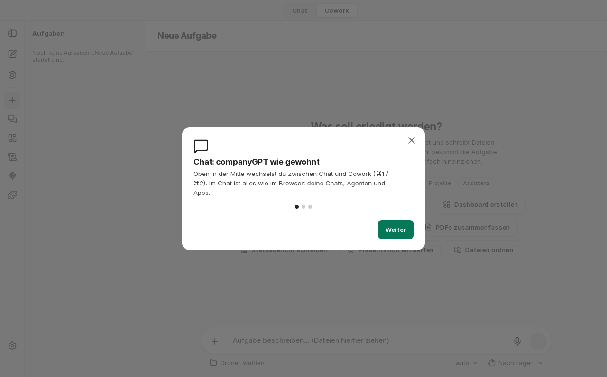

Die Einrichtung der Desktop-App dauert in der Regel weniger als eine Minute. Du brauchst nur die Adresse deines companyGPT und dein Microsoft-Konto. Auf verwalteten Geräten übernimmt deine IT auch diesen Schritt.

## App installieren

Das Installationspaket bekommst du von deinem Unternehmen bzw. von innFactory. Auf verwalteten Geräten verteilt deine IT die App in der Regel über Intune oder ein anderes Softwareverteilungssystem.

- **macOS:** Öffne die `.dmg`-Datei und ziehe **companyGPT** in den Ordner **Programme**.
- **Windows:** Starte das Installationsprogramm (`.exe`). Die App wird für deinen Benutzer installiert, Administratorrechte brauchst du dafür nicht.

:::note[Unsignierte Pilot-Builds]
Pilot-Builds sind noch nicht von Apple bzw. Microsoft signiert. macOS blockiert die App deshalb beim ersten Öffnen: Öffne sie einmal und wähle dann **Systemeinstellungen → Datenschutz & Sicherheit → Dennoch öffnen**. Windows zeigt einen SmartScreen-Hinweis, den du über **Weitere Informationen → Trotzdem ausführen** bestätigst. Auf verwalteten Geräten regelt deine IT das zentral.
:::

## Erster Start

Beim ersten Start fragt die App nur nach der **Adresse deines companyGPT**, zum Beispiel `companygpt.dein-unternehmen.de`. Alle weiteren Werte (Chat-Adresse, AI Gateway, Microsoft-Anmeldung) lädt die App selbst aus der Konfiguration deiner Umgebung.

1. Gib die Adresse deines companyGPT ein und bestätige sie.
2. Klicke auf **Mit Microsoft anmelden** und melde dich mit deinem Firmenkonto an. Die Anmeldung öffnet sich in einem Fenster der App.
3. Eine kurze Tour zeigt dir Chat, Cowork und Quick-Ask. Danach öffnet sich der Chat, bereits angemeldet.

Hat deine IT die App vorkonfiguriert, entfällt die Eingabe der Adresse. Die Verbindungsdaten sind dann in den [Einstellungen](/de/company-gpt/desktop-app/einstellungen/) gesperrt.

:::tip
Findet die App für deine Adresse keine Konfiguration, ist die Desktop-App für deine Umgebung noch nicht freigeschaltet. Wende dich in diesem Fall an deinen Administrator.
:::

## Eine Anmeldung für alles

Mit der einen Microsoft-Anmeldung sind Chat, Cowork und alle App-Tabs angemeldet. Dein Passwort gibst du kein zweites Mal ein, höchstens die Kontoauswahl von Microsoft erscheint noch einmal.

- Läuft deine Chat-Sitzung ab, meldet die App den Chat im Hintergrund wieder an.
- Für lange Cowork-Aufgaben erneuert die App den Zugang selbstständig, sodass auch Aufgaben über mehrere Stunden weiterlaufen.
- Dein Anmeldetoken liegt geschützt im Schlüsselbund (macOS) bzw. in der Windows-Anmeldeinformationsverwaltung. Weder das Modell noch die Befehle, die Cowork ausführt, bekommen ihn zu sehen.

Über das Kontomenü unten links (dein Name bzw. Profilbild) siehst du, mit welchem Konto du angemeldet bist.

## Abmelden

**Abmelden** im Kontomenü meldet dich überall gleichzeitig ab: Cowork vergisst die Anmeldung, wartende Cowork-Prozesse enden, die Chat-Sitzung und die Microsoft-Sitzung werden gelöscht, App-Tabs schließen sich, und der Chat zeigt wieder die Anmeldung. Deine Cowork-Aufgaben und Dateien bleiben auf deinem Rechner erhalten.

## Fenster schließen und beenden

Das Schließen des Fensters beendet die App nicht. Laufende Cowork-Aufgaben arbeiten im Hintergrund weiter. Das Symbol in der Menüleiste (macOS) bzw. im Infobereich der Taskleiste (Windows) zeigt, was Cowork gerade tut, zum Beispiel „2 Aufgaben laufen · 1 wartet auf Freigabe“. Darüber öffnest du das Fenster wieder, startest Quick-Ask oder beendest die App. Beenden kannst du die App außerdem mit ⌘Q bzw. über das Menü.

Ist das Fenster nicht im Vordergrund, melden Mitteilungen und das Dock-Symbol, wenn eine Aufgabe fertig ist oder auf deine Freigabe wartet.

## Updates

Die App sucht eine Minute nach dem Start und danach alle sechs Stunden nach Updates. Ist eine neue Version verfügbar, erscheint oben in der App **Update X · Installieren**. Die App prüft die Signatur des Updates, bevor sie es installiert. Unter **Einstellungen → Version** suchst du auch selbst nach Updates.
