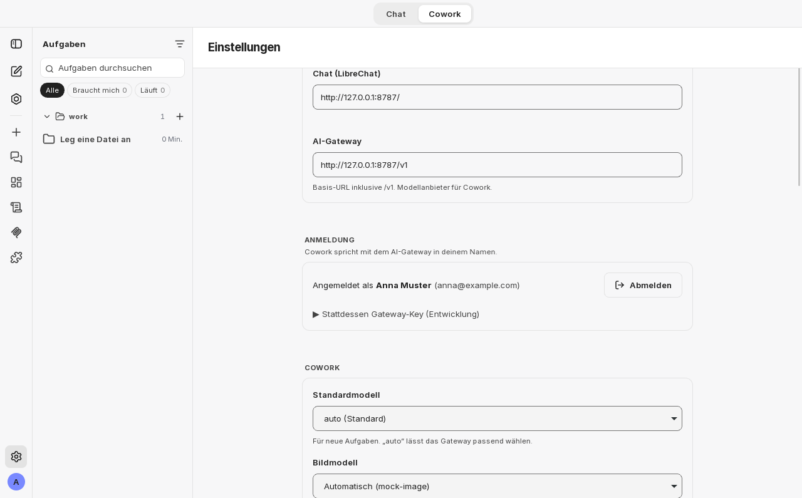

Die Einstellungen öffnest du über das Zahnrad unten in der linken Leiste von Cowork. Hat deine IT einzelne Werte festgelegt, sind sie gesperrt. Ein Hinweis oben auf der Seite sagt das dann.

## Mandant und Anmeldung

| Einstellung | Bedeutung |
|---|---|
| **companyGPT-Adresse** | Die Adresse von companyGPT in deinem Unternehmen, zum Beispiel `companygpt.firma.de`. Die App holt den Rest selbst. |
| **AI-Gateway** | Die Adresse des AI Gateways, über das Cowork die Modelle anspricht. Wird aus der Adresse ermittelt. |
| **Anmeldung** | Zeigt, mit welchem Microsoft-Konto du angemeldet bist, und bietet **Abmelden** bzw. **Mit Microsoft anmelden**. |

Für Entwicklung und Tests gibt es statt der Microsoft-Anmeldung die Option **Stattdessen Gateway-Key (Entwicklung)**. Dein Unternehmen kann sie abschalten.

## Modelle

- **Standardmodell:** gilt für neue Aufgaben. Mit **auto** wählt das AI Gateway passend zur Aufgabe.
- **Bildmodell:** für Bilder, die Cowork erstellt, zum Beispiel für Präsentationen, Designs oder Dokumente.

## Darstellung

- **Technische Details zeigen:** zeigt Befehle und Werkzeug-Angaben im Verlauf und in Freigaben. Ohne diese Option siehst du kurze Beschreibungen, die Details öffnest du mit einem Klick.
- **Einführung noch einmal zeigen:** startet die Tour vom ersten Start erneut.

## Schnell fragen und Diktat

- **Tastenkürzel:** das Kürzel für [Quick-Ask](/de/company-gpt/desktop-app/quick-ask/), zum Beispiel `Alt+Space` oder `CmdOrCtrl+Shift+K`. Ein leeres Feld schaltet es ab. Ist das Kürzel bereits von einer anderen App belegt, weist die App darauf hin.
- **Diktat-Modell:** das Modell am AI Gateway für die Spracherkennung. Leer bedeutet `whisper`.

## Benachrichtigungen

Ist das Fenster nicht im Vordergrund, meldet die App, wenn eine Aufgabe fertig ist, einen Fehler hat oder auf dich wartet. Ein Klick auf die Mitteilung öffnet die Aufgabe. Hier schaltest du Benachrichtigungen ein oder aus, fragst die Berechtigung beim Betriebssystem an und sendest eine Testbenachrichtigung.

## Dokument-Vorschau

Mit LibreOffice zeigt Cowork Folien, Word- und Excel-Dateien so, wie sie wirklich aussehen, prüft damit sein Ergebnis und erstellt PDFs daraus. Ohne LibreOffice gibt es nur Skizzen. Hier lädst du LibreOffice (macOS, Apple-Chip) oder entfernst es wieder. Ein bereits installiertes LibreOffice verwendet die App automatisch.

## Gedächtnis

Hier schaltest du das [Gedächtnis](/de/company-gpt/desktop-app/erweiterungen/#gedächtnis) ein oder aus und siehst, ergänzt oder löschst die Notizen über dich und deine Arbeitsordner.

## companyCODE im Terminal

Zeigt, wo der Befehl `companycode` für das Terminal eingerichtet ist, und entfernt oder installiert ihn neu. Mehr dazu unter [companyCODE](/de/company-gpt/desktop-app/companycode/).

## Version

Zeigt die installierte Version und sucht nach Updates.

## Von deinem Unternehmen verwaltet

Hat dein Unternehmen Funktionen von Cowork über companyADMIN oder die Geräteverwaltung festgelegt, listet dieser Abschnitt alle verwalteten Einstellungen auf, zum Beispiel Gedächtnis, eigene MCP-Server, eigene Skills, eigene Plugins, den Konnektor **Computer**, Browser-Konnektoren, Websuche, **Alles erlauben** und **Für diese Aufgabe immer erlauben**. Die betroffenen Optionen sind in der App gesperrt und tragen den Hinweis **Von deinem Unternehmen verwaltet**.
