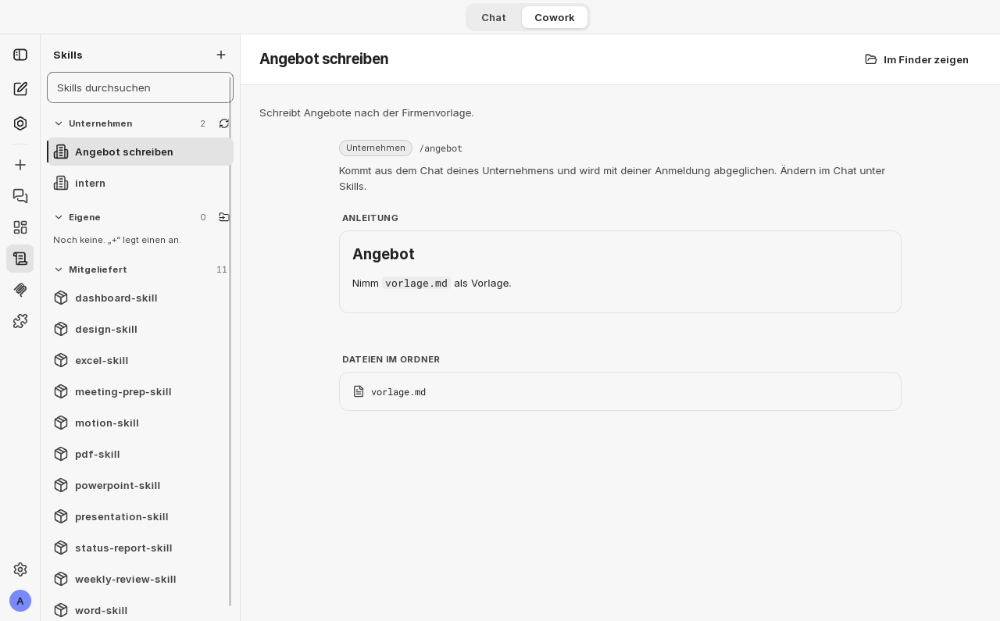
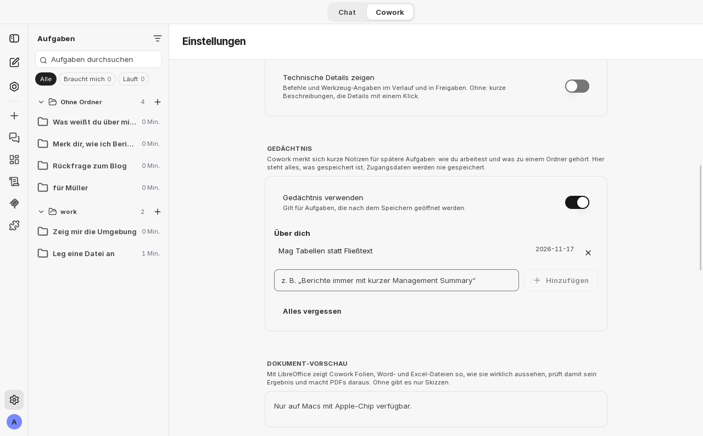
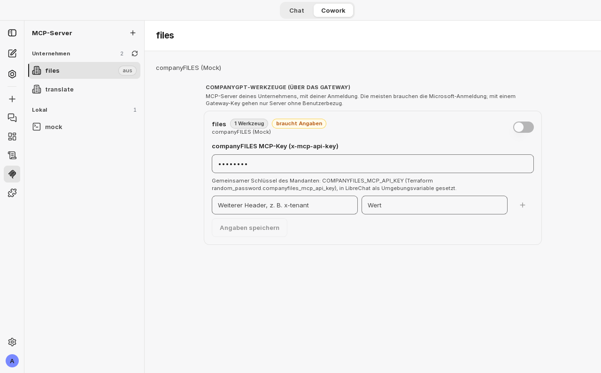
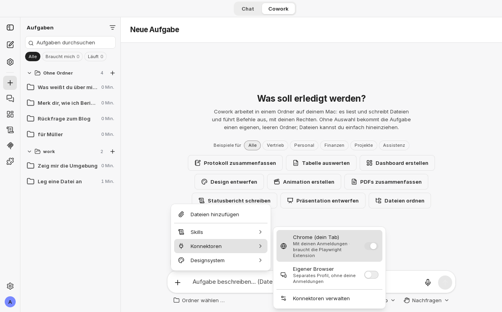

Cowork lässt sich auf mehreren Wegen erweitern: **Skills** bringen Fachwissen und Arbeitsabläufe mit, das **Gedächtnis** merkt sich Wichtiges über dich und deine Ordner, **MCP-Server** stellen zusätzliche Werkzeuge bereit, **Konnektoren** geben Cowork Zugriff auf einen Browser oder deine Desktop-Apps, und **Plugins** bündeln Skills, Befehle und MCP-Server zu Paketen. Was davon du nutzen darfst, kann dein Unternehmen festlegen.

## Skills

Cowork kennt drei Arten von [Skills](/de/company-gpt/skills/):

- **Skills deines Unternehmens:** Alle Skills, die du im Chat nutzen darfst, holt die App nach der Microsoft-Anmeldung automatisch. Geänderte Skills werden neu geladen.
- **Mitgelieferte Skills:** zum Beispiel Besprechungsvorbereitung, Statusbericht und Wochenrückblick sowie die Skills für Office-Dokumente, Dashboards, Designs, Präsentationen und Animationen.
- **Eigene Skills:** Füge in der linken Leiste unter **Skills** einen Ordner mit einer `SKILL.md` hinzu oder schreibe einen Skill direkt in der App.

Cowork wählt passende Skills selbst aus. Gezielt startest du einen Skill mit **/** am Anfang einer Nachricht oder über **+** im Eingabefeld.



## Gedächtnis

Mit eingeschaltetem **Gedächtnis** merkt sich Cowork kurze Notizen über dich und pro Arbeitsordner, zum Beispiel bevorzugte Formate oder wiederkehrende Ansprechpartner. Pro Bereich sind es höchstens 40 Notizen, Zugangsdaten werden nie gespeichert. Jede neue Aufgabe bekommt diese Notizen mit.

In den Einstellungen unter **Gedächtnis** siehst du alle Notizen, ergänzt sie, löschst einzelne oder schaltest das Gedächtnis ganz ab.



## MCP-Server

Über [MCP-Server](/de/company-gpt/integrationen/mcp-server/) bekommt Cowork zusätzliche Werkzeuge. Unter **MCP** in der linken Leiste findest du zwei Bereiche:

- **companyGPT-Werkzeuge (über das Gateway):** die MCP-Server, die das AI Gateway deines Unternehmens für dich freigibt, zum Beispiel companyFILES oder companyRAG. Sie nutzen deine Microsoft-Anmeldung. Server, die keine weitere Eingabe brauchen, sind bereits eingeschaltet.
- **Eigene MCP-Server:** lokale oder entfernte Server im Format von Claude Desktop. Vorlagen (zum Beispiel für Browsersteuerung mit Playwright), ein Import aus Claude Desktop und ein Verbindungstest helfen bei der Einrichtung. Server, die mit `npx` oder `node` starten, laufen auch ohne installiertes Node.js.



:::caution
Eigene MCP-Server laufen **außerhalb** der geschützten Ausführung. Jeder Aufruf eines MCP-Werkzeugs erfordert im Modus **Nachfragen** deine Freigabe. Füge nur Server hinzu, denen du vertraust. Die Server deines Unternehmens kommen am besten als Plugin aus companyADMIN.
:::

## Konnektoren

Über **+** im Eingabefeld schaltest du pro Aufgabe **Konnektoren** ein:

| Konnektor | Was Cowork damit kann |
|---|---|
| **Chrome (dein Tab)** | Einen Tab in deinem Chrome bedienen, über die Playwright-Erweiterung. |
| **Eigener Browser** | Einen separaten Browser steuern, getrennt von deinem eigenen. |
| **Computer** (macOS) | Apps auf deinem Mac sehen und bedienen, etwa Excel, Outlook oder Numbers. |



### Konnektor „Computer“

Mit dem Konnektor **Computer** bedient Cowork Apps auf deinem Mac im Hintergrund, mit einem eigenen Mauszeiger, ohne dir den Fokus zu nehmen. Cowork nutzt ihn nur, wenn es keinen besseren Weg gibt, also wenn Dateien, Office-Werkzeuge, MCP-Server oder Browser-Konnektoren nicht ausreichen.

- Beim ersten Einschalten fragt macOS nach den Berechtigungen **Bedienungshilfen** und **Bildschirmaufnahme** für companyGPT.
- Danach gibst du **jede App einmal pro Aufgabe** frei, bevor Cowork sie ansieht oder bedient, etwa „Cowork möchte ‚Microsoft Excel‘ sehen und bedienen.“ Das gilt in jedem Berechtigungsmodus.
- **Ausgenommen** sind companyGPT selbst, Passwort-Manager, Terminals und Skript-Editoren, die Systemeinstellungen und Anmeldedialoge von macOS.
- **⇧⌘Esc** hält Cowork sofort an.

:::note
Aktionen in anderen Apps lassen sich nicht über **Rückgängig** zurückdrehen.
:::

## Plugins

**Plugins** sind Pakete aus Skills, Befehlen und MCP-Servern im Format von Claude Code und Agent Plugins. Dieselben Plugins laufen also auch in Claude Cowork und Codex. Du findest sie unter **Plugins** in der linken Leiste.

### Plugins deines Unternehmens

Administratoren geben Plugins in companyADMIN frei, aus einem Git-Repository oder einem Marktplatz, pro Rolle oder Gruppe als **Verfügbar**, **Standard an** oder **Vorgegeben**. Die App installiert sie mit deiner Microsoft-Anmeldung selbst, hält sie auf dem freigegebenen Stand und entfernt sie, wenn sie nicht mehr freigegeben sind. Vorgegebene Plugins kannst du nicht abschalten.

### Eigene Plugins

Erlaubt dein Unternehmen eigene Plugins, fügst du sie hinzu

- aus einem **Ordner** oder einer **ZIP-Datei** (**Ordner hinzufügen**, **ZIP hinzufügen**),
- **aus GitHub**: Repository eingeben, gefundene Plugins **Installieren** (oder **Einschalten**, wenn dein Unternehmen sie bereits anbietet). Marktplätze erscheinen in einem eigenen Abschnitt, wo du sie aktualisierst oder entfernst,
- oder mit dem Befehl **/plugin** im Eingabefeld, wie in Claude Code:

```text
/plugin marketplace add <owner/repo>
/plugin install <name>@<marktplatz>
/plugin list | update | enable | disable | uninstall
```

Plugins aus GitHub baut companyADMIN für dich. Die App prüft die Prüfsumme, bevor sie ein Plugin installiert. Den Befehl `/plugin` führt die App selbst aus, er geht nie an das Modell.

Schaltet dein Unternehmen eigene Plugins ab, bleiben sie auf deinem Rechner, werden aber nicht geladen („Von deinem Unternehmen deaktiviert“).

### Was ein Plugin mitbringt

- **Skills** stehen neben den Skills deines Unternehmens bereit.
- **Befehle** erscheinen im Eingabefeld unter **/**.
- **MCP-Server** laufen wie eigene Server außerhalb der Sandbox, jeder Aufruf mit Freigabe.

Hooks und Agenten aus Plugins werden noch nicht ausgeführt, und Server, die eigene Einstellungen brauchen, werden noch nicht geladen. Die Karte des Plugins weist darauf hin.
