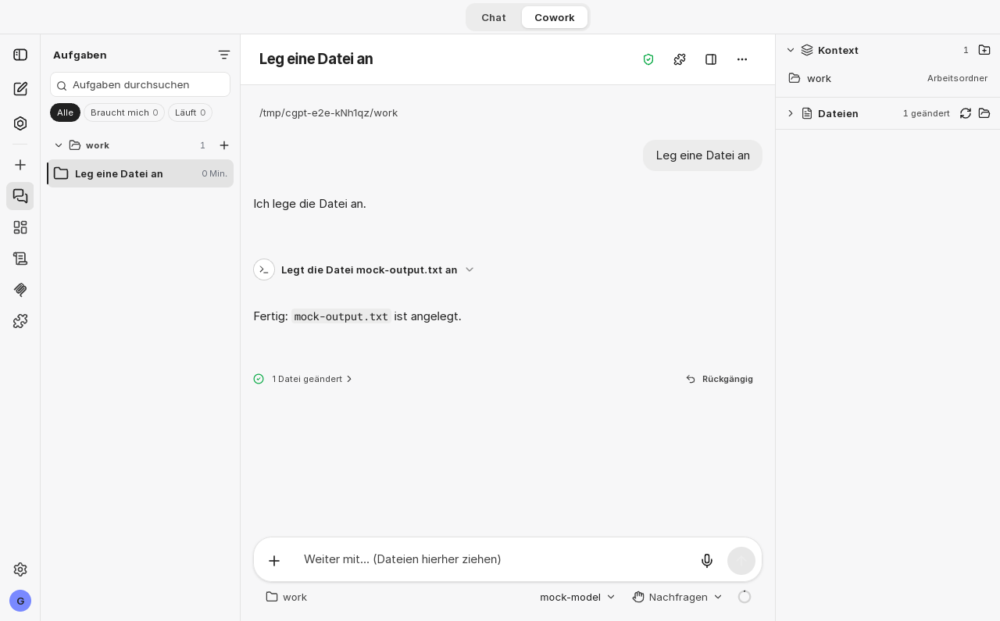

:::caution[Pilotphase]
Die Desktop-App befindet sich in der Pilotphase. Funktionen und Oberfläche ändern sich noch, und nicht jede Umgebung hat sie freigeschaltet. Ob du die App nutzen kannst, legt dein Unternehmen fest.
:::

Die companyGPT Desktop-App bringt companyGPT als eigenständiges Programm auf deinen Mac oder Windows-PC. Sie verbindet zwei Arbeitsweisen in einem Fenster: den **Chat**, also das companyGPT, das du aus dem Browser kennst, und **Cowork**, einen KI-Agenten, der direkt auf deinem Rechner in einem Ordner arbeitet. Cowork liest und schreibt Dateien, erstellt Word-, Excel- und PowerPoint-Dokumente, baut Dashboards und Präsentationen und führt dabei Befehle in einer geschützten Umgebung aus.

Beide Modi nutzen dieselbe Microsoft-Anmeldung, dieselben Modelle über das [AI Gateway](/de/company-gpt/addons/ai-gateway/) deines Unternehmens und dieselben [Skills](/de/company-gpt/skills/). Die companyGPT-Apps wie companyRAG oder companyFILES öffnen sich als eigene Tabs im selben Fenster.

## Die Bereiche der App

| Bereich | Was er ist | Wo er läuft |
|---|---|---|
| **Chat** (⌘1 / Strg+1) | Dein gewohntes companyGPT mit Agenten, Tools, Artefakten und Projekten | auf dem Server deines Unternehmens |
| **Cowork** (⌘2 / Strg+2) | Ein KI-Agent, der Aufgaben in einem Ordner auf deinem Rechner erledigt | auf deinem Rechner, Modelle über das AI Gateway |
| **App-Tabs** | Die companyGPT-Apps (companyRAG, companyFILES, companyTRANSLATE, …) als eigene Tabs | auf dem Server deines Unternehmens |
| **Quick-Ask** (⌥Leertaste, Windows: Strg+Alt+Leertaste) | Ein kleines Fenster für schnelle Fragen mit Screenshots, von überall | sendet an Chat oder Cowork |

Kurz gesagt: Der **Chat** ist companyGPT im Browser, nur als App. **Cowork** ist ein Agent, der auf deinem Rechner in einem Ordner arbeitet.

## Wann Chat, wann Cowork?

- **Chat** eignet sich für Fragen, Recherchen, Texte, die Arbeit mit den Agenten deines Unternehmens und alles, was du mit Kolleginnen und Kollegen teilen möchtest. Die Verläufe liegen wie gewohnt in companyGPT.
- **Cowork** eignet sich, wenn mit Dateien auf deinem Rechner gearbeitet werden soll: einen Ordner aufräumen, mehrere PDFs zusammenfassen, aus einer Excel-Tabelle einen Bericht erstellen, eine Präsentation auf deiner Firmenvorlage bauen oder ein Dashboard aus Daten im Ordner erzeugen. Cowork-Aufgaben bleiben lokal auf deinem Rechner.

Chat-Verläufe und Cowork-Aufgaben werden bewusst nicht miteinander abgeglichen.

## Systemvoraussetzungen

- **macOS** auf Apple Silicon (M1 oder neuer).
- **Windows** 10/11 (x64), derzeit als Vorschau. Für Cowork brauchst du zusätzlich [Git für Windows](https://git-scm.com/download/win).
- Eine companyGPT-Umgebung, in der die Desktop-App freigeschaltet ist, und ein Microsoft-Konto deines Unternehmens.

## Inhalt dieses Bereichs

- [Installation und Anmeldung](/de/company-gpt/desktop-app/einrichtung/): App installieren, erster Start, eine Anmeldung für alles, Updates.
- [Chat und Apps](/de/company-gpt/desktop-app/chat-und-apps/): der Chat in der App, App-Tabs, Downloads und Links.
- [Cowork](/de/company-gpt/desktop-app/cowork/): Aufgaben, Ordner, Eingabefeld, Plan, Rückfragen und Unteragenten.
- [Sicherheit und Freigaben](/de/company-gpt/desktop-app/sicherheit/): Sandbox, Berechtigungsmodi, Freigaben und Rückgängig.
- [Dateien und Office](/de/company-gpt/desktop-app/dateien-und-office/): Vorschauen, Word, Excel, PowerPoint und PDF.
- [Artefakte](/de/company-gpt/desktop-app/artefakte/): Dashboards, Designs, Präsentationen und Animationen.
- [Skills, Plugins und Konnektoren](/de/company-gpt/desktop-app/erweiterungen/): Skills, Gedächtnis, MCP-Server, Konnektoren und Plugins.
- [Quick-Ask und Diktat](/de/company-gpt/desktop-app/quick-ask/): schnelle Fragen mit Screenshots und Spracheingabe.
- [Einstellungen](/de/company-gpt/desktop-app/einstellungen/): Verbindung, Modelle, Kürzel und verwaltete Einstellungen.
- [companyCODE](/de/company-gpt/desktop-app/companycode/): der companyGPT-Agent im Terminal für Entwicklerinnen und Entwickler.
- [Administration](/de/company-gpt/desktop-app/administration/): Verteilung, Intune-Profil und Richtlinien für die IT.

:::note[Diese Dokumentation wird mitgepflegt]
Die Desktop-App entwickelt sich schnell weiter. Diese Seiten werden bei jeder Änderung an der App aktualisiert. Die Screenshots stammen aus dem automatisierten Oberflächentest der App und werden dabei neu erzeugt. Sie zeigen deshalb Beispielinhalte und ein Testmodell (`mock-model`) statt echter Unternehmensdaten.
:::
