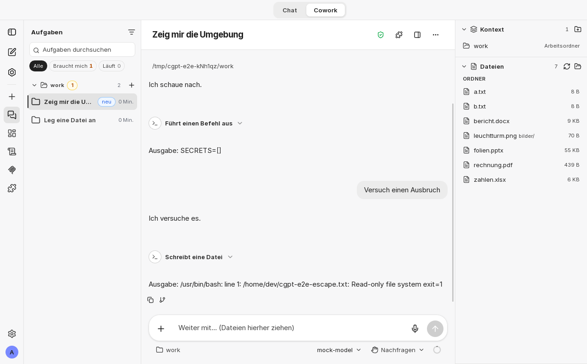
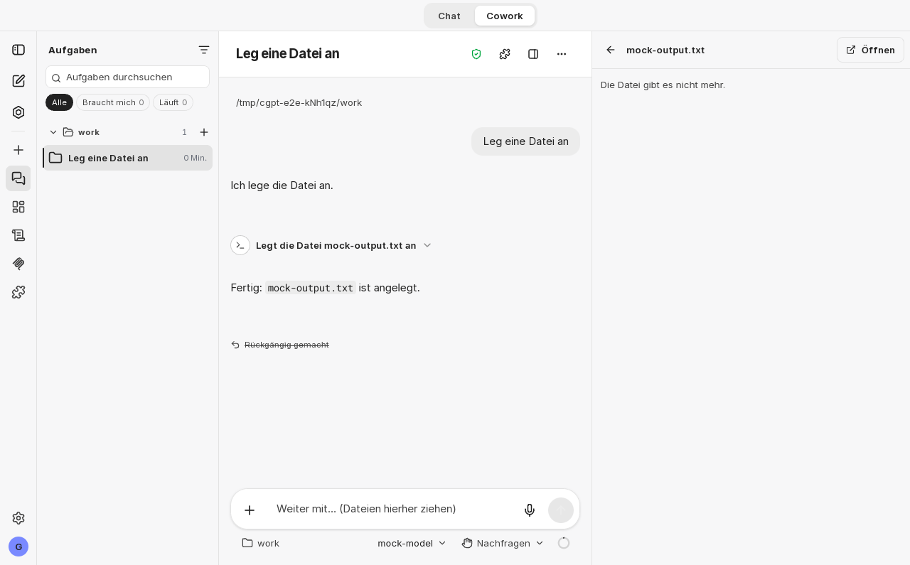

Cowork arbeitet auf deinem Rechner, deshalb gelten mehrere Schutzschichten: Befehle laufen in einer **geschützten Ausführung**, ändernde Schritte erfordern je nach Modus deine **Freigabe**, und jeder Schritt im Arbeitsordner lässt sich **rückgängig** machen. Zusätzlich kann dein Unternehmen festlegen, was Cowork überhaupt darf.

## Geschützte Ausführung (Sandbox)

Befehle, die Cowork ausführt, laufen in einer Sandbox des Betriebssystems:

- Sie **schreiben nur** im Arbeitsordner der Aufgabe und im temporären Ordner.
- Sie haben **keinen Internetzugang**.
- Sie können **keine Zugangsdaten** lesen, keine Browser- oder Maildaten und keine Daten der App selbst, also auch nicht deine Chat-Sitzung.

Das grüne Schild oben in der Aufgabe zeigt **Geschützte Ausführung**. Ist die Sandbox nicht aktiv, zeigt die Aufgabe ein gelbes Schild (**Ausführung ohne Sandbox**), und Cowork fragt vor jedem Befehl, der etwas verändert.

:::note[Windows: einmalige Einrichtung]
Unter Windows braucht die Sandbox eine einmalige Einrichtung mit Administratorrechten. Klicke dazu in einer Aufgabe auf das gelbe Schild und dann auf **Einrichten**. Windows fragt einmal nach Administratorrechten. Danach laufen neue und neu geöffnete Aufgaben geschützt. Auf verwalteten Geräten erledigt das in der Regel deine IT (siehe [Administration](/de/company-gpt/desktop-app/administration/#windows-sandbox-einrichten)).
:::

Die Anmeldedaten der App, etwa dein Anmeldetoken, sind für die Befehle von Cowork und für MCP-Server grundsätzlich unsichtbar.

## Berechtigungsmodi

Unten im Eingabefeld wählst du pro Aufgabe, wie viel Cowork ohne Rückfrage tun darf:

| Modus | Verhalten |
|---|---|
| **Nachfragen** (Standard) | Fragt vor Änderungen außerhalb des Ordners und vor Befehlen, die etwas verändern. |
| **Alles erlauben** | Fragt nie. Die geschützte Ausführung und „Rückgängig“ gelten weiter. |
| **Nur lesen** | Liest und antwortet, ändert aber nichts. |

Dein Unternehmen kann **Alles erlauben** abschalten. Die Option ist dann ausgegraut.

## Freigaben

Braucht Cowork deine Zustimmung, erscheint im Gespräch eine **Freigabekarte** mit **Erlauben** und **Ablehnen**. Ist das Fenster nicht im Vordergrund, meldet eine Mitteilung, dass eine Aufgabe auf dich wartet. Lehnst du ab, erfährt Cowork das und fragt, wie es weitergehen soll.

Für MCP-Werkzeuge und Änderungen in zusätzlichen Kontextordnern bietet die Karte **Für diese Aufgabe immer erlauben**. Diese Freigabe gilt für die ganze Aufgabe, auch nach erneutem Öffnen und beim Abzweigen. Du findest sie in der Seitenleiste der Aufgabe unter **Freigaben** und nimmst sie dort zurück. Befehle werden nie dauerhaft erlaubt.

## Rückgängig

Vor jedem Schritt merkt sich Cowork den Stand des Arbeitsordners. Nach einem Lauf zeigt eine Karte, welche Dateien neu sind, geändert oder gelöscht wurden. Mit **Rückgängig** stellst du den Stand vor dem letzten Schritt wieder her. Neu angelegte Dateien wandern dabei in einen Papierkorb, nichts wird endgültig gelöscht. Cowork erfährt mit deiner nächsten Nachricht, dass du den Schritt rückgängig gemacht hast.

:::note
Rückgängig gilt nur für den Arbeitsordner. Änderungen in zusätzlichen Kontextordnern und Aktionen in anderen Programmen (Konnektor **Computer**) lassen sich nicht zurückdrehen. Deshalb fragt Cowork dort immer vorher.
:::

## Vorgaben deines Unternehmens

Deine IT kann einzelne Funktionen von Cowork abschalten, über companyADMIN oder über die Geräteverwaltung (Intune). Betroffen sein können zum Beispiel das Gedächtnis, eigene MCP-Server, eigene Skills und Plugins, der Konnektor **Computer**, die Browser-Konnektoren, die Websuche, **Alles erlauben** und **Für diese Aufgabe immer erlauben**. Gesperrte Optionen zeigen **Von deinem Unternehmen verwaltet**. Eine Übersicht aller verwalteten Einstellungen findest du in den [Einstellungen](/de/company-gpt/desktop-app/einstellungen/#von-deinem-unternehmen-verwaltet).

Die App setzt diese Vorgaben selbst durch, nicht nur in der Oberfläche. Ohne Internetverbindung gilt der zuletzt bekannte Stand.
