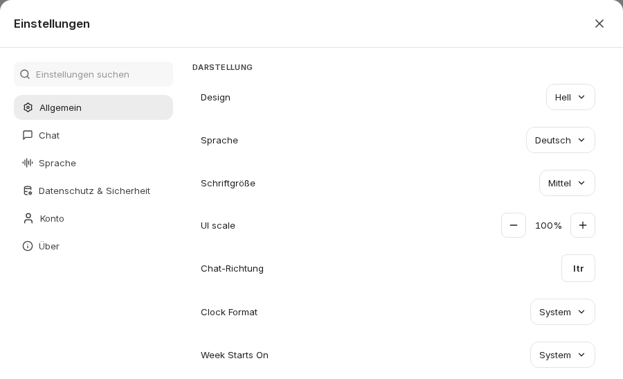

Die Einstellungen öffnen Sie über das Kontomenü unten links unter **Einstellungen** oder mit `Strg` + `Umschalt` + `,` (macOS: `⌘` + `⇧` + `,`). Der Einstellungsdialog ist über die linke Navigation in die Bereiche **Allgemein**, **Chat**, **Sprache**, **Datenschutz & Sicherheit**, **Konto** und **Über** gegliedert. Über das Feld **Einstellungen suchen** finden Sie eine Einstellung direkt.

Welche Einstellungen angezeigt werden, hängt von der Konfiguration Ihrer Umgebung und Ihren Berechtigungen ab. Einzelne neuere Optionen erscheinen in der deutschen Oberfläche derzeit noch mit englischer Beschriftung.

## Allgemein

Unter **Allgemein** werden Darstellung, Layout und Barrierefreiheit konfiguriert:

### Darstellung

#### Design

- **Hell**
- **Dunkel**
- **System**

Zusätzlich gibt es je eine kontrastreiche Variante für hell und dunkel.

#### Sprache

Sprache, in der die Benutzeroberfläche angezeigt wird.

#### Schriftgröße

Auswahl der Schriftgröße, in der die Chatnachrichten dargestellt werden sollen.

#### Chat-Richtung

- `ltr`: Links nach rechts
- `rtl`: Rechts nach links

#### Uhrzeitformat

Legt fest, ob Uhrzeiten im 12- oder 24-Stunden-Format angezeigt werden oder der Einstellung Ihres Systems folgen.

#### Wochenbeginn

Legt fest, ob die Woche am Montag oder am Sonntag beginnt oder der Einstellung Ihres Systems folgt.

### Layout

#### Chat-Bereich maximieren

Der Chat-Bereich wird auf die volle Breite ausgedehnt.

#### Chat-Eingabe im Willkommensbildschirm zentrieren

Chat-Eingabe im Willkommensbildschirm zentriert oder mittig unten.

#### Zum Ende scrollen Button

Zeigt einen Button am unteren Ende des Chat-Bereichs an, der es ermöglicht, schnell zum Ende des Chats zu scrollen.

#### Chat neben der Seitenleiste auf Mobilgeräten

Auf Mobilgeräten reicht die geöffnete Seitenleiste nicht bis zum Rand, sodass ein Streifen des Chats sichtbar bleibt. Ein Tippen auf diesen Streifen schließt die Seitenleiste.

#### Chat-Titel im Browser-Tab

Zeigt den Titel des geöffneten Chats im Titel des Browser-Tabs an.

### Barrierefreiheit

#### Bildschirm während der Antwortgenerierung aktiv lassen

Verhindert, dass der Bildschirm während der Antwortgenerierung in den Ruhemodus wechselt.

## Chat

### Senden

#### Enter drücken, um Nachrichten zu senden

Wenn aktiviert, reicht `Enter` zum Senden von Nachrichten. Neue Zeilen können mit `Umschalt` + `Enter` hinzugefügt werden. Wenn deaktiviert, muss `Strg` + `Enter` (macOS: `⌘` + `Enter`) zum Senden von Nachrichten genutzt werden, `Enter` fügt dann eine neue Zeile hinzu.

#### Während der Generierung bewirkt die Eingabetaste

Legt fest, was `Enter` bewirkt, während noch eine Antwort entsteht:

- **Antwort steuern**: Ihre Nachricht wird in die laufende Antwort einbezogen.
- **Für danach einreihen**: Ihre Nachricht wird nach Abschluss der aktuellen Antwort als neue Nachricht gesendet.

Über die Senden-Schaltfläche können Sie das auch für einzelne Nachrichten wählen, siehe [Chat](/de/company-gpt/chat/#nachrichten-während-einer-laufenden-antwort).

#### Steuerungsnachrichten unterbrechen die Generierung

Wenn aktiviert und **Antwort steuern** eingestellt ist, hält `Enter` die Antwort am nächsten sicheren Punkt an, statt auf den nächsten Werkzeugschritt zu warten. Bereits laufende Werkzeuge werden zuerst abgeschlossen. Der bisherige Teil der Antwort bleibt erhalten, und die Antwort wird anschließend fortgesetzt.

#### Entwürfe lokal speichern

Wenn aktiviert, werden der Text und die Anhänge, die in das Chat-Formular eingegeben werden, automatisch lokal als Entwürfe gespeichert. Diese Entwürfe sind auch verfügbar, wenn die Seite neu geladen oder zu einer anderen Konversation gewechselt wird. Entwürfe werden lokal auf dem Gerät gespeichert und werden gelöscht, sobald die Nachricht gesendet wird.

#### Bilder vor dem Hochladen verkleinern

Wenn aktiviert, werden große Bilder im Browser verkleinert, bevor sie hochgeladen werden. Das beschleunigt den Upload. Bilder, die bereits innerhalb der Größengrenzen liegen, bleiben unverändert.

#### Langen Text als Datei einfügen

Wenn aktiviert, wird sehr langer eingefügter Text als Textdatei angehängt, statt das Eingabefeld zu füllen. Dabei gelten die Grenzen der [Dateiverarbeitung](/de/company-gpt/dateiverarbeitung/).

#### Badgestatus speichern

Wenn aktiviert, wird der Status der Chat-Badges gespeichert. Das bedeutet, dass die Badges im gleichen Status wie im vorherigen Chat bleiben, wenn man einen neuen Chat erstellt. Wenn diese Option deaktiviert ist, werden die Badges jedes Mal, wenn man einen neuen Chat erstellt, auf ihren Standardzustand zurückgesetzt.

### Befehle

Befehle sind Kurzbefehle, die in der Nachrichteneingabe ausgeführt werden können und so schnell auf Modelle, Prompts und Mehrfachantworten zugreifen können.

#### Befehl @ zum Wechseln von Modellen

Schaltet den Befehl `@` zum Wechseln von Endpunkten, Modellen, Voreinstellungen usw. um.

#### Befehl + für Mehrfachantwort

Schaltet den Befehl `+` zum Hinzufügen einer Mehrfachantwort-Einstellung um.

#### Befehl / für Promptvorlage

Schaltet den Befehl `/` zur Auswahl einer [Promptvorlage](/de/company-gpt/prompts/) über die Tastatur um.

### Nachrichten

#### Benutzernachrichten als Markdown darstellen

Regelt die Darstellung der Benutzernachrichten als Markdown. Markdown ist eine leichte Syntax zur Auszeichnung von Texten. KIs antworten ebenfalls in Markdown, und die Inhalte werden entsprechend dargestellt (z.B. fett). Diese Einstellung regelt, ob die Benutzernachrichten ebenfalls formatiert dargestellt werden sollen.

#### Lange eigene Nachrichten einklappen

Wenn aktiviert, werden lange Nachrichten von Ihnen eingeklappt als Vorschau angezeigt und lassen sich bei Bedarf vollständig aufklappen. So nehmen eingefügte Texte oder Code nicht den ganzen Chat ein. Der vollständige Text bleibt kopier- und durchsuchbar.

#### Benutzernamen in Nachrichten anzeigen

Wenn aktiviert, wird der Benutzername des Absenders über jeder Nachricht angezeigt, die gesendet wird. Wenn deaktiviert, wird "Du" über den Nachrichten angezeigt.

#### LaTeX in Nachrichten parsen (kann die Leistung beeinflussen)

Wenn aktiviert, wird LaTeX-Code in Nachrichten als mathematische Gleichungen gerendert. Das Deaktivieren kann die Leistung verbessern, wenn keine LaTeX-Darstellung benötigt wird.

#### Denkprozess-Dropdowns standardmäßig öffnen

Wenn KI-Modelle nachdenken, kann der Denkprozess standardmäßig angezeigt oder hinter einem Dropdown verborgen und bei Bedarf geöffnet werden.

#### Text beim Streaming sanft einblenden

Wenn aktiviert, werden neu gestreamte Wörter in der aktuellen Antwort sanft eingeblendet. Das ist rein visuell und verzögert die Ausgabe nicht. Die Funktion wird automatisch deaktiviert, wenn auf Ihrem Gerät reduzierte Bewegungen eingestellt sind.

#### Nachrichten als formatierten Text kopieren

Wenn aktiviert, legt das Kopieren einer Nachricht zusätzlich eine formatierte Fassung in die Zwischenablage. Überschriften, Listen, Tabellen und Code behalten so ihre Formatierung, wenn Sie sie in Anwendungen ohne Markdown-Unterstützung einfügen, etwa in Teams, Outlook oder Word.

#### Tool-Details automatisch aufklappen

Klappt die Detailansicht von Werkzeugaufrufen automatisch auf, sodass die ausgeführten Schritte direkt sichtbar sind.

### Chats

#### Bei neuem Chat zum Chatverlauf wechseln

Wechselt beim Erstellen eines neuen Chats automatisch zur Ansicht des Chatverlaufs.

#### Automatisch zur neuesten Nachricht scrollen, wenn der Chat geöffnet wird

Diese Einstellung regelt, ob vorhandene Chats automatisch nach ganz unten zur neuesten Nachricht scrollen sollen, wenn sie geöffnet werden.

#### Ermöglicht das Wechseln der Endpunkte mitten im Gespräch

Ermöglicht dem Nutzer, mitten im Gespräch den Endpunkt zu wechseln. Das kann nützlich sein, wenn man beispielsweise feststellt, dass ein anderes Modell für die aktuelle Aufgabe besser geeignet ist.

#### Standardmäßig temporärer Chat

Wenn aktiviert, beginnen neue Chats standardmäßig im [temporären Modus](/de/company-gpt/chat/#temporärer-chat). Temporäre Chats werden nicht im Verlauf gespeichert.

#### Standard-Abzweigungsoption verwenden

Wenn aktiviert, wird beim [Abzweigen](/de/company-gpt/chat/#nachrichtenoptionen) eines Chats immer dieselbe Option verwendet. Welche das ist, wählen Sie darunter unter **Standard-Abzweigungsoption**: **Nur sichtbare Nachrichten**, **Zugehörige Verzweigungen einbeziehen** oder **Alle bis/von hier einbeziehen**.

#### Abzweigung standardmäßig von der Zielnachricht beginnen

Wenn aktiviert, beginnt das Abzweigen von der Zielnachricht bis zur letzten Nachricht in der Konversation, gemäß dem ausgewählten Verhalten.

### Prompts

#### Erweiterter Prompt-Editor

Aktiviert Versionierung und Produktionskontrolle für [Prompts](/de/company-gpt/prompts/).

#### Übernehme neue Prompt Versionen immer auf Produktiv

Neue Versionen eines Prompts werden automatisch als Produktivversion übernommen, ohne dass sie manuell freigegeben werden müssen.

#### Prompts beim Auswählen automatisch senden

Wenn aktiviert, wird ein Prompt beim Auswählen direkt gesendet, anstatt zunächst in das Eingabefeld eingefügt zu werden.

## Sprache

Im CompanyGPT stehen sowohl Sprache zu Text (STT) als auch Text zu Sprache (TTS) zur Verfügung. Beides kann sowohl über die integrierte Browser-Engine als auch über einen externen Sprachdienst genutzt werden (der Dienst muss in Ihrer Umgebung eingerichtet sein).

### Sprache zu Text

Kann genutzt werden, um Prompteingaben zu diktieren, anstatt zu tippen.

- **Sprache zu Text**: schaltet die Funktion ein oder aus.
- **Engine**: **Extern** (Sprachdienst Ihrer Umgebung) oder **Browser** (Engine des aktuellen Browsers).
- **Sprache**: die Sprache der Eingabe.
- **Audio automatisch transkribieren**
- **Dezibel-Empfindlichkeit**
- **Text automatisch senden** mit **Verzögerung (s)**

### Text zu Sprache

Kann genutzt werden, um Nachrichten vorlesen zu lassen.

- **Text zu Sprache**: schaltet die Funktion ein oder aus.
- **Engine**: **Extern** (Sprachdienst Ihrer Umgebung) oder **Browser** (Engine des aktuellen Browsers).
- **Stimme**: verfügbare Stimmen der gewählten Engine.
- **Konversationsmodus**: schaltet die automatische Transkription von Audio ein. Voraussetzung ist, dass Sprache zu Text und Text zu Sprache aktiviert sind.
- **Automatische Wiedergabe der neuesten Nachricht**
- **Cloud-basierte Stimmen verwenden** (nur bei der Engine **Browser**)
- **Audio-Wiedergabegeschwindigkeit**
- **TTS-Caching aktivieren**

## Datenschutz & Sicherheit

### Erinnerungen

#### Gespeicherte Erinnerungen verwenden

Erlaubt der KI, bei den Antworten auf Ihre gespeicherten [Erinnerungen](/de/company-gpt/erinnerungen/) zuzugreifen und sie zu verwenden.

### Deine Daten

#### Konversationen importieren

Über **Importieren** lassen sich Konversationen aus einer exportierten JSON-Datei importieren, um sie beispielsweise mit den Kollegen zu teilen.

#### Geteilte Links

Über **Verwalten** öffnen Sie eine Übersicht der Chats, die Sie über Links [geteilt](/de/company-gpt/chat/#teilen) haben. Von dort öffnen Sie den zugehörigen Chat oder löschen geteilte Links, auch mehrere auf einmal.

#### Dateien verwalten

Über **Verwalten** öffnen Sie eine Übersicht Ihrer hochgeladenen Dateien.

#### Alle Chats archivieren

Verschiebt alle Chats ins Archiv. Sie verschwinden aus der Chatliste und bleiben unter **Archivierte Chats** verfügbar.

### API-Schlüssel

#### Agenten-API-Schlüssel

Sofern Sie die [Agents API](/de/api/agents-api/) nutzen dürfen, erstellen und widerrufen Sie hier API-Schlüssel für Agenten.

#### Benutzer-API-Keys widerrufen

Falls Sie für einen KI-Anbieter eigene API-Schlüssel hinterlegt haben, widerrufen Sie diese hier über **Widerrufen**.

### Gefahrenbereich

#### TTS-Cache-Speicher löschen

Vorgelesene Nachrichten werden im Browser zwischengespeichert, damit sie beim erneuten Abspielen nicht erneut erzeugt werden müssen. Hier leeren Sie diesen Speicher.

#### Alle Chats löschen

Löschen aller Chats.

:::danger[Vorsicht]
Das Löschen aller Chats kann nicht rückgängig gemacht werden.
:::

## Konto

### Profil

#### Profilbild

Ändern des Profilbildes über **Bild ändern**.

### Abrechnung

:::note[Nicht in allen Umgebungen verfügbar]
Ob diese Funktion in Ihrer Umgebung zur Verfügung steht, legt Ihr Unternehmen fest. Wenden Sie sich bei Fragen an Ihren Administrator.
:::

#### Guthaben

Übersicht über das aktuelle Guthaben.

#### Einstellungen zum automatischen Auffüllen

Zeigt an, wann das Guthaben zuletzt aufgefüllt wurde, die Nachfüllmenge, das Intervall und den Zeitpunkt des nächsten automatischen Auffüllens.

### Gefahrenbereich

#### Konto löschen

Löschen des Benutzerkontos.

:::danger[Vorsicht]
Das Löschen des Benutzerkontos kann nicht rückgängig gemacht werden.
:::

## Über

### Versionsinformationen

Zeigt Informationen zur installierten Version: **Version**, **Commit**, **Branch** und **Erstellt** (Build-Datum). Über **Diagnoseinformationen kopieren** lassen sich diese Angaben kopieren, damit Maintainer den konkreten Build identifizieren können.
