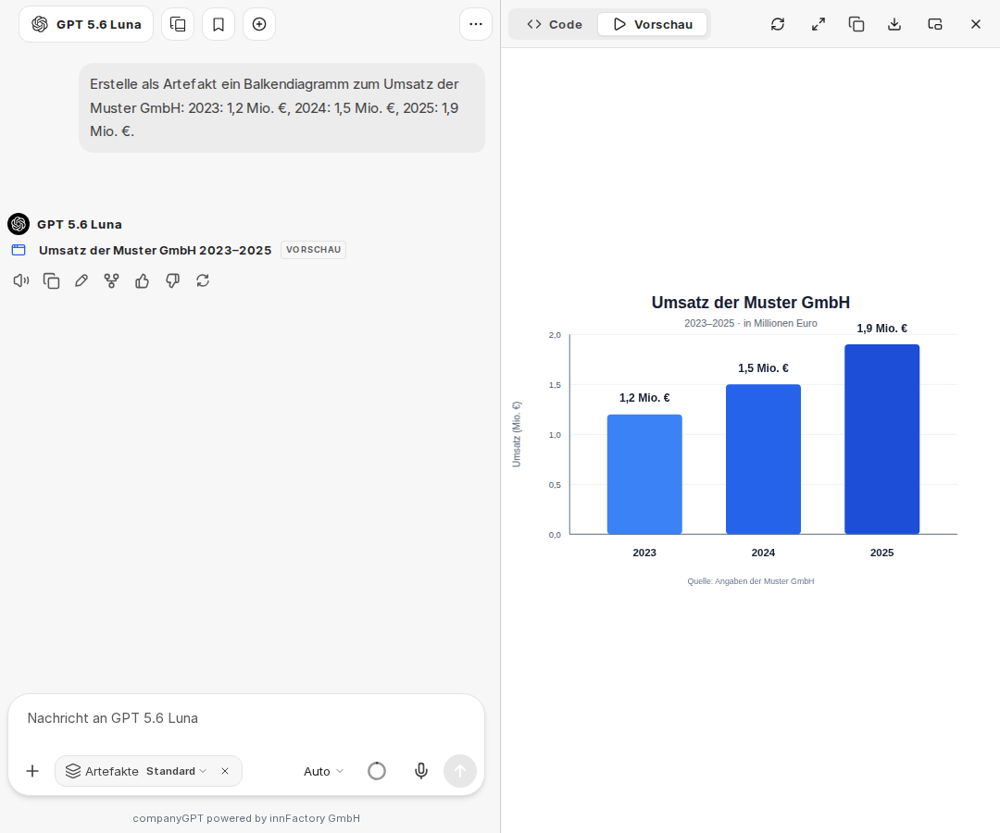

Artefakte ermöglichen dem KI-Modell im CompanyGPT, Code zu erstellen und diesen auszuführen/anzuzeigen. So können beispielsweise Diagramme erzeugt, aber auch Code-Komponenten erzeugt und dargestellt werden.

## Artefakte aktivieren

Im Chat aktivieren Sie Artefakte in der Chateingabe im Menü **Werkzeuge** über **Artefakte**. Für [Agenten](/de/company-gpt/agenten/#artefakte) fügen Sie **Artefakte** über die Tool-Bibliothek hinzu und wählen dort einen **Modus**.

Standardmäßig werden zusätzliche, spezielle Anweisungen für die Nutzung von Artefakten hinzugefügt, es sei denn, der „Benutzerdefinierte Prompt-Modus“ ist aktiviert.



## Artefakte ansehen und exportieren

Artefakte öffnen sich in einem eigenen Bereich neben dem Chat. Dort wechseln Sie zwischen **Code** und **Vorschau**, kopieren oder laden den Inhalt herunter und öffnen das Artefakt mit **Vollbild öffnen** in voller Größe.

Mermaid-Diagramme, die das KI-Modell im Chat ausgibt, werden direkt als Diagramm dargestellt. Mit **Als Artefakt öffnen** zeigen Sie ein Diagramm im Artefakt-Bereich an. Über **Diagramm exportieren** speichern Sie es dort mit **Als SVG exportieren** oder **Als PNG exportieren** als Grafik.

## Optionen

Im Chat stehen im Untermenü von **Artefakte** zwei Optionen zur Verfügung:

**Anweisungen für shadcn/ui-Komponenten einschließen**: Wenn aktiviert, werden Anweisungen zur Verwendung von shadcn/ui-Komponenten eingeschlossen. shadcn/ui ist eine Sammlung wiederverwendbarer Komponenten, die mit Radix UI und Tailwind CSS erstellt wurden. Hinweis: Dies sind umfangreiche Anweisungen, die Sie nur aktivieren sollten, wenn es Ihnen wichtig ist, das KI-Modell über die korrekten Importe und Komponenten zu informieren. Weitere Informationen zu diesen Komponenten finden Sie unter: https://ui.shadcn.com/

**Benutzerdefinierter Promptmodus für Artefakte**: Wenn aktiviert, wird die Standard-Systemaufforderung für Artefakte nicht eingeschlossen. Alle Anweisungen zur Erzeugung von Artefakten müssen in diesem Modus manuell bereitgestellt werden.

Beispiel:

```
Wenn Inhalt als Artefakt dargestellt werden soll, muss folgende Formatierung genutzt werden:

:::artifact{identifier="unique-identifier" type="mime-type" title="Artifact Title"}
```

Inhalt hier

```
:::

Verwenden Sie für das Attribut „type“ eine der folgenden Optionen:
- „text/html“ für HTML-Inhalte
- „application/vnd.mermaid“ für Mermaid-Diagramme
- „application/vnd.react“ für React-Komponenten
- „image/svg+xml“ für SVG-Bilder
```
