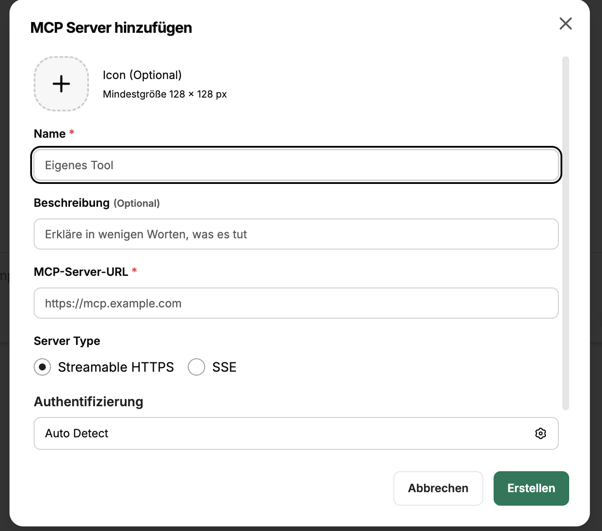
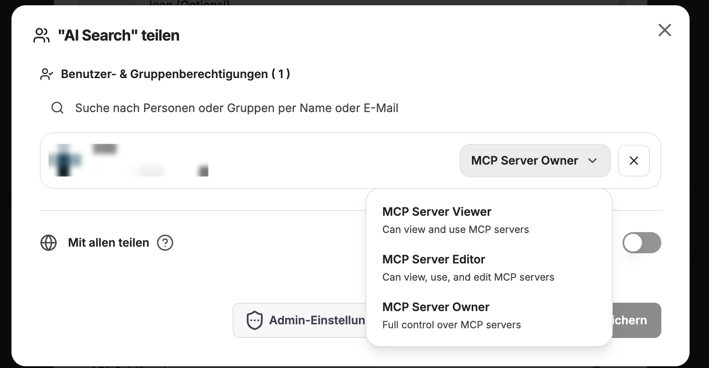

Das Model Context Protocol (MCP) ist ein spezialisiertes Protokoll und eine Schnittstelle, die CompanyGPT die nahtlose Kommunikation mit externen Diensten ermöglicht. Diese Dienste laufen auf kundenspezifischen MCP-Servern, die oft komplexe Backend-Funktionalitäten hosten oder spezifische Unternehmensprozesse orchestrieren. Ursprünglich von Anthropic entwickelt, wird das MCP mittlerweile von nahezu allen KI-Anwendungen unterstützt, wodurch CompanyGPT auf eine breite Masse bestehender MCP-Server zurückgreifen kann. Bei Bedarf lassen sich eigene Server entwickeln, um nahezu jede Anwendung an CompanyGPT anzubinden.

Das MCP basiert auf einer Client-Server-Architektur, bei der CompanyGPT als Client die vom Server bereitgestellten „Tools“ konsumiert. Ein MCP-Server kann beliebig viele solcher Tools beinhalten, wobei das integrierte LLM selbstständig entscheidet, welches Tool genutzt und welche Parameter übergeben werden. Nach der Ausführung wertet das LLM die Ergebnisse aus und formuliert eine entsprechende Antwort an den Benutzer.

Mehr Informationen zu MCP finden Sie hier: [Prompt Engineering / MCP](/de/prompt-engineering/prompt-techniken/tool-use#das-mcp-model-context-protocol-als-tool)

## MCP Server nutzen

Die MCP Server, die Ihnen zur Verfügung stehen, finden Sie in der linken Seitenleiste unter **MCP Einstellungen**. Dort sehen Sie den Status jedes Servers. Verlangt ein Server eine Anmeldung oder einen eigenen Schlüssel, können Sie sich dort mit **Verbinden** anmelden bzw. den Server konfigurieren.

Im [Chat](/de/company-gpt/chat/#integrationen) wählen Sie MCP Server über die Chateingabe aus, in [Agenten](/de/company-gpt/agenten/#mcp-server) über die Tool-Bibliothek.

## MCP Server hinzufügen

Neue MCP Server können nur Personen anlegen, deren Rolle das erlaubt. Normale Nutzer können in der Standardeinstellung keine MCP Server anlegen. Die Berechtigungen für Benutzen, Erstellen und Teilen von MCP Servern vergeben Administratoren in [companyADMIN](/de/company-gpt/addons/companyadmin/rollen-und-rechte/) unter **Zugriff** → **Rollen** → Rolle öffnen → Reiter **companyGPT**, Funktion **MCP-Server**. Welche Domains für MCP Server erlaubt sind, legen Administratoren in companyADMIN unter **Konfiguration** → **MCP-Domains** fest.

Mit der entsprechenden Berechtigung öffnet sich über das **+** oben in den **MCP Einstellungen** (Tooltip **MCP hinzufügen**) der Dialog **MCP Server hinzufügen**.

### MCP Server Eigenschaften

Folgende Eigenschaften können vergeben werden:

- **Icon** `optional`: Ein Icon, welches in der Übersicht angezeigt wird
- **Name**: Der Name des MCP Servers, sichtbar in der Übersicht und in jeder Auswahl
- **Beschreibung** `optional`: Eine Beschreibung, welche in der Übersicht angezeigt wird
- **MCP-Server-URL**: Die URL für den MCP Server. Diese URLs können sowohl für interne Service (innerhalb des Clusters) oder über das Internet erreichbare MCP-Server URLs sein.
- **Transport**: Streamable HTTPS oder SSE (vom Server vorgegeben)
- **Authentifizierung**:
  - **Keine (Automatische Erkennung)**: Automatische Erkennung mit OAuth `Dynamic Client Registration` oder gänzlich ohne Authentifizierung
  - **API-Schlüssel**: Authentifizierung mit API Schlüssel, auswählbar ob ein API Schlüssel für alle User gilt oder jeder Benutzer einen eigenen Schlüssel angibt.
  - **OAuth**: OAuth 2.1 konforme Client-Registrierung mit Client ID, Secret, Redirect Uri, Autorisierungs- und Token-URL.
  - **On-Behalf-Of (OBO)**: Der MCP Server wird im Namen der angemeldeten Person aufgerufen. Unter **OBO-Scopes** geben Sie die Scopes an, die für den MCP Server angefordert werden. Voraussetzung ist eine Anmeldung über OpenID Connect, z. B. Entra ID. Die Option erscheint nur mit dem Recht **OBO konfigurieren** (siehe [Rollen](/de/company-gpt/addons/companyadmin/rollen-und-rechte/)), das standardmäßig nur die Rolle ADMIN hat.
- **Ich vertraue dieser Anwendung**: Kontrollkästchen zum Bestätigen.

Bei erfolgreicher Initialisierung wird der MCP Server in den **MCP Einstellungen** in der linken Seitenleiste angezeigt und kann über den [Chat](/de/company-gpt/chat/#integrationen) oder in [Agenten](/de/company-gpt/agenten/) genutzt werden.

## MCP Server teilen

Sobald ein MCP Server hinzugefügt wurde, kann dieser geteilt werden, sofern Ihre Rolle das Teilen erlaubt. Dazu öffnen Sie den Server in den **MCP Einstellungen** in der linken Seitenleiste über **Bearbeiten**. Im Dialog **MCP-Server bearbeiten** kann dann das bekannte Teilen-Menü aufgerufen werden:

Im Detailmenü kann ausgewählt werden, mit wem und mit welchen Rechten der MCP Server geteilt werden soll.

