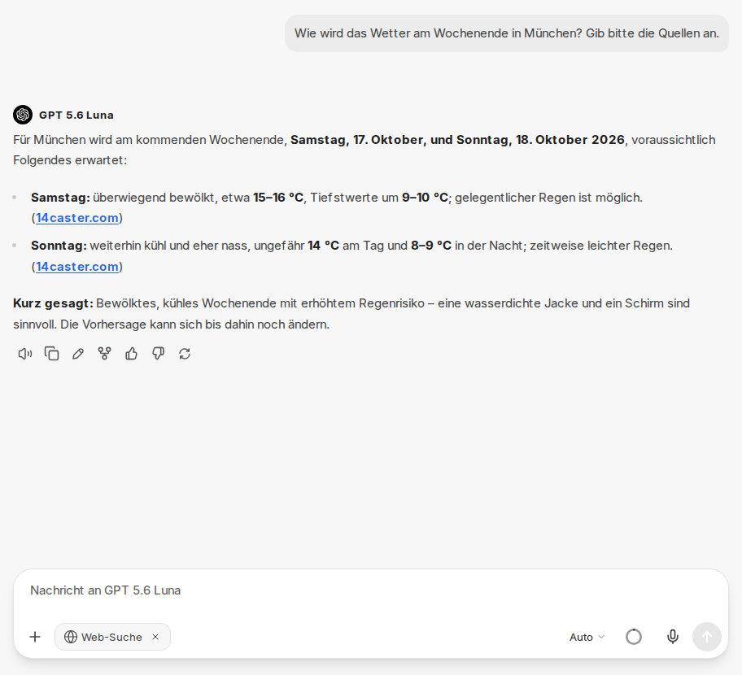
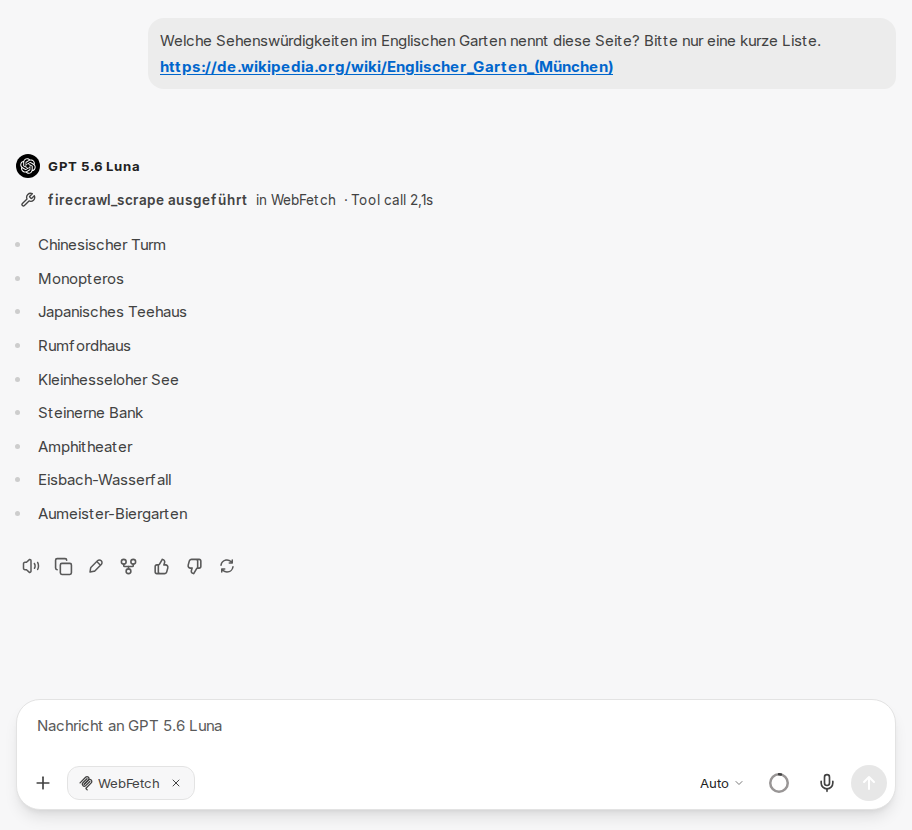

:::note[Neue Chat-Oberfläche]
Bilder und Beschriftungen auf dieser Seite zeigen die [neue Chat-Oberfläche](/de/company-gpt/neue-chat-oberflaeche/). Sie ist derzeit im Demo-Zugang und in Pilotumgebungen verfügbar; in anderen Umgebungen können Beschriftungen und Abläufe noch abweichen.
:::

## Websuche

Die Websuche ermöglicht es CompanyGPT, das Internet zu durchsuchen und aktuelle Inhalte in die Antwort einzubeziehen. Die Suche schalten Sie über das Plus-Symbol in der Chateingabe (**Attach and tools**) unter **Tools** mit **Web-Suche** ein. Die Websuche erscheint dann als Chip in der Eingabeleiste. Sie gilt für den jeweiligen Chat und bleibt aktiv, bis Sie sie über das **×** am Chip wieder ausschalten.

:::note[Nicht in allen Umgebungen verfügbar]
Ob diese Funktion in Ihrer Umgebung zur Verfügung steht, legt Ihr Unternehmen fest. Wenden Sie sich bei Fragen an Ihren Administrator.
:::

Auf Wunsch können die Quellen direkt in der Antwort mit angegeben werden.

:::tip[Hintergrund: Grounding]
Die Websuche basiert auf dem Prinzip des „Grounding" – das KI-Modell stützt seine Antworten auf aktuelle, öffentlich verfügbare Informationen aus dem Web. Dadurch werden Halluzinationen reduziert und die Aktualität der Antworten verbessert. Mehr dazu im Google Cloud Blog: [Vertex AI Grounding with Google Search](https://cloud.google.com/blog/products/ai-machine-learning/using-vertex-ai-grounding-with-google-search?hl=en)
:::

## WebFetch

WebFetch eignet sich, wenn gezielt der Inhalt einer bestimmten Webseite abgerufen und verarbeitet werden soll. Im Gegensatz zur Websuche, die eigenständig im Internet recherchiert, ruft WebFetch eine vom Benutzer angegebene URL auf und extrahiert deren Inhalt.

Das ist besonders nützlich, wenn Sie den Inhalt einer bekannten Seite zusammenfassen, analysieren oder als Grundlage für eine Antwort verwenden möchten.

WebFetch wird als [MCP Server](/de/company-gpt/integrationen/mcp-server/) bereitgestellt. Im Chat wählen Sie ihn über das Plus-Symbol in der Chateingabe (**Attach and tools**) im Bereich **MCP Servers** aus, am schnellsten über das Suchfeld oben im Menü. In [Agenten](/de/company-gpt/agenten/#mcp-server) fügen Sie ihn über die Tool-Bibliothek hinzu.

