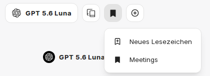

Lesezeichen können zu Konversationen hinzugefügt werden, um sie so schneller wiederzufinden. Dadurch können auch Chats zu bestimmten Themen gruppiert werden. Ein Chat kann mehrere Lesezeichen tragen.

## Lesezeichen zu einem Chat hinzufügen

Über das Lesezeichen-Symbol im Kopfbereich des Chats (**Lesezeichen hinzufügen**) wählen Sie ein vorhandenes Lesezeichen aus oder legen mit **Neues Lesezeichen** ein neues an. Alternativ verwenden Sie das Tastenkürzel `Strg` + `Umschalt` + `B` (macOS: `⌘` + `⇧` + `B`).

Ein Lesezeichen erhält einen **Titel** und optional eine **Beschreibung**.

## Chats nach Lesezeichen filtern

Im [Chatverlauf](/de/company-gpt/user-interface/#chatverlauf) öffnen Sie das Filtersymbol neben der Überschrift **Chats**. Unter **Lesezeichen** wählen Sie ein oder mehrere Lesezeichen aus. Die Liste zeigt dann nur Chats, die mindestens eines der gewählten Lesezeichen tragen. Neben jedem Lesezeichen steht die Anzahl der zugehörigen Chats.

Weitere Filter- und Sortiermöglichkeiten beschreibt [Filtern und sortieren](/de/company-gpt/user-interface/#filtern-und-sortieren).

## Lesezeichen verwalten

Über den Eintrag **Lesezeichen** in der Seitenleiste sehen Sie alle Lesezeichen mit der Anzahl der zugehörigen Chats. Dort können Sie Lesezeichen suchen, mit **Neues Lesezeichen** anlegen, bearbeiten, löschen und per Drag & Drop umsortieren. Beim Anlegen aus dem geöffneten Chat heraus fügen Sie das neue Lesezeichen mit **Zur aktuellen Konversation hinzufügen** direkt diesem Chat hinzu.
