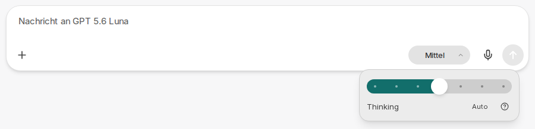
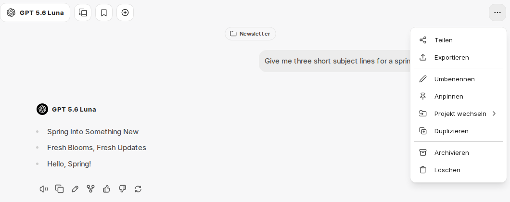
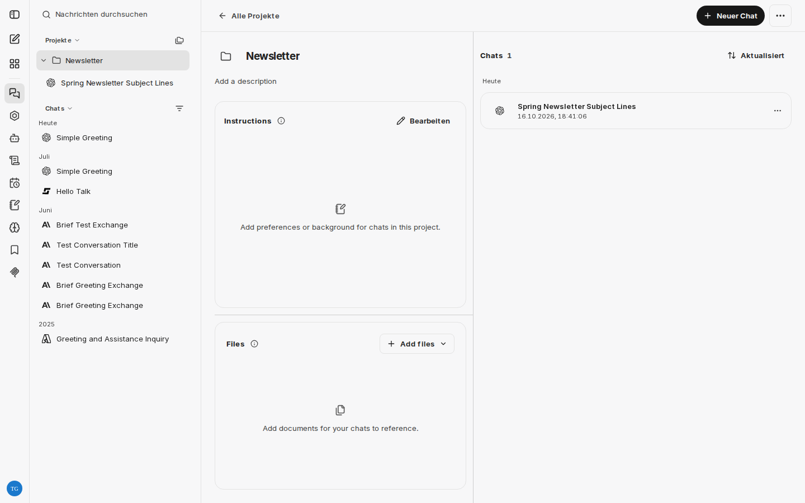
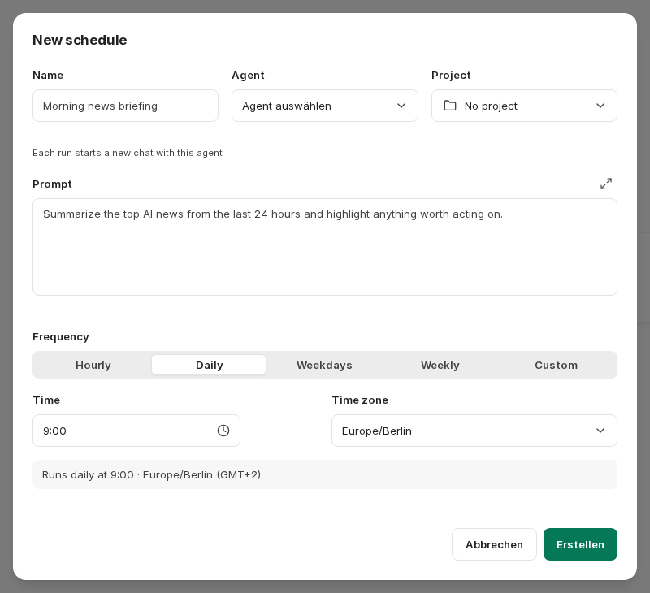

:::note[Derzeit nur im Demo-Zugang]
Die neue Chat-Oberfläche ist derzeit nur im Demo-Zugang bzw. in Pilotumgebungen verfügbar.
:::

CompanyGPT erhält eine überarbeitete Chat-Oberfläche. Diese Seite fasst die wichtigsten Neuerungen zusammen. Die Seiten zum Chat, zu Agenten, Skills, Prompts, Projekten und Integrationen zeigen bereits die neue Oberfläche und weisen oben darauf hin. Im [Demo-Zugang](/de/demo-zugang/) können Sie die neue Oberfläche bereits ausprobieren.

Die Beschriftungen der neuen Funktionen erscheinen in der deutschen Oberfläche derzeit auf Englisch. Diese Seite nennt deshalb die englischen Beschriftungen.

## Neue Eingabeleiste

Das Plus-Symbol im Eingabefeld öffnet ein gemeinsames Menü für Anhänge und Werkzeuge (**Attach and tools**). Es ersetzt die bisherige Büroklammer, das Menü **Werkzeuge** und das Anpinnen von Integrationen.

- **Alles an einem Ort**: Im Menü finden Sie die Upload-Möglichkeiten, zuletzt verwendete Dateien, die integrierten Werkzeuge wie [Websuche](/de/company-gpt/integrationen/websuche/), [Dateisuche](/de/company-gpt/integrationen/dateisuche/) oder [Code ausführen](/de/company-gpt/code-interpreter/), Ihre [Skills](/de/company-gpt/skills/) und die [MCP-Server](/de/company-gpt/integrationen/mcp-server/). Über das Suchfeld oben im Menü (**Search tools, skills and servers**) finden Sie Werkzeuge, Skills und Server direkt.
- **Favoriten**: Häufig genutzte Einträge markieren Sie mit dem Stern oder mit `Strg` + `D` (macOS: `⌘` + `D`). Sie erscheinen dann gesammelt unter **Favoriten** im Menü.
- **Chips**: Aktive Werkzeuge und MCP-Server erscheinen als Chips in der Eingabeleiste, gewählte Skills als Chips über dem Textfeld. Mit einem Klick auf einen Chip entfernen Sie den Eintrag wieder.
- **Denkaufwand**: Bei Modellen mit Denkprozess öffnen Sie über eine Schaltfläche in der Eingabeleiste einen Regler, mit dem Sie zwischen schnelleren (**Faster**) und gründlicheren (**Smarter**) Antworten wählen. Bisher war diese Einstellung nur in den [KI-Einstellungen](/de/company-gpt/ki-einstellungen/#denkaufwand) erreichbar.

### Enter fügt eine neue Zeile ein

In der neuen Oberfläche fügt `Enter` standardmäßig eine neue Zeile ein. Gesendet wird mit `Strg` + `Enter` (macOS: `⌘` + `Enter`). Ebenfalls standardmäßig aktiviert sind die Einstellungen [**Collapse long user messages**](/de/company-gpt/einstellungen/#collapse-long-user-messages) und [**Resize images before upload**](/de/company-gpt/einstellungen/#resize-images-before-upload). Haben Sie diese Einstellungen oder das [Senden mit Enter](/de/company-gpt/einstellungen/#senden) bereits einmal selbst festgelegt, bleibt Ihre Wahl erhalten.

## Chat-Optionen im Kopfbereich

Das bisherige Menü **Exportieren/Teilen** im Kopfbereich des Chats heißt jetzt **Chat options**. Neben Teilen und Exportieren enthält es zusätzlich **Umbenennen**, **Anpinnen**, die Zuordnung zu einem Projekt, **Duplizieren**, **Archivieren** und **Löschen**. Diese Aktionen waren bisher nur über das Menü eines Chats in der Seitenleiste erreichbar.

## Projekte mit Anweisungen und Dateien

[Projekte](/de/company-gpt/projekte/) erhalten eigene Anweisungen und Referenzdateien:

- **Instructions** (Anweisungen): Legen Sie Ton, Ziele oder Hintergrund für alle Chats im Projekt fest. Die Anweisungen gelten für neue Nachrichten im Projekt; frühere Nachrichten werden nicht verändert. Die Regeln Ihrer Umgebung gelten weiterhin.
- **Files** (Dateien): Hinterlegen Sie Referenzdateien im Projekt. Ist die Dateisuche aktiv, nutzen die Chats im Projekt passende Auszüge statt ganzer Dateien. Wie viele Dateien ein Projekt enthalten kann, zeigt der Projekt-Arbeitsbereich an. Entfernen Sie eine Datei, wirkt sich das nur auf künftige Nachrichten aus.

Chats eines Projekts erscheinen standardmäßig nur noch im jeweiligen Projekt und nicht mehr zusätzlich in der Liste **Chats**. Über die Option **Show project chats** im Filtermenü der Chatliste blenden Sie sie dort wieder ein. Die Suche und die archivierten Chats umfassen weiterhin alle Chats.

## Ungelesene Antworten und Benachrichtigungen

Chats mit neuen, noch nicht gelesenen Antworten sind in der Chatliste markiert. Über **Mark as unread** im Menü eines Chats markieren Sie einen Chat wieder als ungelesen.

In den [Einstellungen](/de/company-gpt/einstellungen/) unter **Allgemein** kommen folgende Optionen hinzu:

- **Show unread count in the tab title**: zeigt die Anzahl der Chats mit ungelesenen Antworten im Titel und Symbol des Browser-Tabs an.
- **Notify me when a reply arrives**: zeigt eine Desktop-Benachrichtigung, wenn eine Antwort eintrifft, während Sie nicht in CompanyGPT sind. Ihr Browser fragt beim ersten Einschalten nach Ihrer Erlaubnis. Solange Sie CompanyGPT im Blick haben, erscheinen keine Benachrichtigungen.
- **Play a sound for new replies**: spielt bei neuen Antworten einen kurzen Ton ab. Browser spielen Töne erst ab, nachdem Sie mit der Seite interagiert haben.
- **UI scale**: skaliert die gesamte Oberfläche.

## Agenten-Marktplatz

Der [Agenten-Marktplatz](/de/company-gpt/agenten/#agenten-marktplatz) erhält neue Möglichkeiten:

- Agenten nach Beliebtheit (**Popular**), nach Erstellungsdatum (**Newest first**, **Oldest first**) oder nach dem Namen der erstellenden Person (**By creator name**) sortieren
- nur die selbst erstellten Agenten anzeigen (**Only Agents I created**)
- Gesprächsstarter in der Detailansicht eines Agenten: Ein Klick öffnet einen neuen Chat mit dem Agenten, den Text passen Sie vor dem Senden bei Bedarf an.

Außerdem lassen sich die Anweisungen eines Agenten mit einem gespeicherten [Prompt](/de/company-gpt/prompts/) verknüpfen, statt sie direkt im Agenten einzutragen.

## Kontextanzeige mit Kosten und Guthaben

Die Aufschlüsselung der [Kontextanzeige](/de/company-gpt/chat/#kontextanzeige) zeigt zusätzlich die Werte der letzten bzw. der gerade laufenden Runde. Sofern in Ihrer Umgebung verfügbar, sehen Sie dort auch deren Kosten und den bereits verbrauchten Anteil Ihres Guthabens.

## Artefakte im eigenen Fenster

[Artefakte](/de/company-gpt/integrationen/artefakte/) lassen sich über **Open in new window** in einem eigenen Browserfenster öffnen. Blockiert Ihr Browser das neue Fenster, erlauben Sie Pop-ups für CompanyGPT und versuchen es erneut.

## Geplante Chats

Mit geplanten Chats (**Scheduled chats**) lassen Sie einen [Agenten](/de/company-gpt/agenten/) regelmäßig automatisch arbeiten, etwa für eine tägliche Zusammenfassung. Sie erreichen sie über einen eigenen Eintrag in der Seitenleiste.

Beim Anlegen eines geplanten Chats legen Sie fest:

- einen Namen
- den Agenten
- den Prompt, den der Agent bei jedem Lauf erhält
- optional ein Projekt, dem die entstehenden Chats zugeordnet werden
- die Häufigkeit (**Frequency**): **Hourly** (stündlich, mit der Minute innerhalb der Stunde), **Daily**, **Weekdays** oder **Weekly** (jeweils mit Uhrzeit, wöchentlich zusätzlich mit Wochentagen) oder **Custom** über einen Cron-Ausdruck
- die Zeitzone (**Time zone**)

Der Dialog zeigt dabei die nächsten Ausführungszeitpunkte an. Jeder Lauf startet einen neuen Chat mit dem gewählten Agenten. In der Übersicht führen Sie einen geplanten Chat bei Bedarf mit **Run now** sofort aus, bearbeiten ihn oder schalten ihn ab. Schlägt ein geplanter Chat wiederholt fehl, wird er automatisch deaktiviert. Wie viele geplante Chats Sie anlegen können und in welchem Mindestabstand sie laufen dürfen, legt Ihre Umgebung fest.
