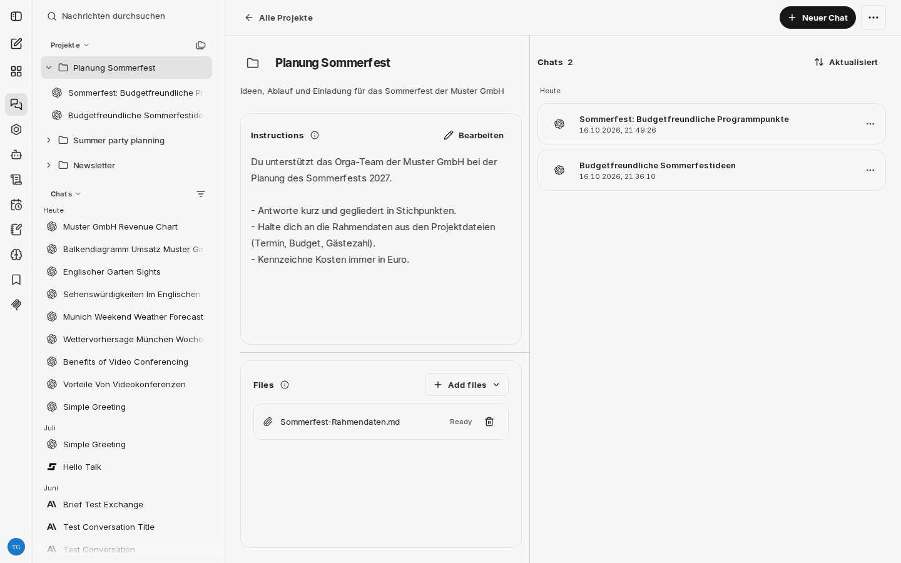

:::note[Neue Chat-Oberfläche]
Bilder und Beschriftungen auf dieser Seite zeigen die [neue Chat-Oberfläche](/de/company-gpt/neue-chat-oberflaeche/). Sie ist derzeit im Demo-Zugang und in Pilotumgebungen verfügbar; in anderen Umgebungen können Beschriftungen und Abläufe noch abweichen.
:::

Projekte ermöglichen es Ihnen, zusammengehörige Konversationen in benannten Arbeitsbereichen zu organisieren. Das ist besonders nützlich für langlaufende Themen, Teams, Kunden oder jeden Bereich, in dem Sie einen fokussierten Satz an Chats zusammenhalten möchten – ohne sich allein auf die Suche verlassen zu müssen.

## Was Projekte können

- Konversationen unter einem Projekt gruppieren und das Projekt mit einer Beschreibung versehen
- Einen neuen Chat direkt innerhalb eines Projekts starten
- Anweisungen und Referenzdateien für alle Chats eines Projekts hinterlegen
- Eine bestehende Konversation einem Projekt zuordnen, sie in ein anderes Projekt verschieben oder wieder lösen
- Projekt-Chats im Projekt-Arbeitsbereich durchsehen und sortieren
- Die Projektliste durchsuchen und sortieren
- Projekte bearbeiten oder löschen

Projekte sind persönlich und nur für die Person sichtbar, die sie erstellt. Andere Nutzer sehen Ihre Projektliste nicht.

## Projekt erstellen

Im [Chatverlauf](/de/company-gpt/user-interface/#chatverlauf) finden Sie oberhalb der angepinnten Chats den Bereich **Projekte**. Solange Sie noch kein Projekt haben, legen Sie dort über **Neues Projekt** eines an. Andernfalls öffnen Sie über das Symbol **Alle Projekte** neben der Überschrift die Projektübersicht und wählen dort **Neues Projekt**.

Geben Sie im Dialog **Projekt erstellen** einen **Projektname** und optional eine **Beschreibung** ein. Anschließend öffnet CompanyGPT den Projekt-Arbeitsbereich.

Im Projekt-Arbeitsbereich starten Sie über **Neuer Chat** eine Konversation, die automatisch diesem Projekt zugeordnet wird. Dieselbe Funktion erreichen Sie im Chatverlauf über das Symbol neben jedem Projekt.

## Anweisungen und Dateien

Im Projekt-Arbeitsbereich hinterlegen Sie Anweisungen und Referenzdateien für alle Chats im Projekt. Diese Möglichkeit gibt es derzeit nur in der neuen Chat-Oberfläche.

- **Instructions** (Anweisungen): Über **Bearbeiten** legen Sie Ton, Ziele oder Hintergrund für alle Chats im Projekt fest. Die Anweisungen gelten für neue Nachrichten im Projekt; frühere Nachrichten werden nicht verändert. Die Regeln Ihrer Umgebung gelten weiterhin.
- **Files** (Dateien): Über **Add files** laden Sie Dateien hoch (**Upload from device**) oder wählen sie aus Ihren bereits hochgeladenen Dateien aus (**Choose from your files**). Ist die [Dateisuche](/de/company-gpt/integrationen/dateisuche/) aktiv, nutzen die Chats im Projekt passende Auszüge statt ganzer Dateien. Entfernen Sie eine Datei, wirkt sich das nur auf künftige Nachrichten aus.

## Bestehende Chats zuordnen

Öffnen Sie im Kopfbereich des Chats das Menü **Chat options** und zeigen Sie auf **Projekt wechseln**. Im Untermenü wählen Sie das gewünschte Projekt aus. Mit **Aus Projekt entfernen** lösen Sie einen Chat wieder aus seinem Projekt. Dieselben Einträge finden Sie im Projekt-Arbeitsbereich im Menü eines Chats. Alternativ ziehen Sie einen Chat im Chatverlauf per Drag & Drop auf ein Projekt.

Chats, die einem Projekt zugeordnet sind, erscheinen standardmäßig nur im jeweiligen Projekt und nicht mehr in der Liste **Chats** im Chatverlauf. Über die Option **Show project chats** im Filtermenü der Chatliste blenden Sie sie dort wieder ein.

## Projekte verwalten

Im Chatverlauf lässt sich jedes Projekt aufklappen, um seine letzten Chats zu sehen. **Alle anzeigen** öffnet den Projekt-Arbeitsbereich. Über das Menü eines Projekts können Sie:

- Den Projekt-Arbeitsbereich öffnen (**Projekt öffnen**)
- Name und Beschreibung des Projekts bearbeiten (**Edit project**)
- Das Projekt **Löschen**

Im Projekt-Arbeitsbereich ändern Sie Name und Beschreibung auch direkt per Klick. Das Menü oben rechts im Arbeitsbereich enthält **Delete project**.

Die Projektübersicht (**Alle Projekte**) zeigt alle Ihre Projekte mit der Anzahl ihrer Chats. Dort können Sie Projekte über **Projekte suchen** finden und nach **Letzte Aktivität**, **Erstellt** oder **Name** sortieren.

Beim Löschen eines Projekts wird lediglich die Zuordnung der enthaltenen Chats entfernt. Die Konversationen selbst bleiben erhalten.

## Hinweise

- Projekt-Arbeitsbereiche besitzen eine eigene Chat-Liste, die sich nach **Aktualisiert** oder **Erstellt** sortieren lässt.
- Chats, die aus einem Projekt heraus gestartet werden, behalten diese Projektzuordnung.
- Löschen Sie ein Projekt, während dessen Arbeitsbereich geöffnet ist, kehrt CompanyGPT zur Projektübersicht zurück.
