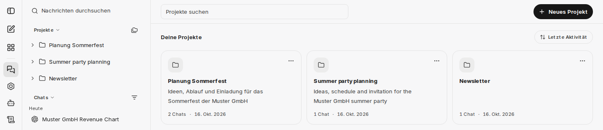
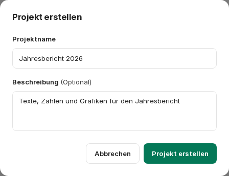
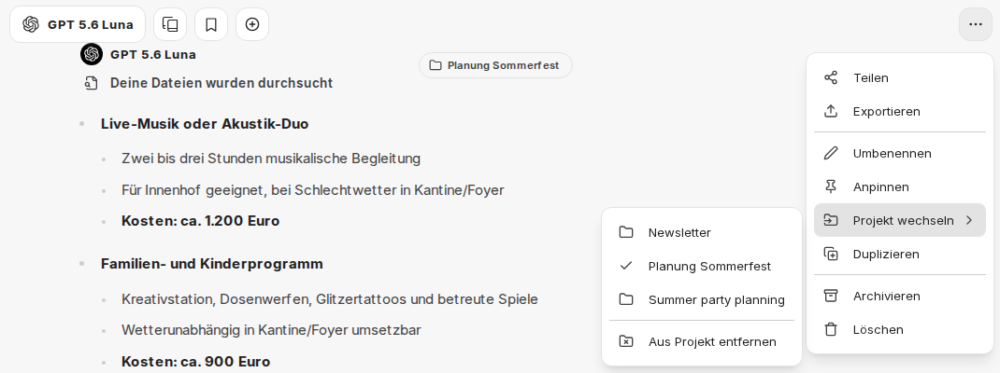

Projekte ermöglichen es Ihnen, zusammengehörige Konversationen in benannten Arbeitsbereichen zu organisieren. Das ist besonders nützlich für langlaufende Themen, Teams, Kunden oder jeden Bereich, in dem Sie einen fokussierten Satz an Chats zusammenhalten möchten – ohne sich allein auf die Suche verlassen zu müssen.

Projekte mit eigenen Anweisungen und Referenzdateien sind derzeit nur im Demo-Zugang bzw. in Pilotumgebungen verfügbar, siehe [Neue Chat-Oberfläche](/de/company-gpt/neue-chat-oberflaeche/#projekte-mit-anweisungen-und-dateien).

## Was Projekte können

- Konversationen unter einem Projekt gruppieren und das Projekt mit einer Beschreibung versehen
- Einen neuen Chat direkt innerhalb eines Projekts starten
- Eine bestehende Konversation einem Projekt zuordnen, sie in ein anderes Projekt verschieben oder wieder lösen
- Projekt-Chats im Projekt-Arbeitsbereich durchsehen und sortieren
- Die Projektliste durchsuchen und sortieren
- Projekte bearbeiten oder löschen

Projekte sind persönlich und nur für die Person sichtbar, die sie erstellt. Andere Nutzer sehen Ihre Projektliste nicht.

## Projekt erstellen

Im [Chatverlauf](/de/company-gpt/user-interface/#chatverlauf) finden Sie oberhalb der angepinnten Chats den Bereich **Projekte**. Solange Sie noch kein Projekt haben, legen Sie dort über **Neues Projekt** eines an. Andernfalls öffnen Sie über das Symbol **Alle Projekte** neben der Überschrift die Projektübersicht und wählen dort **Neues Projekt**.

Geben Sie im Dialog **Projekt erstellen** einen **Projektname** und optional eine **Beschreibung** ein. Anschließend öffnet CompanyGPT den Projekt-Arbeitsbereich.

Im Projekt-Arbeitsbereich starten Sie über **Neuer Chat in** und den Projektnamen eine Konversation, die automatisch diesem Projekt zugeordnet wird. Dieselbe Funktion erreichen Sie im Chatverlauf über das Symbol neben jedem Projekt.

## Bestehende Chats zuordnen

Öffnen Sie das Menü einer Konversation und wählen Sie **Projekt wechseln**. Wählen Sie im Dialog das gewünschte Projekt aus und bestätigen Sie mit **Speichern**. Mit **Aus Projekt entfernen** lösen Sie einen Chat wieder aus seinem Projekt. Alternativ ziehen Sie einen Chat im Chatverlauf per Drag & Drop auf ein Projekt.

Chats, die einem Projekt zugeordnet sind, erscheinen weiterhin auch in der Liste **Chats** im Chatverlauf.

## Projekte verwalten

Im Chatverlauf lässt sich jedes Projekt aufklappen, um seine letzten Chats zu sehen. **Alle anzeigen** öffnet den Projekt-Arbeitsbereich. Über das Menü eines Projekts können Sie:

- Den Projekt-Arbeitsbereich öffnen (**Projekt öffnen**)
- Name und Beschreibung des Projekts bearbeiten
- Das Projekt **Löschen**

Die Projektübersicht (**Alle Projekte**) zeigt alle Ihre Projekte mit der Anzahl ihrer Chats. Dort können Sie Projekte über **Projekte suchen** finden und nach **Letzte Aktivität**, **Erstellt** oder **Name** sortieren.

Beim Löschen eines Projekts wird lediglich die Zuordnung der enthaltenen Chats entfernt. Die Konversationen selbst bleiben erhalten.

## Hinweise

- Projekt-Arbeitsbereiche besitzen eine eigene Chat-Liste, die sich nach **Aktualisiert** oder **Erstellt** sortieren lässt.
- Chats, die aus einem Projekt heraus gestartet werden, behalten diese Projektzuordnung.
- Löschen Sie ein Projekt, während dessen Arbeitsbereich geöffnet ist, kehrt CompanyGPT zur Projektübersicht zurück.
