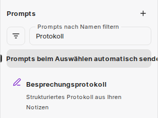
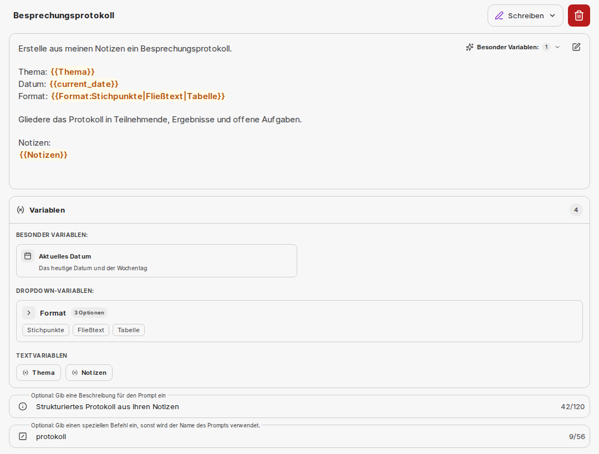
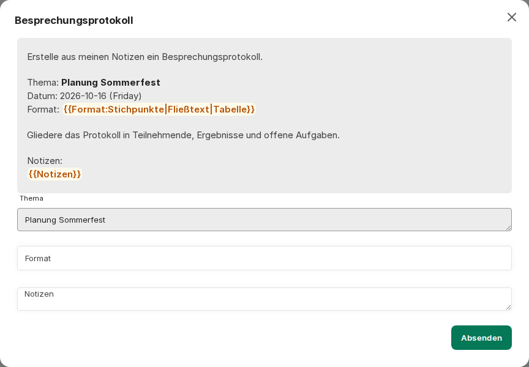
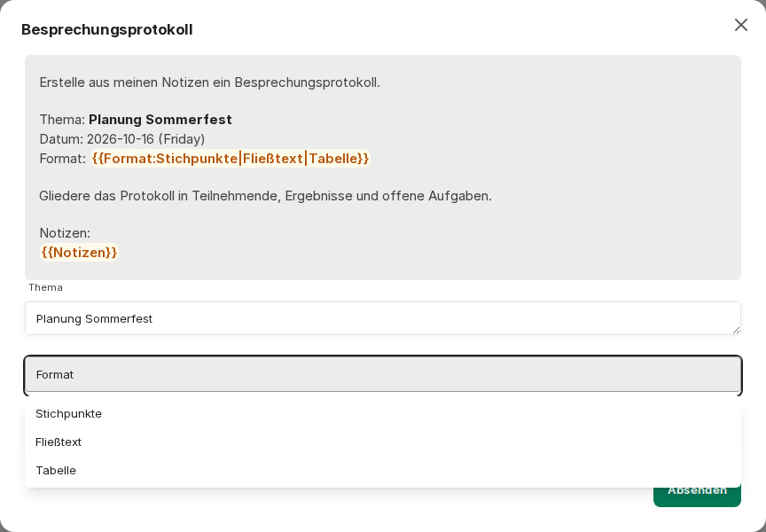

:::note[Neue Chat-Oberfläche]
Bilder und Beschriftungen auf dieser Seite zeigen die [neue Chat-Oberfläche](/de/company-gpt/neue-chat-oberflaeche/). Sie ist derzeit im Demo-Zugang und in Pilotumgebungen verfügbar; in anderen Umgebungen können Beschriftungen und Abläufe noch abweichen.
:::

Prompts im CompanyGPT verstehen sich als Promptvorlagen, die gespeichert und jederzeit genutzt werden können. Die Vorlagen sind dabei unabhängig von KI-Modell oder Agent und können auch mit jedem beliebigen, verfügbaren Modell oder Agent verwendet werden.

Promptvorlagen finden Sie in der linken Seitenleiste unter **Prompts**. Dort können Sie sie einsehen, erstellen, verändern und benutzen.



Im Bereich **Prompts** stehen Ihnen zur Verfügung:

- ein Filter nach **Alle**, **Meine Prompts**, **Geteilte Prompts** oder einer Kategorie
- das Suchfeld **Prompts nach Namen filtern**
- das Plus-Symbol **Prompt erstellen**
- der Schalter **Prompts beim Auswählen automatisch senden**

Wählen Sie einen Prompt aus, wird er in das Eingabefeld übernommen oder, bei aktivem automatischem Senden, direkt gesendet. Ist der [Befehl `/`](/de/company-gpt/einstellungen/#befehl--für-promptvorlage) aktiviert, rufen Sie Prompts auch direkt im Eingabefeld über `/` auf.

## Prompt erstellen

**Prompt erstellen** öffnet einen Dialog. Dort wählen Sie eine **Kategorie**, vergeben einen **Prompt-Name** und geben den **Text** ein. Optional ergänzen Sie eine Beschreibung und einen eigenen Befehl für den Aufruf über `/`; ohne eigenen Befehl wird der Name des Prompts verwendet. Nach dem Erstellen öffnet sich die Detailseite des Prompts, auf der Sie ihn weiter bearbeiten können.

## Bestandteile von Promptvorlagen

- **Prompt-Name**: Der Name des Prompts, der auch in der Schnellauswahl angezeigt wird.
- **Kategorie**: Die Kategorie, welcher der Prompt zugeordnet ist, zum Beispiel **Ideen**, **Lernen**, **Schreiben**.
- **Text**: Der eigentliche Inhalt des Prompts.
- **Variablen**: Variablen innerhalb des Textes, welche zum Ausführen mit entsprechenden Inhalten gefüllt werden können.
- **Beschreibung** (optional): Ein kurzer Text, der zum Prompt angezeigt wird.
- **Befehl** (optional): Der Befehl, mit dem Sie den Prompt über `/` aufrufen.

### Variablen

- **Spezielle Variablen**: Diese sind vordefiniert und werden automatisch befüllt. Über das Menü für spezielle Variablen am Textfeld fügen Sie sie ein: **Aktuelles Datum** (`{{current_date}}`), **Aktueller Nutzer** (`{{current_user}}`), **UTC ISO Datum/Zeit** (`{{iso_datetime}}`) und **Aktuelles Datum & Uhrzeit** (`{{current_datetime}}`).
- **Eigene Variablen**: Innerhalb des Textes können eigene Variablen gesetzt werden. Diese werden über doppelte geschweifte Klammern markiert, z.B. `{{ FARBE }}` => erzeugt die Variable `FARBE`



Sobald der Prompt ausgeführt wird, öffnet sich ein Eingabefenster für die Variablen. Mit **Absenden** wird der Prompt mit Ihren Eingaben übernommen.



Es können außerdem auch Dropdowns als Auswahlmenü für die Variablen ausgewählt werden. Dafür ist folgende Syntax notwendig:

```
{{variable_name:option1|option2|option3}}

# Beispiel
{{ farbe:rot|grün|blau}}
```


In einem solchen Dropdown können Sie neben den vorgegebenen Optionen auch einen eigenen Wert eingeben.

Promptvorlagen können sehr effektiv für wiederkehrende Aufgaben, für [Prompt-Chaining](/de/prompt-engineering/prompt-techniken/prompt-chaining/) oder in Verbindung mit [Agenten](/de/company-gpt/agenten/) genutzt werden.
