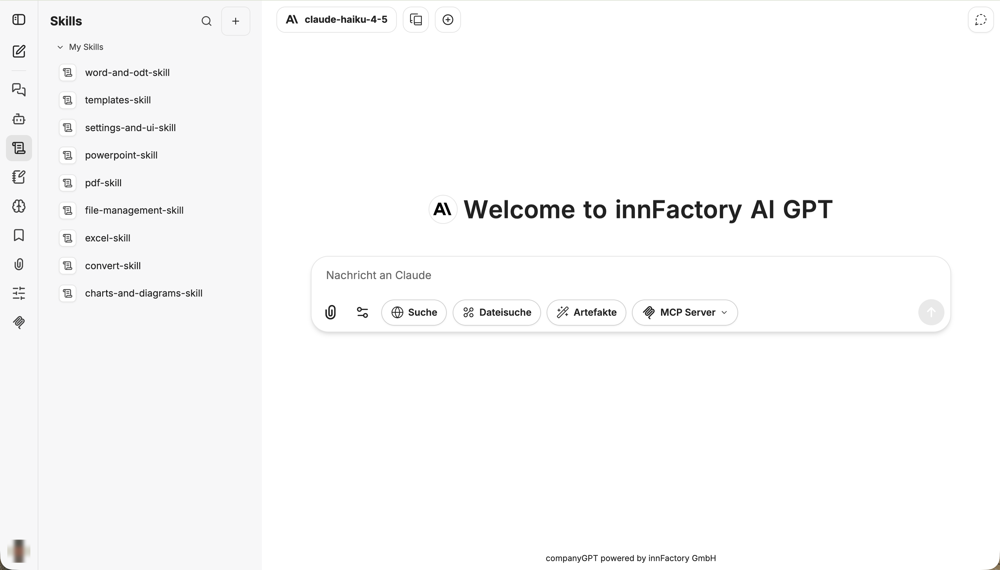
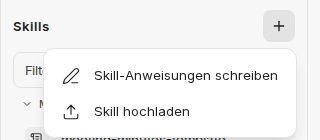
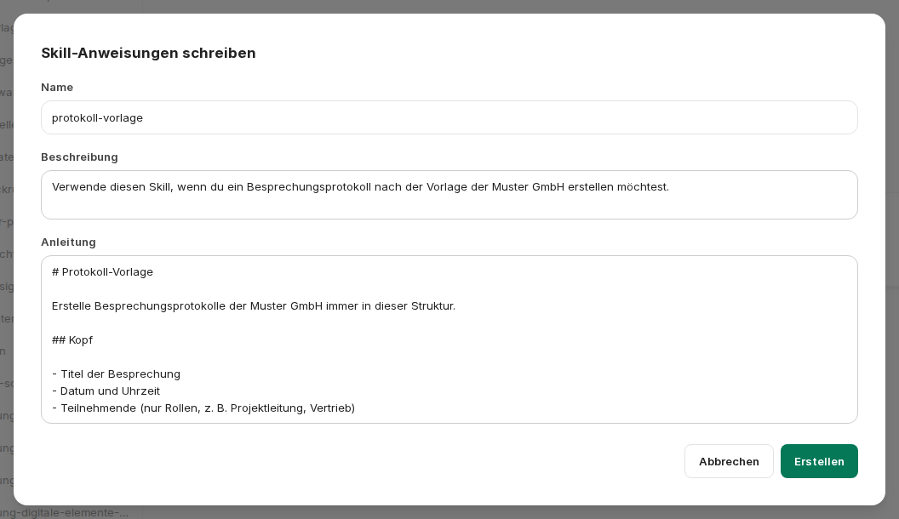
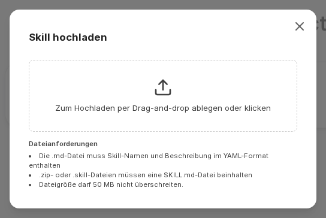
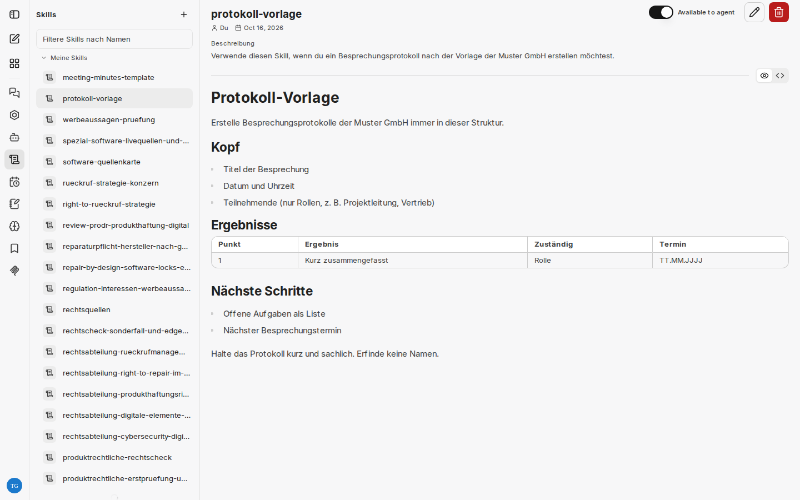
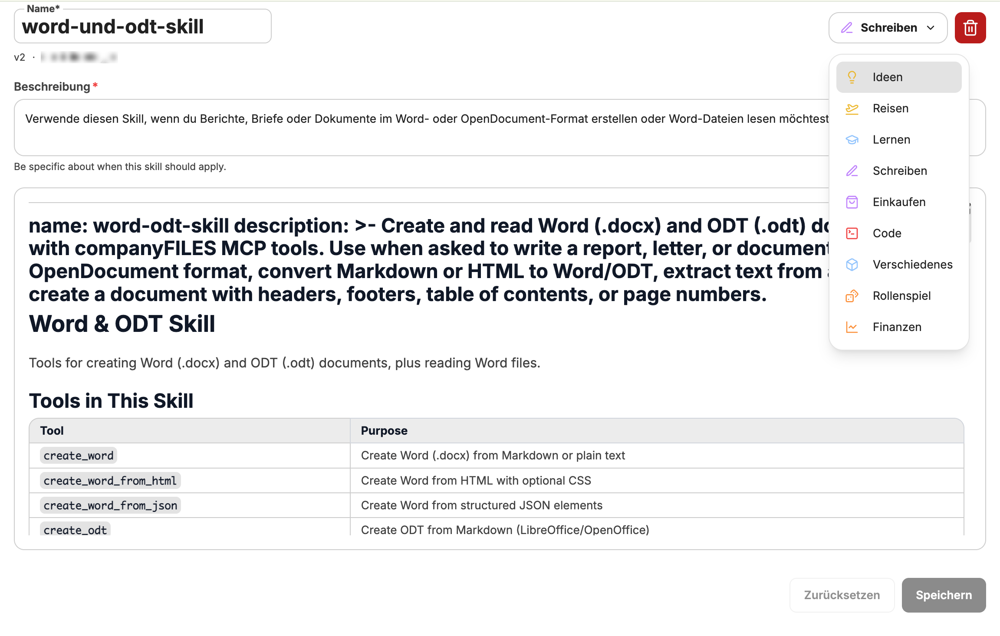

Skills sind wiederverwendbare Anweisungen, die den KI-Assistenten für bestimmte Aufgaben spezialisieren. Sie erweitern die Fähigkeiten des Assistenten, ohne dass Sie jedes Mal komplexe Prompts neu schreiben müssen.

## Skills-Übersicht

Skills werden in der linken Seitenleiste unter **Skills** verwaltet. Unter **Meine Skills** sehen Sie alle Ihre Skills auf einen Blick.

## Skill erstellen

Klicken Sie auf den **+**-Button oben in der Skills-Sidebar, um einen neuen Skill zu erstellen. Es öffnet sich ein Dropdown-Menü mit zwei Optionen.

### Skill-Anweisungen schreiben

Wählen Sie **Skill-Anweisungen schreiben**, um einen Skill selbst zu erstellen. Dafür werden folgende Angaben benötigt:

- **Name** – Ein eindeutiger Name für den Skill
- **Beschreibung** – Kurze Erklärung, wann und wofür der Skill eingesetzt wird
- **Anleitung** – Die eigentlichen Anweisungen im Markdown-Format

### Skill hochladen

Wählen Sie **Skill hochladen**, um eine vorhandene Skill-Datei per Drag & Drop oder Klick hochzuladen.

Folgende Dateiformate werden unterstützt:

| Format            | Anforderungen                                             |
| ----------------- | --------------------------------------------------------- |
| `.md`             | Muss Skill-Name und Beschreibung im YAML-Format enthalten |
| `.zip` / `.skill` | Muss eine `SKILL.md`-Datei enthalten                      |

:::tip
Unter [Skills-Tutorials](/de/tutorials/skills/) finden Sie fertige Skills zum Ausprobieren und Herunterladen.
:::

## Skill-Ansicht

Die Detailansicht eines Skills zeigt den gerenderten Inhalt mit Beschreibung und Markdown-Inhalt, zum Beispiel Tools-Tabellen oder Decision Guides.

Von hier aus können Sie den Skill:

- **Für Agenten freigeben oder sperren** – über den Schalter **Available to agent** oben rechts. Ist er eingeschaltet, kann ein Agent den Skill in neuen Nachrichten verwenden. Die Einstellung gilt nur für Sie.
- **Bearbeiten** – Anweisungen, Name oder Kategorie anpassen
- **Löschen** – den Skill dauerhaft entfernen

## Skill bearbeiten

Öffnen Sie einen Skill und klicken Sie auf **Bearbeiten**, um Name, Beschreibung, Anweisungen und Kategorie anzupassen.

:::note
Die **Beschreibung** legt fest, wann der Skill automatisch aktiviert wird. Formulieren Sie sie so, dass der Assistent den richtigen Anwendungsfall erkennt.
:::

## Skills zu Agenten hinzufügen

Skills können auch direkt einem [Agenten](/de/company-gpt/agenten/) zugewiesen werden. Öffnen Sie dazu den Agenten und wählen Sie im Abschnitt **Skills** einen der drei Modi:

| Modus | Wirkung |
| ----- | ------- |
| **Off** | Der Agent verwendet keine Skills. |
| **All** | Der Agent hat Zugriff auf alle Skills, die Ihnen zur Verfügung stehen und für Agenten freigegeben sind. Die Liste der verfügbaren Skills lässt sich aufklappen. |
| **Selected** | Der Agent verwendet nur die Skills, die Sie ausgewählt haben. |

Im Modus **Selected** fügen Sie Skills über **Add skill** hinzu. Es öffnet sich ein Dialog, in dem Sie die verfügbaren Skills durchsuchen und dem Agenten hinzufügen. Über das Kreuz neben einem Skill entfernen Sie ihn wieder aus der Auswahl. So lässt sich der Funktionsumfang eines Agenten präzise steuern.
