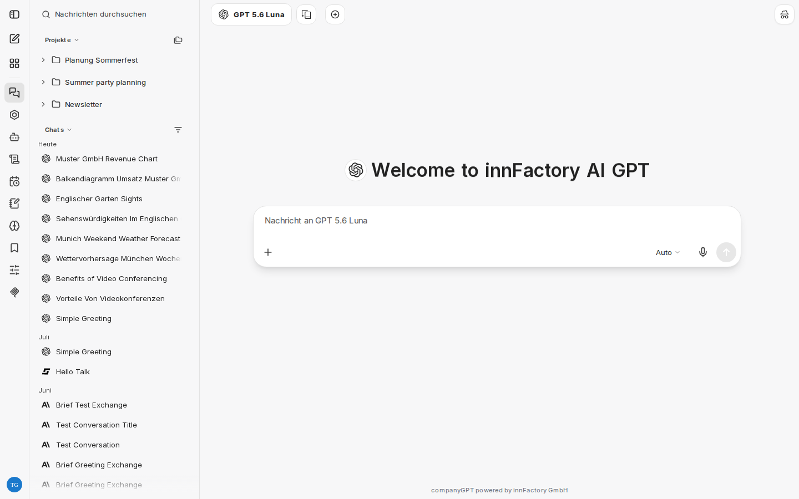
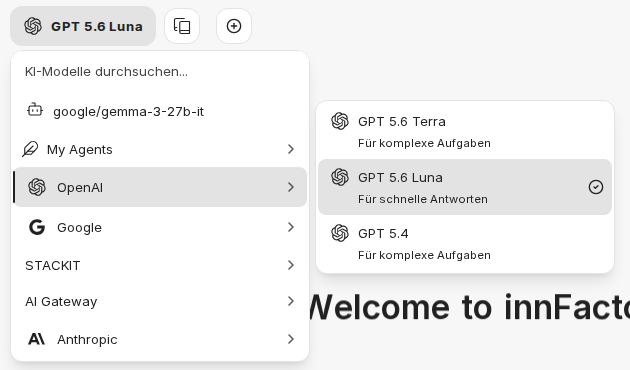
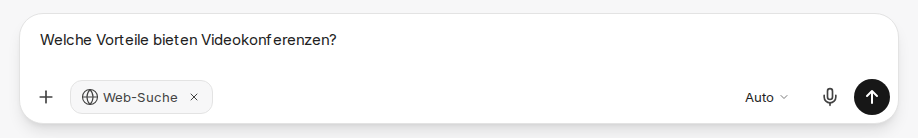
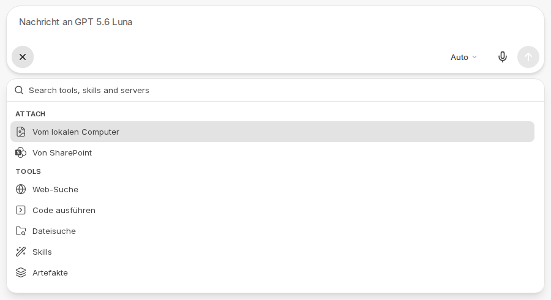
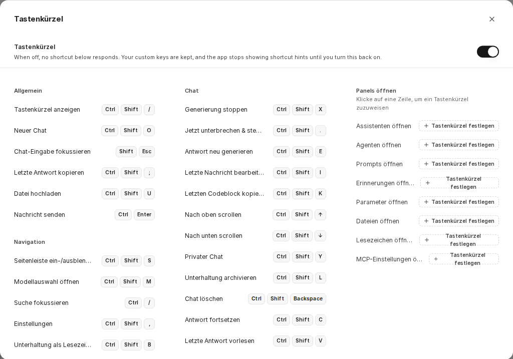

import sidebarImg from "./ui-sidebar.png";
import chatVerlaufImg from "./pinned-chat.png";

:::note[Neue Chat-Oberfläche]
Bilder und Beschriftungen auf dieser Seite zeigen die [neue Chat-Oberfläche](/de/company-gpt/neue-chat-oberflaeche/). Sie ist derzeit im Demo-Zugang und in Pilotumgebungen verfügbar; in anderen Umgebungen können Beschriftungen und Abläufe noch abweichen.
:::

Das User Interface im CompanyGPT ermöglicht es, mit den unterschiedlichen KI-Modellen zu kommunizieren, Agenten zu erstellen, Promptvorlagen zu verwalten und vieles mehr.

## Modellauswahl

Eine Liste der aktuell verfügbaren Modelle finden Sie unter [Modellauswahl](/de/company-gpt/modellauswahl/).

## Chat-Eingabe

Prompts lassen sich über Tastatur oder Mikrofon eingeben.

### Dateien anhängen

Über das Plus-Symbol im Eingabefeld (**Attach and tools**) und dort **Vom lokalen Computer** laden Sie Dateien direkt hoch. Alternativ ziehen Sie Dateien per Drag & Drop in den Chat. Ein Upload-Ziel wählen Sie dabei nicht aus: CompanyGPT entscheidet anhand des Dateityps, wie eine Datei verarbeitet wird.

Ist in Ihrer Umgebung SharePoint angebunden, finden Sie im selben Menü zusätzlich **Von SharePoint**.

Welche Dateitypen wie verarbeitet werden, beschreibt die Seite [Dateiverarbeitung](/de/company-gpt/dateiverarbeitung/).

### Integrationen

Das Plus-Symbol im Eingabefeld öffnet das Menü **Attach and tools**. Dort schalten Sie Integrationen für den aktuellen Chat zu:

- [Dateisuche](/de/company-gpt/integrationen/dateisuche/)
- [Web-Suche](/de/company-gpt/integrationen/websuche/)
- [Skills](/de/company-gpt/skills/)
- [Code ausführen](/de/company-gpt/code-interpreter/)
- [Artefakte](/de/company-gpt/integrationen/artefakte/)
- [MCP Server](/de/company-gpt/integrationen/mcp-server/)
- [Erinnerung](/de/company-gpt/erinnerungen/#im-chat), sofern in Ihrer Umgebung verfügbar

Aktive Werkzeuge und MCP-Server erscheinen als Chips in der Eingabeleiste. Über das x im Chip schalten Sie sie wieder aus. Häufig genutzte Einträge markieren Sie über **Zu Favoriten hinzufügen** oder mit `Strg` + `D` (macOS: `⌘` + `D`) als Favoriten. Über das Suchfeld oben im Menü (**Search tools, skills and servers**) finden Sie Werkzeuge, Skills und Server direkt.

## Chatverlauf

Der Bereich **Chatverlauf** zeigt alle Chats, die Sie bisher geführt haben. Von oben nach unten finden Sie dort:

- **Suchfeld**: **Nachrichten durchsuchen** durchsucht die Titel und die Nachrichteninhalte Ihrer Chats. Während einer Suche zeigt die Liste nur die Treffer.
- **Projekte**: Ihre [Projekte](/de/company-gpt/projekte/) mit den jeweils zugeordneten Chats.
- **Angepinnt**: angepinnte Chats sowie angepinnte Modelle und Agenten. Die Reihenfolge ändern Sie per Drag & Drop oder mit `Alt` + Pfeiltaste nach oben bzw. unten. Ziehen Sie einen Chat in diesen Bereich, wird er angepinnt.
- **Chats**: alle übrigen Chats, nach Datum gruppiert. Chats aus Projekten erscheinen hier nur, wenn Sie im Filtermenü **Show project chats** aktivieren. Chats, in denen gerade eine Antwort entsteht, erscheinen bei der Standardsortierung (**Aktualisiert**, **Newest first**) in einer eigenen Gruppe **Running** am Anfang der Liste. Chats, für die ein geteilter Link aktiv ist, sind mit einem Symbol gekennzeichnet. Chats mit neuen, noch nicht gelesenen Antworten sind ebenfalls markiert.

### Chat-Menü

Über die drei Punkte an einem Chat stehen folgende Aktionen zur Verfügung: **Anpinnen**, **Mark as unread** (markiert den Chat wieder als ungelesen), **Umbenennen**, **Archivieren** und **Löschen**. Weitere Aktionen wie **Teilen**, **Exportieren**, **Projekt wechseln** und **Duplizieren** finden Sie im geöffneten Chat im Menü **Chat options** oben rechts. Wie das Teilen funktioniert, beschreibt [Chat](/de/company-gpt/chat/#teilen).

### Filtern und sortieren

Das Filtersymbol neben der Überschrift **Chats** öffnet das Menü **Chat list**, mit dem Sie die Chatliste eingrenzen und ordnen:

- **Anzeigen**: **Active chats** oder **Archivierte Chats**. In der Ansicht der archivierten Chats holen Sie einen Chat über **Aus Archiv holen** zurück.
- **Sort**: Unter **Chats sortieren nach** wählen Sie **Aktualisiert**, **Erstellt** oder **Title**, bei archivierten Chats zusätzlich **Archivierungsdatum**. Darunter wählen Sie unter **Order** die Reihenfolge (**Newest first** oder **Oldest first** bzw. **A to Z** oder **Z to A**).
- **Filter**: grenzt die Liste ein, nach [Lesezeichen](/de/company-gpt/lesezeichen/) (**Lesezeichen**), nach dem Zeitraum der letzten Änderung (**Aktualisiert**) oder der Erstellung (**Erstellt**), nach **Endpunkt** sowie auf Chats mit Anhängen (**Has attachments**) oder auf geteilte Chats (**Shared only**). Wählen Sie mehrere Lesezeichen aus, erscheinen alle Chats, die mindestens eines davon tragen. Über **Search filters** finden Sie einen Filter direkt, **Clear filters** hebt die Filter wieder auf.
- **Show project chats**: zeigt die Chats aus Projekten zusätzlich in der Liste **Chats** an.

Sind Filter aktiv, ist das Filtersymbol hervorgehoben. Eine geänderte Sortierung zählt dabei ebenfalls als aktiver Filter. Über **Zurücksetzen** oben im Menü setzen Sie alle Filter und die Sortierung zurück. Die gewählte Sortierung merkt sich CompanyGPT, die Filter gelten bis zum nächsten Neuladen der Seite.

## Seitenleiste

  
  

1. **Seitenleiste öffnen/schließen**
2. **Neuer Chat**
3. **[Agenten-Marktplatz](/de/company-gpt/agenten/#agenten-marktplatz)**
4. **[Chatverlauf](/de/company-gpt/user-interface/#chatverlauf)**
5. **[Apps](/de/company-gpt/addons/alle-apps/)**
6. **[Agenten erstellen](/de/company-gpt/agenten/)**
7. **[Skills](/de/company-gpt/skills/)**
8. **[Scheduled chats](/de/company-gpt/neue-chat-oberflaeche/#geplante-chats)**
9. **[Prompts](/de/company-gpt/prompts/)**
10. **[Erinnerungen](/de/company-gpt/erinnerungen/)**
11. **[Lesezeichen](/de/company-gpt/lesezeichen/)**
12. **[KI-Einstellungen](/de/company-gpt/ki-einstellungen/)**
13. **[MCP Einstellungen](/de/company-gpt/integrationen/mcp-server/)**

  

Welche Einträge Sie sehen, hängt von Ihren Berechtigungen und der Konfiguration Ihrer Umgebung ab:

- **Apps** erscheint nur, wenn in Ihrer Umgebung [Alle Apps](/de/company-gpt/addons/alle-apps/) eingerichtet ist.
- Der **Agenten-Marktplatz** erscheint nur mit entsprechender Berechtigung.
- **KI-Einstellungen** wird nur angezeigt, wenn ein Modell und kein Agent ausgewählt ist und Ihre Umgebung die Parameter freigibt.

### Kontomenü

Unten links öffnen Sie über Ihr Profilbild das Kontomenü. Es enthält **Hilfe** (mit **Hilfe & FAQ**, das standardmäßig diese Dokumentation in einem neuen Tab öffnet, und den **Tastenkürzeln**), **Archivierte Chats**, **Meine Dateien** (Übersicht Ihrer hochgeladenen Dateien, in der Sie Dateien filtern und löschen), die [Einstellungen](/de/company-gpt/einstellungen/) und **Abmelden**. Ist in Ihrer Umgebung ein Guthaben eingerichtet, zeigt das Menü zusätzlich Ihr **Guthaben**.

## Tastenkürzel

Die Übersicht aller Tastenkürzel öffnen Sie über das Kontomenü unten links unter **Hilfe** > **Tastenkürzel** oder mit `Strg` + `Umschalt` + `/` (macOS: `⌘` + `⇧` + `/`).

Um einem Befehl ein eigenes Tastenkürzel zuzuweisen, klicken Sie rechts in seiner Zeile auf das Tastenkürzel bzw. bei Befehlen ohne Belegung auf **Tastenkürzel festlegen**. Sobald Sie mindestens ein eigenes Tastenkürzel festgelegt haben, erscheint **Alles auf Standard zurücksetzen**; damit stellen Sie die ursprüngliche Belegung wieder her. Mit dem Schalter **Tastenkürzel** oben im Dialog schalten Sie alle Tastenkürzel aus; Ihre eigenen Belegungen bleiben dabei erhalten.
