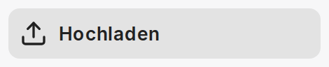
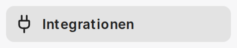
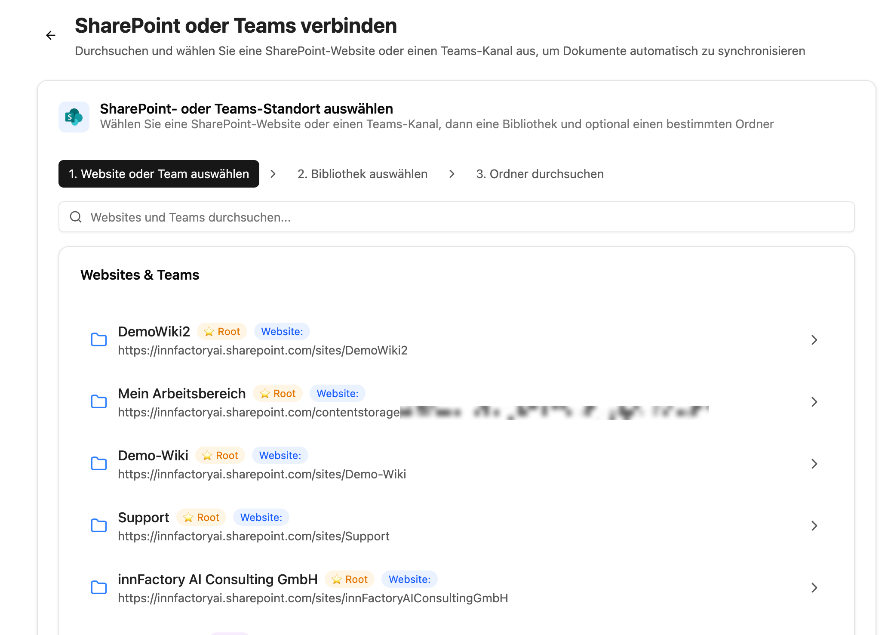

import CollectionPromptBuilder from '../../../../../components/CollectionPromptBuilder.astro'

Damit wir companyRAG in CompanyGPT nutzen können, müssen wir zuerst eine Dokumentensammlung anlegen. Dazu öffnen wir companyRAG über [Alle Apps](/de/company-gpt/addons/alle-apps/) mit der Kachel **Wissen** oder direkt unter `https://FIRMA.company-gpt.com/companygpt/rag` (falls Sie eine eigene Domain nutzen, einfach `/companygpt/rag` anhängen).

## Sammlung erstellen

Dann navigieren wir in der Seitenleiste zu **Sammlungen** und wählen **Sammlung erstellen**. Als **Sammlungstyp** wählen wir **Dokumente**, vergeben einen Namen, eine Beschreibung und wählen die Sichtbarkeit.

Der **technische Name** ist später für den Prompt relevant.

Bei der Sichtbarkeit können wir zwischen **Privat** und **Öffentlich** unterscheiden. **Öffentliche** Sammlungen sind für alle User nutzbar, **private** Sammlungen nur für den Besitzer, diese können aber beliebig freigegeben werden. Nachträglich lässt sich eine Sammlung über **Sammlung teilen** für Personen und Gruppen oder mit dem Schalter **Mit allen teilen** für alle freigeben.

### Erweiterte Einstellungen

In den erweiterten Einstellungen können wir – je nach Umgebung – das Embedding-Modell, die Suchsprache, die Chunking-Strategie sowie die Chunk-Größe und -Überlappung anpassen. Hier können wir aber die Standardwerte belassen.

:::tip
Die Suchsprache sollte im Optimalfall immer der Sprache der Dokumente in der Sammlung entsprechen. Es wird neben semantischer auch Volltextsuche durchgeführt und diese ist besser bei korrekter Spracheinstellung.
:::

## Dokumente indexieren

Sobald die Sammlung erstellt ist, können wir Dokumente hinzufügen.

### Manueller Upload

Dafür unter **Hochladen** einfach die Sammlung sowie die Dokumente auswählen und hochladen. Beim manuellen Upload gibt es keine Berechtigungen auf Dateiebene und keine weiteren Metadaten als den Dateinamen.

### SharePoint, Nextcloud und weitere Quellen

Unter **Quellen** kann eine neue Verbindung angelegt werden – neben SharePoint auch zu Nextcloud, Google Drive, GitHub, WebDAV, FTP oder per Web-Crawl. Im Folgenden zeigen wir den Weg für SharePoint.

:::tip
Falls noch keine Integration verbunden ist, muss unter **Integrationen** zuerst **Microsoft SharePoint** über **Verbinden** angemeldet werden.

:::

Unter **Quellen** startet dann im Reiter **SharePoint** der Button **SharePoint verbinden** die Auswahl. Unter **Zu synchronisierende Inhalte** wählen wir, ob Dateien, Seiten & News oder beides synchronisiert werden. Anschließend wählen wir Website oder Team, Bibliothek und den SharePoint-Ordner, der genutzt werden soll. Es werden immer alle Unterordner des ausgewählten Ordners mit einbezogen.

Sobald der gewünschte Ordner ausgewählt ist, muss die Sammlung ausgewählt und auf **Diesen Ordner auswählen** geklickt werden.

Dann noch die zu indexierenden Dateitypen auswählen und auf **SharePoint verbinden** klicken. Die erste Synchronisation startet danach automatisch, und Änderungen im Ordner werden künftig selbstständig übernommen.

:::note
Über SharePoint indexierte Dokumente sind mit Berechtigungen auf Dokumentenebene versehen. Bei der Abfrage über das CompanyGPT werden die Berechtigungen immer geprüft, egal wie die Freigabe der Sammlungen gestaltet ist.
:::

## CompanyGPT Agent 

Über den [MCP Server](/de/company-gpt/integrationen/mcp-server/) `ai-search` lässt sich der RAG-Service mit CompanyGPT verbinden, um indexierte Dokumente über alle (dem Nutzer zur Verfügung stehenden) Sammlungen zu durchsuchen
(s. [Ähnlichkeitssuche](/de/prompt-engineering/prompt-techniken/rag/)).

### Prompt für den CompanyGPT

Damit die RAG Suche genutzt werden kann, muss ein [Agent](/de/company-gpt/agenten/) angelegt werden. Dieser benötigt den MCP Server `ai-search` mit den aktivierten Tools `search_content`, `find_content_by_metadata`, und `find_content_by_source`.

Enthält der Ordner Tabellen (CSV, Excel, Parquet), aktivieren Sie zusätzlich `execute_sql` und `describe_table`. Bei neuen Sammlungen ist die Option [Tabellen als Datensätze](/de/company-gpt/addons/companyrag/sammlungen/#tabellen-als-datensätze) eingeschaltet: Die Suche liefert aus solchen Dateien dann nur eine Stichprobe, die eigentlichen Werte fragt der Agent über die SQL-Tools ab.

Bei dem KI Modell für den Agenten reicht in der Regel ein kleineres, z.B. **Claude Haiku** oder **Gemini Flash**, geht aber auch mit allen anderen.

Für die Systemanweisung können Sie bequem unsere Vorlage nutzen. Diese ist mit allen möglichen Anweisungen versehen damit die Antworten vom Aufbau identisch werden.

:::tip
Geben Sie den ausführlichen Prompt einem LLM und lassen Sie diesen nach Ihren Wünschen anpassen.
:::

Tragen Sie den **technischen Namen** Ihrer Sammlung ein – die Prompts werden automatisch befüllt:

<CollectionPromptBuilder />
