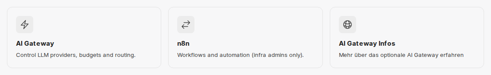

:::note[Not available in all environments]
Whether this feature is available in your environment is decided by your organization. If you have questions, contact your administrator.
:::

The AI Gateway is an optional extension of CompanyGPT. It sits as the central interface between CompanyGPT and the AI providers, in CompanyGPT environments for example Microsoft Azure and Google Cloud. If the gateway is set up in your environment, CompanyGPT no longer calls the AI models directly but through the gateway. There, every request is assigned to a person, checked against the approvals and budgets, recorded with its costs, and forwarded to the right provider.

## What the AI Gateway brings your organization

- **Models and approvals in one place:** The gateway connects the AI providers of your environment and makes their models available. With every request, it checks whether the person may use the model.
- **Budgets and limits:** Your organization can set budgets for the whole organization, per person, and per cost center, for example per month, week, or day and per provider or model. When a budget is used up, the gateway rejects further requests. Alternatively, your organization can specify a cheaper fallback model that answers instead. Rate limits are also possible.
- **Fallback during bottlenecks:** If a model has several deployments, the gateway switches to another one when the provider throttles a deployment or its quota is exhausted. If a model is throttled everywhere, the gateway pauses it briefly and states the waiting time.
- **Transparency on usage and costs:** Every request is recorded with its costs, including those from the chat. Administrators analyze usage in the gateway dashboard by model, person, and cost center. Every person sees their own usage and costs there.
- **API access for your own applications:** With the [AI Gateway API](/en/api/ai-gateway/), you can also call the approved models from your own applications, scripts, and tools—compatible with OpenAI, Anthropic, and Gemini and with a personal API key. The same approvals and budgets apply as in the chat.

## What you notice in the chat

Using CompanyGPT does not change. You choose your model as usual in the [model selection](/en/company-gpt/modellauswahl/). There are still a few differences:

- **Larger requests, more time:** The gateway accepts requests up to 128 MiB, for example with many or large attachments. Up to ten minutes may pass before an answer starts, for example with reasoning models. The limits of the AI providers still apply, see [Request size](/en/api/ai-gateway/#request-size-413).
- **Budget used up:** If a budget is used up, for example your personal one or that of your cost center, you get an error message instead of an answer. New requests are only possible again when the next period begins or your administrator raises the limit. If your organization has specified a fallback model, that model answers instead.
- **Model briefly paused:** If the provider temporarily throttles a model, a request can also end with an error message. Try again after a short wait or choose another model.

What the individual errors mean and whether retrying helps is described under [Error messages](/en/api/ai-gateway/#error-messages) of the AI Gateway API.

## Opening the gateway

In environments with the AI Gateway, [All apps](/en/company-gpt/addons/alle-apps/) has the tile **AI Gateway** with the text **Control LLM providers, budgets and routing.** It opens the gateway dashboard. Whether you see the tile is decided by your organization.

In the [demo access](/en/demo-zugang/), there is also the tile **AI Gateway Infos** (**Mehr über das optionale AI Gateway erfahren** – "Learn more about the optional AI Gateway"). It is a custom tile of the demo access and leads to the [AI Gateway product page](https://innfactory.ai/en/services/ai-gateway/) on innfactory.ai.

In the dashboard, you sign in with **Continue with company account** via single sign-on. What you see afterwards depends on your role in the gateway:

- Under **Overview** → **My usage**, you see your own usage, and there under **Spending** your spending and the applicable limits (page **My spending**).
- If you may create your own API keys, you find them under **Overview** → **My settings** → **API keys**. How this works is described in the [AI Gateway API](/en/api/ai-gateway/#api-keys).
- If the dashboard is not enabled for your role, **Dashboard not available** appears. In that case, contact your administrator.

## For administrators

### Who manages the gateway

innFactory sets up the connection to the AI providers and the models of your environment in the gateway. Request changes, such as an additional model, from innFactory.

Which role a person has in the gateway is derived from groups in your directory; innFactory sets up the mapping for your environment. The tile in All apps is only a link: the gateway itself controls access to the dashboard. In companyADMIN, the switch **Show in companyTOOLS** under **Configuration → [Tools](/en/company-gpt/addons/companyadmin/tools/)** only shows or hides the tile.

### What the dashboard shows administrators

Depending on their role, administrators see these areas in the dashboard, among others:

| Area | Content |
|---|---|
| **Usage** | Who and what uses the gateway, by model, user, and cost center |
| **Costs & budgets** | **Cost centers** with members and caps, and **Model limits** per model |
| **Providers & models** | The connected providers and models with prices, limits, and health |
| **Access** | **Users** with roles and budgets, **Access groups**, and **API keys** |
| **Events** | Denials, errors, and admin actions |

### Interplay with companyADMIN

- **Models in the chat:** The gateway manages providers, models, and budgets. Which role sees which models in the chat is still decided in companyADMIN, see [Models](/en/company-gpt/addons/companyadmin/modelle/#ai-gateway). There, **Open gateway** takes you to the gateway.
- **Operating status:** Under [Status](/en/company-gpt/addons/companyadmin/status/), companyADMIN shows whether the gateway is ready for work.

## Availability

The AI Gateway is optional and not set up in every CompanyGPT environment. innFactory sets it up for your environment on request—contact us if you would like to use it.

In [CompanyGPT Sovereign](/en/company-gpt/sovereign/), the budgets and cost features of the AI Gateway are currently not available.

## Related documentation

- [AI Gateway API](/en/api/ai-gateway/) — calling models from your own applications, budgets, limits, and error codes
- [Agents API](/en/api/agents-api/#budgets-in-the-ai-gateway) — gateway budgets for requests to agents
- [All apps](/en/company-gpt/addons/alle-apps/) — tiles and who sees them
- [Models in companyADMIN](/en/company-gpt/addons/companyadmin/modelle/) — which role sees which models in the chat
- [Model selection](/en/company-gpt/modellauswahl/) — overview of the models in CompanyGPT
