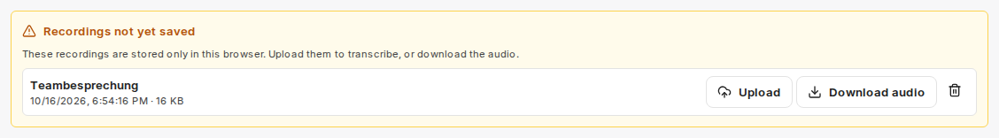

There are two ways to produce a transcript in companyTRANSCRIBE: upload an existing file, or record directly in the browser. You reach both via the **Record** and **Upload** menu entries or via the buttons of the same name in the page header of the **Transcripts** overview.

## Preparing a browser recording

The **New recording** page carries the note "Record straight in the browser — multi-hour sessions included." Before starting, you set the following options.

### Audio source

| Option | Records |
|---|---|
| **Microphone** | The device microphone only |
| **Tab / system** | The browser tab or system audio only |
| **Mic + tab** | Microphone and system audio together |

**Microphone** is preselected. **Tab / system** and **Mic + tab** suit online meetings where the other participants should be captured as well.

:::note
With **Tab / system** and **Mic + tab**, the browser asks for the source. In the picker, choose a tab or window and enable "Share audio". This works in Chrome and Edge; on macOS, only audio from browser tabs can be captured, not from other applications.
:::

### Speaker detection

The **Speaker detection** toggle decides whether the transcript is split by speaker. It is switched on by default. The application describes both states itself:

| State | Note in the interface | Suitable for |
|---|---|---|
| Off | "Continuous text with no speaker labels — right for your own dictation." | Your own dictation and longer recordings transcribed for yourself |
| On | "Detects multiple speakers and separates them in the transcript." | Meetings with several participants, on site or online |

:::note
Speaker detection can only be set before the recording starts. Whether it was active is shown later in the transcript metadata under **Speaker detection** (`On` or `Off`).
:::

### Title and description

**Title (optional)** and **Description (optional)** can be set before recording; both fields can still be changed later in the transcript detail view. Without a title, the application files the entry under a default name.

## Starting and stopping the recording

Clicking **Start recording** begins the capture — the note below the button reads "Records from your microphone. Long sessions are supported."

While recording, the application shows a running timer and a **Stop** button. The note "Recording — audio is streamed securely as you speak." indicates that audio is transferred to the tenant's storage continuously while you speak, rather than only at the end of the session. In addition, every piece of audio stays in the browser until the recording has been saved. While the recording runs, companyTRANSCRIBE keeps the screen from going to sleep, where the browser allows it.

After **Stop**, the application finalizes the recording ("Finalizing recording..."), uploads any remaining audio ("Uploading the remaining audio") and starts transcription in the background. As soon as "Recording saved — transcription started" appears, companyTRANSCRIBE opens the new transcript.

**Keep the page open until "Recording saved — transcription started" appears.** While "Finalizing recording...", "Uploading the remaining audio" or "Waiting for a connection..." is shown, the recording has not been fully saved yet. After that you can close the page; transcription continues.

:::note[How long can a recording be?]
The application itself does not limit the recording length. With speaker detection active, however, at most **240 minutes (4 hours)** per recording can be transcribed. Longer recordings are saved, but their transcription fails. Split very long sessions into several recordings.
:::

## Protecting a running recording

companyTRANSCRIBE prevents a running recording from being lost by accident:

- **Leaving the page:** if you choose another menu entry, **New chat**, **All apps**, another language, or **Log out** during a recording, the application asks: "A recording is in progress. Stop and save it before leaving?" If you confirm, the recording is stopped and saved, and only then does the switch happen. If it cannot be saved right now, you stay on the recording page and the upload keeps retrying.
- **Closing or reloading the tab:** the browser warns before leaving the page.
- **Expired sign-in:** if your CompanyGPT session expires during the recording, companyTRANSCRIBE keeps recording and saves the recording. The note reads "Your sign-in session expired — the recording continues and will be saved. You may need to sign in again afterwards."
- **Account change in the chat:** if you sign in to CompanyGPT with a different account, companyTRANSCRIBE reloads the page only once the recording has ended.

## Connection drops

If the internet connection drops during a recording, the recording continues. The audio stays in the browser and uploads automatically once the connection is back. Meanwhile the note "No connection — … of audio is waiting to upload. The recording continues and uploads automatically once you're back online." appears.

If you stop the recording without a connection, companyTRANSCRIBE shows **Waiting for a connection...** and retries the upload every 30 seconds. Three buttons are available:

| Button | Effect |
|---|---|
| **Retry now** | Starts the upload again immediately |
| **Download audio** | Saves the recording as an audio file on your device |
| **Discard** | Deletes the audio stored in the browser after a confirmation |

In this state, keep the page open or download the audio.

If the server refuses the upload, the recording continues in the browser but cannot be saved. After stopping, download the audio with **Download audio** and then upload the file via [**Upload**](#uploading-a-file).

### Recordings not yet saved

If a tab was closed or reloaded during a recording, the browser crashed, or a recording could not be saved, the audio is kept in the browser. The next time you open **Record** in the same browser, companyTRANSCRIBE lists such recordings in the **Recordings not yet saved** block – with title, time, and size:

- **Upload** – uploads the recording and starts transcription
- **Download audio** – saves the audio as a file
- Bin (**Discard**) – deletes the audio stored in the browser

If the server no longer knows a recording, the entry reads "no longer exists on the server — download the audio and upload the file instead".

## Uploading a file

Use **Upload** to transcribe a recording you already have — for example a meeting captured with a room microphone, a voice recorder, or a phone. The **Upload audio** page carries the note "Upload an existing audio or video file and have it transcribed."

First enter the optional **Title (optional)** and **Description (optional)**. Then drag the file onto the **Drop an audio file to transcribe** area or click to select it; the upload starts immediately. The drop area states "MP3, WAV, M4A, WebM up to 200 MB and 240 minutes"; all common audio and video files up to **200 MB** and at most **240 minutes** long are accepted. Longer files are rejected immediately. For video files the audio track is extracted automatically.

Uploaded files are always transcribed with speaker detection; there is no toggle for it on upload. After the upload, companyTRANSCRIBE reports "Upload complete — transcription started" and opens the new transcript.

## What next?

Once transcription has finished, you see the text in the detail view. [Editing transcripts](/en/company-gpt/addons/company-transcribe/transkripte/) describes how to correct the text, name the speakers, and export the result.
