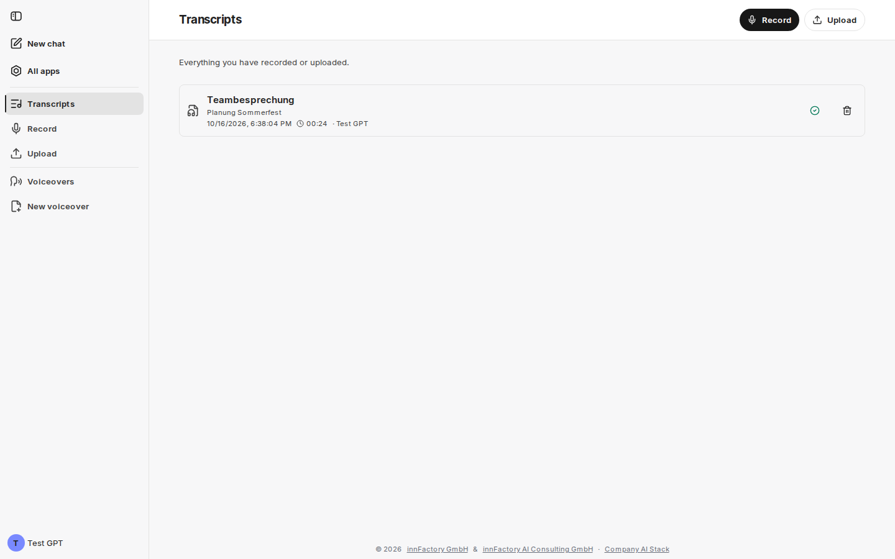

:::tip[Beta]
companyTRANSCRIBE is currently in beta. Individual features may still change or, in some cases, may not work as expected.
:::

companyTRANSCRIBE is a transcription application that, like CompanyGPT, runs in your company's cloud environment. It transcribes audio and video files as well as recordings made directly in the browser, automatically separating the individual speakers. It also works the other way round, turning text back into audio.

Transcription is handled by the Azure Speech service in your Azure environment. For [voiceovers](/en/company-gpt/addons/company-transcribe/sprachausgaben/), Azure OpenAI or Google (Chirp 3 HD) may additionally be enabled as providers, depending on the configuration – your administrator decides which providers are available.

:::caution[Transcription in German]
companyTRANSCRIBE currently always transcribes with a German language model; there is no language selection. Recordings in other languages are therefore recognized unreliably.
:::

## Opening and signing in

You open companyTRANSCRIBE in CompanyGPT via [**All apps**](/en/company-gpt/addons/alle-apps/) and the **Transcribe** tile.

companyTRANSCRIBE uses your CompanyGPT session. If you are signed in to CompanyGPT, you are signed in to companyTRANSCRIBE too; there are no separate credentials.

Your administrator decides who may use companyTRANSCRIBE – depending on the environment, in companyADMIN via the **Use transcription** permission (see [extension permissions](/en/company-gpt/addons/companyadmin/erweiterungen/)) or via groups. If you lack access, companyTRANSCRIBE shows the **No access** page.

## How the application is organised

companyTRANSCRIBE uses the [shared interface of the CompanyGPT extensions](/en/company-gpt/addons/gemeinsame-oberflaeche/). The sidebar holds **New chat** and **All apps**, followed by the application's menu in two groups:

| Menu group | Entries |
|---|---|
| Transcripts | **Transcripts** (start page), **Record**, **Upload** |
| Voiceovers | **Voiceovers**, **New voiceover** |

The account menu offers **Theme** and **Language**, among other things; the interface is available in German and English. This documentation quotes the English labels. A page's actions sit on the right of the page header: **Record** and **Upload** in the **Transcripts** overview, **New voiceover** in the **Voiceovers** overview. On narrow screens you open the menu via the header bar, which then also holds the actions.

The **Transcripts** start page lists every recording you have made or uploaded yourself ("Everything you have recorded or uploaded.").

Each row shows the title, the description if there is one, creation time, audio length, and owner. Clicking the row opens the transcript. On the right are a status icon (finished, failed, or in progress) and the bin. The bin asks for confirmation before deleting; audio and transcript are deleted permanently.

## The areas at a glance

- **[Recording and transcribing](/en/company-gpt/addons/company-transcribe/aufnehmen/)** — choose the audio source and speaker detection, record in the browser, or upload a file; what happens when the connection drops.
- **[Editing transcripts](/en/company-gpt/addons/company-transcribe/transkripte/)** — metadata, text correction, speaker assignment, and Markdown export.
- **[Voiceovers](/en/company-gpt/addons/company-transcribe/sprachausgaben/)** — turn text into audio using an AI voice.
- **[Access from CompanyGPT](/en/company-gpt/addons/company-transcribe/mcp-integration/)** — use transcripts and voiceovers in the chat via the MCP server.

## Supported formats and limits

| Aspect | Value |
|---|---|
| Audio and video formats on upload | common audio and video files, e.g. `.mp3`, `.wav`, `.m4a`, `.mp4`, `.webm` |
| Maximum file size on upload | 200 MB |
| Maximum length | 240 minutes (4 hours) on upload and for recordings with speaker detection |
| Language | German |
| Speaker detection | up to 35 voices per recording |
| Export | speaker-labelled Markdown file (`.md`) |

For video files, the audio track is extracted automatically. Transcription runs as a background job; progress is visible in the application.

## Data storage

All transcriptions are stored in a per-user history where they can be viewed, edited, or deleted. Audio, transcripts, and voiceovers are kept in your company's cloud environment.

For transcription, the audio is sent to the Azure Speech service. For a voiceover, the text goes to the selected provider – with Google (Chirp 3 HD), to Google Cloud Text-to-Speech.
